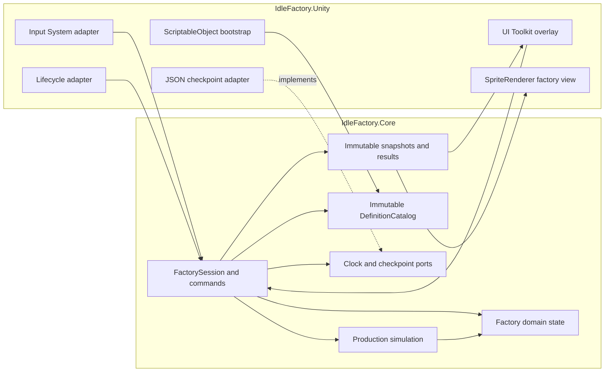

# Component Diagram: Core Game Foundation

**Feature**: Playable Unity foundation for placement, constrained production, persistence and reduced offline progress
**Generated**: 2026-09-14
**Scope**: Full Feature 001

---

## Overview

This diagram shows the runtime components and the flow from Unity input and lifecycle events into the engine-free factory core, then back to presentation through immutable results. Durable state crosses the boundary only through explicit application ports.

## Component Diagram

## Component Breakdown

### FactorySession and application commands

**Role**: Serialize placement, resource, simulation, save/load and lifecycle use cases against one authoritative session.

**Why this exists as a separate component**: Unity callbacks can be duplicated or reordered, while persistence may fail after candidate calculation. Application coordination keeps those workflows outside domain entities and publishes state only after complete validation or durable promotion.

**Key interactions**:

- → Production simulation and domain state: requests a complete candidate and commits one application revision.
- → Clock and checkpoint ports: obtains time and durability without importing Unity APIs.
- → Immutable snapshots/results: supplies presentation without exposing mutable collections.

### Factory domain state

**Role**: Own logical bounds, placed identities, occupancy, buffers and production progress.

**Why this exists as a separate component**: The factory must remain correct when no scene or view exists. Keeping state in plain C# prevents transforms, sprites and UI selection from becoming alternate gameplay truth.

### Production simulation

**Role**: Advance machines by explicit integer time with completion-time exchange and blocking rules.

**Why this exists as a separate component**: Active and offline production need exactly the same arithmetic. One simulation operation makes render cadence irrelevant and supports deterministic Edit Mode tests.

### DefinitionCatalog and content bootstrap

**Role**: Convert editor-authored resources, recipes, buildings and offline policies into validated immutable Core definitions.

**Why this exists as a separate component**: Designers retain ScriptableObject authoring, while runtime instances cannot mutate shared assets. Stable IDs also give Save V1 a versionable lookup boundary.

### Checkpoint and lifecycle boundary

**Role**: Normalize Unity departure/return signals and implement strict local JSON generation storage.

**Why this exists as a separate component**: Mobile lifecycle and filesystem behavior are platform concerns. Core sees clock/store ports and typed outcomes, while the adapter proves replace/recovery behavior per target.

### Presentation and input

**Role**: Translate touch/mouse gestures into commands and render factory, inspector and recovery states.

**Why this exists as a separate component**: Interaction can be replaced or recreated without changing simulation. Pointer ownership, accessibility and responsive layout remain Unity concerns.

## Design Reasoning

### Why this structure?

The feature is a greenfield foundation, but it has only one local runtime and no service boundary. Two production assemblies provide the important compile-time boundary without creating mostly empty projects. Candidate-based commands and immutable snapshots make state ownership visible, while ports isolate the two non-deterministic inputs: time and files.

### Alternatives considered

| Structure | Why it wasn't chosen |
|---|---|
| One Unity assembly | It would let scene, input or view dependencies leak into simulation and persistence tests. |
| One assembly per conceptual layer | It adds reference and compilation overhead before separate ownership or deployment exists. |
| Per-building MonoBehaviours or ECS/DOTS | Neither is required for independent machines; W001 measures the plain-C# approach before optimization. |

### When you'd restructure

Split assemblies or introduce a logistics scheduler only when measured compile ownership, reuse or inter-machine transport creates a real boundary. Remote accounts, cloud saves or analytics would add a separate online-services boundary rather than entering the current Core.
