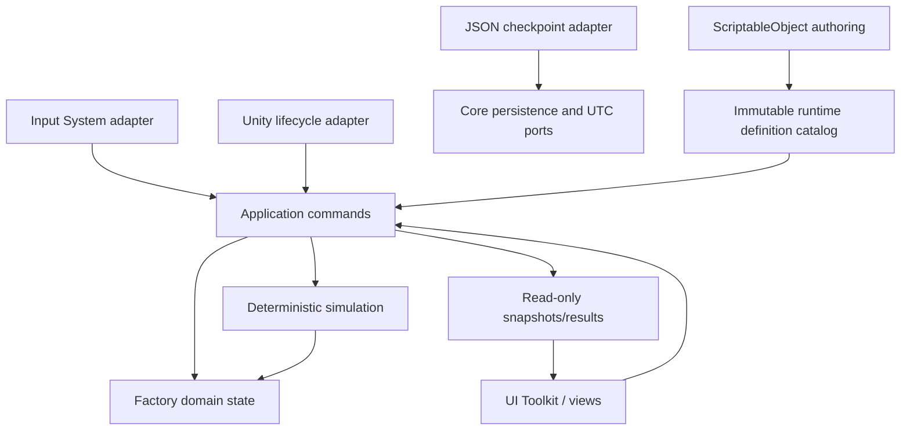

# Implementation Plan: Core Game Foundation

**Branch**: `feat/001-core-game-foundation` | **Date**: 2026-09-13 | **Spec**: [spec.md](spec.md)

**Input**: The clarified feature specification, [Plan-Draft.md](../../Plan-Draft.md), project constitution, and repository baseline. Where the draft says full offline progression is excluded, the later owner-approved clarification in `spec.md` governs: Feature 001 includes one bounded offline-production slice.

## Summary

Build a minimal playable Unity 6 foundation whose factory state lives in a plain-C# core rather than scenes or views. A logical grid owns placement and occupancy; immutable definitions describe buildings, resources, recipes and the versioned offline policy; instance-owned buffers and production state advance through deterministic integer-time operations. Unity adapters provide content authoring, input, UI, lifecycle and local persistence.

The implementation uses four assembly boundaries: engine-free Core, Unity adapters, Edit Mode tests and Play Mode tests. Production advances by cycle-boundary arithmetic rather than frame or per-building replay. Local version-1 JSON checkpoints are strictly validated and promoted through a recoverable whole-file transaction. On return, the same simulation consumes `floor(min(valid UTC absence, 8 h) × 4/5)` in integer time units and durably commits the reconciled checkpoint before publishing the result.

## Technical Context

**Language/Version**: C# supported by Unity `6000.6.0f1`; no unsafe code

**Primary Dependencies**: Unity built-in 2D/SpriteRenderer and UI Toolkit modules; direct `com.unity.inputsystem` `1.20.0`; direct `com.unity.nuget.newtonsoft-json` `3.2.2`; Unity Test Framework `1.8.0`/NUnit. Package changes occur during implementation and remain pinned in both package files.

**Storage**: One application-owned versioned JSON checkpoint plus temporary and previous-valid generation beneath `Application.persistentDataPath`; no PlayerPrefs gameplay state, database, cloud or backend

**Testing**: Plain/Edit Mode NUnit tests for Core and persistence mapping; Play Mode tests for Unity adapters, view recreation, UI/input and lifecycle; repository-owned PowerShell batch runner for complete and file-focused MAQA commands

**Target Platform**: Android and iOS primary; Windows Editor/development player supported and future Steam packaging kept possible. Current Android minimum API 26 is retained as a development baseline. iOS build/device validation requires a macOS/Xcode runner and is not implied by Windows Editor results.

**Project Type**: Single Unity 2D mobile game repository; no service process

**Performance Goals**: On the recorded Windows development workstation, the warmed plain-Core W001 workload of 1,000 machines has p95 ≤10 ms for a 100 ms active advance and p95 ≤100 ms for one capped offline return, with zero steady-state managed allocations inside warmed `ProductionSimulationSession.Advance` (HD-018); preparation and explicit snapshot capture are separate allocating boundaries. Measure before optimizing; record mobile baselines separately without claiming these desktop budgets as mobile guarantees.

**Constraints**: Mobile-first touch plus mouse; responsive development UI in both current autorotation orientations; deterministic integer arithmetic; whole-unit resources; 100 ns logical time units; 80% offline efficiency; eight-hour credit cap; local UTC trust; no background simulation; no ECS/DOTS, DI framework, backend, mutable ScriptableObject runtime state, per-building `Update`, scene-hierarchy saves or speculative logistics

**Scale/Scope**: D001 is a 16×16 area with a 2×2 building and one 2→1/5-second recipe. W001 is an engineering-only 1,000-machine workload, not a product limit. Grid storage has no hard-coded future maximum or chunking implementation.

## Constitution Check

*GATE: Passed before Phase 0 and rechecked after Phase 1 design.*

| Principle / gate | Plan evidence | Result |
|---|---|---|
| Correct observable behavior | Acceptance contracts retain complete-footprint placement, atomic completion, blocking, persistence failures and clarified offline rules. | PASS |
| Domain architecture and explicit state | `IdleFactory.Core` owns state and rules; Unity adapters issue commands and render snapshots. Ownership and writers are defined in `data-model.md`. | PASS |
| Deterministic/data-driven simulation | Immutable definitions, Int64 units, explicit elapsed time, ratio arithmetic and stable identifiers remove rendering and floating-point authority. | PASS |
| Tests protect behavior | Test harness is the first implementation gate; domain, persistence and runtime scenarios map to FR/SC IDs. Empty suites cannot pass. | PASS |
| Simplicity and maintainability | Two production assemblies, direct commands/results and concrete adapters; no ECS, DI container, event bus, repository framework or premature chunking. | PASS |
| Measured performance | W001 declares workload, method and initial desktop regression budgets. Optimization requires captured evidence. | PASS |
| Human authority | Cycle booking, 80%, cap, time trust and lifecycle checkpoint choices come from recorded owner decisions. Remaining choices are technical and reversible. | PASS |
| Traceability and gates | Spec IDs map through contracts, quickstart and planned test categories; tasks/analyze/orchestration remain mandatory later. | PASS |
| Independent role review | Architect, QA, Gameplay, UI/UX, Economy, Security, Performance and Operations lenses review this plan before checkpoint. | PASS |
| Safe delivery and durable knowledge | Strict V1 validation, recoverable generation replacement, explicit failures, pinned dependencies and post-plan wiki ingest are designed. | PASS |

Post-design recheck: the Phase 1 model and contracts preserve the same dependency direction and scope. No exception or constitution violation requires a Complexity Tracking entry.

### Implementation readiness gate

**Current status: READY after Greenfield bootstrap acceptance.** The repository has direct package pins, four asmdefs, non-empty Edit/Play smoke suites, a repository runner, real MAQA commands, a verified repository-local worktree base, PASS reviews from Architecture, Test/QA, Security, and DevOps, and a green full-suite run on the committed candidate. The reviewed specs, tasks, and harness baseline are integrated on `main`; the parent verifies that final Main commit and pushes it to `origin/main` before MAQA synchronization. Each accepted dependency must likewise reach that remote baseline before dependent Issues are dispatched. The Design Constitution Check remains valid.

## Project Structure

### Documentation (this feature)

```text
specs/001-core-game-foundation/
├── spec.md
├── plan.md
├── research.md
├── data-model.md
├── quickstart.md
├── contracts/
│   ├── application-commands.md
│   ├── persistence-v1.md
│   └── presentation-states.md
├── reviews/
│   ├── specification-review.md
│   └── plan-review.md
└── tasks.md                    # Created later by $speckit-tasks
```

### Source Code (repository root)

```text
Assets/IdleFactory/
├── Core/
│   ├── Domain/
│   ├── Simulation/
│   ├── Application/
│   └── IdleFactory.Core.asmdef
├── Unity/
│   ├── Bootstrap/
│   ├── Content/
│   ├── Input/
│   ├── Persistence/
│   ├── Presentation/
│   ├── UI/
│   └── IdleFactory.Unity.asmdef
├── Content/
│   ├── Definitions/
│   └── Development/
├── Art/Development/F001/
├── UI/CoreGameFoundation/
├── Scenes/CoreGameFoundation.unity
└── Tests/
    ├── EditMode/
    │   └── IdleFactory.EditModeTests.asmdef
    └── PlayMode/
        └── IdleFactory.PlayModeTests.asmdef

scripts/
└── test-unity.ps1

test-results/                    # Generated and ignored
```

**Structure Decision**: `IdleFactory.Core` contains Domain, Simulation and Application namespaces in one `noEngineReferences` assembly because their dependency direction is useful now but five mostly empty production assemblies are not. `IdleFactory.Unity` references Core and owns every Unity API, content authoring, serialization package, view, input and lifecycle dependency. The two test assemblies enforce the lowest effective test level. Add an Editor-only assembly only if the batch runner later needs repository-owned Editor code.

## Architecture and Dependency Direction



- Domain owns identifiers, factory bounds, placements, buffers, recipes and mutable instance state.
- Simulation is the only writer of production progress and production resource exchange.
- Application owns use-case ordering, lifecycle state, persistence coordination and typed outcomes.
- Persistence maps fresh DTOs to validated domain candidates; it never mutates a live factory while parsing.
- Presentation owns camera, current selection, placement preview and UI state only. A restored world re-resolves selection by identity or clears it.
- Content ScriptableObjects are editor-authored definitions. Bootstrap validates them and copies them into immutable Core definitions; runtime state never writes source assets.

## Key Technical Decisions

### Grid and placement

`FactoryState` owns bounds, a building dictionary keyed by stable instance ID and an occupancy index from logical `GridPosition` to instance ID. Placement expands the requested definition footprint, checks every cell, then commits the instance and all index entries as one operation. Save V1 stores buildings and bounds; occupancy is reconstructed and validated on load so it cannot become a second durable source of truth.

Logical integer coordinates map to orthographic world coordinates through one Unity presentation mapper using a declared cell size and origin. Sprite bounds and transforms never determine placement. The dictionary representation handles D001 and alternate development fixtures without a fixed maximum; chunking remains a later internal replacement if measured scale requires it.

### Resources, recipes and production

Resource quantities and per-resource development capacities are nonnegative Int64 whole units. Definition validation rejects empty IDs, duplicate entries after normalization, non-positive recipe amounts/durations and arithmetic overflow. Duplicate resource rows are always rejected; they are never aggregated. Each machine owns distinct input and output buffer state; there is no shared inventory or implicit transfer.

Definitions support collections of inputs and outputs while authored F001 content uses only D001. Production time/progress uses Int64 100 ns units with `0 ≤ progress < duration`. An `Advance` call:

1. leaves inactive or currently blocked state unchanged;
2. computes time-permitted cycles without overflowing `progress + elapsed`;
3. computes resource-permitted cycles as the minimum whole quotient across every input and output;
4. commits checked aggregate input removal and output addition together;
5. preserves a valid remainder only while the next cycle can progress, otherwise stops at the blocking boundary and discards blocked time.

This cycle-boundary bulk calculation is equivalent to individual completions because Feature 001 has independent machine buffers and no external action inside one `Advance`. `AdvanceSimulation` first builds and validates a complete factory candidate, including checked arithmetic for every machine, and only then replaces the live state. A failure in a later machine therefore cannot leave earlier machines advanced. Development actions split the timeline into separate advances. No tick replay, per-building `MonoBehaviour.Update`, event queue or background thread is introduced.

### Reusable simulation and explicit capture (HD-018, 2026-09-22)

The human decision for Issue #18 retains W001's zero warmed managed-allocation target and selects a separate reusable simulation path with explicit result snapshots. Gameplay, time units, failure atomicity and Save V1 semantics do not change. The allocating compatibility entry point remains available; it is not the W001 measurement boundary.

The minimum Core contract is `ProductionSimulator.TryPrepare(FactoryState source, out ProductionSimulationSession session)` returning `ProductionAdvanceStatus`, `session.Advance(long elapsedTicks)` returning that typed status, and `session.CaptureResult()` returning a detached `ProductionAdvanceResult`. An internal allocating `CaptureFactory()` supplies a detached committed-state copy to application operations. Preparation failure returns no session. `CaptureResult` is valid only after at least one `Advance`; calling it earlier throws `InvalidOperationException`. It describes the latest attempt: success has a candidate and summary; failure retains its failure status and has neither candidate nor summary, even if an earlier attempt succeeded. A valid retry produces a fresh successful result, and all previously returned snapshots remain unchanged. The existing static `Advance(factory, ticks)` preserves its current observable validation precedence by returning `InvalidElapsedTicks` for negative time before preparing/validating the factory; otherwise it delegates to preparation, the same calculation path, and capture.

Preparation validates the catalog and complete factory, creates two privately owned state graphs and reusable numeric/change storage, and fixes deterministic building/resource traversal arrays. During warmed advancement, validate and calculate every machine's next quantities and progress before publication; check inactive machines and all declared buffer quantities as well. Populate only the hidden back graph, check every staged write, and swap the committed front/back reference once after complete success. Failure leaves the committed graph unchanged. Fully initialize staging and change storage before reuse so a failed attempt cannot contaminate a later success. No live graph, borrowed collection, reused result array or mutable summary escapes the session.

Use indexed cached arrays, bounded checked arithmetic and the existing internal buffer/progress operations; do not rebuild catalogs, deep-copy factories, sort, enumerate through allocating interfaces, construct blockers/results, or call the allocating aggregate-exchange helper inside the warmed path. Resource booking remains atomically observable because only the complete candidate is published. Preparation and explicit capture may allocate; a snapshot must deep-copy mutable state and summary storage so later advances cannot alter it. Immutable definitions may be shared. Avoid duplicate production algorithms.

`FactorySession` is the only application owner and serializes access on the main thread. Retain the prepared session across consecutive advances. Compute the next application revision with checked arithmetic before any committing Core advance or replacement-state publication; if it overflows, preserve the authoritative factory, prepared session and revision. Publish a successful candidate/session and its incremented revision as one application operation. For an external command, capture the current committed factory, validate/mutate a detached candidate, and prepare its replacement session before publication; rejection preserves the old session. Placement, load, reset and other whole-world changes use the same prevalidated revision and coherent session replacement. Never advance a cached session prepared from an earlier factory revision. UI consumes immutable application snapshots, not either working graph. Offline reconciliation prepares its own candidate session and captures an independent result for persistence; it publishes neither candidate nor rewards before durable promotion.

T018 implements the reusable path and compatibility tests within its two files. T019 integrates ownership, commands and immutable projections; T025 retains detached offline candidates; T031 checks full-state equivalence and snapshot lifetime; T033 measures the prepared path. These contract changes must be reconciled with their authoritative MAQA Issues before dependent dispatch. No Domain API, persistence-store path, Save V1 schema or definition migration is required by this design.

### Active and offline time

Unity has one runtime host, not one updater per building. It measures cumulative active time at the adapter boundary, converts the cumulative difference once into Core ticks and calls the same simulation operation. This avoids per-frame rounding drift while keeping rendering cadence non-authoritative.

The authored `OfflinePolicyDefinition` is validated at bootstrap and copied into the immutable Core catalog. Revision `1` contains `efficiencyNumerator=4`, `efficiencyDenominator=5` and `maxCreditedTicks=288_000_000_000`; the algorithm reads these values instead of embedding them. A checkpoint records its policy revision, and reconciliation resolves that exact supported revision. Changing the revision, ratio or cap is a human-approved balancing and save-compatibility decision; Feature 001 supports revision 1 only.

On a valid return:

```text
measured = returnUtc - checkpoint.departureUtc
policy = catalog.Resolve(checkpoint.offlinePolicyRevision)
credited = measured is valid and positive ? min(measured, policy.maxCreditedTicks) : 0
effective = floor(creditedTicks × policy.efficiencyNumerator / policy.efficiencyDenominator)
candidate = Advance(checkpoint.factory, effective)
```

The less-than-one-tick fraction is rounded down once per return. If computation is internally partitioned, its ratio remainder remains local to that return. Separate returns are independently capped and are not equivalent to one uninterrupted long absence. Positive clock manipulation is only bounded by the cap; negative/invalid time gives zero and explicit feedback.

### Persistence and lifecycle

Promote `com.unity.nuget.newtonsoft-json` `3.2.2` to a direct dependency so strict required-field and duplicate/member handling does not depend on the MCP package transitively. DTOs are separate from Core state and use required fields/arrays; JSON never selects a path. Save V1 rejects files over 16 MiB, more than 100,000 buildings, more than 256 entries in any buffer, and IDs longer than 128 UTF-16 code units before expensive allocation. Signed coordinates are allowed; dimensions, quantities, progress and generation use their field-specific nonnegative/positive rules. These versioned parser guards are safety limits, not gameplay limits.

The file adapter uses an application-owned base path and recoverable generations: serialize to a same-directory temporary file, close/flush, parse and validate that candidate, retain the previous complete generation, then promote the candidate. Recovery distinguishes active, previous and abandoned temporary generations. Platform-specific replace/rename behavior must be proven on Windows, Android and iOS before the persistence gate passes; no portable atomicity is assumed.

The application lifecycle coordinator has `Bootstrapping`, `Running`, `Checkpointing`, `Suspended`, `Loading`, `Reconciling` and `ReturnBlocked` states. Initial `OnApplicationPause(false)`, duplicate pause/focus callbacks and quit after pause do not open or close another interval. On mobile, pause/focus loss is the primary signal; quit is supplementary. Background simulation is disabled. A manual save failure returns to `Running` with the live state unchanged. A development load failure also returns to `Running`; return reconciliation or promotion failure enters `ReturnBlocked`, where gameplay mutation and active advancement remain disabled until an explicit retry or authoritative reload resolves the outcome.

For an in-process departure, the coordinator retains the exact checkpoint ID written by that successful departure transition. The matching resume reconciles that ID. If the departure write fails, the owner-approved FR-037 fallback uses the last successfully written active checkpoint and its departure time, reports that fallback explicitly, and publishes only its durably reconciled candidate; unsaved live changes after that checkpoint are therefore not restored. If no successful checkpoint exists, the still-valid in-process live state is retained with zero offline credit and explicit feedback. Cold start likewise selects the active valid generation.

Return processing validates its bound source checkpoint, calculates a complete candidate and durably promotes it with a new checkpoint ID, generation and departure UTC before exposing the world or success summary. A backward but representable return instant yields zero credit and stores `max(source.departureUtc, returnUtc)` so the persisted boundary never moves backward. A missing or unrepresentable clock value cannot form the required checkpoint and enters `ReturnBlocked` without promotion. `RetryReturn` always rereads the store first. If the transition already captured a representable return instant, every promotion retry reuses it; if no valid instant was captured, that retry reads the clock exactly once and binds the value if representable. It publishes an already-promoted candidate if present, or recomputes from the still-active source. `ReloadAuthoritativeGeneration` discards the uncommitted candidate and reloads the active generation. A crash after durable promotion loads the new generation and cannot replay the old interval. `RecoverPreviousCheckpoint` is explicit, validates the previous generation and promotes it as a new generation before replacing the live world.

`LoadDevelopmentCheckpoint` is the explicit US3 development load: from `Running`, it validates the selected active checkpoint and publishes it with zero offline elapsed time after cancelling selection and placement preview. Normal cold start and lifecycle return use reconciliation instead, so this command cannot bypass an earned return. Existing definition IDs are semantically immutable within Save V1; incompatible definition or offline-policy changes require a new supported catalog revision/migration and are rejected otherwise.

### Presentation, interaction and placeholder assets

Use an orthographic SpriteRenderer factory view and a UI Toolkit overlay; do not introduce uGUI or a mixed event stack. Install Input System `1.20.0`, set the new input backend, and translate raw touch/mouse into semantic pan, zoom, select, preview, confirm and cancel operations.

Temporary controls: tap/click selects; drag pans; pinch or mouse wheel zooms; visible zoom buttons provide an alternate path; Build enters placement; tap/click moves a snapped footprint ghost; visible Confirm/Cancel commits or exits. A second world-owned touch cancels the one-finger pan/select candidate and begins pinch; ending pinch remains consumed and cannot select or place. A pointer captured by UI, pan or pinch cannot confirm placement. Every actual development UI control is focusable and keyboard-activatable on the desktop path. Placement feedback combines outline, symbol/text and color.

The inspector shows process, progress, active state, all blocking reasons, required/available input and output/free capacity. The return panel distinguishes measured absence, credited absence, effective budget, actual changes and limitations; pending/failure/retry states never present uncommitted rewards as granted.

Keep current autorotation for the development fixture. Validate safe areas and responsive states at `360×640`, `390×844`, `768×1024` and rotated equivalents plus desktop `1280×720` and `1920×1080`. These are test viewports, not shipping-device claims. Actual suspend/lock/touch evidence requires named Android and iOS devices.

Placeholder brief `F001-Development-Placeholders v0.1` covers repository-owned geometric grid/building/ghost/resource symbols and text badges for normal, selected, valid, invalid, producing, missing-input, full-output and inactive states. Before asset production, every inventory row lists asset ID/type, logical grid footprint or `N/A`, ports as `none/N/A`, power state as `N/A`, required visual states, pixel target, file format, pivot/cell mapping, source/import path, provenance, version and `.meta` requirements. The brief records `Art Bible: N/A — F001-Development-Placeholders v0.1 governs development placeholders`; an Art Director must approve the versioned brief before asset production. It creates no final Art Bible, animation system, atlas pipeline, audio or generated-asset dependency.

## Test and Validation Strategy

Before feature implementation, a separate repository-bootstrap gate establishes four asmdefs, direct package pins, at least one non-empty smoke test in each suite, and `scripts/test-unity.ps1`. This gate is infrastructure preparation, is merged and pushed with the reviewed feature artifacts to `origin/<default-branch>`, and must pass before task implementation or MAQA dispatch. The wrapper runs Edit Mode then Play Mode sequentially, omits `-quit` because the installed runner controls command-line exit, writes fresh XML/log files under ignored `test-results/`, rejects missing/zero-test/stale XML, propagates Unity result codes and scans compilation/relevant console errors. `-TestFile {file}` resolves the owning test assembly/type and fails if it cannot focus the supplied test file. Its exact CLI behavior must be verified against the pinned Test Framework 1.8 package and Unity 6000.6 editor rather than inferred from 2.x documentation.

Only after the wrapper is proven will `maqa-config.yml` receive real full/file commands. Keep `tdd: false` until the focused command has demonstrated red/green behavior. Feature 001 then uses the MAQA lane exclusively. The installed coordinator creates each worker from `origin/<default-branch>`; therefore the reviewed specs/tasks and harness baseline must be merged and pushed there before first dispatch, and every accepted dependency must reach that remote default branch before dependent issues are dispatched. Before dispatch, configure a writable worktree base inside an authorized workspace path and verify worktree creation there.

| Test level | Coverage |
|---|---|
| Edit Mode Core | Grid footprint/identity, definition validation, buffers, checked arithmetic, atomic placement and resource operations |
| Edit Mode simulation | Completion booking, blocking/resume, inactivity, multiple conditions, partition equivalence, multiple cycles, residual progress and overflow boundaries |
| Edit Mode offline | 1 s→0.8 s, 6.25 s→5 s, eight-hour cap→6.4 h, invalid/backward time, inactive/blocked states, exactly-once candidate outcomes |
| Persistence integration | V1 roundtrip/continuation, strict required fields, corruption, unknown references, duplicate IDs, overlap, write-failure injection, active/previous/temp recovery |
| Edit Mode asset contract | Inventory completeness, GUID/reference resolution, dimensions, importer, pixels-per-unit, pivot, sorting and required `.meta` files |
| Play Mode | Input-to-command flow, pan/zoom/placement, view recreation, selection reconciliation, actual path save/load, lifecycle ordering and return-panel states |
| Manual/device | Footprint alignment, all visual states, zoom readability, touch targets, non-color cues, safe areas, rotations, suspend/lock/return on named Android and iOS devices, desktop pointer path |
| Performance | W001 uses D001's 2→1/5 s recipe; each active machine starts with input 9,216 and output capacity 4,608 (exactly 6.4 h). Run 100 untimed warmups and 500 independent timing samples, reset state outside each timed section, and calculate the full-state checksum outside it. Measure plain-Core active and offline `ProductionSimulationSession.Advance` only; in a separate pass run 100 untimed warmups and 500 managed-allocation samples using `GC.GetAllocatedBytesForCurrentThread()` immediately before/after the warmed call, store samples in preallocated storage and summarize afterward. Require every allocation sample to be zero. Record Unity version, runtime/backend and build mode; report that this counter covers managed allocations on the current thread, not native allocations. Prepare/reset before measurement, capture/checksum afterward, and report preparation, capture, serialization, file I/O and UI separately. |

The Windows Editor is installed at `C:\Program Files\Unity\Hub\Editor\6000.6.0f1\Editor\Unity.exe`. Batch tests for one project/worktree are serialized; an interactive Editor must not simultaneously own that project. iOS native validation requires the separate macOS/Xcode environment.

## Implementation Sequence for Task Generation

0. Complete the separate pre-implementation bootstrap gate: dependencies, asmdefs, non-empty smoke suites, batch wrapper, real MAQA commands, writable worktree base and proof runs. After tasks/analyze/orchestration review, merge and push the specs, tasks and harness baseline to `origin/<default-branch>` because that is the installed coordinator's worker base.
1. Start the MAQA lane from that accepted remote default-branch baseline; do not use the direct implementation lane for Feature 001. Merge and push each accepted prerequisite issue before dispatching a dependent issue.
2. Implement value objects, definitions, factory/grid placement and buffers with Edit Mode tests.
3. Implement production/time advancement and D001 fixtures with deterministic and W001 benchmark tests.
4. Implement application commands, immutable snapshots and development operations.
5. Implement strict V1 DTO mapping, whole-file generation store, validation and failure-injection tests.
6. Implement lifecycle coordinator and exactly-once offline reconciliation with Edit/Play tests.
7. Produce and approve the F001 placeholder brief/assets, then build the orthographic view, UI Toolkit states and Input System adapter.
8. Assemble the development scene and complete quickstart journeys, mobile lifecycle checks, responsive/accessibility review and performance evidence.

Shared scene, package, settings, UI asset and prefab edits each have one writer at a time. Core, persistence and UI work may proceed in separate work units only after their contracts and the test harness baseline are committed and their owned paths do not overlap.

## Risks and Mitigations

| Risk | Mitigation / evidence gate |
|---|---|
| Lifecycle callbacks duplicate or reorder departure/return | Bind resume to the exact successful departure checkpoint ID or FR-037's explicit last-successful fallback after a failed departure; test fallback feedback, pause→quit, duplicate pause and initial resume |
| A later-machine arithmetic failure partially advances the factory | Build and validate a full factory candidate before one live-state commit; inject failures at early and late machines |
| Catalog tuning silently changes old saves | Save the offline-policy revision and treat existing content-ID semantics as immutable inside V1; reject unsupported revisions until an explicit migration exists |
| Return award is shown before durable exactly-once commit | Publish world/summary only after candidate generation promotion; inject interruption at every write boundary |
| Strict JSON parse still admits defaults or excessive collections | Required Newtonsoft members, maximum input bytes/counts, fresh DTOs and invariant validation before mapping |
| File replacement differs across platforms | Platform adapter contract plus Windows/Android/iOS write/recovery validation; retain previous complete generation |
| Frame conversion breaks partition equivalence | Cumulative boundary conversion into 100 ns ticks and complete-state partition tests |
| Large elapsed duration causes cycle replay cost | Bulk cycle/resource bound; W001 benchmark before any further optimization |
| UI gestures conflict or stale selection mutates restored state | Pointer ownership/cancel rules; selection resolves by stable ID after world replacement; Play Mode tests |
| Package/tool baseline is transitive or unavailable to workers | Direct pins, repository test wrapper and verified non-empty suites merged to `origin/<default-branch>`; Unity MCP remains optional tooling |
| iOS behavior is inferred from Windows | Require named macOS/Xcode/device evidence; Windows results are explicitly insufficient |

## Human Decisions and Scope Reconciliation

No material decision remains open for planning. The specification already fixes completion-time resource booking, retained paused progress, 80% offline efficiency, eight credited hours, local UTC trust and lifecycle checkpoints. The plan selects reversible implementation details: Core ticks, strict JSON tooling, two production assemblies, current autorotation for development validation and concrete temporary controls.

`Plan-Draft.md` predates the offline clarification. Its “full offline progression is not part” constraint remains true for networks, logistics solvers and final balancing, but its request to defer all actual offline calculation is superseded by FR-022 and FR-032–037.

## Complexity Tracking

No constitution violation requires justification. Assembly boundaries, ports and the JSON dependency each solve a current testability or validation requirement; speculative abstractions are excluded.
