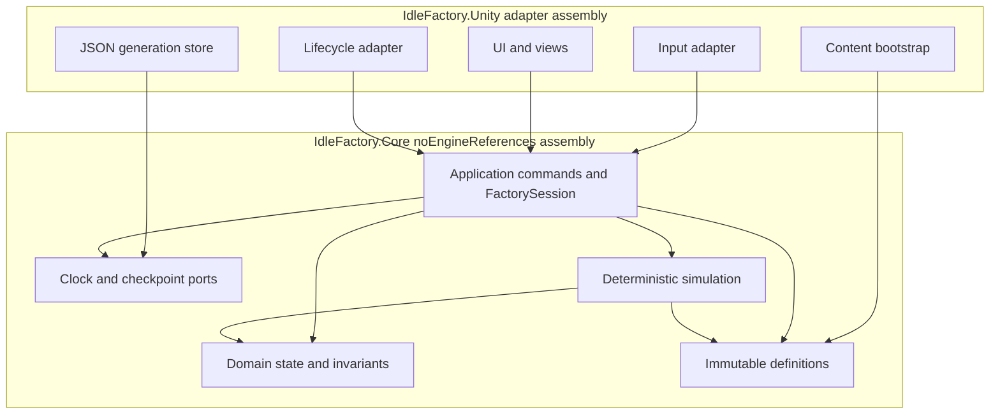

# Software Architecture: Core Game Foundation

**Feature**: Engine-independent factory rules behind Unity adapters
**Generated**: 2026-09-14
**Scope**: Architectural patterns for Feature 001

---

## Overview

The design uses a small ports-and-adapters boundary with layered responsibilities inside the Core assembly. Dependencies point from Unity details and application coordination toward engine-free domain abstractions, allowing deterministic tests without scenes while avoiding a framework-heavy architecture.

## Architecture Diagram

## Architectural Pattern: Lightweight ports and adapters

**What it is**: Core code defines the rules and the abstractions it needs from the environment. Unity-side adapters translate engine callbacks, authored assets, files and input into those abstractions and application commands.

**Why this pattern**: Factory math, save compatibility and offline reconciliation need repeatable tests independent of rendering. A compact Core assembly preserves that property while one adapter assembly keeps Unity integration easy to navigate for a small greenfield project.

**Tradeoffs accepted**:

- ✓ Domain and simulation can run in fast Edit Mode tests without scenes.
- ✓ Time, files and presentation have explicit boundaries and failure results.
- ✗ DTO mapping and immutable projections add code, but they prevent deserialization and UI from mutating live state.
- ✗ Domain, Simulation and Application are namespaces rather than separately compiled assemblies until a real ownership need appears.

## Layer Breakdown

### Domain

**Responsibility**: Own identifiers, grid bounds, occupancy, placed instances, buffers, progress and invariants.

**Depends on**: Immutable definition value types only.

**Depended on by**: Simulation and Application.

**Why this boundary exists**: Merging it with Unity objects would make transforms or serialized components authoritative and prevent headless equivalence tests.

### Simulation

**Responsibility**: Produce a completely validated next factory candidate from explicit integer elapsed time.

**Depends on**: Domain and immutable definitions.

**Depended on by**: Application.

**Why this boundary exists**: Both active and offline progress must reuse the same completion, capacity and blocking rules without observing frame state.

### Application

**Responsibility**: Serialize commands, coordinate lifecycle/load/save, enforce publication order and expose immutable results.

**Depends on**: Domain, Simulation, Definitions and Core-owned ports.

**Depended on by**: Unity input, UI and lifecycle adapters.

**Why this boundary exists**: Multi-step workflows such as durable return reconciliation do not belong in entities or views. The session makes the single writer and allowed lifecycle commands explicit.

### Unity adapters

**Responsibility**: Implement clock/files, convert ScriptableObjects, translate input and lifecycle callbacks, and render snapshots.

**Depends on**: Application contracts, Core ports and immutable definition inputs.

**Depended on by**: Unity scene/bootstrap configuration.

**Why this boundary exists**: Platform APIs and replaceable UI/assets should not determine simulation results or save invariants.

## Module Organization

**Strategy**: Layered namespaces inside one Core assembly plus one platform adapter assembly.

Files live below `Assets/IdleFactory/Core/{Domain,Simulation,Application}` and `Assets/IdleFactory/Unity/{Bootstrap,Content,Input,Persistence,Presentation,UI}`. Separate Edit Mode and Play Mode test assemblies enforce the lowest useful validation level.

## When This Architecture Evolves

Split Core namespaces into assemblies when ownership, reuse or compile-time isolation produces measurable value. Add logistics scheduling only when machines exchange material, and add an online-services boundary only after a separately approved remote feature. Performance evidence from W001 must precede ECS, threading, pooling or cache-heavy designs.

See [component-diagram.md](component-diagram.md) for runtime interactions and [system-design.md](system-design.md) for device and durability boundaries.
