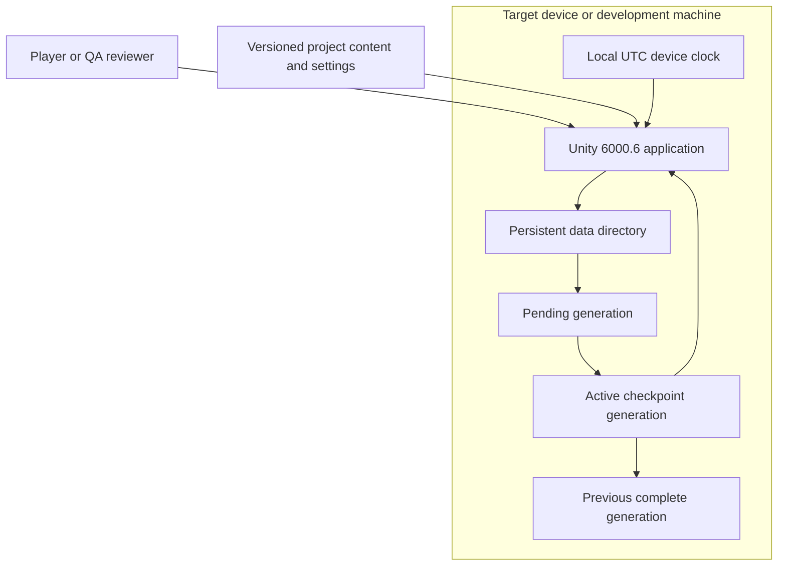
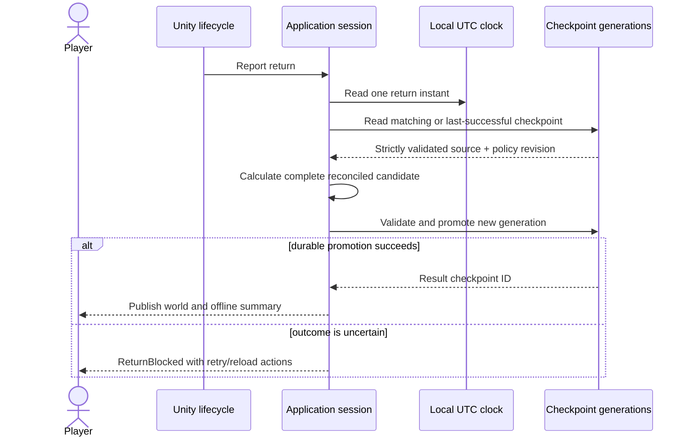

# System Design: Idle Factory Game Foundation

**Feature**: Local mobile-first Unity application with deterministic factory state and recoverable checkpoints
**Generated**: 2026-09-14
**Scope**: Full greenfield project foundation

---

## Overview

The player runs one Unity application on Android, iOS or a Windows development machine. The application uses local device time and an application-owned checkpoint directory; Feature 001 has no backend, account, network API, cache or queue.

## System Design Diagram

## Infrastructure Decisions

### One local Unity runtime

**What**: Simulation, presentation and persistence run in the Unity client process.

**Why**: The specification excludes accounts, multiplayer, cloud saves and analytics. Keeping the first foundation local makes offline behavior testable without inventing an operational service.

**Alternatives considered**:

| Option | Why it wasn't chosen |
|---|---|
| Backend time/save service | It conflicts with the approved local UTC and no-backend scope. |
| Passive background worker | Background production is excluded; return reconciliation handles absence explicitly. |

**When you'd choose differently**: Add a service only after an approved feature introduces accounts, cloud authority, social behavior or trusted time.

### Versioned whole-file generations

**What**: Save V1 uses strict JSON with pending, active and previous complete generations beneath `Application.persistentDataPath`.

**Why**: The state is one coherent local aggregate. A generation transaction preserves the prior usable state across write or validation failure and allows a durable exactly-once return result before UI publication.

**Alternatives considered**:

| Option | Why it wasn't chosen |
|---|---|
| In-place overwrite | Interruption can destroy both the new and previous valid state. |
| Database | It adds schema and operational machinery without a query or concurrency need. |
| PlayerPrefs | It is unsuitable for strict, inspectable authoritative gameplay documents. |

**When you'd choose differently**: Use a two-slot generation manifest if target-platform replace semantics fail interruption tests; use a database only when state/query/concurrency requirements materially change.

## Data Flow

Return reconciliation treats persistence as the publication boundary:

## Scaling & Reliability Notes

Production advancement scales with machine count rather than elapsed cycles. W001 measures 1,000 independent machines before structural optimization. Save V1 applies fixed parser guards before allocation, and actual promotion/lifecycle behavior must be proven on Windows, named Android devices and a macOS/Xcode iOS environment. The absence of network infrastructure means local file and device-clock failures are the current reliability boundary.

See [component-diagram.md](component-diagram.md) for internal runtime responsibilities.
