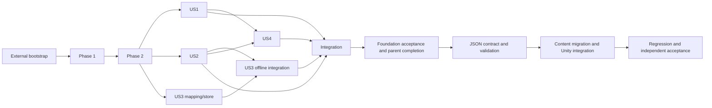

# Tasks: Core Game Foundation

**Input**: Approved artifacts in `specs/001-core-game-foundation/`

**Prerequisites**: `spec.md`, `plan.md`, `research.md`, `data-model.md`, `contracts/`, `quickstart.md`, architecture diagrams, and the constitution

**Tests**: Each MAQA issue must finish with its targeted tests green. A worker may use red/green TDD inside its issue, but no separate red-only issue may block the implementation issue.

**Implementation lane**: Feature 001 uses MAQA after the external Greenfield Bootstrap Prerequisite below. Canonical checklist entries are MAQA work packages. Every accepted prerequisite must be merged and pushed to `origin/main` before dependent workers start.

## Format: `[ID] [P?] [Story] Description`

- **[P]**: May run concurrently only after its dependencies and only with disjoint files/worktrees.
- **[US#]**: Maps the task to the corresponding user story in `spec.md`.
- Every task names its primary paths, validation, and relevant requirement coverage.

## External Greenfield Bootstrap Prerequisite

The parent agent owns this one-time repository preparation outside the Feature 001 MAQA issue set:

1. Through Unity tooling, pin Input System `1.20.0`, Newtonsoft JSON `3.2.2`, and Test Framework `1.8.0`; create Core, Unity, Edit Mode, and Play Mode assemblies plus non-empty smoke suites; implement `scripts/test-unity.ps1`; and prove full-suite, focused-file, deliberate-red, and restored-green execution.
2. Configure real full/file commands in `maqa-config.yml`, retain `tdd: false`, set `worktree_base: ".maqa-worktrees"`, ignore `/.maqa-worktrees/`, and prove that an isolated worktree can be added and removed without losing its commit.
3. Record exact commands, versions, counts, result/log paths, checkout-lock rules, and PASS reviews from DevOps, Architecture, Security, and Test/QA in `docs/testing/unity-test-harness.md`; merge and push the harness and approved planning artifacts to `origin/main`.

Do not run `$speckit-maqa-sync` or dispatch a feature worker until this prerequisite passes.

---

## Context Orchestration Process

### Parent Orchestrator Rules

- Execute work units in ledger order unless their listed prerequisites are verified and their paths are disjoint. Task-level `[P]` markers are local hints only.
- Checklist tasks remain authoritative. Mark a checkbox only after the parent verification gate passes for its work unit.
- Use a clean agent session and one authoritative MAQA Issue/worktree for each work unit. Include the full handoff packet instead of relying on conversation history.
- Keep each agent inside the listed write scope. It must stop before changing an unassigned path or shared serialized asset.
- For behavior tasks, require a failing targeted test before implementation where practical and a green targeted/full result before commit; never accept a red-only work unit.
- Inspect every diff, run targeted verification, reject unrelated changes, and merge/push an accepted prerequisite to `origin/main` before dispatching a dependent unit.
- The parent owns integration and final validation and reruns completion gates even when another agent helps interpret results.

### Required Subagent Handoff Packet

Every assignment includes the role and review lens; MAQA Issue and work-unit IDs; exact task text and paths; authoritative spec, plan, model, contract, quickstart, and constitution sections; current accepted prerequisites; allowed and forbidden paths/tools; overlap constraints; Unity `6000.6.0f1`, target platforms/device class, and required Edit/Play validation; Art Bible/brief version for visual work; workload/baseline/metric/target for performance work; and exact validation commands.

The response must state changed paths, completed task IDs, tests/checks with results and evidence, expected failures, assumptions, unresolved risks, parent follow-up, and a clear done/blocked verdict. Review roles remain read-only and independent from the implementation they approve.

### Parent Verification Gate

For each unit, inspect `git diff -- <unit paths>` plus every extra path reported by the worker; confirm scope and justified adjacent changes; run the targeted Unity command or closest compile/review gate; and reread affected contracts/data-model sections for public boundary changes. Confirm generated directories, secrets, empirical evidence, source assets, persisted data, and shared Unity serialized files outside scope remain unchanged. Mark the task complete only after the exact committed artifact passes, its secondary lenses report no blocking finding, and the accepted commit is available to dependent work.

### Context Compaction Recovery

After compaction, reread this process, the ledger, and the checklist; run `git status --short` and inspect existing diffs. Resume at an earlier partially changed unit if one exists, otherwise at the first unit whose task is unchecked and whose prerequisites are accepted. Reconstruct state from checked tasks, merged commits, diffs, and targeted tests. Finish and verify that unit before opening another agent or shared writer.

### Work Unit Ledger

| Unit | Phase | Tasks | Atomic scope and touched paths | Prerequisites | Required handoff sources | Parent verification |
|------|-------|-------|--------------------------------|---------------|--------------------------|---------------------|
| WU01 | Phase 1: Feature Setup | T001 | IDs and geometry in `Assets/IdleFactory/Core/Domain/Identifiers.cs`, `Assets/IdleFactory/Core/Domain/FactoryGeometry.cs`, and `Assets/IdleFactory/Tests/EditMode/DomainValueObjectTests.cs` | None | `spec.md`, `plan.md`, `data-model.md` | Run focused Edit Mode tests and inspect Core for Unity references |
| WU02 | Phase 1: Feature Setup | T002 | Immutable definitions/catalog in `Assets/IdleFactory/Core/Domain/Definitions.cs`, `Assets/IdleFactory/Core/Domain/DefinitionCatalog.cs`, and `Assets/IdleFactory/Tests/EditMode/DefinitionCatalogTests.cs` | WU01 | `spec.md`, `data-model.md`, `contracts/application-commands.md` | Run focused Edit Mode tests and verify policy/D001 invariants |
| WU03 | Phase 1: Feature Setup | T003 | Six content authoring/builder files in `Assets/IdleFactory/Unity/Content/` and `Assets/IdleFactory/Tests/EditMode/DefinitionCatalogBuilderTests.cs` | WU02 | `plan.md`, `data-model.md` | Run focused Edit Mode tests and verify immutable copy/no asset mutation |
| WU04 | Phase 1: Feature Setup | T004 | Six explicit development `.asset` files under `Assets/IdleFactory/Content/Development/` and `Assets/IdleFactory/Tests/EditMode/DevelopmentContentTests.cs` | WU03 | `spec.md`, `data-model.md`, `quickstart.md` | Run focused Edit Mode tests; inspect values, references, labels, and `.meta` files |
| WU05 | Phase 2: Foundational Core | T005 | Authoritative state in `Assets/IdleFactory/Core/Domain/FactoryState.cs` and `Assets/IdleFactory/Tests/EditMode/FactoryStateTests.cs` | WU04 | `spec.md`, `data-model.md` | Run focused Edit Mode tests and inspect atomic invariant enforcement |
| WU06 | Phase 2: Foundational Core | T006 | Application contracts, ports, session, doubles, and tests under `Assets/IdleFactory/Core/Application/` and `Assets/IdleFactory/Tests/EditMode/ApplicationContractTests.cs` | WU05 | `data-model.md`, `contracts/application-commands.md`, `contracts/runtime-persistence.md` | Run focused Edit Mode tests and verify single-writer/admission rules |
| WU07 | Phase 2: Foundational Core | T007 | Deterministic factories in `Assets/IdleFactory/Tests/EditMode/Fixtures/FoundationFixtures.cs` | WU06 | `spec.md`, `data-model.md`, `research.md` | Run the complete foundational Edit Mode suite and inspect fixture-only scope |
| WU08 | Phase 3: User Story 1 — Navigate and Place Test Buildings (Priority: P1) 🎯 MVP | T008 | Placement domain and tests in `Assets/IdleFactory/Core/Domain/FactoryPlacement.cs` and `Assets/IdleFactory/Tests/EditMode/PlacementTests.cs` | WU07 | `spec.md`, `data-model.md` | Run focused Edit Mode tests for valid/invalid full footprints and zero mutation |
| WU09 | Phase 3: User Story 1 — Navigate and Place Test Buildings (Priority: P1) 🎯 MVP | T009 | Placement application boundary and tests in `Assets/IdleFactory/Core/Application/PlacementCommands.cs` and `Assets/IdleFactory/Tests/EditMode/PlacementApplicationTests.cs` | WU08 | `contracts/application-commands.md`, `data-model.md` | Run focused Edit Mode tests and verify selection stays presentation-owned |
| WU10 | Phase 3: User Story 1 — Navigate and Place Test Buildings (Priority: P1) 🎯 MVP | T010 | Versioned asset brief in `docs/art/F001-development-placeholders-v0.1.md` | WU07 | `spec.md`, `plan.md`, `quickstart.md` | Inspect every required inventory field, provenance rule, and development-only label |
| WU11 | Phase 3: User Story 1 — Navigate and Place Test Buildings (Priority: P1) 🎯 MVP | T011 | Independent brief review in `specs/001-core-game-foundation/reviews/f001-placeholder-brief-review.md` | WU10 | `docs/art/F001-development-placeholders-v0.1.md`, `spec.md` | Verify reviewer independence and an explicit PASS/FAIL verdict |
| WU12 | Phase 3: User Story 1 — Navigate and Place Test Buildings (Priority: P1) 🎯 MVP | T012 | Approved source assets under `Assets/IdleFactory/Art/Development/F001/Source/` | WU11 | Approved F001 brief and review | Inspect bounded asset inventory, formats, provenance, and no production-code changes |
| WU13 | Phase 3: User Story 1 — Navigate and Place Test Buildings (Priority: P1) 🎯 MVP | T013 | Independent source review in `specs/001-core-game-foundation/reviews/f001-placeholder-source-review.md` | WU12 | Approved F001 brief and source inventory | Verify every source asset is compared and verdict is independent |
| WU14 | Phase 3: User Story 1 — Navigate and Place Test Buildings (Priority: P1) 🎯 MVP | T014 | Imported assets, asset tests, and integration evidence under `Assets/IdleFactory/Art/Development/F001/Imported/`, `Assets/IdleFactory/Tests/EditMode/F001AssetContractTests.cs`, and `docs/art/F001-technical-art-integration.md` | WU13 | F001 brief/reviews, `plan.md` | Run focused Edit Mode asset tests and inspect importer/reference/`.meta` evidence |
| WU15 | Phase 3: User Story 1 — Navigate and Place Test Buildings (Priority: P1) 🎯 MVP | T015 | Input, camera, mapper, and Play tests under `Assets/IdleFactory/Unity/Input/`, `Assets/IdleFactory/Unity/Presentation/`, and `Assets/IdleFactory/Tests/PlayMode/NavigationInputTests.cs` | WU07 | `spec.md`, `plan.md`, `quickstart.md` | Run focused Play Mode tests across touch/mouse ownership and camera bounds |
| WU16 | Phase 3: User Story 1 — Navigate and Place Test Buildings (Priority: P1) 🎯 MVP | T016 | Factory views/UI and Play tests in `Assets/IdleFactory/Unity/Presentation/FactoryView.cs`, `Assets/IdleFactory/Unity/UI/CoreGameFoundation.uxml`, `Assets/IdleFactory/Unity/UI/CoreGameFoundation.uss`, and `Assets/IdleFactory/Tests/PlayMode/NavigationPlacementTests.cs` | WU09, WU14, WU15 | `spec.md`, `contracts/application-commands.md`, approved F001 artifacts | Run focused Play Mode tests and independent UI/UX review; inspect no domain rules in views |
| WU17 | Phase 3: User Story 1 — Navigate and Place Test Buildings (Priority: P1) 🎯 MVP | T017 | Runnable scene/bootstrap and US1 evidence in `Assets/IdleFactory/Scenes/CoreGameFoundation.unity`, `Assets/IdleFactory/Unity/Bootstrap/CoreGameFoundationBootstrap.cs`, and `specs/001-core-game-foundation/reviews/us1-placement-acceptance.md` | WU04, WU16 | `quickstart.md`, `spec.md`, accepted US1 units | Run US1 Play Mode/quickstart checks and inspect the scene diff through Unity |
| WU18 | Phase 4: User Story 2 — Run and Inspect Constrained Production (Priority: P1) | T018 | Production simulator and tests in `Assets/IdleFactory/Core/Simulation/ProductionSimulator.cs` and `Assets/IdleFactory/Tests/EditMode/ProductionSimulationTests.cs` | WU07 | `spec.md`, `data-model.md`, `research.md` | Run focused Edit Mode tests for D001 math, blockers, rollback, and partitions |
| WU19 | Phase 4: User Story 2 — Run and Inspect Constrained Production (Priority: P1) | T019 | Production commands/inspection and tests in `Assets/IdleFactory/Core/Application/ProductionCommands.cs` and `Assets/IdleFactory/Tests/EditMode/ProductionApplicationTests.cs` | WU18 | `contracts/application-commands.md`, `data-model.md` | Run focused Edit Mode tests and inspect immutable projections/typed outcomes |
| WU20 | Phase 4: User Story 2 — Run and Inspect Constrained Production (Priority: P1) | T020 | Runtime host and Play tests in `Assets/IdleFactory/Unity/Bootstrap/FactoryRuntimeHost.cs` and `Assets/IdleFactory/Tests/PlayMode/FactoryRuntimeHostTests.cs` | WU19 | `plan.md`, `contracts/application-commands.md` | Run focused Play Mode tests and verify one cumulative clock/no per-building Update |
| WU21 | Phase 4: User Story 2 — Run and Inspect Constrained Production (Priority: P1) | T021 | Shared scene/UI, inspector presenter, and Play tests in `Assets/IdleFactory/Scenes/CoreGameFoundation.unity`, `Assets/IdleFactory/Unity/UI/`, and `Assets/IdleFactory/Tests/PlayMode/ProductionInspectorTests.cs` | WU17, WU19, WU20 | `spec.md`, `quickstart.md`, `contracts/application-commands.md` | Run focused Play Mode tests; inspect serialized scene/UI diff and development labels |
| WU22 | Phase 4: User Story 2 — Run and Inspect Constrained Production (Priority: P1) | T022 | US2 evidence in `specs/001-core-game-foundation/reviews/us2-production-acceptance.md` | WU21 | `spec.md`, `quickstart.md`, accepted US2 commits | Reproduce US2.1–9 and verify exact long-stop/no-catch-up evidence |
| WU23 | Phase 5: User Story 3 — Save, Restore, and Apply Reduced Offline Production (Priority: P1) | T023 | Save DTO/mapper and tests under `Assets/IdleFactory/Unity/Persistence/` and `Assets/IdleFactory/Tests/EditMode/CheckpointMappingTests.cs` | WU07 | `data-model.md`, `contracts/runtime-persistence.md`, `contracts/save-v1.schema.json` | Run focused Edit Mode tests and inspect every parser limit/validation order |
| WU24 | Phase 5: User Story 3 — Save, Restore, and Apply Reduced Offline Production (Priority: P1) | T024 | Generation store and tests in `Assets/IdleFactory/Unity/Persistence/JsonCheckpointStore.cs` and `Assets/IdleFactory/Tests/EditMode/CheckpointStoreTests.cs` | WU07 | `contracts/runtime-persistence.md`, `research.md` | Run isolated-path failure-injection tests and inspect no repository/user data access |
| WU25 | Phase 5: User Story 3 — Save, Restore, and Apply Reduced Offline Production (Priority: P1) | T025 | Offline reconciler and tests in `Assets/IdleFactory/Core/Application/OfflineReconciler.cs` and `Assets/IdleFactory/Tests/EditMode/OfflineReconciliationTests.cs` | WU18 | `spec.md`, `data-model.md`, `contracts/application-commands.md` | Run focused Edit Mode tests for 4/5, cap, invalid UTC, rollback, and exactly-once |
| WU26 | Phase 5: User Story 3 — Save, Restore, and Apply Reduced Offline Production (Priority: P1) | T026 | Persistence commands and tests in `Assets/IdleFactory/Core/Application/PersistenceCommands.cs` and `Assets/IdleFactory/Tests/EditMode/PersistenceApplicationTests.cs` | WU23, WU24, WU25 | Both contracts, `data-model.md`, `spec.md` | Run focused Edit Mode tests and verify command names/status/summary/publication rules |
| WU27 | Phase 5: User Story 3 — Save, Restore, and Apply Reduced Offline Production (Priority: P1) | T027 | UTC/lifecycle adapters and Play tests in `Assets/IdleFactory/Unity/Persistence/DeviceUtcClock.cs`, `Assets/IdleFactory/Unity/Bootstrap/ApplicationLifecycleAdapter.cs`, and `Assets/IdleFactory/Tests/PlayMode/LifecyclePersistenceTests.cs` | WU26 | `contracts/application-commands.md`, `contracts/runtime-persistence.md` | Run focused Play Mode lifecycle tests and inspect blocked-return admission |
| WU28 | Phase 5: User Story 3 — Save, Restore, and Apply Reduced Offline Production (Priority: P1) | T028 | Shared scene/UI persistence presenter and Play tests in `Assets/IdleFactory/Scenes/CoreGameFoundation.unity`, `Assets/IdleFactory/Unity/UI/`, and `Assets/IdleFactory/Tests/PlayMode/PersistenceUiTests.cs` | WU21, WU26, WU27 | `spec.md`, `quickstart.md`, application contract | Run focused Play Mode tests; inspect scene/UI diff, accessibility states, and no path/raw JSON disclosure |
| WU29 | Phase 5: User Story 3 — Save, Restore, and Apply Reduced Offline Production (Priority: P1) | T029 | Security review in `specs/001-core-game-foundation/reviews/persistence-security-review.md` | WU28 | Persistence implementation, contracts, `research.md` | Require independent Security/Privacy PASS/FAIL with concrete threat paths |
| WU30 | Phase 5: User Story 3 — Save, Restore, and Apply Reduced Offline Production (Priority: P1) | T030 | US3 evidence in `specs/001-core-game-foundation/reviews/us3-persistence-offline-acceptance.md` | WU29 | `spec.md`, `quickstart.md`, persistence reviews | Reproduce zero/nonzero/failure/partial-cycle cases and verify FR/SC matrix |
| WU31 | Phase 6: User Story 4 — Reproduce Simulation Independently of the View (Priority: P2) | T031 | Snapshot/checksum and equivalence tests in `Assets/IdleFactory/Core/Application/FactorySnapshot.cs` and `Assets/IdleFactory/Tests/EditMode/SimulationEquivalenceTests.cs` | WU22 | `spec.md`, `data-model.md` | Run focused Edit Mode property/table tests and compare full semantic state |
| WU32 | Phase 6: User Story 4 — Reproduce Simulation Independently of the View (Priority: P2) | T032 | View registry/recreation tests in `Assets/IdleFactory/Unity/Presentation/FactoryViewRegistry.cs` and `Assets/IdleFactory/Tests/PlayMode/ViewRecreationTests.cs` | WU17, WU31 | `spec.md`, `contracts/application-commands.md` | Run focused Play Mode tests and verify render cadence cannot mutate state |
| WU33 | Phase 6: User Story 4 — Reproduce Simulation Independently of the View (Priority: P2) | T033 | W001 test and raw report in `Assets/IdleFactory/Tests/EditMode/W001PerformanceTests.cs` and `specs/001-core-game-foundation/reviews/w001-performance.md` | WU22 | `plan.md`, `research.md`, `data-model.md` | Run W001 as declared; verify workload, warmups, samples, p50/p95, allocations, checksum |
| WU34 | Phase 6: User Story 4 — Reproduce Simulation Independently of the View (Priority: P2) | T034 | Independent review in `specs/001-core-game-foundation/reviews/us4-determinism-performance-review.md` | WU31, WU32, WU33 | US4 tests/report, `plan.md`, `spec.md` | Require independent QA/Performance PASS/FAIL and stated Windows-baseline limits |
| WU35 | Phase 7: Integration, Specialist Gates, and Documentation | T035 | Final scene/bootstrap integration in `Assets/IdleFactory/Scenes/CoreGameFoundation.unity` and `Assets/IdleFactory/Unity/Bootstrap/CoreGameFoundationBootstrap.cs` | WU17, WU22, WU30, WU34 | All accepted story artifacts, `quickstart.md` | Inspect Unity serialized diff, run full Edit/Play suites, and verify one state writer |
| WU36 | Phase 7: Integration, Specialist Gates, and Documentation | T036 | UI/UX evidence in `specs/001-core-game-foundation/reviews/ui-ux-acceptance.md` | WU35 | `spec.md`, `quickstart.md`, integrated scene | Run viewport/input/state matrix and require independent UI/UX PASS/FAIL |
| WU37 | Phase 7: Integration, Specialist Gates, and Documentation | T037 | Art/Technical-Art evidence in `specs/001-core-game-foundation/reviews/f001-placeholder-final-review.md` | WU14, WU35 | F001 brief/reviews/integration and integrated scene | Require independent Art/Technical-Art PASS/FAIL and inspect references/import settings |
| WU38 | Phase 7: Integration, Specialist Gates, and Documentation | T038 | Windows/Android evidence in `specs/001-core-game-foundation/reviews/windows-android-validation.md` | WU35 | `plan.md`, `quickstart.md`, runtime persistence contract | Reproduce builds/device flows and verify exact environment/results |
| WU39 | Phase 7: Integration, Specialist Gates, and Documentation | T039 | iOS evidence/block in `specs/001-core-game-foundation/reviews/ios-validation.md` | WU35 | `plan.md`, `quickstart.md`, runtime persistence contract | Verify named macOS/Xcode/device evidence; unavailable evidence must remain BLOCKED |
| WU40 | Phase 7: Integration, Specialist Gates, and Documentation | T040 | Mobile profiling evidence in `specs/001-core-game-foundation/reviews/mobile-performance.md` | WU35 | `plan.md`, `research.md`, integrated scene | Verify named devices/workload/settings/raw metrics and no Windows-budget transfer |
| WU41 | Phase 7: Integration, Specialist Gates, and Documentation | T041 | Final acceptance matrix in `specs/001-core-game-foundation/reviews/final-acceptance.md` | WU36, WU37, WU38, WU39, WU40 | All feature artifacts, `quickstart.md`, constitution | Rerun full Edit/Play suites and quickstart; inspect console and all 47 requirement links |
| WU42 | Phase 8: Post-Foundation JSON Content Authoring Migration | T042 | Versioned content contract and schema in `docs/content/json-content-pipeline.md` and `Assets/IdleFactory/Content/Schemas/gameplay-content-v1.schema.json` | WU41 | `plan.md`, `research.md`, `data-model.md`, `spec.md` | Require accepted parent foundation completion before dispatch; review schema, stable-ID/Save V1 rules, human/AI editing examples and future-extension boundaries |
| WU43 | Phase 8: Post-Foundation JSON Content Authoring Migration | T043 | Strict JSON DTO parsing and schema tests in `Assets/IdleFactory/Unity/Content/JsonContentDtos.cs`, `Assets/IdleFactory/Unity/Content/JsonContentReader.cs`, and `Assets/IdleFactory/Tests/EditMode/JsonContentSchemaTests.cs` | WU42 | Content contract/schema, `data-model.md`, `plan.md` | Run focused Edit Mode schema/parse tests for malformed, duplicate, missing, unknown, type, range and size failures |
| WU44 | Phase 8: Post-Foundation JSON Content Authoring Migration | T044 | Semantic validation and catalog mapping in `Assets/IdleFactory/Unity/Content/JsonDefinitionCatalogBuilder.cs` and `Assets/IdleFactory/Tests/EditMode/JsonDefinitionCatalogBuilderTests.cs` | WU43 | Content contract/schema, `data-model.md`, existing Core catalog | Run focused Edit Mode graph/immutability tests; inspect no Unity dependency added to Core and no partial publication |
| WU45 | Phase 8: Post-Foundation JSON Content Authoring Migration | T045 | Migrated development content and parity tests in `Assets/IdleFactory/Content/Development/development-catalog.json` and `Assets/IdleFactory/Tests/EditMode/JsonDevelopmentContentTests.cs` | WU44 | Existing development assets, `spec.md`, `data-model.md` | Run focused Edit Mode catalog parity tests for all D001 IDs, values and policies; preserve a baseline independent of retired assets |
| WU46 | Phase 8: Post-Foundation JSON Content Authoring Migration | T046 | Unity bootstrap switch and Play tests in `Assets/IdleFactory/Unity/Bootstrap/CoreGameFoundationBootstrap.cs`, `Assets/IdleFactory/Scenes/CoreGameFoundation.unity`, and `Assets/IdleFactory/Tests/PlayMode/JsonContentBootstrapTests.cs` | WU45 | Content contract, `quickstart.md`, existing scene/bootstrap | Run focused Play Mode startup/failure tests; inspect serialized scene diff and single-source catalog publication |
| WU47 | Phase 8: Post-Foundation JSON Content Authoring Migration | T047 | Save V1 and simulation regression tests in `Assets/IdleFactory/Tests/EditMode/JsonContentCompatibilityTests.cs` and `Assets/IdleFactory/Tests/PlayMode/JsonContentPersistenceTests.cs` | WU46 | `contracts/persistence-v1.md`, `spec.md`, D001/W001 fixtures | Run focused Edit/Play tests with existing V1 checkpoints and deterministic continuation; reject incompatible content without mutation |
| WU48 | Phase 8: Post-Foundation JSON Content Authoring Migration | T048 | Retire gameplay ScriptableObject authority in `Assets/IdleFactory/Unity/Content/`, `Assets/IdleFactory/Content/Development/`, `Assets/IdleFactory/Tests/EditMode/`, and `Assets/IdleFactory/Tests/PlayMode/` | WU47 | Accepted JSON bootstrap and compatibility tests, `plan.md` | Inspect all gameplay content consumers, legacy tests and `.meta` changes; run focused Edit/Play tests proving JSON is the sole gameplay source and presentation references remain valid |
| WU49 | Phase 8: Post-Foundation JSON Content Authoring Migration | T049 | Independent migration reviews in `specs/001-core-game-foundation/reviews/json-content-migration-review.md` | WU48 | Exact committed migration, content contract, `spec.md`, `plan.md` | Require independent Product, Architecture, Game Systems, QA, Security and applicable UI/UX/Technical Art PASS/FAIL evidence |
| WU50 | Phase 8: Post-Foundation JSON Content Authoring Migration | T050 | Final migrated-content acceptance in `specs/001-core-game-foundation/reviews/json-content-final-acceptance.md` | WU49 | `quickstart.md`, final foundation acceptance, migration reviews | Rerun full Unity Edit/Play suites, console, D001 journeys and applicable platform/build checks against committed JSON source |

## Phase 1: Feature Setup

**Purpose**: Establish engine-free definitions and Unity authoring content needed by all stories.

- [ ] T001 Implement normalized identifiers, checked grid geometry, positive footprints, and deterministic row-major occupied cells with final-green boundary tests in `Assets/IdleFactory/Core/Domain/Identifiers.cs`, `Assets/IdleFactory/Core/Domain/FactoryGeometry.cs`, and `Assets/IdleFactory/Tests/EditMode/DomainValueObjectTests.cs`
- [ ] T002 Implement immutable resource, recipe, building, buffer, and offline-policy definitions plus graph validation with final-green tests for required/unique IDs, references, positive amounts/durations, capacities, supported orientation, and policy revision `1 = 4/5, 288000000000 ticks` in `Assets/IdleFactory/Core/Domain/Definitions.cs`, `Assets/IdleFactory/Core/Domain/DefinitionCatalog.cs`, and `Assets/IdleFactory/Tests/EditMode/DefinitionCatalogTests.cs`
- [ ] T003 Implement `ResourceDefinitionAsset`, `RecipeDefinitionAsset`, `BuildingDefinitionAsset`, `OfflinePolicyAsset`, `DefinitionCatalogAsset`, and a validated `DefinitionCatalogBuilder` that copies authored data into immutable Core definitions without retaining mutable asset authority, with final-green Edit Mode tests in `Assets/IdleFactory/Unity/Content/ResourceDefinitionAsset.cs`, `Assets/IdleFactory/Unity/Content/RecipeDefinitionAsset.cs`, `Assets/IdleFactory/Unity/Content/BuildingDefinitionAsset.cs`, `Assets/IdleFactory/Unity/Content/OfflinePolicyAsset.cs`, `Assets/IdleFactory/Unity/Content/DefinitionCatalogAsset.cs`, `Assets/IdleFactory/Unity/Content/DefinitionCatalogBuilder.cs`, and `Assets/IdleFactory/Tests/EditMode/DefinitionCatalogBuilderTests.cs`
- [ ] T004 Author and validate the development-only assets `Assets/IdleFactory/Content/Development/Resources/dev.input.asset`, `Assets/IdleFactory/Content/Development/Resources/dev.output.asset`, `Assets/IdleFactory/Content/Development/Recipes/D001.asset`, `Assets/IdleFactory/Content/Development/Buildings/D001.asset`, `Assets/IdleFactory/Content/Development/OfflinePolicies/revision-1.asset`, and `Assets/IdleFactory/Content/Development/DevelopmentCatalog.asset`, including stable IDs, references, values, and every required `.meta`, with final-green tests in `Assets/IdleFactory/Tests/EditMode/DevelopmentContentTests.cs`

**Checkpoint**: Versioned authoring assets resolve into a valid immutable Core catalog.

---

## Phase 2: Foundational Core

**Purpose**: Establish authoritative state, application boundaries, and deterministic fixtures shared by every story.

- [ ] T005 Implement instance-owned `ResourceBufferState`, `ProductionState`, `BuildingInstanceState`, and `FactoryState` with atomic invariant enforcement, immutable resolvable references, reconstructed occupancy, and derived blockers, with final-green tests in `Assets/IdleFactory/Core/Domain/FactoryState.cs` and `Assets/IdleFactory/Tests/EditMode/FactoryStateTests.cs`
- [ ] T006 Define typed command outcomes, immutable factory/inspection/offline projections, clock and checkpoint ports, the application-owned `FactorySession`, and test doubles with final-green admission/state-ownership tests in `Assets/IdleFactory/Core/Application/Contracts.cs`, `Assets/IdleFactory/Core/Application/Ports.cs`, `Assets/IdleFactory/Core/Application/FactorySession.cs`, and `Assets/IdleFactory/Tests/EditMode/ApplicationContractTests.cs`
- [ ] T007 Build validated D001, alternate-footprint, multi-cycle, negative-coordinate, and W001 definition/state factories without Unity objects and run the complete foundational Edit Mode suite in `Assets/IdleFactory/Tests/EditMode/Fixtures/FoundationFixtures.cs`

**Checkpoint**: Plain C# definitions and state are independently constructible; invalid candidates never partially mutate live state.

---

## Phase 3: User Story 1 — Navigate and Place Test Buildings (Priority: P1) 🎯 MVP

**Goal**: Pan and zoom the development factory, preview a complete footprint, place valid buildings, reject invalid placement, and inspect independent identities.

**Independent Test**: In the runnable development scene without production or persistence, complete US1.1–7 with touch and desktop inputs; rejected placement changes no identity, occupancy, or resource state.

- [ ] T008 [US1] Implement transactional full-footprint placement, overlap/out-of-bounds rejection, independent IDs, alternate bounds/footprints, and zero mutation on failure with final-green Edit Mode tests covering FR-001–003/031 and SC-001 in `Assets/IdleFactory/Core/Domain/FactoryPlacement.cs` and `Assets/IdleFactory/Tests/EditMode/PlacementTests.cs`
- [ ] T009 [US1] Implement `PlaceBuilding`, placement-preview, snapshot, and selection-safe queries with typed rejection and final-green application tests; keep selection ownership outside Core state in `Assets/IdleFactory/Core/Application/PlacementCommands.cs` and `Assets/IdleFactory/Tests/EditMode/PlacementApplicationTests.cs`
- [ ] T010 [P] [US1] Write the structured `F001-Development-Placeholders v0.1` inventory with IDs/types, logical footprints or `N/A`, ports `none/N/A`, power state `N/A`, visual states, pixel targets, format, pivot/cell mapping, output paths, provenance, generator/version, and `Art Bible: N/A` in `docs/art/F001-development-placeholders-v0.1.md`
- [ ] T011 [US1] Record independent Art Director PASS or blocking findings for the complete F001 inventory before asset production in `specs/001-core-game-foundation/reviews/f001-placeholder-brief-review.md`
- [ ] T012 [US1] Produce only approved geometric grid, building, ghost, resource, and non-color state-symbol source assets with recorded provenance in `Assets/IdleFactory/Art/Development/F001/Source/`
- [ ] T013 [US1] Record independent Art Director comparison of every produced source asset against the approved inventory and readability goals in `specs/001-core-game-foundation/reviews/f001-placeholder-source-review.md`
- [ ] T014 [US1] Import only approved sources; configure pixels-per-unit, pivots, sorting, compression, references, and `.meta` files; add final-green asset-contract tests and zoom/memory evidence in `Assets/IdleFactory/Art/Development/F001/Imported/`, `Assets/IdleFactory/Tests/EditMode/F001AssetContractTests.cs`, and `docs/art/F001-technical-art-integration.md`
- [ ] T015 [P] [US1] Create Input System actions, UI-pointer ownership, semantic touch/mouse intents, bounded orthographic pan/zoom, and logical-grid/world mapping with final-green Play Mode tests covering FR-004–006 and SC-005/006 in `Assets/IdleFactory/Unity/Input/`, `Assets/IdleFactory/Unity/Presentation/FactoryCameraController.cs`, `Assets/IdleFactory/Unity/Presentation/GridWorldMapper.cs`, and `Assets/IdleFactory/Tests/PlayMode/NavigationInputTests.cs`
- [ ] T016 [US1] Implement factory/grid/building/ghost views and UI Toolkit browse/build/selection states using explicit application contracts and only approved imported assets, with final-green Play Mode tests in `Assets/IdleFactory/Unity/Presentation/FactoryView.cs`, `Assets/IdleFactory/Unity/UI/CoreGameFoundation.uxml`, `Assets/IdleFactory/Unity/UI/CoreGameFoundation.uss`, and `Assets/IdleFactory/Tests/PlayMode/NavigationPlacementTests.cs`
- [ ] T017 [US1] Assemble a minimal runnable US1 development scene and bootstrap, then record US1.1–7 acceptance for desktop/touch, cancellation, empty selection, orientation/focus interruption, and view recreation in `Assets/IdleFactory/Scenes/CoreGameFoundation.unity`, `Assets/IdleFactory/Unity/Bootstrap/CoreGameFoundationBootstrap.cs`, and `specs/001-core-game-foundation/reviews/us1-placement-acceptance.md`

**Checkpoint**: US1 is runnable and independently testable without production or persistence.

---

## Phase 4: User Story 2 — Run and Inspect Constrained Production (Priority: P1)

**Goal**: Supply a machine, advance deterministic production, observe every blocker, and resume only after the real condition is resolved.

**Independent Test**: From a preconfigured D001 machine, reproduce US2.1–9 and exact 2-input → 1-output / 5-second balances without placement or persistence.

- [ ] T018 [US2] Implement cycle-boundary bulk advancement with checked Int64 100 ns ticks, whole-factory prevalidation/commit, completion-time atomic input/output booking, retained partial progress, discarded blocked/inactive elapsed time, and final-green tests for D001's exact 2-input → 1-output exchange after 5 productive seconds, the unchanged 2.5-second resource checkpoint, blockers, overflow, multiple cycles, partition equivalence, and rollback covering FR-007–020 and SC-002/003/006 in `Assets/IdleFactory/Core/Simulation/ProductionSimulator.cs` and `Assets/IdleFactory/Tests/EditMode/ProductionSimulationTests.cs`
- [ ] T019 [US2] Implement explicit `SetBuildingActive`, `AddResource`, `RemoveResource`, and `AdvanceSimulation` commands plus immutable inspection of every blocker, with final-green application tests in `Assets/IdleFactory/Core/Application/ProductionCommands.cs` and `Assets/IdleFactory/Tests/EditMode/ProductionApplicationTests.cs`
- [ ] T020 [P] [US2] Implement one cumulative active-time runtime host that converts elapsed time once, never adds per-building `Update`, and pauses on lifecycle loss, with final-green Play Mode tests in `Assets/IdleFactory/Unity/Bootstrap/FactoryRuntimeHost.cs` and `Assets/IdleFactory/Tests/PlayMode/FactoryRuntimeHostTests.cs`
- [ ] T021 [US2] After accepted T017, T019, and T020, extend the same development scene and UI with clearly labeled supply/removal controls and machine inspection for producing, missing-input, full-output, inactive, combined-blocker, progress, and capacity states, with final-green Play Mode tests in `Assets/IdleFactory/Scenes/CoreGameFoundation.unity`, `Assets/IdleFactory/Unity/UI/CoreGameFoundation.uxml`, `Assets/IdleFactory/Unity/UI/CoreGameFoundation.uss`, `Assets/IdleFactory/Unity/UI/MachineInspectorPresenter.cs`, and `Assets/IdleFactory/Tests/PlayMode/ProductionInspectorTests.cs`
- [ ] T022 [US2] Record D001, multi-cycle, one-hour/24-hour/seven-day stopped-time, independent-instance, view-refresh, and US2.1–9 acceptance evidence for FR-007–021 and SC-002/003/006 in `specs/001-core-game-foundation/reviews/us2-production-acceptance.md`

**Checkpoint**: US2 works from fixtures and in the scene without presentation owning simulation state.

---

## Phase 5: User Story 3 — Save, Restore, and Apply Reduced Offline Production (Priority: P1)

**Goal**: Persist coherent state locally, restore it safely, and apply the versioned 80%/eight-hour offline rule exactly once with explicit recovery.

**Independent Test**: Save ready, partial, blocked, and inactive fixtures; restore with controlled UTC; inject every write-boundary failure; and verify no invalid candidate or duplicate reward is published.

- [ ] T023 [US3] Implement strict required-member Save V1 DTO mapping and fresh-candidate validation with final-green tests for schema `1`, Int32 coordinates, positive dimensions/revision, nonnegative quantities/capacities/progress/generation, UUIDs, UTC range, ≤16 MiB, ≤100000 buildings, ≤256 entries/buffer, IDs ≤128 UTF-16 units, unknown/duplicate members and IDs, references, overlap, orientation/policy/catalog compatibility, and invalid progress without clamping or live mutation in `Assets/IdleFactory/Unity/Persistence/SaveV1Dtos.cs`, `Assets/IdleFactory/Unity/Persistence/SaveV1Mapper.cs`, and `Assets/IdleFactory/Tests/EditMode/CheckpointMappingTests.cs`
- [ ] T024 [US3] Implement application-owned pending/active/previous generation storage, flush/readback, verified promotion, abandoned-pending handling, and explicit previous recovery with final-green injected failures before/during/after every boundary in `Assets/IdleFactory/Unity/Persistence/JsonCheckpointStore.cs` and `Assets/IdleFactory/Tests/EditMode/CheckpointStoreTests.cs`
- [ ] T025 [US3] Implement policy-revision lookup and checked rational offline calculation through the same `ProductionSimulator`, with final-green tests for 0 s, 1 s→0.8 s, 6.25 s→5 s, 8 h/24 h→6.4 h, blockers, partial progress, partitions, invalid UTC, FR-037 fallback, retry idempotency, and whole-candidate rollback covering FR-022–027/032–037 and SC-004/007/009/010 in `Assets/IdleFactory/Core/Application/OfflineReconciler.cs` and `Assets/IdleFactory/Tests/EditMode/OfflineReconciliationTests.cs`
- [ ] T026 [US3] Implement `SaveNow`, zero-offline `LoadDevelopmentCheckpoint`, `RecordSuspension`, `ResumeAndReconcile`, `RetryReturn`, `ReloadAuthoritativeGeneration`, `RecoverPreviousCheckpoint`, and `ResetDevelopmentScenario` exactly as defined by the application contract, including typed persistence status, measured/credited/effective time, actual resource deltas, limiting reasons, and durable-before-publication semantics, with final-green application tests in `Assets/IdleFactory/Core/Application/PersistenceCommands.cs` and `Assets/IdleFactory/Tests/EditMode/PersistenceApplicationTests.cs`
- [ ] T027 [US3] Implement `DeviceUtcClock` and normalized pause/focus/quit handling that binds successful departure IDs or FR-037 fallback, disables background simulation, and blocks gameplay during unresolved return, with final-green Play Mode lifecycle tests in `Assets/IdleFactory/Unity/Persistence/DeviceUtcClock.cs`, `Assets/IdleFactory/Unity/Bootstrap/ApplicationLifecycleAdapter.cs`, and `Assets/IdleFactory/Tests/PlayMode/LifecyclePersistenceTests.cs`
- [ ] T028 [US3] After accepted T021, T026, and T027, extend the same scene and UI with save/load/scenario-reset/recovery controls and durable offline-result presentation for no-save, saving, load, failure, recovery, pending/blocked return, invalid time, fallback warning, measured/credited/effective time, actual resource deltas, limiting reasons, and stale-selection cancellation without path/raw-JSON disclosure, with final-green Play Mode tests in `Assets/IdleFactory/Scenes/CoreGameFoundation.unity`, `Assets/IdleFactory/Unity/UI/CoreGameFoundation.uxml`, `Assets/IdleFactory/Unity/UI/CoreGameFoundation.uss`, `Assets/IdleFactory/Unity/UI/PersistencePresenter.cs`, and `Assets/IdleFactory/Tests/PlayMode/PersistenceUiTests.cs`
- [ ] T029 [US3] Perform an independent Security/Privacy review of parser limits, path ownership, definition trust, generation integrity, diagnostics, retry/idempotency, clock scope, and persisted-player data; record a PASS/FAIL verdict in `specs/001-core-game-foundation/reviews/persistence-security-review.md`
- [ ] T030 [US3] Record immediate zero-offline roundtrips for ready/partial/blocked/inactive state, a partial cycle crossing save/load, negative-coordinate roundtrip, strict rejection, continuation, failure injection, exactly-once, invalid-clock, fallback, and offline-result acceptance for FR-022–027/032–037 and SC-004/006/007/009/010 in `specs/001-core-game-foundation/reviews/us3-persistence-offline-acceptance.md`

**Checkpoint**: US3 is reproducible from controlled fixtures; uncommitted state or reward is never presented as successful.

---

## Phase 6: User Story 4 — Reproduce Simulation Independently of the View (Priority: P2)

**Goal**: Prove state equivalence across time partitions and view recreation, and measure the declared Core workload.

- [ ] T031 [US4] Implement deterministic semantic snapshots/checksums and final-green property/table tests for complete-state partition equivalence, cycle boundaries, stopped intervals, ordered external actions, invalid elapsed values, and view-independent state covering FR-017–021 and SC-003/006 in `Assets/IdleFactory/Core/Application/FactorySnapshot.cs` and `Assets/IdleFactory/Tests/EditMode/SimulationEquivalenceTests.cs`
- [ ] T032 [US4] Implement idempotent full view rebuild plus selection re-resolution/clear behavior and prove destroy/recreate equivalence at varied refresh schedules with final-green Play Mode tests in `Assets/IdleFactory/Unity/Presentation/FactoryViewRegistry.cs` and `Assets/IdleFactory/Tests/PlayMode/ViewRecreationTests.cs`
- [ ] T033 [US4] Implement and run W001 with 1000 D001 machines (500 active, 250 full-output, 250 inactive), active input `9216`, output capacity `4608`, 100 untimed warmups, 500 independent samples, reset/checksum outside timing, Core-only 100 ms and 6.4 h advances, and p50/p95 plus warmed allocations against Windows ≤10 ms/≤100 ms/zero-allocation targets; record environment and raw summary in `Assets/IdleFactory/Tests/EditMode/W001PerformanceTests.cs` and `specs/001-core-game-foundation/reviews/w001-performance.md`
- [ ] T034 [US4] Obtain independent Test/QA and Performance Engineer PASS/FAIL review of equivalence and W001 method/results, including limits of the Windows baseline, in `specs/001-core-game-foundation/reviews/us4-determinism-performance-review.md`

**Checkpoint**: US4 proves simulation/view independence and records a credible Windows Core baseline.

---

## Phase 7: Integration, Specialist Gates, and Documentation

**Purpose**: Close cross-story scene, platform, performance, specialist, convergence, and knowledge gates.

- [ ] T035 Integrate all accepted story increments and approved content into the single development scene with one bootstrap and no duplicate state owner in `Assets/IdleFactory/Scenes/CoreGameFoundation.unity` and `Assets/IdleFactory/Unity/Bootstrap/CoreGameFoundationBootstrap.cs`
- [ ] T036 Run responsive/accessibility acceptance after T035 at `360×640`, `390×844`, `768×1024` and rotations plus `1280×720`/`1920×1080`; verify safe areas, actual-control keyboard focus/activation, touch targets, non-color cues, and normal/loading/disabled/empty/error/recovery states; record independent UI/UX PASS/FAIL in `specs/001-core-game-foundation/reviews/ui-ux-acceptance.md`
- [ ] T037 Complete independent Art Director and Technical Artist review after T035 for approved-source fidelity, footprint/pivot/cell alignment, states, sorting/import/compression, zoom readability, references, `.meta`, and memory observations in `specs/001-core-game-foundation/reviews/f001-placeholder-final-review.md`
- [ ] T038 [P] Validate reproducible Windows and Android builds plus named Android touch, autorotation, safe-area, suspend/lock/return, and persistent-path promotion/recovery behavior after T035; record exact commands/devices/results in `specs/001-core-game-foundation/reviews/windows-android-validation.md`
- [ ] T039 [P] Validate the same required lifecycle, input, layout, and persistence behavior on a named iOS device/build after T035 using macOS/Xcode evidence; if unavailable or failing, record the unresolved requirement and leave the feature BLOCKED in `specs/001-core-game-foundation/reviews/ios-validation.md`
- [ ] T040 [P] Measure the integrated scene on named Android and iOS target devices after T035 with declared factory size, build settings, sampling window, frame time, allocations, GC, memory, load, rendering, and asset cost; record mobile baselines separately without applying the Windows budgets or inventing a mobile PASS threshold, and leave unavailable required device evidence BLOCKED in `specs/001-core-game-foundation/reviews/mobile-performance.md`
- [ ] T041 Run fresh complete Edit Mode and Play Mode suites, the full `quickstart.md`, and Unity console inspection; reconcile every FR-001–037 and SC-001–010 result with links to evidence in `specs/001-core-game-foundation/reviews/final-acceptance.md`

## Core Game Foundation Completion Procedure

These steps are orchestration and governance actions, not Feature 001 MAQA issues, and therefore deliberately have no task checkbox or ID:

1. After T041 is accepted and merged, collect independent final PASS/FAIL verdicts from Test/QA, Game Designer/Product Owner, Software Architect, Game Systems/Economy, UI/UX, Art Director, Technical Artist, Performance, Security/Privacy, and DevOps/Operations in `specs/001-core-game-foundation/reviews/final-specialist-reviews.md`. Record that Sound, Composer, 3D/Render, and Online Services were omitted because Feature 001 excludes those boundaries.
2. Run `$speckit-converge`. If it appends remaining work, refresh and validate the orchestration ledger, run `$speckit-maqa-sync`, dispatch and merge the new bounded issues, and repeat convergence until it reports no remaining work.
3. Run `$speckit-learn-review` and write `specs/001-core-game-foundation/learn.md`.
4. Ingest verified planning and implementation decisions with `$speckit-wiki-ingest`, run `$speckit-wiki-lint`, and resolve contradictions, orphan pages, stale claims, broken links, and index drift in `wiki/`.
5. Verify accepted commits, clean worktrees, complete evidence, passing Unity suites, a clear Unity console, zero remaining convergence work, a healthy wiki, and every completion gate; record the parent verdict in `specs/001-core-game-foundation/reviews/completion-verification.md`.

---

## Phase 8: Post-Foundation JSON Content Authoring Migration

**Purpose**: Replace gameplay/balancing ScriptableObject authoring with a validated JSON source after the original Core Game Foundation is fully accepted. The immutable `DefinitionCatalog` and engine-independent Core contracts remain the boundary. This phase adds no player-facing mechanic, new content family, balance value or Save V1 format change. Future research, items, prestige and contracts are schema-evolution considerations only.

**Entry gate**: T041 and every step of the Core Game Foundation Completion Procedure above must have an accepted, merged parent verdict on `origin/main`. Do not sync or dispatch T042–T050 before that gate. Every later MAQA worker also starts from the current accepted `origin/main` and waits for its listed prerequisite.

- [ ] T042 Define a versioned, documented UTF-8 JSON authoring contract with non-empty normalized stable domain IDs using the existing case-sensitive ordinal identity, never derived from labels or asset paths, explicit integer units, readable examples for human and AI editors, deterministic ordering/canonical review rules, required/unknown-field policy, limits, schema evolution and Save V1 compatibility rules in `docs/content/json-content-pipeline.md` and `Assets/IdleFactory/Content/Schemas/gameplay-content-v1.schema.json`; model current resources, recipes, buildings, production rates and offline policy, and document how costs plus future research/items/prestige/contracts gain JSON definitions only when separately specified, without inventing those mechanics or values now
- [ ] T043 Implement strict JSON → fresh DTO parsing and repository-owned schema validation, rejecting malformed/truncated/oversize documents, missing/unknown/duplicate fields, invalid types, noninteger/out-of-range numbers, null/empty required collections and unsupported schema versions before catalog construction, with final-green Edit Mode tests in `Assets/IdleFactory/Unity/Content/JsonContentDtos.cs`, `Assets/IdleFactory/Unity/Content/JsonContentReader.cs`, and `Assets/IdleFactory/Tests/EditMode/JsonContentSchemaTests.cs`
- [ ] T044 Implement deterministic semantic and cross-reference validation plus DTO → existing immutable `DefinitionCatalog` conversion using the existing non-empty normalized, case-sensitive ordinal ID rules and duplicate detection after that normalization, without generating IDs from labels or asset paths; validate referenced resources/recipes, positive recipe amounts/durations, buffer coverage/capacities, footprints/orientations and offline-policy revisions, and reject an entire invalid graph without publishing partial content or retaining mutable DTO authority, with final-green Edit Mode tests in `Assets/IdleFactory/Unity/Content/JsonDefinitionCatalogBuilder.cs` and `Assets/IdleFactory/Tests/EditMode/JsonDefinitionCatalogBuilderTests.cs`
- [ ] T045 Migrate the existing development-only gameplay definitions into `Assets/IdleFactory/Content/Development/development-catalog.json`, preserving every D001 stable ID, label, development flag, presentation key, 2→1/5-second recipe, 2×2 footprint, buffer capacities and revision-1 4/5/eight-hour policy; capture the accepted ScriptableObject catalog values as an independent expected fixture and add final-green parity/order-independence tests that still run after old assets are retired in `Assets/IdleFactory/Tests/EditMode/JsonDevelopmentContentTests.cs`
- [ ] T046 Switch `Assets/IdleFactory/Unity/Bootstrap/CoreGameFoundationBootstrap.cs` and `Assets/IdleFactory/Scenes/CoreGameFoundation.unity` to packaged JSON as the sole gameplay-definition input; keep presentation-only prefab/sprite/audio/animation/VFX references separate, and add final-green Play Mode tests for successful bootstrap, missing/invalid JSON, explicit failure, no partial catalog/state publication and unchanged D001 scene behavior in `Assets/IdleFactory/Tests/PlayMode/JsonContentBootstrapTests.cs`
- [ ] T047 Add final-green Save V1 and simulation regression tests using representative pre-migration checkpoints and D001/W001 fixtures in `Assets/IdleFactory/Tests/EditMode/JsonContentCompatibilityTests.cs` and `Assets/IdleFactory/Tests/PlayMode/JsonContentPersistenceTests.cs`; prove exact stable-ID/definition meanings, save/restore and offline continuation, deterministic outcomes, and rejection of incompatible content without changing a checkpoint or live factory
- [ ] T048 Retire the gameplay authoring/builder ScriptableObjects and development `.asset` definitions only after T047 passes; update the obsolete builder/asset assertions in `Assets/IdleFactory/Tests/EditMode/DefinitionCatalogBuilderTests.cs`, `Assets/IdleFactory/Tests/EditMode/DevelopmentContentTests.cs`, `Assets/IdleFactory/Tests/EditMode/F001AssetContractTests.cs` and affected `Assets/IdleFactory/Tests/PlayMode/` tests to verify JSON authority and presentation references; prove no second gameplay source or silent fallback remains with final-green tests in `Assets/IdleFactory/Tests/EditMode/JsonContentAuthorityTests.cs`, and inspect intentional `.meta` changes under `Assets/IdleFactory/Unity/Content/` and `Assets/IdleFactory/Content/Development/`
- [ ] T049 Obtain independent Game Designer/Product Owner, Software Architect, Game Systems/Economy, Test/QA and Security/Privacy review of the exact committed JSON migration, plus UI/UX and Technical Art review if their boundaries changed; record PASS/FAIL, catalog parity, authoring usability, cross-reference/failure behavior, Save V1 compatibility and omitted-role reasons in `specs/001-core-game-foundation/reviews/json-content-migration-review.md`
- [ ] T050 Rerun complete configured Unity Edit Mode and Play Mode suites, `quickstart.md`, D001 acceptance and Unity console inspection on the committed JSON path; verify packaged-content availability and affected Windows/Android/iOS build/device behavior, leaving unavailable required evidence BLOCKED, and record results and all unchanged FR/SC outcomes in `specs/001-core-game-foundation/reviews/json-content-final-acceptance.md`

**Checkpoint**: The post-foundation migration is accepted only after T050 and the post-foundation parent closeout below; the original foundation completion gate remains an independent prerequisite.

---

## Post-Foundation Parent Closeout

After T050 is accepted and merged, rerun `$speckit-converge` against the JSON-authoring migration, refresh and validate this ledger if it appends tasks, and reconcile only missing MAQA Issues. Re-ingest the verified successor authoring decision and implementation learning into the wiki, run wiki lint and the relevant learning review, then record the parent verdict and exact accepted commit in `specs/001-core-game-foundation/reviews/json-content-completion-verification.md`. Completion requires independent QA, Product, Architecture and Game Systems verdicts, applicable specialist reviews, green configured Unity suites, a clear relevant console, preserved Save V1 semantics and zero remaining convergence work.

---

## Dependencies and Execution Order

- The external bootstrap prerequisite must be merged to `origin/main` before MAQA sync or dispatch.
- Phase 1 runs T001 → T002 → T003 → T004. Phase 2 then runs T005 → T006 → T007.
- After Phase 2, US1 domain/input work and US2 simulation work may begin on disjoint paths. For US1, T008 → T009; the asset chain is T010 → T011 → T012 → T013 → T014; T016 requires T009, T014, and T015; T017 requires T004 and T016.
- For US2, T018 → T019 → T020; the shared-scene task T021 requires accepted T017, T019, and T020, and T022 follows T021. No US2 worker may modify the scene or shared UXML/USS before T017 is accepted.
- For US3, T023 and T024 may begin after Phase 2; T025 requires accepted T018; T026 requires T023–T025; T027 requires T026; the shared-scene/UI task T028 requires accepted T021, T026, and T027; T029 and T030 follow the completed implementation. No US3 worker may modify the scene or shared UXML/USS before T021 is accepted.
- US4 requires accepted US2; T032 also requires accepted US1 presentation, and T034 follows T031–T033.
- T035 requires all story checkpoints. T036–T040 require T035 and may run only where their evidence paths and environments do not overlap.
- T041 follows T036–T040. The parent-owned completion procedure starts only after T041 is accepted and merged, and its five steps are sequential except for independent specialist reviews.
- Post-foundation T042–T050 start only after T041 and all five Core Game Foundation Completion Procedure steps pass, including accepted parent verification on `origin/main`. T042 → T043 → T044 → T045 → T046 → T047 → T048 → T049 → T050. Each MAQA issue is committed, independently reviewed, accepted, merged and pushed before its dependent starts. Post-foundation closeout follows T050.

Every MAQA worker starts from the current accepted `origin/main`. Merge prerequisite issues before dispatching dependents. Never assign two workers to the same scene, prefab, package, project settings, UXML/USS, definition asset, importer path, or evidence file concurrently.

## Subagent Handoff Examples

**Test-oriented behavior unit — WU18/T018:** Assign a Gameplay Developer with Software Architect, Test/QA, Game Systems/Economy, and Performance review lenses. Permit only the simulator and named test file, provide the D001 and time/atomicity sections from the spec/model, require an internal red→green proof and the focused Edit Mode command, and require exact resource/progress results plus a done/blocked verdict.

**Implementation/content unit — WU12/T012:** Assign an Asset Artist with the approved F001 brief and Art Director verdict. Permit only the listed source-asset directory and approved local image tools; forbid Unity import settings, prefabs, code, and balance changes. Require one-to-one inventory, provenance, dimensions/format checks, changed paths, and a review-ready verdict for WU13.

## Implementation Strategy

### Incremental Delivery

1. Complete and publish the external bootstrap prerequisite.
2. Deliver the foundation and US1 visual-interaction MVP.
3. Add US2 deterministic production, US3 persistence/offline return, and US4 equivalence/performance in dependency order.
4. Integrate once, collect platform and specialist evidence, converge, document learning, ingest knowledge, and close the parent gate.
5. After the accepted foundation parent verdict, run the post-foundation JSON authoring migration through separate MAQA issues, repeat the full acceptance and knowledge gates, and close its parent verdict.

### Context-Orchestrated Subagent Strategy

For every assignment, include the primary role, exact allowed paths/tools, forbidden overlaps, requirement IDs, dependencies, Unity version and targets, test commands, and expected evidence. Secondary reviewers inspect the committed result without editing the worker worktree. A failed review creates bounded corrective work.

## Requirement Coverage Index

| Requirement group | Primary tasks |
|---|---|
| FR-001–006, FR-031; SC-001/005/006 | T008–T017, T032, T035–T041, parent completion |
| FR-007–021; SC-002/003/006 | T001–T007, T018–T022, T031–T034, T041, parent completion |
| FR-022–027, FR-032–037; SC-004/007/009/010 | T001–T007, T023–T030, T035, T038–T041, parent completion |
| FR-028–030; SC-005/008 | T010–T017, T021–T022, T028, T035–T041, parent completion |
| Cross-cutting constitution/readiness/completion | External prerequisite, T029, T033–T041, parent completion |
| Post-foundation authoring migration; existing FR/SC unchanged | T042–T050 and post-foundation parent closeout |

## Notes

- `[P]` never overrides dependencies or Unity serialized-file ownership.
- D001, W001, parser limits, visual dimensions, and temporary controls are versioned validation fixtures, not final game balance.
- Sound, music, 3D rendering, and online services are omitted because Feature 001 explicitly excludes those systems.
- Do not mark a task complete without its named tests/evidence and applicable independent verdict.
- T042–T050 are technical follow-on work, not substitute evidence for T001–T041. Schema extension rules for costs, research, items, prestige and contracts do not authorize those gameplay systems or values in Feature 001.
