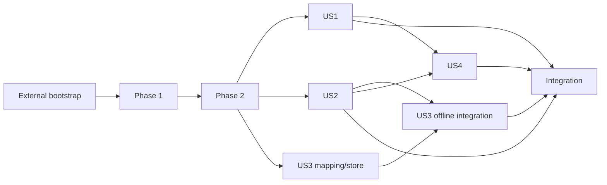

# Tasks: Core Game Foundation

**Input**: Approved artifacts in `specs/001-core-game-foundation/`

**Prerequisites**: `spec.md`, `plan.md`, `research.md`, `data-model.md`, `contracts/`, `quickstart.md`, architecture diagrams, and the constitution

**Tests**: Each MAQA issue must finish with its targeted tests green. A worker may use red/green TDD inside its issue, but no separate red-only issue may block the implementation issue.

**Implementation lane**: Feature 001 uses MAQA after the external Greenfield Bootstrap Prerequisite below. Canonical checklist entries are MAQA work packages. Every accepted prerequisite must be merged and pushed to `origin/main` before dependent workers start.

## Format: `[ID] [P?] [Story] Description`

- **[P]**: May run concurrently only after its dependencies and only with disjoint files/worktrees.
- **[US#]**: Maps the task to the corresponding user story in `spec.md`.
- Every task names its primary paths, validation, and relevant requirement coverage.

## External Greenfield Bootstrap Prerequisite

The parent agent owns this one-time repository preparation outside the Feature 001 MAQA issue set:

1. Through Unity tooling, pin Input System `1.20.0`, Newtonsoft JSON `3.2.2`, and Test Framework `1.8.0`; create Core, Unity, Edit Mode, and Play Mode assemblies plus non-empty smoke suites; implement `scripts/test-unity.ps1`; and prove full-suite, focused-file, deliberate-red, and restored-green execution.
2. Configure real full/file commands in `maqa-config.yml`, retain `tdd: false`, set `worktree_base: ".maqa-worktrees"`, ignore `/.maqa-worktrees/`, and prove that an isolated worktree can be added and removed without losing its commit.
3. Record exact commands, versions, counts, result/log paths, checkout-lock rules, and PASS reviews from DevOps, Architecture, Security, and Test/QA in `docs/testing/unity-test-harness.md`; merge and push the harness and approved planning artifacts to `origin/main`.

Do not run `$speckit-maqa-sync` or dispatch a feature worker until this prerequisite passes.

---

## Context Orchestration Process

### Parent Orchestrator Rules

- Execute work units in ledger order unless the ledger explicitly marks independent units as parallel candidates and their prerequisites are verified. Task-level `[P]` markers are local hints only.
- Task checkboxes remain the implementation completion checklist: a ledger unit is complete only when every referenced task is checked after parent verification. GitHub Issues remain the MAQA workflow-status authority; checkboxes never replace issue status.
- Use a clean agent session and one authoritative MAQA Issue/worktree for each work unit. Include the full handoff packet instead of relying on conversation history.
- Keep each agent inside the listed write scope. It must stop before changing an unassigned path or shared serialized asset.
- Require fail-first behavior for test tasks. For behavior tasks, require a failing targeted test before implementation where practical and a green targeted/full result before commit; never accept a red-only work unit.
- Inspect `git diff -- <unit paths>` plus every extra path reported by the worker; run targeted verification, reread affected public contracts, reject unrelated changes, and merge/push an accepted prerequisite to `origin/main` before dispatching a dependent unit.
- The parent owns integration and final validation and reruns completion gates even when another agent helps interpret results.

### Required Subagent Handoff Packet

Every assignment includes the role and review lens; MAQA Issue, exact task IDs, and work-unit IDs; exact task descriptions and file paths; authoritative spec, plan, model, contract, quickstart, and constitution sections; current accepted prerequisites; allowed edit paths and forbidden paths/tools; overlap constraints; Unity `6000.6.0f1`, target platforms/device class, and required Edit/Play validation; Art Bible/brief version for visual work; workload/baseline/metric/target for performance work; and exact validation commands.

The response must state changed paths, completed task IDs, tests/checks with results and evidence, expected failures, assumptions, unresolved risks, parent follow-up, and a clear done/blocked verdict. Review roles remain read-only and independent from the implementation they approve.

### Parent Verification Gate

For each unit, inspect `git diff -- <unit paths>` plus every extra path reported by the worker; confirm scope and justified adjacent changes; run the targeted Unity command or closest compile/review gate; and reread affected contracts/data-model sections for public boundary changes. Confirm generated directories, secrets, empirical evidence, source assets, persisted data, and shared Unity serialized files outside scope remain unchanged. Mark the task complete only after the exact committed artifact passes, its secondary lenses report no blocking finding, and the accepted commit is available to dependent work.

### Context Compaction Recovery

After compaction, reread this process, the ledger, and the checklist; run `git status --short` and inspect existing diffs. Resume at an earlier partially changed unit if one exists, otherwise at the first unit whose authoritative MAQA Issue is incomplete and whose prerequisites are accepted. Reconstruct state from GitHub Issue status, merged commits, informational checkboxes, diffs, and targeted tests. Finish and verify that unit before opening another agent or shared writer.

### Work Unit Ledger

| Unit | Phase | Tasks | Atomic scope and touched paths | Prerequisites | Required handoff sources | Parent verification |
|------|-------|-------|--------------------------------|---------------|--------------------------|---------------------|
| WU01 | Phase 1: Feature Setup | T001 | IDs and geometry in `Assets/IdleFactory/Core/Domain/Identifiers.cs`, `Assets/IdleFactory/Core/Domain/FactoryGeometry.cs`, and `Assets/IdleFactory/Tests/EditMode/DomainValueObjectTests.cs` | None | `spec.md`, `plan.md`, `data-model.md` | Run focused Edit Mode tests and inspect Core for Unity references |
| WU02 | Phase 1: Feature Setup | T002 | Immutable definitions/catalog in `Assets/IdleFactory/Core/Domain/Definitions.cs`, `Assets/IdleFactory/Core/Domain/DefinitionCatalog.cs`, and `Assets/IdleFactory/Tests/EditMode/DefinitionCatalogTests.cs` | WU01 | `spec.md`, `data-model.md`, `contracts/application-commands.md` | Run focused Edit Mode tests and verify policy/D001 invariants |
| WU03 | Phase 1: Feature Setup | T003 | Six content authoring/builder files in `Assets/IdleFactory/Unity/Content/` and `Assets/IdleFactory/Tests/EditMode/DefinitionCatalogBuilderTests.cs` | WU02 | `plan.md`, `data-model.md` | Run focused Edit Mode tests and verify immutable copy/no asset mutation |
| WU04 | Phase 1: Feature Setup | T004 | Six explicit development `.asset` files under `Assets/IdleFactory/Content/Development/` and `Assets/IdleFactory/Tests/EditMode/DevelopmentContentTests.cs` | WU03 | `spec.md`, `data-model.md`, `quickstart.md` | Run focused Edit Mode tests; inspect values, references, labels, and `.meta` files |
| WU05 | Phase 2: Foundational Core | T005 | Authoritative state in `Assets/IdleFactory/Core/Domain/FactoryState.cs` and `Assets/IdleFactory/Tests/EditMode/FactoryStateTests.cs` | WU04 | `spec.md`, `data-model.md` | Run focused Edit Mode tests and inspect atomic invariant enforcement |
| WU06 | Phase 2: Foundational Core | T006 | Application contracts, ports, session, doubles, and tests under `Assets/IdleFactory/Core/Application/` and `Assets/IdleFactory/Tests/EditMode/ApplicationContractTests.cs` | WU05 | `data-model.md`, `contracts/application-commands.md`, `contracts/persistence-v1.md` | Run focused Edit Mode tests and verify single-writer/admission rules |
| WU07 | Phase 2: Foundational Core | T007 | Deterministic factories in `Assets/IdleFactory/Tests/EditMode/Fixtures/FoundationFixtures.cs` | WU06 | `spec.md`, `data-model.md`, `research.md` | Run the complete foundational Edit Mode suite and inspect fixture-only scope |
| WU08 | Phase 3: User Story 1 — Navigate and Place Test Buildings (Priority: P1) 🎯 MVP | T008 | Placement domain and tests in `Assets/IdleFactory/Core/Domain/FactoryPlacement.cs` and `Assets/IdleFactory/Tests/EditMode/PlacementTests.cs` | WU07 | `spec.md`, `data-model.md` | Run focused Edit Mode tests for valid/invalid full footprints and zero mutation |
| WU09 | Phase 3: User Story 1 — Navigate and Place Test Buildings (Priority: P1) 🎯 MVP | T009 | Placement application boundary and tests in `Assets/IdleFactory/Core/Application/PlacementCommands.cs` and `Assets/IdleFactory/Tests/EditMode/PlacementApplicationTests.cs` | WU08 | `contracts/application-commands.md`, `data-model.md` | Run focused Edit Mode tests and verify selection stays presentation-owned |
| WU10 | Phase 3: User Story 1 — Navigate and Place Test Buildings (Priority: P1) 🎯 MVP | T010 | Versioned asset brief in `docs/art/F001-development-placeholders-v0.1.md` | WU07 | `spec.md`, `plan.md`, `quickstart.md` | Inspect every required inventory field, provenance rule, and development-only label |
| WU11 | Phase 3: User Story 1 — Navigate and Place Test Buildings (Priority: P1) 🎯 MVP | T011 | Independent brief review in `specs/001-core-game-foundation/reviews/f001-placeholder-brief-review.md` | WU10 | `docs/art/F001-development-placeholders-v0.1.md`, `spec.md` | Verify reviewer independence and an explicit PASS/FAIL verdict |
| WU12 | Phase 3: User Story 1 — Navigate and Place Test Buildings (Priority: P1) 🎯 MVP | T012 | Approved source assets under `Assets/IdleFactory/Art/Development/F001/Source/` | WU11 | Approved F001 brief and review | Inspect bounded asset inventory, formats, provenance, and no production-code changes |
| WU13 | Phase 3: User Story 1 — Navigate and Place Test Buildings (Priority: P1) 🎯 MVP | T013 | Independent source review in `specs/001-core-game-foundation/reviews/f001-placeholder-source-review.md` | WU12 | Approved F001 brief and source inventory | Verify every source asset is compared and verdict is independent |
| WU14 | Phase 3: User Story 1 — Navigate and Place Test Buildings (Priority: P1) 🎯 MVP | T014 | Imported assets, asset tests, and integration evidence under `Assets/IdleFactory/Art/Development/F001/Imported/`, `Assets/IdleFactory/Tests/EditMode/F001AssetContractTests.cs`, and `docs/art/F001-technical-art-integration.md` | WU13 | F001 brief/reviews, `plan.md` | Run focused Edit Mode asset tests and inspect importer/reference/`.meta` evidence |
| WU15 | Phase 3: User Story 1 — Navigate and Place Test Buildings (Priority: P1) 🎯 MVP | T015 | Input, camera, mapper, and Play tests under `Assets/IdleFactory/Unity/Input/`, `Assets/IdleFactory/Unity/Presentation/`, and `Assets/IdleFactory/Tests/PlayMode/NavigationInputTests.cs` | WU07 | `spec.md`, `plan.md`, `quickstart.md` | Run focused Play Mode tests across touch/mouse ownership and camera bounds |
| WU16 | Phase 3: User Story 1 — Navigate and Place Test Buildings (Priority: P1) 🎯 MVP | T016 | Factory views/UI and Play tests in `Assets/IdleFactory/Unity/Presentation/FactoryView.cs`, `Assets/IdleFactory/Unity/UI/CoreGameFoundation.uxml`, `Assets/IdleFactory/Unity/UI/CoreGameFoundation.uss`, and `Assets/IdleFactory/Tests/PlayMode/NavigationPlacementTests.cs` | WU09, WU14, WU15 | `spec.md`, `contracts/application-commands.md`, approved F001 artifacts | Run focused Play Mode tests and independent UI/UX review; inspect no domain rules in views |
| WU17 | Phase 3: User Story 1 — Navigate and Place Test Buildings (Priority: P1) 🎯 MVP | T017 | Runnable scene/bootstrap and US1 evidence in `Assets/IdleFactory/Scenes/CoreGameFoundation.unity`, `Assets/IdleFactory/Unity/Bootstrap/CoreGameFoundationBootstrap.cs`, and `specs/001-core-game-foundation/reviews/us1-placement-acceptance.md` | WU04, WU16 | `quickstart.md`, `spec.md`, accepted US1 units | Run US1 Play Mode/quickstart checks and inspect the scene diff through Unity |
| WU18 | Phase 4: User Story 2 — Run and Inspect Constrained Production (Priority: P1) | T018 | Production simulator and tests in `Assets/IdleFactory/Core/Simulation/ProductionSimulator.cs` and `Assets/IdleFactory/Tests/EditMode/ProductionSimulationTests.cs` | WU07 | `spec.md`, `plan.md`, `data-model.md`, `research.md` (HD-018), `contracts/application-commands.md` | Run focused Edit Mode tests for D001, blockers, rollback/retry, success→failure→capture(no candidate/summary)→retry, pre-first-capture exception, negative-time status precedence, partitions, detached snapshots, prepared/static equivalence and zero warmed allocations |
| WU19 | Phase 4: User Story 2 — Run and Inspect Constrained Production (Priority: P1) | T019 | Production commands/inspection and tests in `Assets/IdleFactory/Core/Application/ProductionCommands.cs`, `Assets/IdleFactory/Core/Application/FactorySession.cs`, and `Assets/IdleFactory/Tests/EditMode/ProductionApplicationTests.cs` | WU18 | `contracts/application-commands.md`, `data-model.md` | Run focused Edit Mode tests; verify persistent session ownership, external-command replacement/rejection, revision prevalidation before every state/session publication, overflow rollback, immutable capture and no stale state |
| WU20 | Phase 4: User Story 2 — Run and Inspect Constrained Production (Priority: P1) | T020 | Runtime host and Play tests in `Assets/IdleFactory/Unity/Bootstrap/FactoryRuntimeHost.cs` and `Assets/IdleFactory/Tests/PlayMode/FactoryRuntimeHostTests.cs` | WU19 | `plan.md`, `contracts/application-commands.md` | Run focused Play Mode tests and verify one cumulative clock/no per-building Update |
| WU21 | Phase 4: User Story 2 — Run and Inspect Constrained Production (Priority: P1) | T021 | Shared scene/UI, per-machine supply/removal/active controls, live inspector refresh, and Play tests in `Assets/IdleFactory/Scenes/CoreGameFoundation.unity`, `Assets/IdleFactory/Unity/UI/`, and `Assets/IdleFactory/Tests/PlayMode/ProductionInspectorTests.cs` | WU17, WU19, WU20 | `spec.md`, `quickstart.md`, `contracts/application-commands.md` | Run focused Play Mode cases for selected-instance supply/removal/toggle, every blocker, progress/capacity, and live refresh; inspect scene/UI diff, labels, and `.meta` files |
| WU22 | Phase 4: User Story 2 — Run and Inspect Constrained Production (Priority: P1) | T022 | US2 live-state evidence in `specs/001-core-game-foundation/reviews/us2-production-acceptance.md` | WU21 | `spec.md`, `quickstart.md`, accepted US2 commits | Reproduce live US2.1–9 behavior and stopped-time cases; record checkpoint-load inspector refresh as deferred to T028 |
| WU23 | Phase 5: User Story 3 — Save, Restore, and Apply Reduced Offline Production (Priority: P1) | T023 | Save DTO/mapper and tests under `Assets/IdleFactory/Unity/Persistence/` and `Assets/IdleFactory/Tests/EditMode/CheckpointMappingTests.cs` | WU07 | `data-model.md`, `contracts/persistence-v1.md`, `contracts/save-v1.schema.json` | Run focused Edit Mode tests and inspect every parser limit/validation order |
| WU24 | Phase 5: User Story 3 — Save, Restore, and Apply Reduced Offline Production (Priority: P1) | T024 | Generation store and tests in `Assets/IdleFactory/Unity/Persistence/JsonCheckpointStore.cs` and `Assets/IdleFactory/Tests/EditMode/CheckpointStoreTests.cs` | WU07 | `contracts/persistence-v1.md`, `research.md` | Run isolated-path failure-injection tests and inspect no repository/user data access |
| WU25 | Phase 5: User Story 3 — Save, Restore, and Apply Reduced Offline Production (Priority: P1) | T025 | Offline reconciler and tests in `Assets/IdleFactory/Core/Application/OfflineReconciler.cs` and `Assets/IdleFactory/Tests/EditMode/OfflineReconciliationTests.cs` | WU18 | `spec.md`, `data-model.md`, `contracts/application-commands.md` | Run focused Edit Mode tests for 4/5, cap, invalid UTC, rollback, exactly-once and retained detached offline candidate |
| WU26 | Phase 5: User Story 3 — Save, Restore, and Apply Reduced Offline Production (Priority: P1) | T026 | Persistence commands and fresh D001 reset in `Assets/IdleFactory/Core/Application/PersistenceCommands.cs`; cold-start/suspended lifecycle admission in `Assets/IdleFactory/Core/Application/FactorySession.cs`; application tests in `Assets/IdleFactory/Tests/EditMode/PersistenceApplicationTests.cs` | WU23, WU24, WU25 | Both contracts, `data-model.md`, `spec.md` | Run focused Edit Mode tests; verify Bootstrapping→Loading→Reconciling cold-start admission with `UsedFallback=false`, suspended FR-037 fallback distinction, no gameplay before durable resolution, zero-credit NoCheckpoint without fallback, fresh D001 reset/atomic failure, durable confirmation before RetryReturn or authoritative reload publication, and typed recovery failure handling |
| WU27 | Phase 5: User Story 3 — Save, Restore, and Apply Reduced Offline Production (Priority: P1) | T027 | UTC/lifecycle adapters and Play tests in `Assets/IdleFactory/Unity/Persistence/DeviceUtcClock.cs`, `Assets/IdleFactory/Unity/Bootstrap/ApplicationLifecycleAdapter.cs`, and `Assets/IdleFactory/Tests/PlayMode/LifecyclePersistenceTests.cs` | WU26 | `contracts/application-commands.md`, `contracts/persistence-v1.md` | Run focused Play Mode lifecycle tests and inspect blocked-return admission |
| WU28 | Phase 5: User Story 3 — Save, Restore, and Apply Reduced Offline Production (Priority: P1) | T028 | Shared scene/UI persistence presenter, checkpoint-load inspector refresh, and Play tests in `Assets/IdleFactory/Scenes/CoreGameFoundation.unity`, `Assets/IdleFactory/Unity/UI/`, and `Assets/IdleFactory/Tests/PlayMode/PersistenceUiTests.cs` | WU21, WU26, WU27 | `spec.md`, `quickstart.md`, application contract | Run focused Play Mode tests; verify loaded snapshot and stale-selection resolution; inspect UI states and no path/raw JSON disclosure |
| WU29 | Phase 5: User Story 3 — Save, Restore, and Apply Reduced Offline Production (Priority: P1) | T029 | Security review in `specs/001-core-game-foundation/reviews/persistence-security-review.md` | WU28 | Persistence implementation, contracts, `research.md` | Require independent Security/Privacy PASS/FAIL with concrete threat paths |
| WU30 | Phase 5: User Story 3 — Save, Restore, and Apply Reduced Offline Production (Priority: P1) | T051 | Stage candidate bytes separately, flush/close and strictly read back/validate before touching active or previous data; promote validated bytes through the existing data-slot/manifest protocol in `Assets/IdleFactory/Unity/Persistence/JsonCheckpointStore.cs` and `Assets/IdleFactory/Tests/EditMode/CheckpointStoreTests.cs` | WU29 | `spec.md`, `plan.md`, `research.md`, `contracts/persistence-v1.md`, `specs/001-core-game-foundation/reviews/persistence-security-review.md` | Run `powershell -NoProfile -ExecutionPolicy Bypass --% -File scripts/test-unity.ps1 -TestFile "Assets/IdleFactory/Tests/EditMode/CheckpointStoreTests.cs"`; verify successful initial save and failed first pending save reopen respectively as the saved checkpoint and NoCheckpoint; ordinary and recovery saves plus retries; inject every pending open/write/flush/close/partial/truncated/readback/validation failure, then reopen a fresh store after simulated storage loss and assert Active/Previous checkpoint IDs, generations, and complete serialized checkpoint contents are unchanged; with an existing dual manifest, ensure valid and corrupt orphan pending files are never auto-promoted on cold start and ReadActive/ReadPrevious still return the prior generations and complete serialized contents; load and promote an existing Save V1 JSON/dual-manifest fixture with expected Active/Previous; validate Previous before recovery and assert the recovery uses a new checkpoint ID/generation; after fresh reopen, verify interrupted ordinary promotion retains prior Active and interrupted recovery retains its Previous source; verify successful Active-to-Previous rotation. Require an independent Security/Privacy PASS on the exact committed T051 diff before accepting WU30; inspect scope and rerun validation if review changes the commit. |
| WU31 | Phase 5: User Story 3 — Save, Restore, and Apply Reduced Offline Production (Priority: P1) | T030 | US3 evidence in `specs/001-core-game-foundation/reviews/us3-persistence-offline-acceptance.md` | WU30 | `spec.md`, `quickstart.md`, persistence reviews | Require independent Security/Privacy PASS on the exact T051 commit before accepting this unit; then reproduce zero/nonzero/failure/partial-cycle cases and verify the FR/SC matrix for the committed US3 evidence. |
| WU32 | Phase 6: User Story 4 — Reproduce Simulation Independently of the View (Priority: P2) | T031 | Snapshot/checksum and equivalence tests in `Assets/IdleFactory/Core/Application/FactorySnapshot.cs` and `Assets/IdleFactory/Tests/EditMode/SimulationEquivalenceTests.cs` | WU22 | `spec.md`, `data-model.md` | Run focused Edit Mode property/table tests; compare prepared/static full state, ordered actions and snapshots retained across session reuse |
| WU33 | Phase 6: User Story 4 — Reproduce Simulation Independently of the View (Priority: P2) | T032 | View registry/recreation tests in `Assets/IdleFactory/Unity/Presentation/FactoryViewRegistry.cs` and `Assets/IdleFactory/Tests/PlayMode/ViewRecreationTests.cs` | WU17, WU32 | `spec.md`, `contracts/application-commands.md` | Run focused Play Mode tests and verify render cadence cannot mutate state |
| WU34 | Phase 6: User Story 4 — Reproduce Simulation Independently of the View (Priority: P2) | T033 | W001 test and raw report in `Assets/IdleFactory/Tests/EditMode/W001PerformanceTests.cs` and `specs/001-core-game-foundation/reviews/w001-performance.md` | WU22 | `plan.md`, `research.md`, `data-model.md`, `quickstart.md` | Run W001 on warmed session.Advance; verify full operation inside timing, separate allocation pass with 100 warmups/500 same-thread samples and every delta zero, preallocated measurement storage, setup/capture outside, workload, timing samples, p50/p95, runtime/backend record and checksum |
| WU35 | Phase 6: User Story 4 — Reproduce Simulation Independently of the View (Priority: P2) | T034 | Independent review in `specs/001-core-game-foundation/reviews/us4-determinism-performance-review.md` | WU32, WU33, WU34 | US4 tests/report, `plan.md`, `spec.md` | Require independent QA/Performance PASS/FAIL and stated Windows-baseline limits |
| WU36 | Phase 7: Integration, Specialist Gates, and Documentation | T035 | Integrate the development scene, persistence/lifecycle wiring, blocked-state gating, and isolated real-scene fixtures in `Assets/IdleFactory/Scenes/CoreGameFoundation.unity`, `Assets/IdleFactory/Unity/Bootstrap/CoreGameFoundationBootstrap.cs`, `Assets/IdleFactory/Unity/Bootstrap/ApplicationLifecycleAdapter.cs`, `Assets/IdleFactory/Unity/Bootstrap/FactoryRuntimeHost.cs`, `Assets/IdleFactory/Unity/UI/MachineInspectorPresenter.cs`, `Assets/IdleFactory/Unity/Presentation/FactoryHudDocument.cs`, `Assets/IdleFactory/Unity/Input/PlacementInputController.cs`, `Assets/IdleFactory/Tests/PlayMode/CoreGameFoundationSceneTests.cs`, `Assets/IdleFactory/Tests/PlayMode/SceneCompositionTestScope.cs`, `Assets/IdleFactory/Tests/PlayMode/FactoryRuntimeHostTests.cs`, `Assets/IdleFactory/Tests/PlayMode/ProductionInspectorTests.cs`, `Assets/IdleFactory/Tests/PlayMode/LifecyclePersistenceTests.cs`, and `Assets/IdleFactory/Tests/PlayMode/PersistenceUiTests.cs` | WU17, WU22, WU31, WU35 | `spec.md`, `plan.md`, `contracts/application-commands.md`, `contracts/persistence-v1.md`, `contracts/presentation-states.md`, `quickstart.md`, accepted US1–US4 evidence | Run focused `CoreGameFoundationSceneTests.cs` and complete Edit/Play suites; verify every PlayMode fixture that loads the authored scene uses isolated checkpoint storage, cold start reconciles before interaction, one FactorySession backs placement/production/persistence, active time flushes before suspension is recorded, ReturnBlocked gates all scene gameplay entrypoints including build/placement, inspector actions and runtime advancement, no placement preview or confirmation can be started while blocked, world replacement cancels preview/pointer state and resolves or clears selection, and the scene has no unrelated serialized changes |
| WU37 | Phase 7: Integration, Specialist Gates, and Documentation | T036 | Responsive/accessibility evidence in `specs/001-core-game-foundation/reviews/ui-ux-acceptance.md` and required viewport coverage in `Assets/IdleFactory/Tests/PlayMode/NavigationPlacementTests.cs` | WU36 | `spec.md`, `research.md` R15, `quickstart.md`, integrated scene | Run focused Play Mode layout/input/state tests and the configured Unity suites; verify 360×640/640×360, 390×844/844×390, 768×1024/1024×768, 1280×720 and 1920×1080, simulated safe areas, actual-control keyboard focus/activation, touch-target minimums, non-color state cues, and normal/loading/disabled/empty/error/recovery states; require independent UI/UX PASS/FAIL |
| WU38 | Phase 7: Integration, Specialist Gates, and Documentation | T037 | Art/Technical-Art evidence in `specs/001-core-game-foundation/reviews/f001-placeholder-final-review.md` | WU14, WU36 | F001 brief/reviews/integration and integrated scene | Require independent Art/Technical-Art PASS/FAIL and inspect references/import settings |
| WU39 | Phase 7: Integration, Specialist Gates, and Documentation | T038 | Add the authored development scene to `ProjectSettings/EditorBuildSettings.asset` if absent, then build Windows and attempt ARM64 Android emulator validation in `specs/001-core-game-foundation/reviews/windows-android-validation.md` | WU36 | `plan.md`, `quickstart.md`, runtime persistence contract, Unity build configuration | Verify only the intended scene is enabled; reproduce the Windows build; confirm the API 36 AVD exposes `arm64-v8a`, build an ARM64 Development Player and prove install/launch through the translation layer before touch/rotation/safe-area/lifecycle/persistence checks; if it cannot run, record exact evidence and leave Android runtime acceptance unresolved; never claim physical-device/release qualification |
| WU40 | Phase 9: Convergence | T052 | Player-build checkpoint remediation in `Assets/IdleFactory/Unity/Persistence/` (for example `SaveV1Mapper.cs`, `JsonCheckpointStore.cs`, a scoped `link.xml` only if proven), player-level regression tests, and `specs/001-core-game-foundation/reviews/player-persistence-remediation.md` | WU39 | `spec.md` FR-023/026/027/037, `contracts/`, `data-model.md`, `reviews/windows-android-validation.md` F1, `reviews/persistence-security-review.md` | Reproduce and then fix in Windows and Android IL2CPP player builds; the diagnostics must not expose player data; run full Edit and Play suites; Architecture, Security and QA reviews on the exact commit |
| WU41 | Phase 9: Convergence | T053 | Responsive HUD layout in `Assets/IdleFactory/Unity/UI/CoreGameFoundation.uss`/`.uxml`, HUD presenters, Play Mode layout-overlap tests, and `reviews/ui-ux-acceptance.md` | WU39 | `spec.md` FR-004/005, SC-005, `reviews/ui-ux-acceptance.md`, T038 F2 screenshots | Prove no panel overlap at `sw411dp` plus every T036 class; independent UI/UX Reviewer; full suites |
| WU42 | Phase 9: Convergence | T054 | Initial camera framing in `Assets/IdleFactory/Unity/Bootstrap/CoreGameFoundationBootstrap.cs`/`Assets/IdleFactory/Unity/Input/` camera controller and Play tests | WU41 | `spec.md` FR-004/005/028, `quickstart.md` D001, T038 F3 evidence | Confirm the machine is present before changing framing; authoritative state and checksums unchanged; the scene file has one writer at a time, sequenced after WU41 |
| WU43 | Phase 9: Convergence | T055 | Emulator rotation method and result in `reviews/windows-android-validation.md` | WU41, WU42 | T036 rotation matrix, `quickstart.md` section 5, emulator configuration | Evidence-only unless an isolated app defect requires a separate task; no physical-device claim |
| WU44 | Phase 9: Convergence | T056 | Post-build Graphics-API assertion in `Assets/IdleFactory/Editor/PlatformBuildCommands.cs` or its batch wrapper | WU39 | `plan.md` build reproducibility, Architect review of #38 | Run the GLES3 build and confirm the assertion passes and `ProjectSettings.asset` is unchanged; DevOps and Architecture review |
| WU45 | Phase 9: Convergence | T058 | Runtime rotation in the Android player: the proven orientation fix in Android player settings (`ProjectSettings/ProjectSettings.asset`) or project code under `Assets/IdleFactory/Unity/`, Play tests for rotation handling, and the rotation matrix in `reviews/windows-android-validation.md` | WU41, WU42, WU43 | `spec.md` SC-005, T036 rotation matrix, T055 isolated blocker in `reviews/windows-android-validation.md`, `quickstart.md` section 5, emulator configuration | Confirm the root cause before changing settings; `ProjectSettings.asset` diff limited to the proven orientation change; authoritative state and checksums unchanged across rotation; emulator-only labeling; UI/UX Reviewer and Test/QA verdicts |
| WU46 | Phase 9: Convergence | T059 | Landscape HUD column overflow in `Assets/IdleFactory/Unity/UI/CoreGameFoundation.uss`/`.uxml`, HUD presenters, Play Mode layout-overlap/clipping tests, and `reviews/ui-ux-acceptance.md` | WU45 | `spec.md` FR-004/005, SC-005, `reviews/ui-ux-acceptance.md` T036/T053 matrices, T058-F1 in `reviews/windows-android-validation.md` and `test-results/android/t058/shots/07-landscape-after-held-pan.png` | Reproduce with the longest HUD state (Machine inspector plus Durable offline return) on every T036 class before changing layout; no overlap or clipping of HUD panels and all tap targets reachable; independent UI/UX Reviewer; full suites |
| WU47 | Phase 9: Convergence | T060 | Suppress the Durable offline return summary for rotation-induced returns in the lifecycle/return path (`Assets/IdleFactory/Unity/Bootstrap/`, `Assets/IdleFactory/Unity/UI/PersistencePresenter.cs` or the owning application boundary), Play Mode lifecycle tests, and `reviews/windows-android-validation.md` | WU46 | `spec.md` FR-036/FR-037 and Clarifications Session 2026-09-27, T058 lifecycle side effect in `reviews/windows-android-validation.md` | Confirm the Android rotation lifecycle signals before changing code; genuine suspend/lock/return and cold start still show the summary; checkpoint and exactly-once accounting unchanged unless an Architect decision is recorded; emulator-only labeling; Software Architect, UI/UX Reviewer and Test/QA verdicts |
| WU48 | Phase 9: Convergence | T057 | Repeat the T038 Android runtime journey and append the results to `reviews/windows-android-validation.md` | WU40, WU41, WU42, WU43, WU44, WU45, WU46, WU47 | T038 task text, `quickstart.md` section 5, prior report | Fail-fast install/launch; every check PASS or exact blocker; emulator-only labeling; QA, Product Owner and UI/UX verdicts |
| WU49 | Phase 9: Convergence | T061 | Render the restored factory after a cold start from a checkpoint in the cold-start composition path (`Assets/IdleFactory/Unity/Bootstrap/CoreGameFoundationBootstrap.cs` or the owning presentation boundary), Play Mode cold-start tests, and `reviews/windows-android-validation.md` | WU48 | `spec.md` FR-026/FR-036 and US3, T057-F2 and `t057-evidence/` in `reviews/windows-android-validation.md` | Reproduce and confirm the root cause before changing code; a Play Mode test that restores a real checkpoint at cold start and asserts rendered building views without any input; authoritative state, checkpoints and offline accounting unchanged; Android emulator and Windows player evidence; Software Architect and Test/QA verdicts |
| WU50 | Phase 9: Convergence | T062 | Keep world state badges and the Browse selection summary current after simulation-driven state changes in `Assets/IdleFactory/Unity/Presentation/FactoryView.cs`, the HUD selection presenter and Play Mode presentation tests, plus `reviews/windows-android-validation.md` | WU49 | `spec.md` FR-005, `contracts/presentation-states.md`, T057-F1 in `reviews/windows-android-validation.md` | Refresh only on an actual presentation-relevant state change, not a full rebuild every tick; a Play Mode test that a production-driven change updates badge and summary without a new selection; no per-tick allocation regression on the W001 fixture; emulator evidence; UI/UX Reviewer, Performance and Test/QA verdicts |
| WU51 | Phase 7: Integration, Specialist Gates, and Documentation | T040 | Repeatable exploratory Android ARM64-on-emulator profile in `specs/001-core-game-foundation/reviews/mobile-performance.md` | WU39, WU48, WU49, WU50 | `plan.md`, `research.md`, integrated scene, T035 development scene/checkpoint, T038 build/evidence | On the same named emulator after successful T038 launch, repeat three runs of fixed-checkpoint restore → 30-second no-input warm-up → capture-start state record → 60-second capture; record checkpoint identity, factory contents at each capture start, AVD/translation details, Unity/build settings and raw evidence; compare only matching starts, mark the profile exploratory, leave unavailable metrics explicit, and make no physical-device/release claim or mobile pass-threshold claim |
| WU52 | Phase 9: Convergence | T063 | Allocation-free machine-inspector polling in `Assets/IdleFactory/Unity/UI/MachineInspectorPresenter.cs` using allocation-free application queries (`Assets/IdleFactory/Core/Application/PlacementCommands.cs` or `ProductionCommands.cs`), W001-scale Edit/Play Mode allocation and behavior tests, and `reviews/mobile-performance.md` | WU51 | `spec.md` FR-014/FR-017/FR-021, `plan.md` Performance Goals, T040-F1 in `reviews/mobile-performance.md` | Confirm the O(N²) poll cost with a W001 measurement before changing code; zero managed allocations for an unchanged-revision or no-selection poll and no machine-count-proportional allocation on a revision change at W001 scale; host enablement and live inspector refresh unchanged; producing-path per-tick allocation measured and fixed or recorded; full configured Edit/Play Mode suites; Software Architect, Performance and Test/QA verdicts |
| WU53 | Phase 9: Convergence | T064 | Unity Profiler (Standalone Process) procedure for the Android emulator player in `docs/integrations/` and a comparable three-run Unity-side emulator set in `reviews/mobile-performance.md` | WU52 | T040-F2 and the T040 protocol in `reviews/mobile-performance.md`, `reviews/t040-evidence/capture-protocol.ps1`, spec Clarifications Session 2026-09-28 | Exclusive emulator use with verified APK hash and device checkpoint before each run; matching capture-start state hashes across three runs with the standalone profiler attached, or the exact recorded blocker; profiler-attached frame times labelled distorted; no threshold; Performance, DevOps/Operations and Test/QA verdicts |
| WU54 | Phase 9: Convergence | T065 | Explicit 60 FPS frame-rate target at the Unity presentation/bootstrap boundary (`Assets/IdleFactory/Unity/Bootstrap/CoreGameFoundationBootstrap.cs` or the owning presentation component), a Play Mode test that the target is applied, and frame-pacing evidence in `reviews/mobile-performance.md` | WU53 | spec Clarifications Session 2026-09-28 and FR-017, `plan.md` Performance Goals, T040 frame-pacing runs F1–F3 in `reviews/mobile-performance.md` | Three matching-start runs plus a same-session 30 FPS control with `capture-protocol.ps1 -CaptureFrameTimeStats`; average FPS and p50/p95/p99 present intervals reported against the 60 FPS target, or the measured limiting cause recorded; production yields independent of frame rate; full configured Edit/Play Mode suites; Performance, Software Architect, UI/UX and Test/QA verdicts |
| WU55 | Phase 7: Integration, Specialist Gates, and Documentation | T041 | Final acceptance matrix in `specs/001-core-game-foundation/reviews/final-acceptance.md` | WU37, WU38, WU39, WU51, WU48, WU49, WU50, WU52, WU53, WU54 | All feature artifacts, `quickstart.md`, constitution | Rerun full Edit/Play suites and quickstart; inspect console and all 47 requirement links; characterize Android results as emulator-only development evidence, leave physical-device/release qualification unverified, and record the open/blocked T039 iOS deferral without claiming iOS validation |
| WU56 | Phase 8: Post-Foundation JSON Content Authoring Migration | T042 | Versioned content contract and schema in `docs/content/json-content-pipeline.md` and `Assets/IdleFactory/Content/Schemas/gameplay-content-v1.schema.json` | WU55 | Separate migration spec, resolved clarification gate, plan, tasks, analysis and validated ledger; accepted foundation closeout; existing T042 issue | Before dispatch require the separate JSON migration's specify/clarify/plan/tasks/analyze lifecycle and its own validated ledger; document if clarification finds no open questions; reconcile the existing issue without duplication; then review schema, stable-ID/Save V1 rules, human/AI editing examples and future-extension boundaries |
| WU57 | Phase 8: Post-Foundation JSON Content Authoring Migration | T043 | Strict JSON DTO parsing and schema tests in `Assets/IdleFactory/Unity/Content/JsonContentDtos.cs`, `Assets/IdleFactory/Unity/Content/JsonContentReader.cs`, and `Assets/IdleFactory/Tests/EditMode/JsonContentSchemaTests.cs` | WU56 | Content contract/schema, `data-model.md`, `plan.md` | Run focused Edit Mode schema/parse tests for malformed, duplicate, missing, unknown, type, range and size failures |
| WU58 | Phase 8: Post-Foundation JSON Content Authoring Migration | T044 | Semantic validation and catalog mapping in `Assets/IdleFactory/Unity/Content/JsonDefinitionCatalogBuilder.cs` and `Assets/IdleFactory/Tests/EditMode/JsonDefinitionCatalogBuilderTests.cs` | WU57 | Content contract/schema, `data-model.md`, existing Core catalog | Run focused Edit Mode graph/immutability tests; inspect no Unity dependency added to Core and no partial publication |
| WU59 | Phase 8: Post-Foundation JSON Content Authoring Migration | T045 | Migrated development content and parity tests in `Assets/IdleFactory/Content/Development/development-catalog.json` and `Assets/IdleFactory/Tests/EditMode/JsonDevelopmentContentTests.cs` | WU58 | Existing development assets, `spec.md`, `data-model.md` | Run focused Edit Mode catalog parity tests for all D001 IDs, values and policies; preserve a baseline independent of retired assets |
| WU60 | Phase 8: Post-Foundation JSON Content Authoring Migration | T046 | Unity bootstrap switch and Play tests in `Assets/IdleFactory/Unity/Bootstrap/CoreGameFoundationBootstrap.cs`, `Assets/IdleFactory/Scenes/CoreGameFoundation.unity`, and `Assets/IdleFactory/Tests/PlayMode/JsonContentBootstrapTests.cs` | WU59 | Content contract, `quickstart.md`, existing scene/bootstrap | Run focused Play Mode startup/failure tests; inspect serialized scene diff and single-source catalog publication |
| WU61 | Phase 8: Post-Foundation JSON Content Authoring Migration | T047 | Save V1 and simulation regression tests in `Assets/IdleFactory/Tests/EditMode/JsonContentCompatibilityTests.cs` and `Assets/IdleFactory/Tests/PlayMode/JsonContentPersistenceTests.cs` | WU60 | `contracts/persistence-v1.md`, `spec.md`, D001/W001 fixtures | Run focused Edit/Play tests with existing V1 checkpoints and deterministic continuation; reject incompatible content without mutation |
| WU62 | Phase 8: Post-Foundation JSON Content Authoring Migration | T048 | Retire gameplay ScriptableObject authority in `Assets/IdleFactory/Unity/Content/`, `Assets/IdleFactory/Content/Development/`, `Assets/IdleFactory/Tests/EditMode/`, and `Assets/IdleFactory/Tests/PlayMode/` | WU61 | Accepted JSON bootstrap and compatibility tests, `plan.md` | Inspect all gameplay content consumers, legacy tests and `.meta` changes; run focused Edit/Play tests proving JSON is the sole gameplay source and presentation references remain valid |
| WU63 | Phase 8: Post-Foundation JSON Content Authoring Migration | T049 | Independent migration reviews in `specs/001-core-game-foundation/reviews/json-content-migration-review.md` | WU62 | Exact committed migration, content contract, `spec.md`, `plan.md` | Require independent Product, Architecture, Game Systems, QA, Security and applicable UI/UX/Technical Art PASS/FAIL evidence |
| WU64 | Phase 8: Post-Foundation JSON Content Authoring Migration | T050 | Final migrated-content acceptance in `specs/001-core-game-foundation/reviews/json-content-final-acceptance.md` | WU63 | `quickstart.md`, final foundation acceptance, migration reviews | Rerun full Unity Edit/Play suites, console, D001 journeys, Windows build and ARM64 Player attempt on the API 36 x86_64 AVD; mark evidence emulator-only and retain physical-device/release and iOS limitations |

## Phase 1: Feature Setup

**Purpose**: Establish engine-free definitions and Unity authoring content needed by all stories.

- [X] T001 Implement normalized identifiers, checked grid geometry, positive footprints, and deterministic row-major occupied cells with final-green boundary tests in `Assets/IdleFactory/Core/Domain/Identifiers.cs`, `Assets/IdleFactory/Core/Domain/FactoryGeometry.cs`, and `Assets/IdleFactory/Tests/EditMode/DomainValueObjectTests.cs`
- [X] T002 Implement immutable resource, recipe, building, buffer, and offline-policy definitions plus graph validation with final-green tests for required/unique IDs, references, positive amounts/durations, capacities, supported orientation, and policy revision `1 = 4/5, 288000000000 ticks` in `Assets/IdleFactory/Core/Domain/Definitions.cs`, `Assets/IdleFactory/Core/Domain/DefinitionCatalog.cs`, and `Assets/IdleFactory/Tests/EditMode/DefinitionCatalogTests.cs`
- [X] T003 Implement `ResourceDefinitionAsset`, `RecipeDefinitionAsset`, `BuildingDefinitionAsset`, `OfflinePolicyAsset`, `DefinitionCatalogAsset`, and a validated `DefinitionCatalogBuilder` that copies authored data into immutable Core definitions without retaining mutable asset authority, with final-green Edit Mode tests in `Assets/IdleFactory/Unity/Content/ResourceDefinitionAsset.cs`, `Assets/IdleFactory/Unity/Content/RecipeDefinitionAsset.cs`, `Assets/IdleFactory/Unity/Content/BuildingDefinitionAsset.cs`, `Assets/IdleFactory/Unity/Content/OfflinePolicyAsset.cs`, `Assets/IdleFactory/Unity/Content/DefinitionCatalogAsset.cs`, `Assets/IdleFactory/Unity/Content/DefinitionCatalogBuilder.cs`, and `Assets/IdleFactory/Tests/EditMode/DefinitionCatalogBuilderTests.cs`
- [X] T004 Author and validate the development-only assets `Assets/IdleFactory/Content/Development/Resources/dev.input.asset`, `Assets/IdleFactory/Content/Development/Resources/dev.output.asset`, `Assets/IdleFactory/Content/Development/Recipes/D001.asset`, `Assets/IdleFactory/Content/Development/Buildings/D001.asset`, `Assets/IdleFactory/Content/Development/OfflinePolicies/revision-1.asset`, and `Assets/IdleFactory/Content/Development/DevelopmentCatalog.asset`, including stable IDs, references, values, and every required `.meta`, with final-green tests in `Assets/IdleFactory/Tests/EditMode/DevelopmentContentTests.cs`

**Checkpoint**: Versioned authoring assets resolve into a valid immutable Core catalog.

---

## Phase 2: Foundational Core

**Purpose**: Establish authoritative state, application boundaries, and deterministic fixtures shared by every story.

- [X] T005 Implement instance-owned `ResourceBufferState`, `ProductionState`, `BuildingInstanceState`, and `FactoryState` with atomic invariant enforcement, immutable resolvable references, reconstructed occupancy, and derived blockers, with final-green tests in `Assets/IdleFactory/Core/Domain/FactoryState.cs` and `Assets/IdleFactory/Tests/EditMode/FactoryStateTests.cs`
- [X] T006 Define typed command outcomes, immutable factory/inspection/offline projections, clock and checkpoint ports, the application-owned `FactorySession`, and test doubles with final-green admission/state-ownership tests in `Assets/IdleFactory/Core/Application/Contracts.cs`, `Assets/IdleFactory/Core/Application/Ports.cs`, `Assets/IdleFactory/Core/Application/FactorySession.cs`, and `Assets/IdleFactory/Tests/EditMode/ApplicationContractTests.cs`
- [X] T007 Build validated D001, alternate-footprint, multi-cycle, negative-coordinate, and W001 definition/state factories without Unity objects and run the complete foundational Edit Mode suite in `Assets/IdleFactory/Tests/EditMode/Fixtures/FoundationFixtures.cs`

**Checkpoint**: Plain C# definitions and state are independently constructible; invalid candidates never partially mutate live state.

---

## Phase 3: User Story 1 — Navigate and Place Test Buildings (Priority: P1) 🎯 MVP

**Goal**: Pan and zoom the development factory, preview a complete footprint, place valid buildings, reject invalid placement, and inspect independent identities.

**Independent Test**: In the runnable development scene without production or persistence, complete US1.1–7 with touch and desktop inputs; rejected placement changes no identity, occupancy, or resource state.

- [X] T008 [US1] Implement transactional full-footprint placement, overlap/out-of-bounds rejection, independent IDs, alternate bounds/footprints, and zero mutation on failure with final-green Edit Mode tests covering FR-001–003/031 and SC-001 in `Assets/IdleFactory/Core/Domain/FactoryPlacement.cs` and `Assets/IdleFactory/Tests/EditMode/PlacementTests.cs`
- [X] T009 [US1] Implement `PlaceBuilding`, placement-preview, snapshot, and selection-safe queries with typed rejection and final-green application tests; keep selection ownership outside Core state in `Assets/IdleFactory/Core/Application/PlacementCommands.cs` and `Assets/IdleFactory/Tests/EditMode/PlacementApplicationTests.cs`
- [X] T010 [P] [US1] Write the structured `F001-Development-Placeholders v0.1` inventory with IDs/types, logical footprints or `N/A`, ports `none/N/A`, power state `N/A`, visual states, pixel targets, format, pivot/cell mapping, output paths, provenance, generator/version, and `Art Bible: N/A` in `docs/art/F001-development-placeholders-v0.1.md`
- [X] T011 [US1] Record independent Art Director PASS or blocking findings for the complete F001 inventory before asset production in `specs/001-core-game-foundation/reviews/f001-placeholder-brief-review.md`
- [X] T012 [US1] Produce only approved geometric grid, building, ghost, resource, and non-color state-symbol source assets with recorded provenance in `Assets/IdleFactory/Art/Development/F001/Source/`
- [X] T013 [US1] Record independent Art Director comparison of every produced source asset against the approved inventory and readability goals in `specs/001-core-game-foundation/reviews/f001-placeholder-source-review.md`
- [X] T014 [US1] Import only approved sources; configure pixels-per-unit, pivots, sorting, compression, references, and `.meta` files; add final-green asset-contract tests and zoom/memory evidence in `Assets/IdleFactory/Art/Development/F001/Imported/`, `Assets/IdleFactory/Tests/EditMode/F001AssetContractTests.cs`, and `docs/art/F001-technical-art-integration.md`
- [X] T015 [P] [US1] Create Input System actions, UI-pointer ownership, semantic touch/mouse intents, bounded orthographic pan/zoom, and logical-grid/world mapping with final-green Play Mode tests covering FR-004–006 and SC-005/006 in `Assets/IdleFactory/Unity/Input/`, `Assets/IdleFactory/Unity/Presentation/FactoryCameraController.cs`, `Assets/IdleFactory/Unity/Presentation/GridWorldMapper.cs`, and `Assets/IdleFactory/Tests/PlayMode/NavigationInputTests.cs`
- [X] T016 [US1] Implement factory/grid/building/ghost views and UI Toolkit browse/build/selection states using explicit application contracts and only approved imported assets, with final-green Play Mode tests in `Assets/IdleFactory/Unity/Presentation/FactoryView.cs`, `Assets/IdleFactory/Unity/UI/CoreGameFoundation.uxml`, `Assets/IdleFactory/Unity/UI/CoreGameFoundation.uss`, and `Assets/IdleFactory/Tests/PlayMode/NavigationPlacementTests.cs`
- [X] T017 [US1] Assemble a minimal runnable US1 development scene and bootstrap, then record US1.1–7 acceptance for desktop/touch, cancellation, empty selection, orientation/focus interruption, and view recreation in `Assets/IdleFactory/Scenes/CoreGameFoundation.unity`, `Assets/IdleFactory/Unity/Bootstrap/CoreGameFoundationBootstrap.cs`, and `specs/001-core-game-foundation/reviews/us1-placement-acceptance.md`

**Checkpoint**: US1 is runnable and independently testable without production or persistence.

---

## Phase 4: User Story 2 — Run and Inspect Constrained Production (Priority: P1)

**Goal**: Supply a machine, advance deterministic production, observe every blocker, and resume only after the real condition is resolved.

**Independent Test**: From a preconfigured D001 machine, reproduce US2.1–9 and exact 2-input → 1-output / 5-second balances without placement or persistence.

- [X] T018 [US2] Implement HD-018 preparation, reusable session advancement with zero warmed managed allocations, explicit detached result capture, and the compatible allocating static API through one calculation path; retain cycle-boundary bulk advancement with checked Int64 100 ns ticks, whole-factory prevalidation/commit, completion-time atomic input/output booking, retained partial progress, discarded blocked/inactive elapsed time, and final-green tests for D001's exact 2-input → 1-output exchange after 5 productive seconds, the unchanged 2.5-second resource checkpoint, blockers, overflow, multiple cycles, partition equivalence, rollback, late-machine failure followed by valid retry, capture-before-first-advance throwing `InvalidOperationException`, success→failure→capture with no candidate/summary→valid retry→new successful capture, successful snapshot retention across reuse, negative-time `InvalidElapsedTicks` precedence before invalid-factory validation, prepared/static equivalence, and direct warmed allocation measurement covering FR-011–013/017–020 and SC-002/003/006 in `Assets/IdleFactory/Core/Simulation/ProductionSimulator.cs` and `Assets/IdleFactory/Tests/EditMode/ProductionSimulationTests.cs`
- [X] T019 [US2] Implement explicit `SetBuildingActive`, `AddResource`, `RemoveResource`, and `AdvanceSimulation` commands plus immutable inspection of every blocker; retain the prepared simulation session across advances, capture complete command results, prepare replacement sessions from current committed state before accepted external/world changes, compute the next revision with checked arithmetic before every state/session publication, and test rejection, overflow rollback preserving factory/session/revision, stale-session and snapshot isolation, with final-green application tests in `Assets/IdleFactory/Core/Application/ProductionCommands.cs`, `Assets/IdleFactory/Core/Application/FactorySession.cs`, and `Assets/IdleFactory/Tests/EditMode/ProductionApplicationTests.cs`
- [X] T020 [P] [US2] Implement one cumulative active-time runtime host that converts elapsed time once, never adds per-building `Update`, and pauses on lifecycle loss, with final-green Play Mode tests in `Assets/IdleFactory/Unity/Bootstrap/FactoryRuntimeHost.cs` and `Assets/IdleFactory/Tests/PlayMode/FactoryRuntimeHostTests.cs`
- [X] T021 [US2] After accepted T017, T019, and T020, extend the same development scene and UI with clearly labeled per-machine input-supply, output-removal, and active/inactive controls; inspection for producing, missing-input, full-output, inactive, combined-blocker, progress, and capacity states; and live refresh after production and accepted controls. Verify deactivation retains resources/progress and stops advancement, and reactivation resumes only when unblocked. Defer checkpoint-load refresh to T028. Add final-green Play Mode tests in `Assets/IdleFactory/Scenes/CoreGameFoundation.unity`, `Assets/IdleFactory/Unity/UI/CoreGameFoundation.uxml`, `Assets/IdleFactory/Unity/UI/CoreGameFoundation.uss`, `Assets/IdleFactory/Unity/UI/MachineInspectorPresenter.cs`, and `Assets/IdleFactory/Tests/PlayMode/ProductionInspectorTests.cs`
- [X] T022 [US2] Record D001, multi-cycle, one-hour/24-hour/seven-day stopped-time, independent-instance, live view-refresh, and US2.1–9 acceptance evidence for FR-007–021 and SC-002/003/006 in `specs/001-core-game-foundation/reviews/us2-production-acceptance.md`; checkpoint-load inspector refresh is evidenced by T028 after persistence UI is available

**Checkpoint**: US2 works from fixtures and in the scene without presentation owning simulation state.

---

## Phase 5: User Story 3 — Save, Restore, and Apply Reduced Offline Production (Priority: P1)

**Goal**: Persist coherent state locally, restore it safely, and apply the versioned 80%/eight-hour offline rule exactly once with explicit recovery.

**Independent Test**: Save ready, partial, blocked, and inactive fixtures; restore with controlled UTC; inject every write-boundary failure; and verify no invalid candidate or duplicate reward is published.

- [X] T023 [US3] Implement strict required-member Save V1 DTO mapping and fresh-candidate validation with final-green tests for schema `1`, Int32 coordinates, positive dimensions/revision, nonnegative quantities/capacities/progress/generation, UUIDs, UTC range, ≤16 MiB, ≤100000 buildings, ≤256 entries/buffer, IDs ≤128 UTF-16 units, unknown/duplicate members and IDs, references, overlap, orientation/policy/catalog compatibility, and invalid progress without clamping or live mutation in `Assets/IdleFactory/Unity/Persistence/SaveV1Dtos.cs`, `Assets/IdleFactory/Unity/Persistence/SaveV1Mapper.cs`, and `Assets/IdleFactory/Tests/EditMode/CheckpointMappingTests.cs`
- [X] T024 [US3] Implement application-owned pending/active/previous generation storage, flush/readback, verified promotion, abandoned-pending handling, and explicit previous recovery with final-green injected failures before/during/after every boundary in `Assets/IdleFactory/Unity/Persistence/JsonCheckpointStore.cs` and `Assets/IdleFactory/Tests/EditMode/CheckpointStoreTests.cs`
- [X] T025 [US3] Implement policy-revision lookup and checked rational offline calculation through the same `ProductionSimulator` calculation path, capturing an independent offline candidate/summary that remains unchanged across session reuse and is unpublished until durable promotion, with final-green tests for 0 s, 1 s→0.8 s, 6.25 s→5 s, 8 h/24 h→6.4 h, blockers, partial progress, partitions, invalid UTC, FR-037 fallback, retry idempotency, and whole-candidate rollback covering FR-022–027/032–037 and SC-004/007/009/010 in `Assets/IdleFactory/Core/Application/OfflineReconciler.cs` and `Assets/IdleFactory/Tests/EditMode/OfflineReconciliationTests.cs`
- [X] T026 [US3] Implement `SaveNow`, zero-offline `LoadDevelopmentCheckpoint`, `RecordSuspension`, `ResumeAndReconcile`, `RetryReturn`, `ReloadAuthoritativeGeneration`, `RecoverPreviousCheckpoint`, and `ResetDevelopmentScenario` exactly as defined by the application contract, including typed persistence status, measured/credited/effective time, actual resource deltas, limiting reasons, durable-before-publication semantics, and fresh D001 reset with live-state retention on setup failure; make cold-start `ResumeAndReconcile` enter legally from a prepared `Bootstrapping` session through `Loading` into `Reconciling`, report `UsedFallback=false` for cold-start selection of the active generation, preserve the explicit in-process FR-037 fallback signal, keep gameplay unavailable until durable resolution, and retain the prepared live scenario with zero credit and `UsedFallback=false` when no checkpoint exists. `RetryReturn` must durably confirm a matching active candidate before publication and remain blocked if confirmation fails; `ReloadAuthoritativeGeneration` has the same confirmation requirement. Test cold start, suspended returns, retry/reload confirmation, recovery, and failures in `Assets/IdleFactory/Core/Application/PersistenceCommands.cs`, `Assets/IdleFactory/Core/Application/FactorySession.cs`, and `Assets/IdleFactory/Tests/EditMode/PersistenceApplicationTests.cs`
- [X] T027 [US3] Implement `DeviceUtcClock` and normalized pause/focus/quit handling that binds successful departure IDs or FR-037 fallback, disables background simulation, and blocks gameplay during unresolved return, with final-green Play Mode lifecycle tests in `Assets/IdleFactory/Unity/Persistence/DeviceUtcClock.cs`, `Assets/IdleFactory/Unity/Bootstrap/ApplicationLifecycleAdapter.cs`, and `Assets/IdleFactory/Tests/PlayMode/LifecyclePersistenceTests.cs`
- [X] T028 [US3] After accepted T021, T026, and T027, extend the same scene and UI with save/load/scenario-reset/recovery controls and durable offline-result presentation for no-save, saving, load, failure, recovery, pending/blocked return, invalid time, fallback warning, measured/credited/effective time, actual resource deltas, limiting reasons, and stale-selection cancellation without path/raw-JSON disclosure. Verify a successful checkpoint load refreshes inspection from the loaded snapshot and resolves or clears stale selection. Add final-green Play Mode tests in `Assets/IdleFactory/Scenes/CoreGameFoundation.unity`, `Assets/IdleFactory/Unity/UI/CoreGameFoundation.uxml`, `Assets/IdleFactory/Unity/UI/CoreGameFoundation.uss`, `Assets/IdleFactory/Unity/UI/PersistencePresenter.cs`, and `Assets/IdleFactory/Tests/PlayMode/PersistenceUiTests.cs`
- [X] T029 [US3] Perform an independent Security/Privacy review of parser limits, path ownership, definition trust, generation integrity, diagnostics, retry/idempotency, clock scope, and persisted-player data; record a PASS/FAIL verdict in `specs/001-core-game-foundation/reviews/persistence-security-review.md`
- [X] T051 [US3] After T029 and before T030, isolate candidate checkpoint writes from the current active/previous data: write and flush/close a separate pending file, strictly read it back and validate it, then promote only validated bytes through the existing data-slot/manifest protocol; ignore stale or corrupt pending files on cold start, preserve Save V1 JSON and read existing manifests, and test successful initial save plus a failed first pending save reopening as no checkpoint; ordinary and recovery saves plus retries; each pending open/write/flush/close/partial/truncated/readback/validation failure preserving Active and Previous by expected checkpoint ID, generation, and complete serialized checkpoint content when a fresh store reopens after simulated storage loss; valid and corrupt orphan pending files with an existing dual manifest never being auto-promoted on cold start, with ReadActive and ReadPrevious still returning their prior generations and complete serialized checkpoint content; loading and then promoting a fixture in the existing Save V1 JSON and dual-manifest format with expected Active/Previous; explicit Previous validation followed by recovery under a new checkpoint ID/generation; promotion or manifest interruption leaving the prior Active readable after an ordinary save and the Previous source readable after recovery through a fresh store; and successful active-to-previous rotation in `Assets/IdleFactory/Unity/Persistence/JsonCheckpointStore.cs` and `Assets/IdleFactory/Tests/EditMode/CheckpointStoreTests.cs`
- [X] T030 [US3] Record immediate zero-offline roundtrips for ready/partial/blocked/inactive state, a partial cycle crossing save/load, negative-coordinate roundtrip, strict rejection, continuation, failure injection, exactly-once, invalid-clock, fallback, and offline-result acceptance for FR-022–027/032–037 and SC-004/006/007/009/010 in `specs/001-core-game-foundation/reviews/us3-persistence-offline-acceptance.md`

**Checkpoint**: US3 is reproducible from controlled fixtures; uncommitted state or reward is never presented as successful.

---

## Phase 6: User Story 4 — Reproduce Simulation Independently of the View (Priority: P2)

**Goal**: Prove state equivalence across time partitions and view recreation, and measure the declared Core workload.

- [X] T031 [US4] Implement deterministic semantic snapshots/checksums and final-green property/table tests for complete-state partition equivalence, cycle boundaries, stopped intervals, ordered external actions, invalid elapsed values, prepared/static path equivalence, detached snapshots across at least two later advances, stale-session prevention after external actions, and view-independent state covering FR-017–021 and SC-003/006 in `Assets/IdleFactory/Core/Application/FactorySnapshot.cs` and `Assets/IdleFactory/Tests/EditMode/SimulationEquivalenceTests.cs`
- [X] T032 [US4] Implement idempotent full view rebuild plus selection re-resolution/clear behavior and prove destroy/recreate equivalence at varied refresh schedules with final-green Play Mode tests in `Assets/IdleFactory/Unity/Presentation/FactoryViewRegistry.cs` and `Assets/IdleFactory/Tests/PlayMode/ViewRecreationTests.cs`
- [X] T033 [US4] Implement and run W001 with 1000 D001 machines (500 active, 250 full-output, 250 inactive), active input `9216`, output capacity `4608`, 100 untimed warmups and 500 independent timing samples, plus a separate pass with 100 untimed warmups and 500 same-thread managed-allocation samples using `GC.GetAllocatedBytesForCurrentThread()` around each warmed `ProductionSimulationSession.Advance`; require all 500 allocation deltas to be zero, preallocate measurement storage, reset/prepare outside measured calls, capture/checksum afterward, and record Unity version/runtime/backend/build mode plus that the counter excludes native allocations. Measure only the complete warmed Core method for 100 ms and 6.4 h advances, report excluded preparation/capture costs separately, and compare p50/p95 against Windows ≤10 ms/≤100 ms targets in `Assets/IdleFactory/Tests/EditMode/W001PerformanceTests.cs` and `specs/001-core-game-foundation/reviews/w001-performance.md`
- [X] T034 [US4] Obtain independent Test/QA and Performance Engineer PASS/FAIL review of equivalence and W001 method/results, including limits of the Windows baseline, in `specs/001-core-game-foundation/reviews/us4-determinism-performance-review.md`

**Checkpoint**: US4 proves simulation/view independence and records a credible Windows Core baseline.

---

## Phase 7: Integration, Specialist Gates, and Documentation

**Purpose**: Close cross-story scene, platform, performance, specialist, convergence, and knowledge gates.

- [X] T035 Integrate all accepted story increments and approved content into one development scene and bootstrap with no duplicate state owner; wire durable checkpoint and lifecycle reconciliation, flush active time before suspension is recorded, gate every scene gameplay mutation entrypoint including Build/placement, inspector actions and runtime advancement while `ReturnBlocked`, and prove cold start, save/load, selection reconciliation, and lifecycle wiring against an isolated checkpoint store; ensure every PlayMode fixture that loads the authored scene uses an isolated composition store rather than the normal persistent path. Include `Assets/IdleFactory/Scenes/CoreGameFoundation.unity`, `Assets/IdleFactory/Unity/Bootstrap/CoreGameFoundationBootstrap.cs`, `Assets/IdleFactory/Unity/Bootstrap/ApplicationLifecycleAdapter.cs`, `Assets/IdleFactory/Unity/Bootstrap/FactoryRuntimeHost.cs`, `Assets/IdleFactory/Unity/UI/MachineInspectorPresenter.cs`, `Assets/IdleFactory/Unity/Presentation/FactoryHudDocument.cs`, `Assets/IdleFactory/Unity/Input/PlacementInputController.cs`, `Assets/IdleFactory/Tests/PlayMode/CoreGameFoundationSceneTests.cs`, `Assets/IdleFactory/Tests/PlayMode/SceneCompositionTestScope.cs`, `Assets/IdleFactory/Tests/PlayMode/FactoryRuntimeHostTests.cs`, `Assets/IdleFactory/Tests/PlayMode/ProductionInspectorTests.cs`, `Assets/IdleFactory/Tests/PlayMode/LifecyclePersistenceTests.cs`, and `Assets/IdleFactory/Tests/PlayMode/PersistenceUiTests.cs`
- [X] T036 Run responsive/accessibility acceptance after T035 at `360×640`/`640×360`, `390×844`/`844×390`, `768×1024`/`1024×768`, `1280×720` and `1920×1080`; verify safe areas, actual-control keyboard focus/activation, touch targets, non-color cues, and normal/loading/disabled/empty/error/recovery states; record independent UI/UX PASS/FAIL in `specs/001-core-game-foundation/reviews/ui-ux-acceptance.md`. Extend `Assets/IdleFactory/Tests/PlayMode/NavigationPlacementTests.cs` for any missing required rotated viewport and assertion coverage.
- [X] T037 Complete independent Art Director and Technical Artist review after T035 for approved-source fidelity, footprint/pivot/cell alignment, states, sorting/import/compression, zoom readability, references, `.meta`, and memory observations in `specs/001-core-game-foundation/reviews/f001-placeholder-final-review.md`
- [X] T038 [P] Ensure `Assets/IdleFactory/Scenes/CoreGameFoundation.unity` is enabled in `ProjectSettings/EditorBuildSettings.asset`, produce a reproducible Windows build, then confirm the named API 36 x86_64 AVD `Medium_Phone_API_36.0` advertises `arm64-v8a` and attempt a Unity ARM64 Android Development Build/install/launch through its translation layer. Only after launch succeeds, validate touch, autorotation, safe-area, suspend/lock/return, and persistent-path promotion/recovery after T035. Record exact commands, emulator image/API/ABI list/native bridge, Unity/build settings, and results in `specs/001-core-game-foundation/reviews/windows-android-validation.md`. If no Android Player can be launched, record the exact build/install/runtime blocker and leave Android runtime acceptance unresolved. This is owner-approved experimental emulator development evidence only; physical-device support and release readiness remain unverified because Unity does not support emulator hardware as an Android Player target.
- [X] T040 After T038 successfully launches, create a repeatable exploratory profile of the integrated ARM64 Development Build on the same API 36 x86_64 emulator and `arm64-v8a` translation layer. Use the committed T035 development scene and a fixed starting checkpoint; for each of three runs, restore that checkpoint, warm up for 30 seconds with no input, record the post-warm-up starting state, then capture 60 seconds. Record the checkpoint identity and a reproducible description/hash of factory contents at each capture start (machine IDs/count, positions, active/blocked state, and buffer contents), AVD image/API/ABI/native bridge, Unity/build settings, and sampling windows. Record frame time, allocations/GC, memory, load, rendering, and asset cost with raw evidence where observable in `specs/001-core-game-foundation/reviews/mobile-performance.md`; mark this first baseline exploratory, do not apply Windows budgets, invent a mobile PASS threshold, or claim physical-device/release performance. If capture-start states do not match, report them but do not compare runs. If the profiler cannot produce a metric, record it as unavailable rather than zero. If T038 cannot launch an Android Player, leave T040 blocked and state the exact dependency blocker.
- [ ] T041 Run fresh complete Edit Mode and Play Mode suites, the full `quickstart.md`, and Unity console inspection; reconcile every FR-001–037 and SC-001–010 result with evidence links, characterize Android results as emulator-only development evidence, record physical-device/release qualification as unverified, and state the approved iOS deferral without claiming iOS validation, in `specs/001-core-game-foundation/reviews/final-acceptance.md`. Characterize T040 and T063–T065 as qualified, exploratory emulator evidence and not a clean mobile performance baseline: one emulator host, sets compared only within a session, the T040-F1 remediation from T063, the T064 standalone-profiler set or its recorded blocker, the achieved T065 frame rate against the 60 FPS target, and no mobile evidence for an actively producing factory unless T063–T065 add it.

## Deferred platform follow-up (outside current Foundation acceptance)

**T039 — iOS device validation (GitHub Issue #39, OPEN and `maqa:blocked`)** remains deferred by the owner as of 2026-09-25 because this workstation runs Windows and no iOS device is available. Resume with either a local macOS/Xcode build or a Unity Build Automation cloud build, plus a named physical iOS device. A cloud build does not provide the required on-device lifecycle, filesystem or performance evidence. Validate the existing lifecycle, input, layout and persistence journey, then profile the integrated scene on that iOS device with declared workload, build settings and sampling window; record frame time, allocations, GC, memory, loading, rendering and asset cost as a separate iOS baseline without importing Windows or Android thresholds. Store the device journey in `specs/001-core-game-foundation/reviews/ios-validation.md` and profiling results in the distinct `specs/001-core-game-foundation/reviews/ios-mobile-performance.md` report. This follow-up is not a T041 prerequisite; its behavior remains unverified and no iOS PASS or shipping-readiness claim is implied.

## Core Game Foundation Completion Procedure

These steps are orchestration and governance actions, not Feature 001 MAQA issues, and therefore deliberately have no task checkbox or ID:

1. After T041 is accepted and merged, collect independent final PASS/FAIL verdicts from Test/QA, Game Designer/Product Owner, Software Architect, Game Systems/Economy, UI/UX, Art Director, Technical Artist, Performance, Security/Privacy, and DevOps/Operations in `specs/001-core-game-foundation/reviews/final-specialist-reviews.md`. Record that Sound, Composer, 3D/Render, and Online Services were omitted because Feature 001 excludes those boundaries.
2. Run `$speckit-converge`. If it appends remaining work, refresh and validate the orchestration ledger, run `$speckit-maqa-sync`, dispatch and merge the new bounded issues, and repeat convergence until it reports no remaining work.
3. Run `$speckit-learn-review` and write `specs/001-core-game-foundation/learn.md`.
4. Ingest verified planning and implementation decisions with `$speckit-wiki-ingest`, run `$speckit-wiki-lint`, and resolve contradictions, orphan pages, stale claims, broken links, and index drift in `wiki/`.
5. Verify accepted commits, clean worktrees, complete evidence, passing Unity suites, a clear Unity console, zero remaining convergence work, a healthy wiki, and every current completion gate; record the parent verdict and explicitly preserve Issue #39 as open/blocked deferred iOS follow-up with no iOS acceptance claim in `specs/001-core-game-foundation/reviews/completion-verification.md`.

---

## Phase 8: Post-Foundation JSON Content Authoring Migration

**Purpose**: Replace gameplay/balancing ScriptableObject authoring with a validated JSON source after the original Core Game Foundation is fully accepted. The immutable `DefinitionCatalog` and engine-independent Core contracts remain the boundary. This phase adds no player-facing mechanic, new content family, balance value or Save V1 format change. Future research, items, prestige and contracts are schema-evolution considerations only.

**Entry gate**: T042–T050 may be synchronized as planned MAQA Issues from this reviewed task checkpoint. These rows are roadmap seeds only; they do not satisfy the Spec Kit lifecycle for the separate JSON migration. Before dispatch or implementation, complete and review that migration's own Specify, Clarify, Plan, Tasks, and Analyze gates; resolve all clarification questions or document that none remain, refresh and validate its orchestration ledger, then reconcile these existing issues to the approved task scope without creating duplicates. Also wait until this task extension is merged to `origin/main` and T041 plus every step of the Core Game Foundation Completion Procedure above have an accepted, merged parent verdict there. The approved iOS deferral under Issue #39 is recorded in that verdict and does not imply iOS validation. Every later MAQA worker starts from the current accepted `origin/main` and waits for its listed prerequisite.

- [ ] T042 Define a versioned, documented UTF-8 JSON authoring contract with non-empty normalized stable domain IDs using the existing case-sensitive ordinal identity, never derived from labels or asset paths, explicit integer units, readable examples for human and AI editors, deterministic ordering/canonical review rules, required/unknown-field policy, limits, schema evolution and Save V1 compatibility rules in `docs/content/json-content-pipeline.md` and `Assets/IdleFactory/Content/Schemas/gameplay-content-v1.schema.json`; model current resources, recipes, buildings, production rates and offline policy, and document how costs plus future research/items/prestige/contracts gain JSON definitions only when separately specified, without inventing those mechanics or values now
- [ ] T043 Implement strict JSON → fresh DTO parsing and repository-owned schema validation, rejecting malformed/truncated/oversize documents, missing/unknown/duplicate fields, invalid types, noninteger/out-of-range numbers, null/empty required collections and unsupported schema versions before catalog construction, with final-green Edit Mode tests in `Assets/IdleFactory/Unity/Content/JsonContentDtos.cs`, `Assets/IdleFactory/Unity/Content/JsonContentReader.cs`, and `Assets/IdleFactory/Tests/EditMode/JsonContentSchemaTests.cs`
- [ ] T044 Implement deterministic semantic and cross-reference validation plus DTO → existing immutable `DefinitionCatalog` conversion using the existing non-empty normalized, case-sensitive ordinal ID rules and duplicate detection after that normalization, without generating IDs from labels or asset paths; validate referenced resources/recipes, positive recipe amounts/durations, buffer coverage/capacities, footprints/orientations and offline-policy revisions, and reject an entire invalid graph without publishing partial content or retaining mutable DTO authority, with final-green Edit Mode tests in `Assets/IdleFactory/Unity/Content/JsonDefinitionCatalogBuilder.cs` and `Assets/IdleFactory/Tests/EditMode/JsonDefinitionCatalogBuilderTests.cs`
- [ ] T045 Migrate the existing development-only gameplay definitions into `Assets/IdleFactory/Content/Development/development-catalog.json`, preserving every D001 stable ID, label, development flag, presentation key, 2→1/5-second recipe, 2×2 footprint, buffer capacities and revision-1 4/5/eight-hour policy; capture the accepted ScriptableObject catalog values as an independent expected fixture and add final-green parity/order-independence tests that still run after old assets are retired in `Assets/IdleFactory/Tests/EditMode/JsonDevelopmentContentTests.cs`
- [ ] T046 Switch `Assets/IdleFactory/Unity/Bootstrap/CoreGameFoundationBootstrap.cs` and `Assets/IdleFactory/Scenes/CoreGameFoundation.unity` to packaged JSON as the sole gameplay-definition input; keep presentation-only prefab/sprite/audio/animation/VFX references separate, and add final-green Play Mode tests for successful bootstrap, missing/invalid JSON, explicit failure, no partial catalog/state publication and unchanged D001 scene behavior in `Assets/IdleFactory/Tests/PlayMode/JsonContentBootstrapTests.cs`
- [ ] T047 Add final-green Save V1 and simulation regression tests using representative pre-migration checkpoints and D001/W001 fixtures in `Assets/IdleFactory/Tests/EditMode/JsonContentCompatibilityTests.cs` and `Assets/IdleFactory/Tests/PlayMode/JsonContentPersistenceTests.cs`; prove exact stable-ID/definition meanings, save/restore and offline continuation, deterministic outcomes, and rejection of incompatible content without changing a checkpoint or live factory
- [ ] T048 Retire the gameplay authoring/builder ScriptableObjects and development `.asset` definitions only after T047 passes; update the obsolete builder/asset assertions in `Assets/IdleFactory/Tests/EditMode/DefinitionCatalogBuilderTests.cs`, `Assets/IdleFactory/Tests/EditMode/DevelopmentContentTests.cs`, `Assets/IdleFactory/Tests/EditMode/F001AssetContractTests.cs` and affected `Assets/IdleFactory/Tests/PlayMode/` tests to verify JSON authority and presentation references; prove no second gameplay source or silent fallback remains with final-green tests in `Assets/IdleFactory/Tests/EditMode/JsonContentAuthorityTests.cs`, and inspect intentional `.meta` changes under `Assets/IdleFactory/Unity/Content/` and `Assets/IdleFactory/Content/Development/`
- [ ] T049 Obtain independent Game Designer/Product Owner, Software Architect, Game Systems/Economy, Test/QA and Security/Privacy review of the exact committed JSON migration, plus UI/UX and Technical Art review if their boundaries changed; record PASS/FAIL, catalog parity, authoring usability, cross-reference/failure behavior, Save V1 compatibility and omitted-role reasons in `specs/001-core-game-foundation/reviews/json-content-migration-review.md`
- [ ] T050 Rerun complete configured Unity Edit Mode and Play Mode suites, `quickstart.md`, D001 acceptance and Unity console inspection on the committed JSON path; verify packaged-content availability, Windows build behavior, and ARM64 Android Player install/launch/runtime behavior on the API 36 x86_64 AVD through its `arm64-v8a` translation when available. Label Android evidence emulator-only and physical-device/release qualification unverified; if the emulator cannot launch the Player, record the exact blocker and leave that runtime evidence unresolved rather than requiring unavailable physical hardware. Record results, all unchanged FR/SC outcomes, and the still-deferred iOS follow-up without claiming Android release or iOS acceptance in `specs/001-core-game-foundation/reviews/json-content-final-acceptance.md`

**Checkpoint**: The post-foundation migration is accepted only after T050 and the post-foundation parent closeout below; the original foundation completion gate remains an independent prerequisite.

---

## Post-Foundation Parent Closeout

After T050 is accepted and merged, rerun `$speckit-converge` against the JSON-authoring migration, refresh and validate this ledger if it appends tasks, and reconcile only missing MAQA Issues. Re-ingest the verified successor authoring decision and implementation learning into the wiki, run wiki lint and the relevant learning review, then record the parent verdict and exact accepted commit in `specs/001-core-game-foundation/reviews/json-content-completion-verification.md`. Completion requires independent QA, Product, Architecture and Game Systems verdicts, applicable specialist reviews, green configured Unity suites, a clear relevant console, preserved Save V1 semantics and zero remaining convergence work.

---

## Dependencies and Execution Order
- The external bootstrap prerequisite must be merged to `origin/main` before MAQA sync or dispatch.
- HD-018 (2026-09-22): before resuming T018 or dispatching T019/T025/T031/T033, the parent reviews the reusable-session contract, reruns consistency analysis, refreshes/validates this ledger and reconciles the affected authoritative MAQA Issues. T018 retains its two-file write scope; T019 owns application integration, including the existing `FactorySession.cs` state/revision owner; T025 owns detached offline results; T031 owns equivalence/snapshot lifetime; T033 owns W001 measurement. T024 store paths and Save V1 are unchanged. Reuse existing workers for bounded fixes. Ingest approved planning knowledge after review; do not claim this design update itself completes implementation gates.
- Phase 1 runs T001 → T002 → T003 → T004. Phase 2 then runs T005 → T006 → T007.
- After Phase 2, US1 domain/input work and US2 simulation work may begin on disjoint paths. For US1, T008 → T009; the asset chain is T010 → T011 → T012 → T013 → T014; T016 requires T009, T014, and T015; T017 requires T004 and T016.
- For US2, T018 → T019 → T020; the shared-scene task T021 requires accepted T017, T019, and T020, and T022 follows T021. No US2 worker may modify the scene or shared UXML/USS before T017 is accepted.
- For US3, T023 and T024 may begin after Phase 2; T025 requires accepted T018; T026 requires T023–T025; T027 requires T026; the shared-scene/UI task T028 requires accepted T021, T026, and T027; T029 follows the completed implementation, then corrective T051 and an independent Security/Privacy PASS on its exact commit must precede T030 final US3 acceptance evidence. T035 must wait for accepted T030. No US3 worker may modify the scene or shared UXML/USS before T021 is accepted.
- US4 requires accepted US2; T032 also requires accepted US1 presentation, and T034 follows T031–T033.
- T035 requires all story checkpoints. T036–T038 and T040 require T035; T038 and T040 share one emulator and must run sequentially, with T040 after T038. T039 remains a deferred follow-up outside the active checklist and completion dependency chain.
- T063, T064 and T065 follow T040 in that order and precede T041 (owner decision 2026-09-28).
- T041 follows T036–T038, T040 and T063–T065; it records emulator-only Android development evidence, unverified physical-device/release qualification, and the T039/iOS deferral but does not wait for physical Android or iOS hardware. The parent-owned completion procedure starts only after T041 is accepted and merged, and its five steps are sequential except for independent specialist reviews.
- Post-foundation T042–T050 may be recorded in GitHub before foundation completion, but start only after a separate JSON-migration Spec Kit lifecycle has produced reviewed Specify/Clarify/Plan/Tasks/Analyze artifacts (with clarification resolved or documented as unnecessary) and its own prepared/validated ledger, these existing issues have been reconciled to that scope without duplication, this task extension is merged to `origin/main`, and T041 plus all five Core Game Foundation Completion Procedure steps pass there with accepted parent verification. T042 → T043 → T044 → T045 → T046 → T047 → T048 → T049 → T050. Each MAQA issue is committed, independently reviewed, accepted, merged and pushed before its dependent starts. Post-foundation closeout follows T050.

Every MAQA worker starts from the current accepted `origin/main`. Merge prerequisite issues before dispatching dependents. Never assign two workers to the same scene, prefab, package, project settings, UXML/USS, definition asset, importer path, or evidence file concurrently.

## Subagent Handoff Examples

**Test-oriented behavior unit — WU18/T018:** Assign a Gameplay Developer with Software Architect, Test/QA, Game Systems/Economy, and Performance review lenses. Permit only the simulator and named test file, provide the D001 and time/atomicity sections plus HD-018 preparation/ownership/capture and W001 boundaries from the plan/model/contracts, require an internal red→green proof and the focused Edit Mode command, and require exact resource/progress results plus explicit pre-first-capture, success→failure→capture→retry, compatibility-status-precedence evidence and a done/blocked verdict.

**Implementation/content unit — WU12/T012:** Assign an Asset Artist with the approved F001 brief and Art Director verdict. Permit only the listed source-asset directory and approved local image tools; forbid Unity import settings, prefabs, code, and balance changes. Require one-to-one inventory, provenance, dimensions/format checks, changed paths, and a review-ready verdict for WU13.

## Implementation Strategy

### Incremental Delivery

1. Complete and publish the external bootstrap prerequisite.
2. Deliver the foundation and US1 visual-interaction MVP.
3. Add US2 deterministic production, US3 persistence/offline return, and US4 equivalence/performance in dependency order.
4. Integrate once, collect platform and specialist evidence, converge, document learning, ingest knowledge, and close the parent gate.
5. After the accepted foundation parent verdict, run the post-foundation JSON authoring migration through separate MAQA issues, repeat the full acceptance and knowledge gates, and close its parent verdict.

### Context-Orchestrated Subagent Strategy

For every assignment, include the primary role, exact allowed paths/tools, forbidden overlaps, requirement IDs, dependencies, Unity version and targets, test commands, and expected evidence. Secondary reviewers inspect the committed result without editing the worker worktree. A failed review creates bounded corrective work.

## Requirement Coverage Index

| Requirement group | Primary tasks |
|---|---|
| FR-001–006, FR-031; SC-001/005/006 | T008–T017, T032, T035–T038, T040–T041, parent completion |
| FR-007–021; SC-002/003/006 | T001–T007, T018–T022, T031–T034, T041, T063, T065, parent completion |
| FR-022–027, FR-032–037; SC-004/007/009/010 | T001–T007, T023–T030, T035, T038, T040–T041, T051, parent completion |
| FR-028–030; SC-005/008 | T010–T017, T021–T022, T028, T035–T038, T040–T041, parent completion |
| Cross-cutting constitution/readiness/completion | External prerequisite, T029, T033–T038, T040–T041, T051, T063–T065, parent completion; T039 remains deferred |
| Post-foundation authoring migration; existing FR/SC unchanged | T042–T050 and post-foundation parent closeout |

## Notes

- `[P]` never overrides dependencies or Unity serialized-file ownership.
- D001, W001, parser limits, visual dimensions, and temporary controls are versioned validation fixtures, not final game balance.
- Sound, music, 3D rendering, and online services are omitted because Feature 001 explicitly excludes those systems.
- Do not mark a task complete without its named tests/evidence and applicable independent verdict.
- T039 is owner-approved deferred iOS follow-up under open/blocked GitHub Issue #39; its omission from the active checklist and T041 prerequisites is not an iOS pass.
- T042–T050 are technical follow-on work, not substitute evidence for T001–T041. Schema extension rules for costs, research, items, prestige and contracts do not authorize those gameplay systems or values in Feature 001.

## Phase 9: Convergence

**Source**: T038 player-build and Android ARM64 emulator evidence in `specs/001-core-game-foundation/reviews/windows-android-validation.md` (merged via PR #79), with independent Test/QA, Game Designer/Product Owner and Software Architect reviews. These tasks precede T040 and T041: T040 needs a restorable on-device checkpoint and representative D001 content, and T041 must reconcile the corrected player behavior. Every Android verification uses the documented emulator configuration (cold boot `-gpu host -no-snapshot-load` plus `IdleFactory.Editor.PlatformBuildCommands.BuildAndroidArm64DevelopmentGles3`) and remains emulator-only development evidence. T058 was added from the T055 isolated rotation blocker (Issue #84, PR #91) and precedes T057. T059 was added from the T058 UI/UX finding T058-F1 (Issue #92, PR #95) and also precedes T057. T060 was added from the owner's 2026-09-27 decision on the T058 lifecycle side effect (no Durable offline return summary after a rotation) and also precedes T057. T061 and T062 were added from the T057 findings T057-F2 and T057-F1 (Issue #86, PR #102). They follow T057 and precede T040 and T041: T040 restores a checkpoint and warms up without input, so its rendering baseline needs the restored buildings drawn (T061), and T062 changes the per-tick view update that T040 measures. T063–T065 were added from the T040 review (Issue #40, PR #112) and the owner's decisions of 2026-09-28 (spec Clarifications). T063 remediates T040-F1. T064 implements T040-F2 with the Unity Profiler (Standalone Process). T065 raises the frame-rate target to 60 FPS. They run in this order, because T064 profiles the corrected presenter and T065 uses the T064 profiler to find what limits the frame rate, and all three precede T041.

- [X] T052 [US3] Gameplay Developer (Software Architect, Security/Privacy and Test/QA lenses): Fix the player-build checkpoint save failure. In the Windows Standalone and Android ARM64 IL2CPP players, manual save returns `CommandOutcome.InvalidCheckpoint` ("The saved factory could not be validated") and lifecycle departures leave `IdleFactory/Checkpoints/v1` empty. First make the exception that `SaveV1Mapper`/`JsonCheckpointStore` currently collapse into `InvalidCheckpoint` diagnosable, without exposing player data. Then reproduce the failure in a player build and fix the proven root cause. Do not presume linker stripping: the mapper hand-parses tokens with `JsonTextReader`/`JsonTextWriter`. Add a scoped `link.xml`/`[Preserve]` only if a reproduced exception implicates stripping. Add player-level regression coverage that exercises the real `JsonCheckpointStore` and `SaveV1Mapper` round trip outside `CompositionTestOverrides`. Prove in both player builds: manual save writes a valid checkpoint; pause/background/quit writes a departure checkpoint; relaunch restores it; previous-generation recovery works. Record the evidence in `specs/001-core-game-foundation/reviews/player-persistence-remediation.md`. Traces to FR-023, FR-026, FR-027, FR-037, SC-004 and SC-007 (contradicts).
- [X] T053 [US1] UI/UX Developer (independent UI/UX Reviewer, Test/QA): Fix the overlapping HUD on portrait phones. At `sw411dp` (1080×2400, 420 dpi) the Browse-mode, Machine inspector and Save-and-return panels are drawn on top of each other in the top ~230 px, with unreadable text and overlapping tap targets. Keep every declared screen class, safe-area inset, focus order and non-color cue from T036. Add a Play Mode layout assertion that fails on overlapping HUD panel bounds at the phone-portrait class. Record player-build or emulator screenshots of no overlap in `specs/001-core-game-foundation/reviews/ui-ux-acceptance.md`. Traces to FR-004, FR-005 and SC-005 (partial).
- [X] T054 [US1] Gameplay Developer (UI/UX Reviewer, Game Designer/Product Owner): Verify, by panning in the Android player, that the canonical D001 2×2 machine at grid (0,0) exists but lies outside the initial portrait camera frame, which is centered on the 16×16 area. Then make the initial framing show the D001 scenario content on every declared screen class without changing authoritative state. If the machine is absent rather than off-frame, stop and report that as a defect. Evidence: player screenshots showing the machine visible and inspectable at launch. Traces to FR-004, FR-005, FR-028 and SC-005 (partial).
- [X] T055 [US1] Test/QA with UI/UX Developer: Establish a working rotation method for the Android emulator player; neither `settings put system user_rotation` nor `adb emu rotate` rotated the display, although the manifest declares `fullUser`. If the emulator cannot rotate, isolate whether the cause is the emulator or the Unity activity. Then verify portrait↔landscape transitions without state loss, gesture leaks or safe-area regressions. Record the result, or the exact isolated blocker, in `specs/001-core-game-foundation/reviews/windows-android-validation.md`. Traces to SC-005 and the T036 rotation matrix (partial).
- [X] T056 DevOps/Operations (Software Architect): Add a post-build assertion to the GLES3 emulator build path. It must fail when `ProjectSettings/ProjectSettings.asset` retains a non-automatic Android Graphics API after the build, so the emulator-only override cannot leak into release configuration even if `EditorApplication.Exit` bypasses the `finally` restore in `Assets/IdleFactory/Editor/PlatformBuildCommands.cs`. Traces to the plan's reproducible-build decision (partial).
- [X] T058 [US1] Gameplay Developer (UI/UX Reviewer, Test/QA): Make the Android player follow runtime rotation. T055 isolated that `UnityPlayerGameActivity` requests a concrete orientation equal to the accelerometer orientation at launch (`PORTRAIT` or `REVERSE_LANDSCAPE`) and never follows later sensor or rotation-lock changes, although the manifest declares `fullUser` and the project uses Auto Rotation with all four orientations, `useOSAutorotation: 1` and User auto-rotation behaviour. First confirm the root cause (Unity 6000.6 player behaviour versus a project setting or project code). Then make the player follow the OS auto-rotate setting and rotation lock without changing authoritative state; if no supported fix exists, record an owner-approved limitation instead. Verify portrait↔landscape transitions without state loss, gesture leaks or safe-area regressions on `Medium_Phone_API_36.0` with the T055 method (`cmd window user-rotation`, `emu sensor set acceleration`), and append the results to `specs/001-core-game-foundation/reviews/windows-android-validation.md`. Traces to SC-005 and the T036 rotation matrix (partial).
- [X] T059 [US1] UI/UX Developer (independent UI/UX Reviewer, Test/QA): Fix the landscape HUD column overflow found in T058 (T058-F1). On the Android player at `sw411dp` in landscape (2400×1080), when the Machine inspector and the Durable offline return summary are both shown, the left panel column overlaps the Browse-mode header and is clipped at the bottom edge, so text and actions are unreadable or unreachable. Reproduce it with the longest HUD state on every declared T036 screen class, including after a runtime rotation. Then make every HUD panel stay readable and reachable without overlap or clipping, for example by scrolling, collapsing or reflowing, while keeping the safe-area insets, focus order, touch targets and non-color cues from T036/T053. Extend the Play Mode layout assertions to fail on overlapping or clipped HUD panel bounds at the landscape phone class with maximum content. Record player-build or emulator screenshots in portrait and landscape in `specs/001-core-game-foundation/reviews/ui-ux-acceptance.md`. Traces to FR-004, FR-005 and SC-005 (partial).
- [X] T060 [US3] Gameplay Developer (Software Architect, UI/UX Reviewer, Test/QA): Stop showing the Durable offline return summary after a runtime rotation. T058 showed that an Android rotation briefly removes window focus; per FR-037 this records a departure checkpoint and a sub-second return reconciliation, and the HUD then shows a new Durable offline return summary (T058 lifecycle side effect in `specs/001-core-game-foundation/reviews/windows-android-validation.md`). Owner decision 2026-09-27 (spec Clarifications, FR-036): a rotation or other configuration change the player does not leave is not a return that warrants feedback, so it must not show a summary, and it must not replace or remove a summary that an earlier genuine return is showing. First confirm which lifecycle signals the Android player reports during a rotation (focus, pause, orientation or resolution change) compared with a real suspend/lock/return. Keep the FR-037 checkpoint behavior and exactly-once offline accounting unchanged unless the analysis shows the rotation must not be a lifecycle transition at all; that change needs a recorded Software Architect decision. Genuine suspend/lock/return and cold-start returns must still show the FR-036 summary. Add Play Mode tests that distinguish rotation-induced from genuine returns, verify on `Medium_Phone_API_36.0` with the T055 rotation method and a suspend/lock/return, and append the results to `specs/001-core-game-foundation/reviews/windows-android-validation.md`. Traces to FR-036, FR-037 and SC-005 (partial).
- [X] T057 Test/QA (Game Designer/Product Owner, UI/UX Reviewer): After T052–T055 and T058–T060, rerun the complete T038 Android runtime journey on `Medium_Phone_API_36.0`: touch, autorotation, safe area, suspend/lock/return, and persistent-path checkpoint promotion and recovery. Use the documented emulator configuration and a fresh Windows smoke test. Append the dated results to `specs/001-core-game-foundation/reviews/windows-android-validation.md`, keeping them labeled emulator-only and without any physical-device or release claim. T040 and T041 start only after this task. Traces to T038 Android runtime acceptance (partial).
- [X] T061 [US3] Gameplay Developer (Software Architect, Test/QA): Render the restored factory after a cold start from a checkpoint (T057-F2). In the Android ARM64 IL2CPP and Windows Mono players, a cold start that restores an existing checkpoint shows an empty grid, although the restored state and the checkpoint contain the buildings; the first world tap makes them appear (`specs/001-core-game-foundation/reviews/t057-evidence/emulator-F2-*.png`, `windows-F2-restored-no-buildings.png`). First confirm the root cause; the T057 hypothesis is that `CoreGameFoundationBootstrap` refreshes `FactoryView` after the cold-start reconciliation only when there was no checkpoint. Then make every world replacement at startup (checkpoint restore, fallback and FR-037 recovery) render the resulting factory before the first frame the player can act on, without input and without changing authoritative state, checkpoints or offline accounting. Add a Play Mode test that composes the scene against a real persisted checkpoint (not only `CompositionTestOverrides` state) and asserts the rendered building views and selection resolution at cold start. Verify on `Medium_Phone_API_36.0` (force-stop and relaunch with an existing checkpoint) and in the Windows player, and append the results to `specs/001-core-game-foundation/reviews/windows-android-validation.md`, labeled emulator-only. Traces to FR-026, FR-036 and US3 (partial).
- [X] T062 [US2] Gameplay Developer or UI/UX Developer (UI/UX Reviewer, Performance Engineer, Test/QA): Keep the world state badges and the Browse selection summary current after simulation-driven state changes (T057-F1). On the Android player, after a machine finished its cycle and became blocked, the inspector showed `Blocked` but the world badge still showed `▶ RUN` and the Browse header `Blockers 0` until the machine was selected again (`specs/001-core-game-foundation/reviews/t057-evidence/emulator-F1-*.png`). First confirm which presentation paths refresh only on commands or selection (T057 hypothesis: `FactoryView` rebuilds only on `Refresh`/`SelectAt`/`Select`). Then update the badge and the selection summary whenever the presented machine state (producing, blocked, inactive, blockers) changes, for every visible machine, without rebuilding the whole view every tick and without new per-tick allocations on the W001 fixture. Add Play Mode tests that advance production across a state change and assert the badge and the summary without a new selection. Verify on `Medium_Phone_API_36.0` and append the results to `specs/001-core-game-foundation/reviews/windows-android-validation.md`, labeled emulator-only. Traces to FR-005 and `contracts/presentation-states.md` (partial).
- [X] T063 [US2] Gameplay Developer (Performance Engineer, Software Architect, Test/QA): Remove the per-poll factory copies from the machine inspector's polling path (T040-F1). T040's Unity Profiler probe measured 23,182 B in 352 allocations per poll in `MachineInspectorPresenter.Update()` in an idle D001 factory with no machine selected (`specs/001-core-game-foundation/reviews/mobile-performance.md`, T040-F1). Every 0.1 s of unscaled time, the poll builds three full `FactorySnapshot`s through `CoreGameFoundationBootstrap.Snapshot`. `RefreshRuntimeHostState` then calls `GetMachineInspection` for every building, and each call copies the whole factory state, so one poll costs O(N²) in the number of buildings. First confirm this cost with a W001-scale (1,000-machine) allocation measurement of the poll path. Then read the revision and per-machine readiness through allocation-free application queries (for example `PlacementCommands.CurrentRevision` and `CopyMachinePresentationStates` from T062), and request a full inspection only for the selected machine and only when the revision changed. Keep the behavior unchanged: the selected machine's inspector still refreshes live, `FactoryRuntimeHost` is still enabled only while at least one machine can produce, and lifecycle gating is the same. Add tests that assert, on the W001 fixture, zero managed allocations for a poll with an unchanged revision or no selection, and no allocation that grows with the machine count when the revision changes. Add tests that assert the host-enable and inspector-refresh behavior are unchanged. Also measure whether the producing path (`FactoryRuntimeHost` → `ProductionCommands.AdvanceSimulation`, which builds a full snapshot and one inspection per machine every frame) allocates per tick in proportion to the machine count at W001 scale. Fix it in this task only if the same bounded change covers it; otherwise record it as a finding. Record the results in `specs/001-core-game-foundation/reviews/mobile-performance.md`. Traces to FR-014, FR-017, FR-021 and the plan's per-tick allocation goals (partial).
- [X] T064 DevOps/Operations with Performance Engineer (Software Architect, Test/QA): Establish the Unity Profiler (Standalone Process) as the profiling path for the Android emulator player (T040-F2, owner decision 2026-09-28). In T040, attaching the in-editor Profiler slowed the player's cold start from "Fully drawn" +14–16.5 s to +33–48 s and stalled the player after scene load, so no run reached the fixed capture-start state. Document a reproducible procedure in `docs/integrations/`: launch the standalone profiler; connect with `adb forward tcp:34999 localabstract:Unity-com.DefaultCompany.idlefactorygame`; record which editor or host processes must be closed; do one unscored launch after every install; and keep exclusive use of `emulator-5554` for the whole protocol, with no parallel sessions and a verified APK hash and device checkpoint. Then verify that, after T063, the player reaches the T040 capture-start state with the standalone profiler attached: the same fixed checkpoint, a matching factory-state hash, and the 30 s no-input warm-up. Record one comparable three-run Unity-side set: GC allocated bytes and allocation count per frame, GC used/reserved memory, Unity total used/reserved memory, texture and render-texture memory, batches, SetPass calls, draw calls, triangles and vertices, plus per-asset residency from a Memory Profiler snapshot if it is achievable. Label all frame times measured under the profiler as distorted. Append the set to `specs/001-core-game-foundation/reviews/mobile-performance.md` as exploratory, emulator-only evidence with no threshold. If the standalone profiler still prevents a matching capture-start state, record the exact blocker instead of partial data. Traces to T040-F2 and the plan's measured-performance principle.
- [ ] T065 [US1] Gameplay Developer with Performance Engineer (Software Architect, UI/UX Reviewer, Test/QA): Raise the frame-rate target to an average of 60 FPS (owner decision 2026-09-28, spec Clarifications). T040's frame-pacing runs F1–F3 show the Android emulator player pacing at about 30 FPS (33 ms median present interval), because no project code sets `Application.targetFrameRate` and Unity caps Android at 30 FPS by default. Set the target explicitly at the Unity presentation/bootstrap boundary for mobile players, with a documented choice for the Windows player (vSync or the same target). Keep FR-017: render frequency must not determine production yields. Add a Play Mode test that the configured target is applied. Measure with the T040 protocol (`specs/001-core-game-foundation/reviews/t040-evidence/capture-protocol.ps1 -CaptureFrameTimeStats`): three runs with matching capture-start state, plus a same-session control run at the old 30 FPS target, because host load varies between sessions. Report average FPS and the p50/p95/p99 present intervals of the Unity layer, and the CPU and memory change against the control. The goal is an average of 60 FPS on the Unity layer. If the emulator cannot reach it, use the T064 profiler to identify what limits the frame rate, fix what is within this task's scope, and record the remaining gap with evidence instead of claiming the target. Record that the battery and thermal cost on physical devices remains unverified. Append the results to `specs/001-core-game-foundation/reviews/mobile-performance.md`, labeled emulator-only. Traces to FR-017 and the owner's 60 FPS decision.
