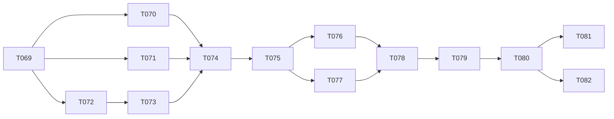

# Tasks: JSON Content Authoring Migration

**Input**: Approved artifacts in `specs/002-json-content-authoring/`

**Prerequisites**: `spec.md` (clarified 2026-09-28), `plan.md`, `research.md`, `data-model.md`, `contracts/gameplay-content-v1.md`, `quickstart.md`, `reviews/spec-reviews.md`, `reviews/plan-reviews.md`, and the constitution

**Tests**: Every implementation Issue ends with its named tests green, run through `scripts/test-unity.ps1 -TestFile <file>` and then the suite. Red/green TDD inside an Issue is allowed. The spec requires automated evidence for every FR and SC, so test work is part of each task and never a separate red-only Issue.

**Implementation lane**: MAQA. Each task below is one MAQA Issue unless it is marked *parent*. The existing Issues #46–#54 (Feature 001 Phase 8 seeds) are reconciled to these tasks; see the Issue mapping. Every accepted dependency is merged to `origin/main` before its dependents start. The Feature 001 parent completion verdict ([PR #136](https://github.com/fjure/idle-factory-game/pull/136)) must be merged before any dispatch.

**Shared resources**: Unity and the emulator are leased through `scripts/resource-lease.ps1`. Issues labeled `resource:unity` never run Unity at the same time. `[P]` therefore means that paths are disjoint and the work may be implemented concurrently; Unity test runs are still serialized by the lease.

**Task IDs**: Numbering continues after Feature 001's last task (T068), so this feature uses T069–T082. The MAQA scripts (`scripts/lib` `Get-TaskIdFromIssueTitle`, `maqa-sync-task-checkboxes.ps1`) map every `maqa` Issue by its title's task ID without feature scope, so task IDs must be unique across the repository.

## Format: `[ID] [P?] [Story] Description`

- **[P]**: may run concurrently after its dependencies, on disjoint paths and worktrees.
- **[US#]**: user story in `spec.md`.
- Every task names its role, paths, validation and the requirements it covers.

## Issue mapping

| Task | Issue | Resources | Replaces Feature 001 seed |
|---|---|---|---|
| T069 | *parent* | — | Phase 8 header |
| T070 | new | unity | part of T045 (fixture) and T047 (checkpoints) |
| T071 | #46 | — | T042 |
| T072 | #47 | unity | T043 |
| T073 | #48 | unity | T044 |
| T074 | #49 | unity | T045 |
| T075 | #50 | unity | T046 |
| T076 | new | unity, emulator | part of T046/T050 (player evidence) |
| T077 | #51 | unity | T047 |
| T078 | *parent* | — | — (owner gate, FR-019) |
| T079 | #52 | unity | T048 |
| T080 | #53 | — | T049 |
| T081 | #54 | unity, emulator | T050 (editor, Windows, SC-008) |
| T082 | new | unity, emulator | T050 (Android emulator) |

**Organization**: Tasks are grouped by user story. The context-orchestration work-unit ledger below is the execution control plane for the parent agent and its clean-context MAQA workers.

## Context Orchestration Process

### Parent Orchestrator Rules

- Execute work units in ledger order. Only units that the ledger marks as parallel candidates may run concurrently, and only once their prerequisites are verified. Task-level `[P]` markers are local hints only.
- Task checkboxes are the implementation completion checklist: a unit is complete only when every referenced task is checked after parent verification. GitHub Issues remain the MAQA workflow-status authority, and checkboxes are mirrored from them.
- Use a clean agent session and one authoritative MAQA Issue and worktree for each unit. Include the full handoff packet; do not rely on conversation history.
- Keep each worker inside its listed write scope. A worker must stop before changing an unassigned path or a shared serialized Unity asset.
- Test tasks follow fail-first behavior. A behavior task needs a failing targeted test before implementation where practical, and a green targeted and suite result before commit. A red-only unit is never accepted.
- Acquire the leases a unit needs (`scripts/resource-lease.ps1`, owner `issue-<n>`) before spawning its worker, and release them after QA and merge.
- The parent owns integration and final validation. It reruns the completion gates itself, even when another agent helped interpret results.

### Required Subagent Handoff Packet

Every assignment includes:

- the role, review lenses and complexity tier;
- the MAQA Issue, task ID and work-unit ID;
- the exact task text and paths;
- the relevant `spec.md` FR, SC and edge-case items, `plan.md` Design sections, `research.md` R-ids, `data-model.md` rule rows and `contracts/gameplay-content-v1.md` sections;
- the accepted prerequisite commits;
- allowed and forbidden paths and tools (Core, `SaveV1Mapper.cs` and Save V1 files are forbidden unless the task names them; scene edits only through Unity tooling);
- Unity `6000.6.0f1`, the platforms and the required Edit Mode or Play Mode validation;
- the relevant wiki pages (`wiki/pages/json-content-authoring.md`, `core-architecture.md`, `player-level-test-gaps.md`, `local-checkpoints-and-offline-return.md` as applicable);
- the exact validation commands.

The response states:

- the changed paths and the task IDs completed;
- the tests run, with results;
- any expected failures, assumptions and unresolved risks;
- the parent follow-up and a done/blocked verdict.

### Parent Verification Gate

For each unit, the parent:

1. inspects `git diff -- <unit paths>` plus every extra path the worker reported, and confirms the edits stay in scope;
2. runs the targeted `scripts/test-unity.ps1 -TestFile <file>` command and the suite named in the unit;
3. rereads the contract and data-model sections for any public boundary change;
4. confirms that `Assets/IdleFactory/Core/`, `SaveV1Mapper.cs`, the Save V1 fixture files after T070, `Library/`, `ProjectSettings/` noise (`scripts/check-settings-noise.ps1 -Commit <sha>`) and unassigned serialized assets are unchanged;
5. requires independent QA PASS on the exact commit.

The parent marks a task only after this gate passes and the commit is merged to `origin/main`.

### Context Compaction Recovery

After compaction:

1. Reread this process, the ledger and the checklist.
2. Run `git status --short` and `scripts/resource-lease.ps1 -Status`, and inspect the existing diffs.
3. Resume at an earlier partially changed unit if one exists. Otherwise resume at the first unit whose MAQA Issue is incomplete and whose prerequisites are accepted.
4. Reconstruct state from Issue status, merged commits, mirrored checkboxes, diffs and targeted tests.
5. Finish and verify that unit before opening another worker.

### Work Unit Ledger

| Unit | Phase | Tasks | Atomic scope and touched paths | Prerequisites | Required handoff sources | Parent verification |
|------|-------|-------|--------------------------------|---------------|--------------------------|---------------------|
| WU01 | Phase 1: Setup | T069 | Parent-only: annotate the superseded seeds in `specs/001-core-game-foundation/tasks.md`; reconcile Issues #46–#54, create the Issues for T070/T076/T082, backfill the board | PR #136 merged | `tasks.md` Issue mapping, `research.md` R11 | `gh issue list --label maqa` matches the Issue mapping one to one; no duplicate titles; diff limited to the Phase 8 annotations |
| WU02 | Phase 2: Foundational | T070 | Capture of fixture, Save V1 files and baseline in `Assets/IdleFactory/Tests/EditMode/Fixtures/AcceptedFoundationCatalogFixture.cs`, `Assets/IdleFactory/Tests/EditMode/PreMigrationCaptureTests.cs`, `Assets/IdleFactory/Tests/EditMode/Fixtures/SaveV1/`, `specs/002-json-content-authoring/reviews/pre-migration-baseline.md` | WU01; parallel candidate with WU03 and WU04 (disjoint paths; Unity runs serialized by lease) | `spec.md` FR-011/012/016/018, `research.md` R09/R10, `plan.md` work item 2 | `scripts/test-unity.ps1 -TestFile Assets/IdleFactory/Tests/EditMode/PreMigrationCaptureTests.cs`; fixture values compared by hand with the `.asset` files; README scenarios complete; no production diff |
| WU03 | Phase 3: User Story 1 — Author and review gameplay content as text (P1) 🎯 MVP | T071 | Documentation only: `docs/content/json-content-pipeline.md`, `Assets/IdleFactory/Content/Schemas/gameplay-content-v1.schema.json` | WU01; parallel candidate with WU02 and WU04 | `contracts/gameplay-content-v1.md`, `data-model.md` rule table, `spec.md` FR-001–005/017 | Diff limited to the two paths plus `.meta`; field-by-field comparison with the contract; schema parses as JSON; T073 later enforces consistency |
| WU04 | Phase 3: User Story 1 — Author and review gameplay content as text (P1) 🎯 MVP | T072 | Reader in `Assets/IdleFactory/Unity/Content/GameplayContentDtos.cs`, `GameplayContentLimits.cs`, `ContentDiagnostic.cs`, `GameplayContentReader.cs`; `Assets/IdleFactory/Tests/EditMode/GameplayContentReaderTests.cs` | WU01; parallel candidate with WU02 and WU03 | `research.md` R02–R04, `data-model.md`, contract § Encoding/Fields/Diagnostics | `scripts/test-unity.ps1 -TestFile Assets/IdleFactory/Tests/EditMode/GameplayContentReaderTests.cs`, then `-Suite EditMode`; no diff in Core or `SaveV1Mapper.cs` |
| WU05 | Phase 3: User Story 1 — Author and review gameplay content as text (P1) 🎯 MVP | T073 | Validator, builder, loader in `Assets/IdleFactory/Unity/Content/`; tests `GameplayContentValidatorTests.cs`, `GameplayContentOrderTests.cs`, `GameplayContentSchemaConsistencyTests.cs`, `GameplayContentAuthoringCheckTests.cs` | WU03, WU04 | `data-model.md` rules and state transitions, `research.md` R03/R05/R07, `Core/Domain/Definitions.cs`, `DefinitionCatalog.cs` | Each test file via `-TestFile`, then `-Suite EditMode`; domain-parity test covers every semantic code |
| WU06 | Phase 3: User Story 1 — Author and review gameplay content as text (P1) 🎯 MVP | T074 | `Assets/IdleFactory/Content/Development/development-catalog.json`, `Assets/IdleFactory/Tests/EditMode/JsonDevelopmentContentTests.cs` | WU02, WU03, WU05 | `spec.md` FR-011/012, `research.md` R06/R09, contract § Canonical form | `-TestFile .../JsonDevelopmentContentTests.cs`, `-Suite EditMode`; document diffed against the fixture; no bootstrap diff |
| WU07 | Phase 4: User Stories 2 and 3 — Run from JSON unchanged, and fail safely (P1) | T075 | `Assets/IdleFactory/Unity/Bootstrap/CoreGameFoundationBootstrap.cs`, `Assets/IdleFactory/Unity/UI/MachineInspectorPresenter.cs`, `Assets/IdleFactory/Scenes/CoreGameFoundation.unity` (Unity tooling), `Assets/IdleFactory/Tests/PlayMode/JsonContentBootstrapTests.cs`, `CoreGameFoundationSceneTests.cs` | WU06 | `plan.md` Components and Test seams, `spec.md` FR-013–015 and US2/US3 scenarios, `data-model.md` state transitions | `-TestFile .../JsonContentBootstrapTests.cs`, full `scripts/test-unity.ps1`; scene diff shows only the bootstrap field; `Initialize()` order is reviewed |
| WU08 | Phase 4: User Stories 2 and 3 — Run from JSON unchanged, and fail safely (P1) | T076 | `Assets/IdleFactory/Tests/PlayMode/JsonContentPlayerTests.cs` | WU07; parallel candidate with WU09 | `plan.md` Test seams, `research.md` R10, `PlayerCheckpointRoundTripTests.cs` pattern | `scripts/test-unity.ps1 -StandaloneWindowsPlayer` under the `unity,emulator` leases; SC-008 median recorded |
| WU09 | Phase 4: User Stories 2 and 3 — Run from JSON unchanged, and fail safely (P1) | T077 | `Assets/IdleFactory/Tests/EditMode/JsonContentCompatibilityTests.cs`, `Assets/IdleFactory/Tests/PlayMode/JsonContentPersistenceTests.cs` | WU07; parallel candidate with WU08 | `spec.md` FR-016/018, `Fixtures/SaveV1/README.md`, Feature 001 `contracts/persistence-v1.md` | Both files via `-TestFile`, full `scripts/test-unity.ps1`; `SaveV1Mapper.cs` and the fixture files unchanged |
| WU10 | Phase 5: User Story 4 — Single gameplay authority (P2) | T078 | Parent-only owner gate: `specs/002-json-content-authoring/reviews/retirement-approval.md` | WU08, WU09 | Evidence from WU06/WU08/WU09, spec Clarifications | The record holds the owner's explicit approval, date and evidence commit; no approval means WU11 stays blocked |
| WU11 | Phase 5: User Story 4 — Single gameplay authority (P2) | T079 | Retirement in `Assets/IdleFactory/Unity/Content/` and `Assets/IdleFactory/Content/Development/`; test rewrites in `Assets/IdleFactory/Tests/EditMode/` and `Assets/IdleFactory/Tests/PlayMode/`; new `JsonContentAuthorityTests.cs` | WU10 | `plan.md` Retirement scope, `spec.md` FR-019/020 | `-TestFile .../JsonContentAuthorityTests.cs`, full `scripts/test-unity.ps1`, `-StandaloneWindowsPlayer`; the `.meta` deletions are inspected; `F001SpriteCatalog` and sprites unchanged |
| WU12 | Phase 6: Polish, reviews and acceptance | T080 | Read-only reviews: `specs/002-json-content-authoring/reviews/json-content-migration-review.md` | WU11 | Exact merged commit, spec, plan, contract, quickstart §2 | Every required verdict present and independent; SC-005 walkthrough recorded; omitted roles justified |
| WU13 | Phase 6: Polish, reviews and acceptance | T081 | Parent-supervised acceptance: `specs/002-json-content-authoring/reviews/json-content-final-acceptance.md` | WU12 | `quickstart.md` §1–§6, baseline record | Full suites, player suite and console check reran by the parent on the accepted commit; every FR/SC outcome recorded |
| WU14 | Phase 6: Polish, reviews and acceptance | T082 | Android emulator evidence appended to `json-content-final-acceptance.md` | WU12; runs sequentially with WU13 on the emulator lease | `quickstart.md` §7, `wiki/pages/android-emulator-validation.md` | Journey log reviewed; result labeled emulator-only or recorded as an unresolved blocker |

---

## Phase 1: Setup

- [ ] T069 *Parent*: mark Phase 8 (T042–T050) and the Post-Foundation Parent Closeout in `specs/001-core-game-foundation/tasks.md` as superseded by this file, with the seed-to-task mapping, and keep the original rows as history. (Done in PR #137.) Retitle and rescope Issues #46–#54 per the Issue mapping, create the missing Issues for T070, T076 and T082 with the `maqa` label and their resource labels, and confirm there are no duplicates (R11). Mirror the result to Project #4 with `scripts/maqa-board-mirror.ps1 -Backfill`.

**Checkpoint**: The Issue set matches this file one to one.

---

## Phase 2: Foundational (pre-migration capture; blocks US2 evidence)

- [ ] T070 [P] Test/QA with Gameplay Developer (Game Systems/Economy lens): capture the accepted pre-migration state while the ScriptableObject path is still live. Change no production code.
  - (a) Hand-write `Assets/IdleFactory/Tests/EditMode/Fixtures/AcceptedFoundationCatalogFixture.cs`. It holds every accepted value: `dev.input` ("Input", `F001-RESOURCE-DEV-INPUT`), `dev.output` ("Output", `F001-RESOURCE-DEV-OUTPUT`), `dev.recipe.basic` (2 × `dev.input` → 1 × `dev.output`, `durationTicks` 50000000), `dev.machine.basic` (2×2, orientations `[0]`, input `dev.input` capacity 4, output `dev.output` capacity 1, `F001-MACHINE-D001-NORMAL`), development flags, and offline revision 1 (4/5, `maxCreditedTicks` 288000000000). The fixture must reference no ScriptableObject type.
  - (b) Add `Assets/IdleFactory/Tests/EditMode/PreMigrationCaptureTests.cs`. It asserts, field by field, that the fixture equals `DefinitionCatalogBuilder.Build(DevelopmentCatalog.asset)`. The test is deleted by T079 and is the reviewable one-time verification (R09).
  - (c) Using the unchanged `SaveV1Mapper`, write Save V1 files for five scenarios: an empty factory, an idle placed D001, D001 mid-cycle with partial progress, D001 blocked with its output full, and a checkpoint with a departure time for offline return. Also write one W001-scale checkpoint. The files go to `Assets/IdleFactory/Tests/EditMode/Fixtures/SaveV1/`, together with a `README.md` recording the capture commit, the scenario and the expected outcome.
  - (d) Record the pre-migration SC-008 baseline: the median of 5 `DefinitionCatalogBuilder.Build` timings in the Windows player, stored in `specs/002-json-content-authoring/reviews/pre-migration-baseline.md`.

  Covers FR-012, FR-016, FR-018, SC-001, SC-002, SC-008.

**Checkpoint**: The fixture, the checkpoint files and the baseline are merged, and T070(b) is green.

---

## Phase 3: User Story 1 — Author and review gameplay content as text (P1) 🎯 MVP

**Goal**: A documented, strictly validated JSON contract and a migrated document that reproduces the accepted catalog.

**Independent test**: Content suites in Edit Mode only (quickstart §1). The migrated document validates and equals the fixture, and every edge case is rejected with a coded diagnostic.

- [ ] T071 [P] [US1] Software Architect with Game Designer/Product Owner (read-only lens): write `docs/content/json-content-pipeline.md` and `Assets/IdleFactory/Content/Schemas/gameplay-content-v1.schema.json` (JSON Schema draft 2020-12, documentation only). They must agree with `contracts/gameplay-content-v1.md` in every field, type, range, required or optional status, ID rule ("1–128 UTF-16 code units, unchanged by trim + Unicode NFC, case-sensitive ordinal"), limit (1 MiB, depth 16, 1,024 per family, 256 per nested list), canonical form, diagnostic code, and evolution and Save V1 compatibility rule (FR-017).

  The guide includes:
  - a complete annotated example that validates;
  - the authoring-check command, with the environment variable the T073 test reads;
  - a "future families" section (costs, research, items, prestige, contracts) that adds no fields (FR-005).

  Documentation only; no Unity run. Covers FR-001–FR-005, FR-017.

- [ ] T072 [P] [US1] Gameplay Developer (Architect and Security lenses): implement `Assets/IdleFactory/Unity/Content/GameplayContentDtos.cs`, `GameplayContentLimits.cs`, `ContentDiagnostic.cs` and `GameplayContentReader.cs`, following R02–R04.
  - Decode strict UTF-8 without BOM.
  - Enforce the size limit (1 MiB, reject empty input) and the depth limit (16).
  - Peek `contentSchemaVersion` first; only `1` is accepted.
  - Walk the tokens with `JsonTextReader` (`FloatParseHandling.Decimal`, `DateParseHandling.None`, the integer token required, no reflection-based deserialization). Reject unknown and duplicate members, missing members, `null`, wrong types, empty or oversized collections, and trailing content.
  - Report the first structural diagnostic with its code, JSON Pointer, line and column (`IJsonLineInfo`).

  Add final-green `Assets/IdleFactory/Tests/EditMode/GameplayContentReaderTests.cs` with one test per structural code in `data-model.md` and each spec edge case in that class: BOM, invalid UTF-8, truncation, trailing content, `1.0`/`1e3`, out of range, duplicate member, unknown member, `null`, empty collection, too many entries, depth, unsupported and missing version. Touch neither `SaveV1Mapper.cs` nor Core. Covers FR-003, FR-006, FR-008 (structural).

- [ ] T073 [US1] Gameplay Developer (Architect and Game Systems lenses), after T072: implement `Assets/IdleFactory/Unity/Content/GameplayContentValidator.cs`, `JsonDefinitionCatalogBuilder.cs`, `ContentLoadResult.cs` and `GameplayContentLoader.cs`.
  - The validator collects *all* semantic violations in document order, capped at 100 with a truncation note, for every identity, reference, recipe, building and offline-policy code in `data-model.md`.
  - The builder constructs domain definitions and `DefinitionCatalog` only when there are zero violations, maps any constructor exception to `content.internal`, and keeps no reference to a DTO.

  Add these final-green tests:
  - `Assets/IdleFactory/Tests/EditMode/GameplayContentValidatorTests.cs`: one test per semantic code, a multi-error ordering test, and a domain-parity test proving that each code rejects exactly what the domain constructor rejects;
  - `GameplayContentOrderTests.cs`: permutations give an identical catalog (SC-007);
  - `GameplayContentSchemaConsistencyTests.cs`: the schema file's property names, required lists, bounds and `maxLength` equal the reader constants, and every schema property appears in the pipeline guide (FR-002);
  - `GameplayContentAuthoringCheckTests.cs`: validates the document named by the documented environment variable and prints diagnostics; it is ignored when the variable is unset (FR-010, SC-005).

  Covers FR-004, FR-007–FR-010, SC-003, SC-007.

- [ ] T074 [US1] Gameplay Developer (Game Systems/Economy lens), after T070, T071 and T073: author `Assets/IdleFactory/Content/Development/development-catalog.json` in canonical form, with exactly the values of `AcceptedFoundationCatalogFixture`. Add final-green `Assets/IdleFactory/Tests/EditMode/JsonDevelopmentContentTests.cs`. It proves:
  - the document loads through `GameplayContentLoader` and equals the fixture field for field, with no ScriptableObject reference (FR-011, FR-012, SC-001);
  - it equals its canonical rendering (R06);
  - the pipeline guide's example validates.

  No bootstrap change. Covers FR-011, FR-012, SC-001.

**Checkpoint**: US1 is complete. Authors can validate content without a scene, and the migrated document is proven equal to the accepted catalog.

---

## Phase 4: User Stories 2 and 3 — Run from JSON unchanged, and fail safely (P1)

**Goal**: The game builds its catalog only from the packaged document. Every content failure stops start-up before any session or checkpoint I/O.

**Independent test**: Editor Play Mode start-up and failure matrix; the Windows player content case; the Save V1 and simulation regression against the T070 captures.

- [ ] T075 [US2] [US3] Gameplay Developer (Architect, Test/QA and UI/UX lenses; UI/UX only to confirm the existing error state is unchanged), after T074: change `Assets/IdleFactory/Unity/Bootstrap/CoreGameFoundationBootstrap.cs`.
  - Replace the serialized `DefinitionCatalogAsset developmentCatalog` with `TextAsset gameplayContent`, and replace the `DevelopmentCatalog` property with read-only `Definitions`.
  - Reorder `Initialize()`: content load, then `spriteCatalog.Validate()`, then resolution of every `presentationKey` (`presentation.key.unresolved`), and only then `CreateCheckpointStore` and `new FactorySession`.
  - Route every rejection through `DisableWithError` with the coded diagnostics.
  - Add a static `Func<byte[]>` content override to the `#if UNITY_EDITOR` composition seam.
  - Change `Assets/IdleFactory/Unity/UI/MachineInspectorPresenter.cs:250` to consume `bootstrap.Definitions` instead of building a second catalog.
  - Swap the scene reference in `Assets/IdleFactory/Scenes/CoreGameFoundation.unity` through Unity tooling only, and review the serialized diff (bootstrap field only).
  - The ScriptableObject types stay in place, unused by the bootstrap.

  Add final-green `Assets/IdleFactory/Tests/PlayMode/JsonContentBootstrapTests.cs`:
  - a successful start-up with the unchanged D001 journey: placement, two cycles with blocking, save and load (SC-001, FR-018);
  - a failure matrix covering a missing asset, empty, BOM, truncated, oversized, unknown member, unresolved reference, unsupported version, and an unresolved presentation key. For each case it asserts the error state, the diagnostic code, no session, no checkpoint-store creation, and byte-identical files in a temporary checkpoint root (FR-014, FR-015, SC-004).

  Update `CoreGameFoundationSceneTests.cs` for the missing-reference message. Covers FR-013–FR-015, SC-004.

- [ ] T076 [P] [US3] Test/QA (Security lens), after T075: add `[Category("StandalonePlayer")]` tests in `Assets/IdleFactory/Tests/PlayMode/JsonContentPlayerTests.cs`, following the `PlayerCheckpointRoundTripTests` pattern (the editor seam is unavailable in players).
  - (a) The packaged `gameplayContent` bytes load in the built player and produce the fixture's catalog (FR-013).
  - (b) Corrupted copies of those bytes are rejected, and a real `JsonCheckpointStore` on a temporary root holding a T070 checkpoint is never opened; its files stay byte-identical (SC-004).
  - (c) A `Stopwatch` measures content load time, reported as the median of 5 cold loads (SC-008). This part is measure-only.

  Run `scripts/test-unity.ps1 -StandaloneWindowsPlayer` under the `unity,emulator` leases. `AGENTS.md` requires both, because Windows player runs on this host log "Killing ADB server". No emulator is used. Covers FR-013, SC-004, SC-008.

- [ ] T077 [P] [US2] Gameplay Developer (Game Systems/Economy and Security lenses), after T075: add final-green `Assets/IdleFactory/Tests/EditMode/JsonContentCompatibilityTests.cs` and `Assets/IdleFactory/Tests/PlayMode/JsonContentPersistenceTests.cs`.
  - Every T070 Save V1 file loads unmodified against the JSON catalog, with identical buildings, buffers, progress and policy revision.
  - Simulation and offline return from each file equal the expected outcomes recorded in `Fixtures/SaveV1/README.md`, including D001 two-cycle and W001 determinism.
  - Checkpoints written after the migration remain Save V1 and round-trip.
  - A document lacking an ID that a checkpoint references is rejected through the existing Save V1 incompatibility path, with no file or live-state change.

  Change neither `SaveV1Mapper.cs` nor Save V1 files. Covers FR-016, FR-018, SC-002, US3 scenario 3.

**Checkpoint**: US2 and US3 are complete. JSON is the runtime authority, behavior is unchanged, and failures are safe in the editor and the Windows player.

---

## Phase 5: User Story 4 — Single gameplay authority (P2)

**Goal**: The gameplay ScriptableObjects are removed, and the absence of a second source is proven.

**Independent test**: The authority test, the full suites and the player suite pass after retirement.

- [ ] T078 [US4] *Parent* owner gate, after T074, T076 and T077 are merged: present the owner with the parity (T074), Save V1 and simulation (T077) and player (T076) evidence, and with Git history as the rollback source. Record the owner's explicit approval, with date and commit, in `specs/002-json-content-authoring/reviews/retirement-approval.md`. Without that record, T079 is not dispatched (FR-019, clarification 2026-09-28).

- [ ] T079 [US4] Gameplay Developer (Architect, Test/QA and Technical Art lenses), after T078: delete these, with their `.meta` files:
  - `Assets/IdleFactory/Unity/Content/{ResourceDefinitionAsset,RecipeDefinitionAsset,BuildingDefinitionAsset,OfflinePolicyAsset,DefinitionCatalogAsset,DefinitionCatalogBuilder}.cs`;
  - `Assets/IdleFactory/Content/Development/{Resources,Recipes,Buildings,OfflinePolicies}/` together with `DevelopmentCatalog.asset`;
  - `PreMigrationCaptureTests.cs`.

  Rewrite `DefinitionCatalogBuilderTests.cs`, `DevelopmentContentTests.cs`, the presentation-key test in `F001AssetContractTests.cs`, and the ScriptableObject-dependent parts of `CheckpointMappingTests.cs`, `CheckpointStoreTests.cs` and `PersistenceApplicationTests.cs`. Each must use the JSON document or `AcceptedFoundationCatalogFixture`, with the same assertions.

  Add final-green `Assets/IdleFactory/Tests/EditMode/JsonContentAuthorityTests.cs`. It proves that:
  - no type deriving from `ScriptableObject` under `IdleFactory.Unity.Content` carries gameplay fields;
  - the bootstrap has exactly one gameplay input;
  - every `presentationKey` resolves in `F001SpriteCatalog`;
  - no retired GUID is referenced under `Assets/`.

  `F001SpriteCatalog` and all sprites stay unchanged. Inspect the `.meta` deletions. Run the full suites and the player suite. Covers FR-019, FR-020, SC-006.

**Checkpoint**: US4 is complete. The packaged document is the only gameplay source.

---

## Phase 6: Polish, reviews and acceptance

- [ ] T080 Independent reviewers, read-only, after T079: record in `specs/002-json-content-authoring/reviews/json-content-migration-review.md` the verdicts of Game Designer/Product Owner (including the SC-005 walkthrough: attempts, diagnostics shown, verdict), Software Architect, Game Systems/Economy, Test/QA and Security/Privacy, each on the exact merged commit. Add UI/UX and Technical Art verdicts only if their boundaries changed; record omitted roles with their reasons. Covers FR-021, SC-005.

- [ ] T081 Test/QA, after T080: on the accepted commit, run the full `scripts/test-unity.ps1` (Edit Mode and Play Mode), inspect the console, and run `scripts/test-unity.ps1 -StandaloneWindowsPlayer`. Execute `quickstart.md` §1–§6, and compare the SC-008 measurement from T076 with the T070 baseline; a value over 100 ms triggers a Performance review and does not block. Record every FR and SC outcome in `specs/002-json-content-authoring/reviews/json-content-final-acceptance.md`, with iOS stated as deferred (Issue #39). Covers SC-001–SC-008.

- [ ] T082 [P] Test/QA, after T080, sequential with T081 on the emulator lease: build the ARM64 Development Player and run `scripts/android-emulator-journey.ps1` on the API 36 x86_64 AVD. Check packaged content, start-up and the D001 journey. Label the result emulator-only; if the Player cannot run, record the exact blocker as unresolved. Append the result to `json-content-final-acceptance.md`. Covers FR-013 (Android).

---

## Parent closeout (not an Issue)

After T081 and T082 are merged, the parent performs these steps in order:

1. mirrors the checkboxes with `scripts/maqa-sync-task-checkboxes.ps1 -TasksFile specs/002-json-content-authoring/tasks.md`;
2. runs `$speckit-wiki-ingest specs/002-json-content-authoring` and `$speckit-learn-review` (mandatory `after_implement`), then wiki lint;
3. runs `scripts/check-after-implement-hooks.ps1 -FeatureDir specs/002-json-content-authoring`;
4. runs `$speckit-converge` until no work remains;
5. runs `scripts/maqa-stale-worktrees.ps1`;
6. records the parent verdict and the exact accepted commit in `specs/002-json-content-authoring/reviews/completion-verification.md`.

---

## Dependencies and execution order

- T069 runs first (parent), after PR #136 is merged.
- **Parallel wave A**: T070 (test paths), T071 (docs only, no lease) and T072 (`Unity/Content` reader) touch disjoint paths. T071 runs fully in parallel. T070 and T072 serialize only their Unity runs through the `unity` lease.
- T073 needs T072. T074 needs T070, T071 and T073.
- **Parallel wave B**: after T075, T076 (player test file) and T077 (compatibility test files) touch disjoint paths. T076 holds `unity,emulator` during its player run.
- T078 is the owner gate. T079 through T081 are sequential. T082 shares the emulator and runs after T081's player run or before it, never at the same time.

## Parallel Execution

### Parallel Opportunities

Work-unit ordering controls orchestration, and `[P]` markers are local hints only. Parallel candidates: WU02 ∥ WU03 ∥ WU04 after WU01; WU08 ∥ WU09 after WU07. Unity test runs stay serialized through the `unity` lease, and the parent verifies each unit before any dependent unit starts.

- Wave A: dispatch #46 (T071, no lease) together with #47 (T072, `unity`), then the new T070 Issue as soon as #47 releases the `unity` lease. Alternatively, implement all three and serialize only the test runs.
- Wave B: dispatch #51 (T077) and the new T076 Issue together. The parent grants the `unity` lease to one test run at a time.

## Subagent Handoff Examples

**Test-oriented unit — WU09/T077**: Assign a Gameplay Developer, Medium tier, with the Game Systems/Economy and Security lenses. Give it:

- the T077 text;
- spec FR-016 and FR-018, SC-002 and US3 scenario 3;
- `Fixtures/SaveV1/README.md`;
- the Feature 001 `contracts/persistence-v1.md`;
- the wiki page `local-checkpoints-and-offline-return.md`.

It may write only the two named test files. `SaveV1Mapper.cs`, Core, the fixture files and all production code are forbidden. It must write the compatibility tests first and show that they pass against the accepted JSON catalog. It must report the result per fixture, the commands with their results, and a done/blocked verdict.

**Implementation unit — WU07/T075**: Assign a Gameplay Developer, Medium tier at `high` reasoning because of the bootstrap ordering risk, with the Architect, Test/QA and UI/UX lenses. Give it:

- plan › Components and Test seams;
- data-model › State transitions;
- the contract › Load outcome;
- FR-013 to FR-015;
- the wiki pages `json-content-authoring.md` and `player-level-test-gaps.md`.

It may edit only the bootstrap, `MachineInspectorPresenter.cs`, the scene (Unity tooling only, `unity` lease), `JsonContentBootstrapTests.cs` and `CoreGameFoundationSceneTests.cs`. It must write the failure-matrix tests first. It must report the new `Initialize()` order, the scene diff summary, the test results and a done/blocked verdict.

## Implementation Strategy

### Context-Orchestrated Subagent Strategy

The parent syncs Issues (WU01), then dispatches through `$speckit-maqa-coordinator` in ledger order. It runs up to `max_parallel` workers on the parallel candidates, and it grants the `unity` lease to one test run at a time. QA (`$speckit-maqa-qa`) runs on each exact commit before merge. After each merged batch, the parent mirrors the checkboxes and runs the mandatory `after_implement` hooks before convergence.

### Incremental Delivery

- **MVP**: US1, T070–T074. The contract, the reader and the migrated document are proven equal to the accepted catalog. None of this changes runtime behavior, so the MVP is safe to merge in isolation.
- **Increment 2**: US2 and US3, T075–T077. The runtime switches to JSON, with failure safety and compatibility proven.
- **Increment 3**: US4, T078–T079. Retirement happens only after owner approval.
- **Acceptance**: T080–T082, then the parent closeout.

## Requirement coverage

| Requirement | Tasks |
|---|---|
| FR-001–FR-005, FR-017 | T071, T073 (consistency) |
| FR-006, FR-003 | T072 |
| FR-004, FR-007–FR-010 | T073 |
| FR-011, FR-012 | T070, T074 |
| FR-013 | T075, T076, T082 |
| FR-014, FR-015 | T075, T076 |
| FR-016, FR-018 | T070, T077 |
| FR-019, FR-020 | T078, T079 |
| FR-021 | T080 |
| SC-001 | T074, T075 · SC-002 T077 · SC-003 T072, T073 · SC-004 T075, T076 · SC-005 T073, T080 · SC-006 T079 · SC-007 T073 · SC-008 T070, T076, T081 |
