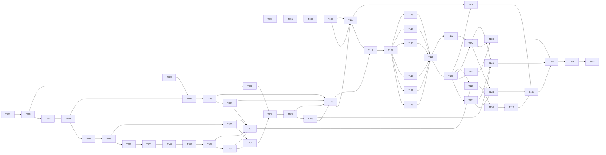

# Tasks: First Iron Factory and Prestige Loop

**Input**: Approved artifacts in `specs/003-first-factory-prestige/`

**Prerequisites**: `spec.md` (clarified 2026-09-29; OD-1 to OD-9 approved and final), `plan.md`, `research.md` (R01–R17), `data-model.md`, `contracts/gameplay-content-v2.md`, `contracts/run-application.md`, `contracts/save-v2-and-v1-import.md`, `contracts/ui-surfaces.md`, `quickstart.md`, `reviews/` (discovery, remaining-decisions, wiki-recovery, plan-reviews) and the constitution. Feature 002 is merged (PR #170).

**Tests**: Every implementation Issue ends with its named tests green, run through `scripts/test-unity.ps1 -TestFile <file>` and then the suite named in its ledger unit. Red/green TDD inside an Issue is allowed. The spec requires automated evidence for each FR and SC, so test work is part of each task and never a separate red-only Issue. Determinism obligations (SC-002) and the Save V1 byte-identity rule (SC-005) are tested wherever a task names them.

**Implementation lane**: MAQA. Each task below is one MAQA Issue unless it is marked *Parent*. Issues are created later by the owner-approved `$speckit-maqa-sync` run (deliberately not run by the `after_tasks` hook; see T087). Every accepted dependency is merged to `origin/main` before its dependents start.

**Shared resources**: Unity and the emulator are leased through `scripts/resource-lease.ps1` (owner `issue-<n>`). Every task that runs Unity (Edit Mode, Play Mode, editor tooling or a player build) carries `resource:unity`. AGENTS.md requires `unity,emulator` together for any run that may have Android as the active build target (any worktree whose `Library/` came from an Android build) and for every `-StandaloneWindowsPlayer` run, which logs "Killing ADB server" on this host; these tasks carry `resource:unity` and `resource:emulator`. Only T124 uses the emulator itself. `[P]` therefore means that paths are disjoint and the work may be implemented concurrently; Unity test runs are still serialized by the lease.

**Task IDs**: Numbering continues after Feature 002's last task (T086), so this feature uses T087–T139. T136–T139 were added by the plan review wave and sit in the phase where they run. The MAQA scripts (`scripts/lib` `Get-TaskIdFromIssueTitle`, `maqa-sync-task-checkboxes.ps1`) map each `maqa` Issue by its title's task ID without feature scope, so IDs are unique across the repository.

**Plan review wave (T088)**: `reviews/plan-reviews.md` (2026-09-29) recorded 59 findings; every disposition is applied to `spec.md` (OD-6 to OD-9), `plan.md`, `research.md`, `data-model.md`, the four contracts, `quickstart.md` and the tasks below. Task changes by finding:

- New tasks: T136 (GD-4, second half of T096), T137 (GD-4, second half of T099), T138 (GD-4, second half of T104; QA-5, PE-6), T139 (UX-4, early independent UI/UX gate before the panels).
- Batching beyond the event bound (OD-6 from ECO-1; GD-5) with partial batches (OD-9, owner follow-up): T094, T095, T096, T097, T098, T107, T122, T125, T137.
- Simulation and application: T098 (QA-3, QA-7, GD-3, PE-4, PE-7), T095 (GD-6), T099 and T137 (GD-2, UX-10, ECO-7), T103 (GD-2, GD-3, QA-6), T102 (QA-4, ECO-7, ECO-8).
- Content and balance: T094 (ECO-5, ECO-7), T096 (ECO-5, ECO-7, ECO-8), T097 (ECO-3, ECO-5, ECO-6, ECO-7), T107 (ECO-2 to ECO-6), T125 (ECO-2, ECO-9).
- Persistence and import: T093 (GD-1, OPS-3), T104 (SEC-2, SEC-3, SEC-5, OPS-5, PE-6), T105 (QA-4, QA-5), T106 (QA-1, QA-8, QA-9, SEC-1, SEC-5, OPS-2), T110 (QA-8, SEC-1, PE-2, UX-9), T119 (GD-1, QA-10), T120 (QA-10), T131 (OD-7 from OPS-1, SEC-4), T133 (OD-7 release note).
- UI and art: T112 (UX-1, UX-2, UX-3, UX-8, UX-9, ART-4); T113–T118 (UX-3, and they now depend on T139); T113 (UX-2, UX-10); T115 (UX-2, UX-5); T116 (OD-8 from UX-7); T117 (UX-2); T118 (UX-2, UX-6); T128 (section after T139); T090 (ART-1 to ART-4, ART-6); T109 and T111 (ART-1); T129 (ART-5).
- Evidence: T121 (QA-2), T122 (PE-1, PE-3, PE-4, PE-5, PE-7, QA-7), T123 (PE-2, PE-6, OPS-4), T124 (PE-2). QA-11 changed only `quickstart.md`.

Because tasks and the ledger changed, the parent reruns the `speckit.orchestration-task-context-management.validate` hook, runs `$speckit-maqa-sync` for T136–T139, refreshes the Issue bodies of the changed tasks (with the new `Depends on` links) and backfills the board before any dispatch.

## Format: `[ID] [P?] [Story] Description`

- **[P]**: may run concurrently after its dependencies, on disjoint paths and worktrees.
- **[US#]**: user story in `spec.md`. Phase 1, Phase 2 and the final phases carry no story label when they serve every story. A task that serves several stories lists each.
- Every task names its role, paths, validation and the requirements it covers. **Resources** are `unity` (Unity lease), `emulator` (emulator lease) or `none`.
- Tasks marked *Parent* have no MAQA Issue and are ticked manually by the parent after verification (`maqa-sync-task-checkboxes.ps1` leaves tasks without Issues unchanged).

## Issue mapping

Issue numbers are assigned by the owner-approved sync (T087 created #171–#212; T136–T139 need a follow-up sync). The label set is fixed here so that the sync can apply it.

| Task | Issue | Resources | Notes |
|---|---|---|---|
| T087, T088 | *parent* | none | Gates and review wave |
| T089 | new | none | Docs and schema only |
| T090, T091 | new | none | Art Bible track, no dependency on code |
| T092–T098, T136 | new | unity | Core and Unity content and rules |
| T099–T102, T137, T140 | new | unity | Session, commands and prestige in memory |
| T103 | new | unity | Offline segmentation |
| T104–T106, T138 | new | unity | Save V2, durable transitions, V1 import |
| T107 | new | unity | Balance trace |
| T108, T109 | new | none | Asset production and Art Direction source review |
| T110–T118 | new | unity | Bootstrap, Technical Art import, HUD shell and panels |
| T139 | new | unity | Early independent UI/UX shell review (read-only; runs the shell's layout and focus tests) |
| T119, T120 | new | unity | Retirement and full suites (`unity,emulator` for the player suite) |
| T121, T122 | new | unity, emulator | StandalonePlayer journey and W003 timings |
| T123 | new | none | Android journey script extension (no emulator run) |
| T124 | new | unity, emulator | Android emulator journey and FPS |
| T125 | new | unity | Balance iteration |
| T126, T127 | *parent* | none | Human playtest and owner approval gates |
| T128–T132 | new | none | Independent read-only reviews |
| T133 | *parent* | unity, emulator | Final acceptance |
| T134, T135 | *parent* | none | after_implement hooks and convergence |

**Organization**: Tasks are grouped by user story. The context-orchestration work-unit ledger below is the execution control plane for the parent agent and its clean-context MAQA workers. Foundational and evidence phases are unlabeled because they serve every story. Story phases order the plan's work items (`plan.md` › Proposed work breakdown, WI 1–23) by dependency; the WI number is cited in each task.

## Context Orchestration Process

### Parent Orchestrator Rules

- Execute work units in ledger order unless the ledger marks units as parallel candidates and their prerequisites are verified. Task-level `[P]` markers are local hints only.
- Task checkboxes are the implementation completion checklist: a unit is complete only when every referenced task is checked after parent verification. GitHub Issues remain the MAQA workflow-status authority and checkboxes are mirrored from them (`scripts/maqa-sync-task-checkboxes.ps1`).
- Use a clean subagent session for each delegated unit, with one authoritative MAQA Issue and worktree. Include the full handoff packet; do not rely on prior conversation state.
- Keep each worker inside its listed write scope and stop before editing an unassigned path or a shared serialized Unity asset (scenes only through Unity tooling).
- Test tasks require fail-first behavior where practical; a red-only unit is never accepted.
- Acquire the leases a unit needs (`scripts/resource-lease.ps1`, owner `issue-<n>`; `unity` and, per AGENTS.md, `emulator` for player runs) before spawning its worker, and release them after QA and merge.
- Choose the model tier per AGENTS.md routing (Medium by default, `high` reasoning where a task says so) and escalate only with a recorded reason.
- The parent inspects diffs, runs targeted verification, checks for unrelated changes, and fixes or re-delegates inconsistencies before starting a dependent unit.
- The parent owns final validation and reruns the completion gates even when another agent helped interpret results. Workers and QA never run the `after_implement` hooks.

### Required Subagent Handoff Packet

Every assignment includes:

- the work unit ID, phase, task ID, MAQA Issue, exact task text and exact paths;
- the role, review lenses, complexity tier and model/reasoning level;
- the relevant `spec.md` FR, SC and edge cases, `plan.md` Design sections, `research.md` R-ids, `data-model.md` rows, `contracts/` sections, and the approved OD-1 to OD-9 decisions;
- non-negotiable constraints: Core stays engine-free and JSON-free, exact integers bounded by 10^18, no `double` in authoritative rules, no reflection deserialization, V1 files never written, nothing published partially;
- the accepted prerequisite commits and the current implementation status;
- allowed and forbidden paths and tools (legacy Core, `SaveV1Mapper.cs` and the committed Save V1 fixtures are forbidden unless the task names them);
- Unity `6000.6.0f1`, target platforms and the required Edit Mode, Play Mode or player validation, with the exact validation commands;
- the relevant wiki pages (`wiki/pages/run-economy-and-prestige.md`, `factory-run-simulation.md`, `save-v2-and-v1-import.md`, `gameplay-content-v2.md`, `core-architecture.md`, `unity-presentation-boundary.md`, `player-level-test-gaps.md` as applicable);
- the required response: files changed, task IDs completed, tests run with results, expected failures, assumptions, unresolved risks, parent follow-up and a done/blocked verdict.

### Parent Verification Gate

For each unit, the parent:

1. inspects `git diff -- <unit paths>` plus every extra path the worker reported, and confirms edits stay in scope or are justified adjacent changes;
2. runs the targeted `scripts/test-unity.ps1 -TestFile <file>` commands and the suite named in the unit;
3. rereads the contract and data-model sections for any public boundary change;
4. confirms that `Library/`, `ProjectSettings/` noise (`scripts/check-settings-noise.ps1 -Commit <sha>`), legacy Core, `SaveV1Mapper.cs`, the committed Save V1 fixtures and unassigned serialized assets are unchanged unless the unit names them;
5. requires independent QA PASS on the exact commit before marking the unit.

### Context Compaction Recovery

After compaction:

1. Read this process, the ledger and the checklist.
2. Run `git status --short` and `scripts/resource-lease.ps1 -Status`, and inspect existing diffs.
3. Resume at an earlier partially changed unit if one exists; otherwise at the first unit with unchecked tasks whose prerequisites are accepted.
4. Reconstruct state from Issue status, merged commits, mirrored checkboxes, diffs and targeted tests.
5. Finish and verify that unit before opening another worker.

### Work Unit Ledger

Ledger convention: rows are listed in execution order and numbered sequentially, and every prerequisite names an earlier unit. Unit numbers are not derived from task numbers (the former `WU = task − 86` rule was dropped when the plan review wave inserted T136–T139); the Tasks column is the only mapping between units and tasks.

| Unit | Phase | Tasks | Atomic scope and touched paths | Prerequisites | Required handoff sources | Parent verification |
|------|-------|-------|--------------------------------|---------------|--------------------------|---------------------|
| WU01 | Phase 1: Setup and design gates | T087 | Parent-only. `.specify/branch-convention.yml`, `specs/003-first-factory-prestige/tasks.md` | None | `specs/003-first-factory-prestige/contracts/run-application.md`, `spec.md` FR/SC named in the task, `plan.md`, `data-model.md` | Parent inspects the recorded artifact, confirms verdicts are complete and independent of the implementer, and diffs only the listed paths; no code diff. |
| WU02 | Phase 1: Setup and design gates | T088 | `specs/003-first-factory-prestige/reviews/plan-reviews.md`, `contracts/ui-surfaces.md`, `wiki/pages/run-economy-and-prestige.md` | WU01 | `specs/003-first-factory-prestige/contracts/gameplay-content-v2.md`, `specs/003-first-factory-prestige/contracts/save-v2-and-v1-import.md`, `specs/003-first-factory-prestige/contracts/ui-surfaces.md`, `research.md` R01, R04, R08, R11, R13, R15, R17, `spec.md` FR/SC named in the task, `plan.md`, `data-model.md` | Parent inspects the recorded artifact, confirms verdicts are complete and independent of the implementer, and diffs only the listed paths; no code diff. |
| WU03 | Phase 1: Setup and design gates | T089 | Parallel candidate. `docs/content/json-content-pipeline.md`, `Assets/IdleFactory/Content/Schemas/gameplay-content-v2.schema.json`, `contracts/gameplay-content-v2.md` | WU02 (parallel candidate; Unity runs serialized by lease) | `specs/003-first-factory-prestige/contracts/gameplay-content-v2.md`, `specs/003-first-factory-prestige/contracts/run-application.md`, `research.md` R06, `spec.md` FR/SC named in the task, `plan.md`, `data-model.md` | Diff limited to the listed paths plus `.meta`; field-by-field comparison with the cited contract or brief; no Unity run. |
| WU04 | Phase 1: Setup and design gates | T090 | Parallel candidate. `docs/art/F003-provisional-art-bible-v0.1.md`, `docs/art/F003-asset-briefs-v0.1.md` | WU02 (parallel candidate; Unity runs serialized by lease) | `specs/003-first-factory-prestige/contracts/gameplay-content-v2.md`, `specs/003-first-factory-prestige/contracts/ui-surfaces.md`, `research.md` R15, `spec.md` FR/SC named in the task, `plan.md`, `data-model.md` | Diff limited to the listed paths plus `.meta`; field-by-field comparison with the cited contract or brief; no Unity run. |
| WU05 | Phase 1: Setup and design gates | T091 | `specs/003-first-factory-prestige/reviews/art-direction-review.md`, `contracts/ui-surfaces.md` | WU04 | `specs/003-first-factory-prestige/contracts/ui-surfaces.md`, `spec.md` FR/SC named in the task, `plan.md`, `data-model.md` | Parent inspects the recorded artifact, confirms verdicts are complete and independent of the implementer, and diffs only the listed paths; no code diff. |
| WU06 | Phase 2: Foundational (blocks every story) | T092 | Parallel candidate. `Assets/IdleFactory/Core/Numerics/CheckedMath.cs`, `Assets/IdleFactory/Unity/UI/QuantityFormatter.cs` | WU02 (parallel candidate; Unity runs serialized by lease) | `spec.md` FR/SC named in the task, `plan.md`, `data-model.md` | `scripts/test-unity.ps1 -Suite EditMode`; `scripts/check-settings-noise.ps1 -Commit <sha>`; diff inspection limited to scope; legacy Core and Save V1 files unchanged unless named. |
| WU07 | Phase 2: Foundational (blocks every story) | T093 | Parallel candidate. `Assets/IdleFactory/Unity/Persistence/CheckpointGenerationFiles.cs`, `…/IdleFactory/Checkpoints/v1/`, `Assets/IdleFactory/Unity/Persistence/SaveV1CheckpointSource.cs`, `Assets/IdleFactory/Core/Run/Application/ILegacyCheckpointSource.cs`, `Assets/IdleFactory/Tests/EditMode/Fixtures/SaveV1/`, `Assets/IdleFactory/Tests/EditMode/CheckpointGenerationFilesTests.cs` | WU02 (parallel candidate; Unity runs serialized by lease) | `specs/003-first-factory-prestige/contracts/gameplay-content-v2.md`, `specs/003-first-factory-prestige/contracts/save-v2-and-v1-import.md`, `research.md` R08, `spec.md` FR/SC named in the task, `plan.md`, `data-model.md` | `scripts/test-unity.ps1 -TestFile Assets/IdleFactory/Tests/EditMode/CheckpointGenerationFilesTests.cs`; `scripts/test-unity.ps1 -Suite EditMode`; `scripts/check-settings-noise.ps1 -Commit <sha>`; diff inspection limited to scope; legacy Core and Save V1 files unchanged unless named. |
| WU08 | Phase 2: Foundational (blocks every story) | T094 | `Assets/IdleFactory/Core/Run/Content/`, `Assets/IdleFactory/Tests/EditMode/Fixtures/Run/RunTestCatalogs.cs`, `Assets/IdleFactory/Tests/EditMode/RunCatalogTests.cs` | WU06 | `specs/003-first-factory-prestige/contracts/gameplay-content-v2.md`, `specs/003-first-factory-prestige/contracts/run-application.md`, `research.md` R02, `spec.md` FR/SC named in the task, `plan.md`, `data-model.md` | `scripts/test-unity.ps1 -TestFile Assets/IdleFactory/Tests/EditMode/RunCatalogTests.cs`; `scripts/test-unity.ps1 -Suite EditMode`; `scripts/check-settings-noise.ps1 -Commit <sha>`; diff inspection limited to scope; legacy Core and Save V1 files unchanged unless named. |
| WU09 | Phase 2: Foundational (blocks every story) | T095 | `Assets/IdleFactory/Core/Run/Domain/`, `Assets/IdleFactory/Tests/EditMode/` | WU08 | `specs/003-first-factory-prestige/contracts/run-application.md`, `research.md` R03, `spec.md` FR/SC named in the task, `plan.md`, `data-model.md` | `scripts/test-unity.ps1 -Suite EditMode`; `scripts/check-settings-noise.ps1 -Commit <sha>`; diff inspection limited to scope; legacy Core and Save V1 files unchanged unless named. |
| WU10 | Phase 3: User Story 6 — Author and validate expanded content (P1) | T096 | `Assets/IdleFactory/Unity/Content/RunContent{Dtos,Reader,Validator}.cs`, `contracts/gameplay-content-v2.md`, `Assets/IdleFactory/Tests/EditMode/` | WU03, WU08 | `specs/003-first-factory-prestige/contracts/gameplay-content-v2.md`, `specs/003-first-factory-prestige/contracts/save-v2-and-v1-import.md`, `research.md` R03, R04, `spec.md` FR/SC named in the task, `plan.md`, `data-model.md` | `scripts/test-unity.ps1 -Suite EditMode`; `scripts/check-settings-noise.ps1 -Commit <sha>`; diff inspection limited to scope; legacy Core and Save V1 files unchanged unless named. |
| WU11 | Phase 3: User Story 6 — Author and validate expanded content (P1) | T136 | `Assets/IdleFactory/Unity/Content/RunCatalogBuilder.cs`, `Assets/IdleFactory/Unity/Content/GameplayContentDispatcher.cs`, `Assets/IdleFactory/Tests/EditMode/` | WU10 | `specs/003-first-factory-prestige/contracts/gameplay-content-v2.md`, `spec.md` FR/SC named in the task, `plan.md`, `data-model.md` | `scripts/test-unity.ps1 -Suite EditMode`; `scripts/check-settings-noise.ps1 -Commit <sha>`; diff inspection limited to scope; legacy Core and Save V1 files unchanged unless named. |
| WU12 | Phase 3: User Story 6 — Author and validate expanded content (P1) | T097 | `Assets/IdleFactory/Content/Iron/iron-factory-content.json`, `specs/003-first-factory-prestige/reviews/content-record-r1.md`, `Assets/IdleFactory/Tests/EditMode/RunContentCanonicalTests.cs` | WU11 | `specs/003-first-factory-prestige/contracts/gameplay-content-v2.md`, `spec.md` FR/SC named in the task, `plan.md`, `data-model.md` | `scripts/test-unity.ps1 -TestFile Assets/IdleFactory/Tests/EditMode/RunContentCanonicalTests.cs`; `scripts/test-unity.ps1 -Suite EditMode`; `scripts/check-settings-noise.ps1 -Commit <sha>`; diff inspection limited to scope; legacy Core and Save V1 files unchanged unless named. |
| WU13 | Phase 4: User Story 1 — Build and diagnose an Iron factory (P1) | T098 | `Assets/IdleFactory/Core/Run/Simulation/RunSimulator.cs`, `Assets/IdleFactory/Tests/EditMode/Fixtures/Run/W003Workload.cs`, `Assets/IdleFactory/Tests/EditMode/` | WU09 | `specs/003-first-factory-prestige/contracts/gameplay-content-v2.md`, `specs/003-first-factory-prestige/contracts/run-application.md`, `research.md` R01, `spec.md` FR/SC named in the task, `plan.md`, `data-model.md` | `scripts/test-unity.ps1 -Suite EditMode`; `scripts/check-settings-noise.ps1 -Commit <sha>`; diff inspection limited to scope; legacy Core and Save V1 files unchanged unless named. |
| WU14 | Phase 4: User Story 1 — Build and diagnose an Iron factory (P1) | T099 | `Assets/IdleFactory/Core/Run/Application/RunSession.cs`, `Assets/IdleFactory/Core/Run/Application/RunCommandResult.cs`, `contracts/run-application.md`, `Assets/IdleFactory/Tests/EditMode/RunSessionTests.cs` | WU13 | `specs/003-first-factory-prestige/contracts/run-application.md`, `spec.md` FR/SC named in the task, `plan.md`, `data-model.md` | `scripts/test-unity.ps1 -TestFile Assets/IdleFactory/Tests/EditMode/RunSessionTests.cs`; `scripts/test-unity.ps1 -Suite EditMode`; `scripts/check-settings-noise.ps1 -Commit <sha>`; diff inspection limited to scope; legacy Core and Save V1 files unchanged unless named. |
| WU15 | Phase 4: User Story 1 — Build and diagnose an Iron factory (P1) | T137 | `Assets/IdleFactory/Core/Run/Application/RunCommands.Factory.cs`, `Assets/IdleFactory/Core/Run/Application/RunSnapshots.cs`, `Assets/IdleFactory/Tests/EditMode/RunCommandTests.cs`, `Assets/IdleFactory/Tests/EditMode/RatesSnapshotTests.cs` | WU14 | `specs/003-first-factory-prestige/contracts/run-application.md`, `specs/003-first-factory-prestige/contracts/ui-surfaces.md`, `spec.md` FR/SC named in the task, `plan.md`, `data-model.md` | `scripts/test-unity.ps1 -TestFile Assets/IdleFactory/Tests/EditMode/RunCommandTests.cs`; `scripts/test-unity.ps1 -TestFile Assets/IdleFactory/Tests/EditMode/RatesSnapshotTests.cs`; `scripts/test-unity.ps1 -Suite EditMode`; `scripts/check-settings-noise.ps1 -Commit <sha>`; diff inspection limited to scope; legacy Core and Save V1 files unchanged unless named. |
| WU16 | Phase 4: User Story 1 — Build and diagnose an Iron factory (P1) | T140 | Unlock evaluation pass in the simulator, with the unlock and allow hooks and the session revision bump: `Assets/IdleFactory/Core/Run/Simulation/`, `Assets/IdleFactory/Core/Run/Domain/` (unlock and allow hooks only), `Assets/IdleFactory/Core/Run/Application/RunSession.cs`, `Assets/IdleFactory/Tests/EditMode/RunUnlockTests.cs` | WU15 | `specs/003-first-factory-prestige/contracts/gameplay-content-v2.md` (unlock kinds), `specs/003-first-factory-prestige/contracts/run-application.md`, `research.md` › Unlocks and R01, `spec.md` FR-013, `plan.md`, `data-model.md` | `scripts/test-unity.ps1 -TestFile Assets/IdleFactory/Tests/EditMode/RunUnlockTests.cs`; `scripts/test-unity.ps1 -Suite EditMode` (simulator, session, command and W003 zero-allocation suites stay green); `scripts/check-settings-noise.ps1 -Commit <sha>`; diff inspection limited to scope; legacy Core and Save V1 files unchanged unless named. |
| WU17 | Phase 5: User Story 2 — Sell strategically and complete contracts (P1) | T100 | `Assets/IdleFactory/Core/Run/Application/RunCommands.Contracts.cs`, `Assets/IdleFactory/Tests/EditMode/RunContractTests.cs` | WU16 | `specs/003-first-factory-prestige/contracts/run-application.md`, `spec.md` FR/SC named in the task, `plan.md`, `data-model.md` | `scripts/test-unity.ps1 -TestFile Assets/IdleFactory/Tests/EditMode/RunContractTests.cs`; `scripts/test-unity.ps1 -Suite EditMode`; `scripts/check-settings-noise.ps1 -Commit <sha>`; diff inspection limited to scope; legacy Core and Save V1 files unchanged unless named. |
| WU18 | Phase 6: User Story 3 — Use Items, Overdrive and immediate Research (P1) | T101 | `Assets/IdleFactory/Core/Run/Application/RunCommands.Items.cs`, `Assets/IdleFactory/Tests/EditMode/` | WU17 | `specs/003-first-factory-prestige/contracts/gameplay-content-v2.md`, `specs/003-first-factory-prestige/contracts/run-application.md`, `spec.md` FR/SC named in the task, `plan.md`, `data-model.md` | `scripts/test-unity.ps1 -Suite EditMode`; `scripts/check-settings-noise.ps1 -Commit <sha>`; diff inspection limited to scope; legacy Core and Save V1 files unchanged unless named. |
| WU19 | Phase 7: User Story 4 — Sell and rebuild a stronger factory (P1) | T102 | `Assets/IdleFactory/Core/Run/Application/FactoryValuation.cs`, `Assets/IdleFactory/Tests/EditMode/FactoryValuationTests.cs` | WU18 | `specs/003-first-factory-prestige/contracts/gameplay-content-v2.md`, `specs/003-first-factory-prestige/contracts/run-application.md`, `spec.md` FR/SC named in the task, `plan.md`, `data-model.md` | `scripts/test-unity.ps1 -TestFile Assets/IdleFactory/Tests/EditMode/FactoryValuationTests.cs`; `scripts/test-unity.ps1 -Suite EditMode`; `scripts/check-settings-noise.ps1 -Commit <sha>`; diff inspection limited to scope; legacy Core and Save V1 files unchanged unless named. |
| WU20 | Phase 8: User Story 5 — Return safely and import V1 saves (P1) | T103 | Parallel candidate. `Assets/IdleFactory/Core/Run/Simulation/OfflineSegmenter.cs`, `Assets/IdleFactory/Core/Run/Application/RunOfflineSummary.cs`, `Assets/IdleFactory/Tests/EditMode/OfflineSegmentationTests.cs` | WU13 (parallel candidate; Unity runs serialized by lease) | `specs/003-first-factory-prestige/contracts/run-application.md`, `spec.md` FR/SC named in the task, `plan.md`, `data-model.md` | `scripts/test-unity.ps1 -TestFile Assets/IdleFactory/Tests/EditMode/OfflineSegmentationTests.cs`; `scripts/test-unity.ps1 -Suite EditMode`; `scripts/check-settings-noise.ps1 -Commit <sha>`; diff inspection limited to scope; legacy Core and Save V1 files unchanged unless named. |
| WU21 | Phase 8: User Story 5 — Return safely and import V1 saves (P1) | T104 | `Assets/IdleFactory/Unity/Persistence/SaveV2Dtos.cs`, `Assets/IdleFactory/Unity/Persistence/SaveV2Mapper.cs`, `contracts/save-v2-and-v1-import.md`, `Assets/IdleFactory/Tests/EditMode/Fixtures/SaveV2/`, `Assets/IdleFactory/Tests/EditMode/` | WU19, WU20 | `specs/003-first-factory-prestige/contracts/gameplay-content-v2.md`, `specs/003-first-factory-prestige/contracts/save-v2-and-v1-import.md`, `research.md` R03, R08, `spec.md` FR/SC named in the task, `plan.md`, `data-model.md` | `scripts/test-unity.ps1 -Suite EditMode`; `scripts/check-settings-noise.ps1 -Commit <sha>`; diff inspection limited to scope; legacy Core and Save V1 files unchanged unless named. |
| WU22 | Phase 8: User Story 5 — Return safely and import V1 saves (P1) | T138 | `Assets/IdleFactory/Unity/Persistence/JsonRunCheckpointStore.cs`, `Assets/IdleFactory/Core/Run/Application/IRunCheckpointStore.cs`, `Assets/IdleFactory/Core/Run/Application/RunPersistence.cs`, `…/IdleFactory/Checkpoints/v2/`, `Assets/IdleFactory/Tests/EditMode/Fixtures/SaveV2/device/`, `Assets/IdleFactory/Tests/EditMode/` | WU07, WU21 | `specs/003-first-factory-prestige/contracts/save-v2-and-v1-import.md`, `specs/003-first-factory-prestige/contracts/run-application.md`, `research.md` R08, R09, `spec.md` FR/SC named in the task, `plan.md`, `data-model.md` | `scripts/test-unity.ps1 -Suite EditMode`; `scripts/check-settings-noise.ps1 -Commit <sha>`; diff inspection limited to scope; legacy Core and Save V1 files unchanged unless named. |
| WU23 | Phase 8: User Story 5 — Return safely and import V1 saves (P1) | T105 | `Assets/IdleFactory/Core/Run/Application/RunPersistence.cs`, `Assets/IdleFactory/Tests/EditMode/` | WU22 | `specs/003-first-factory-prestige/contracts/run-application.md`, `specs/003-first-factory-prestige/contracts/save-v2-and-v1-import.md`, `spec.md` FR/SC named in the task, `plan.md`, `data-model.md` | `scripts/test-unity.ps1 -Suite EditMode`; `scripts/check-settings-noise.ps1 -Commit <sha>`; diff inspection limited to scope; legacy Core and Save V1 files unchanged unless named. |
| WU24 | Phase 8: User Story 5 — Return safely and import V1 saves (P1) | T106 | `Assets/IdleFactory/Core/Run/Application/V1Import.cs`, `Assets/IdleFactory/Tests/EditMode/Fixtures/SaveV1/`, `Assets/IdleFactory/Tests/EditMode/V1ImportTests.cs` | WU23 | `specs/003-first-factory-prestige/contracts/gameplay-content-v2.md`, `specs/003-first-factory-prestige/contracts/save-v2-and-v1-import.md`, `specs/003-first-factory-prestige/contracts/ui-surfaces.md`, `research.md` R10, `spec.md` FR/SC named in the task, `plan.md`, `data-model.md` | `scripts/test-unity.ps1 -TestFile Assets/IdleFactory/Tests/EditMode/V1ImportTests.cs`; `scripts/test-unity.ps1 -Suite EditMode`; `scripts/check-settings-noise.ps1 -Commit <sha>`; diff inspection limited to scope; legacy Core and Save V1 files unchanged unless named. |
| WU25 | Phase 9: Balance evidence (US4 — SC-003, SC-004) | T107 | Parallel candidate. `Assets/IdleFactory/Tests/EditMode/Balance/BalanceTraceRunner.cs`, `specs/003-first-factory-prestige/reviews/balance-policy.md`, `contracts/run-application.md`, `Assets/IdleFactory/Tests/EditMode/Fixtures/Balance/trace-r1.csv`, `Assets/IdleFactory/Tests/EditMode/Balance/BalanceTraceTests.cs`, `specs/003-first-factory-prestige/reviews/balance-trace-r1.md` | WU12, WU18, WU19, WU20 (parallel candidate; Unity runs serialized by lease) | `specs/003-first-factory-prestige/contracts/run-application.md`, `research.md` R13, `spec.md` FR/SC named in the task, `plan.md`, `data-model.md` | `scripts/test-unity.ps1 -TestFile Assets/IdleFactory/Tests/EditMode/Balance/BalanceTraceTests.cs`; `scripts/test-unity.ps1 -Suite EditMode`; `scripts/check-settings-noise.ps1 -Commit <sha>`; diff inspection limited to scope; legacy Core and Save V1 files unchanged unless named. |
| WU26 | Phase 10: Player-visible surfaces (US1–US5) | T108 | Parallel candidate. `Assets/IdleFactory/Art/Development/F003/Source/`, `Assets/IdleFactory/Art/Development/F003/Source/PROVENANCE.md` | WU05 (parallel candidate; Unity runs serialized by lease) | `specs/003-first-factory-prestige/contracts/ui-surfaces.md`, `spec.md` FR/SC named in the task, `plan.md`, `data-model.md` | Diff limited to the listed paths plus `.meta`; field-by-field comparison with the cited contract or brief; no Unity run. |
| WU27 | Phase 10: Player-visible surfaces (US1–US5) | T109 | `specs/003-first-factory-prestige/reviews/art-direction-review.md` | WU26 | `specs/003-first-factory-prestige/contracts/ui-surfaces.md`, `spec.md` FR/SC named in the task, `plan.md`, `data-model.md` | Parent inspects the recorded artifact, confirms verdicts are complete and independent of the implementer, and diffs only the listed paths; no code diff. |
| WU28 | Phase 10: Player-visible surfaces (US1–US5) | T110 | `Assets/IdleFactory/Unity/Bootstrap/CoreGameFoundationBootstrap.cs`, `Assets/IdleFactory/Unity/Presentation/PresentationSpriteCatalog.cs` (resolution-agnostic: world size and pivot, optional frame list), `Assets/IdleFactory/Scenes/CoreGameFoundation.unity`, `Assets/IdleFactory/Tests/PlayMode/RunLifecycleTests.cs`, `Assets/IdleFactory/Tests/PlayMode/RunBootstrapTests.cs`, `Assets/IdleFactory/Tests/EditMode/PresentationSpriteCatalogTests.cs` | WU11, WU12, WU23, WU24 | `specs/003-first-factory-prestige/contracts/gameplay-content-v2.md`, `specs/003-first-factory-prestige/contracts/run-application.md`, `specs/003-first-factory-prestige/contracts/save-v2-and-v1-import.md`, `specs/003-first-factory-prestige/contracts/ui-surfaces.md`, `spec.md` FR/SC named in the task, `plan.md`, `data-model.md` | `scripts/test-unity.ps1 -TestFile Assets/IdleFactory/Tests/PlayMode/RunLifecycleTests.cs`; `scripts/test-unity.ps1 -TestFile Assets/IdleFactory/Tests/PlayMode/RunBootstrapTests.cs`; `scripts/test-unity.ps1 -TestFile Assets/IdleFactory/Tests/EditMode/PresentationSpriteCatalogTests.cs`; full `scripts/test-unity.ps1`; `scripts/check-settings-noise.ps1 -Commit <sha>`; diff inspection limited to scope; legacy Core and Save V1 files unchanged unless named. |
| WU29 | Phase 10: Player-visible surfaces (US1–US5) | T111 | `Assets/IdleFactory/Art/Development/F003/Sprites/`, `docs/art/F003-technical-art-integration.md`, `Assets/IdleFactory/Tests/EditMode/F003AssetContractTests.cs` | WU27, WU28 | `specs/003-first-factory-prestige/contracts/gameplay-content-v2.md`, `specs/003-first-factory-prestige/contracts/ui-surfaces.md`, `spec.md` FR/SC named in the task, `plan.md`, `data-model.md` | `scripts/test-unity.ps1 -TestFile Assets/IdleFactory/Tests/EditMode/F003AssetContractTests.cs`; `scripts/test-unity.ps1 -Suite EditMode`; `scripts/check-settings-noise.ps1 -Commit <sha>`; diff inspection limited to scope; legacy Core and Save V1 files unchanged unless named. |
| WU30 | Phase 10: Player-visible surfaces (US1–US5) | T112 | `Assets/IdleFactory/Unity/Presentation/SlotGridView.cs`, `Assets/IdleFactory/Unity/UI/FactoryRun.uxml`, `Assets/IdleFactory/Tests/PlayMode/` | WU28, WU29 | `specs/003-first-factory-prestige/contracts/run-application.md`, `specs/003-first-factory-prestige/contracts/ui-surfaces.md`, `spec.md` FR/SC named in the task, `plan.md`, `data-model.md` | `scripts/test-unity.ps1 -Suite EditMode`; `scripts/check-settings-noise.ps1 -Commit <sha>`; diff inspection limited to scope; legacy Core and Save V1 files unchanged unless named. |
| WU31 | Phase 10: Player-visible surfaces (US1–US5) | T139 | Read-only review. `specs/003-first-factory-prestige/reviews/ui-ux-review.md` | WU30 | `specs/003-first-factory-prestige/contracts/ui-surfaces.md`, `docs/art/F003-provisional-art-bible-v0.1.md`, `spec.md` FR/SC named in the task, `plan.md`, `data-model.md` | Parent inspects the recorded artifact, confirms verdicts are complete and independent of the implementer, and diffs only the listed paths; no code diff. |
| WU32 | Phase 10: Player-visible surfaces (US1–US5) | T113 | Parallel candidate. `Assets/IdleFactory/Unity/UI/Panels/BuildSheetPanel.{uxml,uss}`, `Assets/IdleFactory/Tests/PlayMode/` | WU31 (parallel candidate; Unity runs serialized by lease) | `specs/003-first-factory-prestige/contracts/run-application.md`, `specs/003-first-factory-prestige/contracts/ui-surfaces.md`, `spec.md` FR/SC named in the task, `plan.md`, `data-model.md` | `scripts/test-unity.ps1 -Suite EditMode`; `scripts/check-settings-noise.ps1 -Commit <sha>`; diff inspection limited to scope; legacy Core and Save V1 files unchanged unless named. |
| WU33 | Phase 10: Player-visible surfaces (US1–US5) | T114 | Parallel candidate. `Assets/IdleFactory/Unity/UI/Panels/InventoryRatesPanel.*`, `Assets/IdleFactory/Tests/PlayMode/` | WU31 (parallel candidate; Unity runs serialized by lease) | `specs/003-first-factory-prestige/contracts/ui-surfaces.md`, `spec.md` FR/SC named in the task, `plan.md`, `data-model.md` | `scripts/test-unity.ps1 -Suite EditMode`; `scripts/check-settings-noise.ps1 -Commit <sha>`; diff inspection limited to scope; legacy Core and Save V1 files unchanged unless named. |
| WU34 | Phase 10: Player-visible surfaces (US1–US5) | T115 | Parallel candidate. `Assets/IdleFactory/Unity/UI/Panels/ContractsPanel.*`, `Assets/IdleFactory/Tests/PlayMode/` | WU31 (parallel candidate; Unity runs serialized by lease) | `specs/003-first-factory-prestige/contracts/ui-surfaces.md`, `spec.md` FR/SC named in the task, `plan.md`, `data-model.md` | `scripts/test-unity.ps1 -Suite EditMode`; `scripts/check-settings-noise.ps1 -Commit <sha>`; diff inspection limited to scope; legacy Core and Save V1 files unchanged unless named. |
| WU35 | Phase 10: Player-visible surfaces (US1–US5) | T116 | Parallel candidate. `Assets/IdleFactory/Unity/UI/Panels/ResearchPanel.*`, `Assets/IdleFactory/Tests/PlayMode/` | WU31 (parallel candidate; Unity runs serialized by lease) | `specs/003-first-factory-prestige/contracts/ui-surfaces.md`, `spec.md` FR/SC named in the task, `plan.md`, `data-model.md` | `scripts/test-unity.ps1 -Suite EditMode`; `scripts/check-settings-noise.ps1 -Commit <sha>`; diff inspection limited to scope; legacy Core and Save V1 files unchanged unless named. |
| WU36 | Phase 10: Player-visible surfaces (US1–US5) | T117 | Parallel candidate. `Assets/IdleFactory/Unity/UI/Panels/PrestigePanel.{uxml,uss}`, `Assets/IdleFactory/Tests/PlayMode/` | WU31 (parallel candidate; Unity runs serialized by lease) | `specs/003-first-factory-prestige/contracts/run-application.md`, `specs/003-first-factory-prestige/contracts/ui-surfaces.md`, `spec.md` FR/SC named in the task, `plan.md`, `data-model.md` | `scripts/test-unity.ps1 -Suite EditMode`; `scripts/check-settings-noise.ps1 -Commit <sha>`; diff inspection limited to scope; legacy Core and Save V1 files unchanged unless named. |
| WU37 | Phase 10: Player-visible surfaces (US1–US5) | T118 | Parallel candidate. `Assets/IdleFactory/Unity/UI/Panels/OfflineSummaryPanel.*`, `Assets/IdleFactory/Tests/PlayMode/` | WU31 (parallel candidate; Unity runs serialized by lease) | `specs/003-first-factory-prestige/contracts/save-v2-and-v1-import.md`, `specs/003-first-factory-prestige/contracts/ui-surfaces.md`, `spec.md` FR/SC named in the task, `plan.md`, `data-model.md` | `scripts/test-unity.ps1 -Suite EditMode`; `scripts/check-settings-noise.ps1 -Commit <sha>`; diff inspection limited to scope; legacy Core and Save V1 files unchanged unless named. |
| WU38 | Phase 11: Retirement and player/device evidence | T119 | `Assets/IdleFactory/Tests/EditMode/RunAuthorityTests.cs`, `Assets/`, `specs/003-first-factory-prestige/reviews/full-suite-evidence.md` | WU32, WU33, WU34, WU35, WU36, WU37 | `specs/003-first-factory-prestige/contracts/gameplay-content-v2.md`, `specs/003-first-factory-prestige/contracts/run-application.md`, `specs/003-first-factory-prestige/contracts/save-v2-and-v1-import.md`, `specs/003-first-factory-prestige/contracts/ui-surfaces.md`, `research.md` R16, `spec.md` FR/SC named in the task, `plan.md`, `data-model.md` | `scripts/test-unity.ps1 -TestFile Assets/IdleFactory/Tests/EditMode/RunAuthorityTests.cs`; full `scripts/test-unity.ps1`; `scripts/check-settings-noise.ps1 -Commit <sha>`; diff inspection limited to scope; legacy Core and Save V1 files unchanged unless named. |
| WU39 | Phase 11: Retirement and player/device evidence | T120 | `scripts/test-unity.ps1`, `specs/003-first-factory-prestige/reviews/full-suite-evidence.md` | WU38 | `spec.md` FR/SC named in the task, `plan.md`, `data-model.md` | full `scripts/test-unity.ps1`; `scripts/check-settings-noise.ps1 -Commit <sha>`; diff inspection limited to scope; legacy Core and Save V1 files unchanged unless named. |
| WU40 | Phase 11: Retirement and player/device evidence | T121 | Parallel candidate. `Assets/IdleFactory/Tests/PlayMode/RunJourneyPlayerTests.cs`, `Assets/IdleFactory/Tests/PlayMode/Fixtures/SaveV1/`, `Assets/IdleFactory/Tests/EditMode/SaveV1PlayerFixtureParityTests.cs`, `reviews/full-suite-evidence.md` | WU39 (parallel candidate; Unity runs serialized by lease) | `specs/003-first-factory-prestige/contracts/save-v2-and-v1-import.md`, `spec.md` FR/SC named in the task, `plan.md`, `data-model.md` | `scripts/test-unity.ps1 -TestFile Assets/IdleFactory/Tests/PlayMode/RunJourneyPlayerTests.cs`; `scripts/test-unity.ps1 -StandaloneWindowsPlayer` under the `unity,emulator` leases; `scripts/check-settings-noise.ps1 -Commit <sha>`; diff inspection limited to scope; legacy Core and Save V1 files unchanged unless named. |
| WU41 | Phase 11: Retirement and player/device evidence | T122 | Parallel candidate. `Assets/IdleFactory/Tests/PlayMode/W003PlayerTimingTests.cs`, `Assets/IdleFactory/Tests/PlayMode/Fixtures/SaveV2/`, `specs/003-first-factory-prestige/reviews/w003-measurements.md` | WU39 (parallel candidate; Unity runs serialized by lease) | `specs/003-first-factory-prestige/contracts/gameplay-content-v2.md`, `spec.md` FR/SC named in the task, `plan.md`, `data-model.md` | `scripts/test-unity.ps1 -TestFile Assets/IdleFactory/Tests/PlayMode/W003PlayerTimingTests.cs`; `scripts/test-unity.ps1 -StandaloneWindowsPlayer` under the `unity,emulator` leases; `scripts/check-settings-noise.ps1 -Commit <sha>`; diff inspection limited to scope; legacy Core and Save V1 files unchanged unless named. |
| WU42 | Phase 11: Retirement and player/device evidence | T123 | Parallel candidate. `scripts/android-emulator-journey.ps1` | WU38 (parallel candidate; Unity runs serialized by lease) | `specs/003-first-factory-prestige/contracts/run-application.md`, `spec.md` FR/SC named in the task, `plan.md`, `data-model.md` | PowerShell parse check of `scripts/android-emulator-journey.ps1`, unknown-step handling and lease-conflict path exercised without `adb`; existing steps unchanged in the diff. |
| WU43 | Phase 11: Retirement and player/device evidence | T124 | `specs/003-first-factory-prestige/reviews/android-emulator-evidence.md` | WU39, WU42 | `specs/003-first-factory-prestige/contracts/run-application.md`, `spec.md` FR/SC named in the task, `plan.md`, `data-model.md` | `scripts/test-unity.ps1 -Suite EditMode`; `scripts/check-settings-noise.ps1 -Commit <sha>`; diff inspection limited to scope; legacy Core and Save V1 files unchanged unless named. |
| WU44 | Phase 12: Balance iteration and owner gate (SC-003, SC-004) | T125 | `Assets/IdleFactory/Content/Iron/iron-factory-content.json`, `Fixtures/Balance/trace-r<N>.csv`, `reviews/balance-trace-r<N>.md`, `reviews/content-record-r<N>.md` | WU25, WU39 | `specs/003-first-factory-prestige/contracts/gameplay-content-v2.md`, `specs/003-first-factory-prestige/contracts/run-application.md`, `research.md` R13, `spec.md` FR/SC named in the task, `plan.md`, `data-model.md` | `scripts/test-unity.ps1 -Suite EditMode`; `scripts/check-settings-noise.ps1 -Commit <sha>`; diff inspection limited to scope; legacy Core and Save V1 files unchanged unless named. |
| WU45 | Phase 12: Balance iteration and owner gate (SC-003, SC-004) | T126 | Parent-only. `specs/003-first-factory-prestige/reviews/playtest-<name>-<yyyymmdd>.md` | WU44 | `spec.md` FR/SC named in the task, `plan.md`, `data-model.md` | Parent inspects the recorded artifact, confirms verdicts are complete and independent of the implementer, and diffs only the listed paths; no code diff. |
| WU46 | Phase 12: Balance iteration and owner gate (SC-003, SC-004) | T127 | Parent-only. `specs/003-first-factory-prestige/reviews/content-approval.md` | WU45 | `specs/003-first-factory-prestige/contracts/gameplay-content-v2.md`, `spec.md` FR/SC named in the task, `plan.md`, `data-model.md` | Parent inspects the recorded artifact, confirms verdicts are complete and independent of the implementer, and diffs only the listed paths; no code diff. |
| WU47 | Phase 13: Independent reviews and final acceptance | T128 | Parallel candidate. `specs/003-first-factory-prestige/reviews/ui-ux-review.md` | WU40, WU43 (parallel candidate; Unity runs serialized by lease) | `spec.md` FR/SC named in the task, `plan.md`, `data-model.md` | Parent inspects the recorded artifact, confirms verdicts are complete and independent of the implementer, and diffs only the listed paths; no code diff. |
| WU48 | Phase 13: Independent reviews and final acceptance | T129 | Parallel candidate. `reviews/art-direction-review.md` | WU29, WU39 (parallel candidate; Unity runs serialized by lease) | `specs/003-first-factory-prestige/contracts/ui-surfaces.md`, `spec.md` FR/SC named in the task, `plan.md`, `data-model.md` | Parent inspects the recorded artifact, confirms verdicts are complete and independent of the implementer, and diffs only the listed paths; no code diff. |
| WU49 | Phase 13: Independent reviews and final acceptance | T130 | Parallel candidate. `specs/003-first-factory-prestige/reviews/performance-review.md` | WU41, WU43 (parallel candidate; Unity runs serialized by lease) | `spec.md` FR/SC named in the task, `plan.md`, `data-model.md` | Parent inspects the recorded artifact, confirms verdicts are complete and independent of the implementer, and diffs only the listed paths; no code diff. |
| WU50 | Phase 13: Independent reviews and final acceptance | T131 | Parallel candidate. `specs/003-first-factory-prestige/reviews/security-devops-review.md`, `v2/` | WU24, WU40, WU43 (parallel candidate; Unity runs serialized by lease) | `specs/003-first-factory-prestige/contracts/save-v2-and-v1-import.md`, `research.md` R17, `spec.md` FR/SC named in the task, `plan.md`, `data-model.md` | Parent inspects the recorded artifact, confirms verdicts are complete and independent of the implementer, and diffs only the listed paths; no code diff. |
| WU51 | Phase 13: Independent reviews and final acceptance | T132 | `specs/003-first-factory-prestige/reviews/feature-review.md` | WU46, WU47, WU48 | `spec.md` FR/SC named in the task, `plan.md`, `data-model.md` | Parent inspects the recorded artifact, confirms verdicts are complete and independent of the implementer, and diffs only the listed paths; no code diff. |
| WU52 | Phase 13: Independent reviews and final acceptance | T133 | Parent-only. `specs/003-first-factory-prestige/reviews/final-acceptance.md` | WU49, WU50, WU51 | `spec.md` FR/SC named in the task, `plan.md`, `data-model.md` | Parent inspects the recorded artifact, confirms verdicts are complete and independent of the implementer, and diffs only the listed paths; no code diff. |
| WU53 | Phase 14: Closeout hooks and convergence (parent) | T134 | Parent-only. `.specify/extensions.yml` | WU52 | `spec.md` FR/SC named in the task, `plan.md`, `data-model.md` | Parent inspects the recorded artifact, confirms verdicts are complete and independent of the implementer, and diffs only the listed paths; no code diff. |
| WU54 | Phase 14: Closeout hooks and convergence (parent) | T135 | Parent-only. `scripts/maqa-stale-worktrees.ps1`, `specs/003-first-factory-prestige/reviews/completion-verification.md` | WU53 | `specs/003-first-factory-prestige/contracts/run-application.md`, `spec.md` FR/SC named in the task, `plan.md`, `data-model.md` | Parent inspects the recorded artifact, confirms verdicts are complete and independent of the implementer, and diffs only the listed paths; no code diff. |

---

## Phase 1: Setup and design gates

- [x] T087 *Parent*: verify the AGENTS.md greenfield gates still hold on the exact base commit (constitution without placeholders, `.specify/branch-convention.yml`, wiki initialized, `maqa` labels present, `maqa-config.yml` Unity Edit Mode and Play Mode commands). Confirm `before_implement` hook `speckit.orchestration-task-context-management.validate` passes on this file. **`speckit.maqa.sync` was skipped by the `after_tasks` hook run; it creates GitHub Issues and is an owner decision.** When the owner approves it: run `$speckit-maqa-sync` with the explicit path `specs/003-first-factory-prestige/tasks.md` (Windows rules in AGENTS.md), apply the `resource:unity` and `resource:emulator` labels from the Issue mapping, then run `scripts/maqa-board-mirror.ps1 -Backfill`. No dispatch before then. Resources: none. **Done 2026-09-29**: gates verified, sync run (Issues #171–#212), board backfilled.

- [x] T088 Read-only plan review wave (`max_parallel: 3`), before any implementation dispatch. Record verdicts in `specs/003-first-factory-prestige/reviews/plan-reviews.md`: (1) Test/QA and Gameplay Developer on `plan.md` and all four contracts; (2) Performance Engineer on R01/R04/W003, Security/Privacy on R08/R17, DevOps/Operations on the V1→V2 migration and rollback; (3) Game Systems/Economy on R11–R13, UI/UX on `contracts/ui-surfaces.md`, Art Director on R15. Each review lists findings with severity and disposition. A finding that needs a product decision goes to the owner, not into the spec. State the roles omitted (Online Services, Sound, Composer, 3D/Render) and why. Wiki pages to pass: `wiki/pages/run-economy-and-prestige.md`, `factory-run-simulation.md`, `save-v2-and-v1-import.md`, `gameplay-content-v2.md`, `mobile-performance-targets.md`. Resources: none. Covers Constitution IX, plan › Review waves. **Done 2026-09-29**: the review record exists and every disposition is applied (see "Plan review wave" above).

- [X] T089 [P] Software Architect with Game Designer/Product Owner (read-only lens) and Game Systems/Economy: write the content v2 author section in `docs/content/json-content-pipeline.md` and the documentation-only schema `Assets/IdleFactory/Content/Schemas/gameplay-content-v2.schema.json` (JSON Schema draft 2020-12). They must agree with `contracts/gameplay-content-v2.md` in every family, field, type, range, required or optional status, closed vocabulary (effect kinds `machineSpeed`, `machineOutput`, `salePrice`, `upgradeCost`, `startingCash`, `startingStorageLevel`; unlock kinds `always`, `researchPurchased`, `factoryLevelAtLeast`, `resourceProduced`; contract kinds `plate`, `gear`, `timedBar`; curve `{ base, growthPpm, rounding: "ceil" | "floor" }`), limit (1 MiB, depth 16, 1,024 per family, 256 per nested list, IDs of 1–128 UTF-16 code units unchanged by trim and NFC), canonical form and semantic rule code. Include the revision and balance-hypothesis rules (`contentRevision`), the version dispatch (v1 legacy import catalog, v2 gameplay), the numeric bound 10^18 with ppm and rounding rules (R06), the offline formula and the locked revision 1 policy (4/5, eight hours), a complete annotated example that validates, and the authoring-check command with its environment variable (`IDLEFACTORY_CONTENT_CHECK_PATH`). Documentation only; no Unity run. `RunContentSchemaConsistencyTests` in T096 enforces consistency later. Resources: none. Covers FR-029, FR-030, FR-035, US6.

- [X] T090 [P] Art Director (WI16): write `docs/art/F003-provisional-art-bible-v0.1.md` and `docs/art/F003-asset-briefs-v0.1.md` per R15. The Art Bible fixes the top-down orthographic view, the 64 px per cell convention from F001, the palette, non-color state cues (icon or shape plus color), the silhouettes of Miner, Smelter, Press and Assembler, and the slot (empty, locked, occupied), resource, Item-tier and UI-icon families, with limits on visual noise and a readable-at-12-slots rule. Each asset brief row follows the F001 inventory format: asset ID (`F003-*` presentation key) and type, logical footprint (1 slot), ports `N/A`, required visual states (running, paused, waiting, missing-input, storage-full, inactive, boosted, Overdrive), pixel target, file format, pivot, source path, import path, provenance method (`T1`: repository-authored SVG rasterized with Inkscape CLI 1.4.2) and Art Bible version. Every `presentationKey` referenced by content T097 and every UI icon must have its own enumerated row (ART-3). The Art Bible also carries measurable readability rules (pixels per cell at each zoom step, 4.5:1 badge contrast, grayscale and colour-vision-deficiency checks, numeric noise limits; ART-1), a state and marker precedence table with at most one state badge and two markers per slot and a unique silhouette plus a text or shape cue per state, including the locked slot (ART-2), a UI token section (palette roles, focus ring, minimum text size, disabled look, contrast) referenced by T112–T118 (ART-4), and the Inkscape CLI 1.4.2 version with the no-silent-substitution rule (ART-6). No ComfyUI or Blender is assumed. Resources: none. Covers FR-034, R15.

- [X] T091 Independent Art Director review (a separate session from T090's author; read-only on code), after T090: approve or reject Art Bible v0.1 and the briefs, and record the frozen version, the checked rows and the approval in `specs/003-first-factory-prestige/reviews/art-direction-review.md` (section "Art Bible v0.1 approval"). Include the Game Designer/Product Owner check that each visual state carries the gameplay meaning in `contracts/ui-surfaces.md`. No asset production (T108) and no Technical Art integration (T111) start without this record. Resources: none. Covers FR-034.

**Checkpoint**: Gates are verified, the plan review wave is recorded, the content v2 author contract exists, and Art Bible v0.1 is approved and frozen.

---

## Phase 2: Foundational (blocks every story)

**Purpose**: Exact numerics, the run content model, the run state and the reusable durability protocol.

- [X] T092 [P] Gameplay Developer (Architect, Test/QA and Performance lenses), WI2: implement the Core numerics in `Assets/IdleFactory/Core/Numerics/CheckedMath.cs`, `ExactBound.cs`, `MulDiv.cs` and `IntegerSqrt.cs`, and the display formatter in `Assets/IdleFactory/Unity/UI/QuantityFormatter.cs` (pure C#, no Unity API).
  - `ExactBound` = 10^18: "Resource units, Cash ($), RP, IP, Item count: `long`, `0 … ExactBound` (10^18). Overflow rejects atomically (R06)".
  - `CheckedMath` add, multiply and sum return `bool` without allocating; a result above `ExactBound` or `Int64` fails.
  - `MulDivFloor` and `MulDivCeil` use an allocation-free 128-bit intermediate (two `ulong` halves); no `BigInteger`, no `double`. `ISqrt` uses Newton's method on `ulong`.
  - `QuantityFormatter`: exact values below 10,000 with grouping; larger values show three significant digits, **floored**, with suffixes K, M, B, T, Qa, Qi and scientific notation beyond; an exact-value string for inspection.

  Add final-green `Assets/IdleFactory/Tests/EditMode/CheckedMathTests.cs` (edges at 0, `ExactBound`, `Int64.MaxValue`, 128-bit products, ceil versus floor, `ISqrt` perfect squares and neighbours, a zero-allocation check) and `Assets/IdleFactory/Tests/EditMode/QuantityFormatterTests.cs` (floor never overstates; the boundary at 9,999 and 10,000; the exact string). Changes no legacy Core file. Resources: unity. Covers FR-035, R06, SC-008 (allocation).

- [X] T093 [P] Gameplay Developer (Architect, Security and DevOps lenses), WI12: extract the generation protocol without changing Save V1 behavior. Create `Assets/IdleFactory/Unity/Persistence/CheckpointGenerationFiles.cs`, parameterized by a codec (serialize, deserialize, validate bytes), holding the existing pending → read back → retain previous → promote → verify steps, and the fault-injection seams of the Feature 001 store (write, flush, read back, manifest, verify each failing individually). Keep `JsonCheckpointStore` and its V1 write API as a thin delegate over the same code, used only by the legacy suites (GD-1; file names and bytes under `…/IdleFactory/Checkpoints/v1/` unchanged), and add `Assets/IdleFactory/Unity/Persistence/SaveV1CheckpointSource.cs` implementing the new Core port `Assets/IdleFactory/Core/Run/Application/ILegacyCheckpointSource.cs` (read-only `TryReadActive` plus a diagnostic description; no member opens a file for writing). `SaveV1CheckpointSource` is the only V1 access the runtime wires. The existing Save V1 suites (`CheckpointStoreTests`, `CheckpointMappingTests`, `PersistenceApplicationTests`, `JsonContentCompatibilityTests` and the player round-trip suites) and the six committed V1 fixtures under `Assets/IdleFactory/Tests/EditMode/Fixtures/SaveV1/` must pass **unchanged**. Add final-green `Assets/IdleFactory/Tests/EditMode/CheckpointGenerationFilesTests.cs` covering the shared protocol with a fake codec and every step failing, a write-denying file-system fake proving that `SaveV1CheckpointSource` never writes, and a golden characterization of the V1 read path: an identical `Selection` and byte hash over the six committed V1 fixtures before and after the extraction (OPS-3). `SaveV1Mapper.cs` and the fixture files stay unchanged. Resources: unity. Covers FR-027, FR-028 (read-only V1), SC-005, R08.

- [X] T094 Gameplay Developer (Architect and Game Systems lenses), after T092, WI3: implement the immutable run content model in `Assets/IdleFactory/Core/Run/Content/` (one file per type): `RunCatalog`, `ResourceDef`, `MachineRecipe`, `MachineDef`, `StorageLevelDef`, `FactoryLevelDef`, `ContractOfferDef`, `ItemDef`, `ResearchDef`, `IndustryUpgradeDef`, `EffectDef`, `UnlockCondition`, `OverdriveDef`, `PrestigeDef`, `RunStartDef`, `Curve` and the precomputed per-level tables. Quote from `data-model.md`: "`MachineRecipe`: `Inputs[]` (0–256, unique, amount ≥ 1), `Outputs[]` (1–256), `DurationTicks ≥ 1`" (zero inputs allowed, R02); "`StorageLevelDef / FactoryLevelDef`: `Level`, `Capacity` / `SlotCount`, `Cost` (level 1 costs 0). Slot counts never decrease, and the highest slot count is at most 12 (guard 64)"; "`ContractOfferDef` `DurationMs?` (required exactly for `timedBar`)"; `RemovalRefundPpm` "(0–999,999, so removal always lowers FV; ECO-7)", `MinCycleTicks` "(≥ 1,000,000; OD-6)", `MaxRewardRatioPpm` "(≥ 10^6; ECO-5)" and `DurationTicks` "(1 … 10^12)". Curves evaluate iteratively per level (`v₀ = base`, `vₗ₊₁ = round(vₗ × growthPpm / 10^6)`) with `ceil` or `floor` rounding and precompute tables; a table value above `ExactBound` is `curve.overflow`. The effect vocabulary is closed. The Feature 001 `RecipeDefinition`, `BuildingDefinition` and `DefinitionCatalog` stay unchanged (R02). Also create the shared test fixture builder `Assets/IdleFactory/Tests/EditMode/Fixtures/Run/RunTestCatalogs.cs` that builds catalogs from code with the literal FR-002 values (Miner 2 Ore/2 s no input, Smelter 2 Ore → 1 Bar/2 s, Press 2 Bars → 1 Plate/4 s, Assembler 2 Plates → 1 Gear/5 s; markets $1/$3/$8/$24) so later suites do not depend on the JSON sheet. Add final-green `Assets/IdleFactory/Tests/EditMode/RunCatalogTests.cs` (tables, curve rounding and overflow, zero-input recipe, unlock vocabulary, immutability). Resources: unity. Covers FR-001, FR-002, FR-007, FR-008, FR-010, FR-030.

- [X] T095 Gameplay Developer (Architect, Game Systems and Test/QA lenses), after T094, WI6: implement the run state and invariants in `Assets/IdleFactory/Core/Run/Domain/` (`RunState`, `GlobalInventory`, `MachineInstance`, `PriorityOrder`, `ContractBoard`, `ActiveEffect`, `OverdriveState`, `PermanentState`) and `SpeedComposer.cs`. Invariants quoted from `data-model.md`: "Σ units ≤ Capacity(StorageLevel) (including industry), every entry is ≥ 0, and only unlocked or mapped resource IDs appear"; "`MachineInstance`: … `SlotIndex` (unique, `< SlotCount`), `Level` (1…MaxLevel) … There are no buffers"; "`PriorityOrder`: an ordered list that is a permutation of the current machine instance IDs. A new machine is appended, a removed one is deleted, and reordering is a permutation command"; "`0 ≤ progress ≤ cycleDuration` (equality means *waiting*)"; "At most one effect per `ConflictKey`". The only inventory mutations are the atomic exchange, a sale, a delivery and an import, each checked and atomic (rejected without partial change). `SpeedComposer` folds `level × milestones × research × industry × active items × Overdrive` left to right with `MulDivFloor(acc, factor, 1_000_000)` in the contract's fixed order (the clamp to `maxCombinedSpeedPpm` is defensive only; valid content never reaches it); per **OD-6** the batch factor is `k = MulDivCeil(speedPpm, minCycleTicks, durationTicks × 10^6)`, at least 1, and `cycleDuration = MulDivCeil(k × durationTicks, 1_000_000, speedPpm)`, never below 1 and at least `minCycleTicks` when `k > 1` (R03); output factors clamp to `maxCombinedOutputFactor`; progress rescale `p′ = MulDivFloor(p, D′, D)` with a waiting machine staying waiting (R03). Machine, priority, effect, unlock and inventory collections are arrays or lists with fixed-order iteration; no rule depends on hash order (GD-6). Add final-green `RunStateTests.cs` and `SpeedComposerTests.cs` under `Assets/IdleFactory/Tests/EditMode/` (every invariant rejected atomically; rescale preserves the completed fraction; composition order; clamps; the ×2/×2/×3/×5 milestone values; `k = 1` up to the event bound and `k > 1` beyond it with the rate equal to the full multiplier within one tick per cycle; the OD-9 partial count `k′ = min(k, k_in, k_cap)` for input-limited, capacity-limited, input-free and non-positive-net recipes; checked overflow; fixed iteration order). No Unity API in Core. Resources: unity. Covers FR-003, FR-004, FR-006, FR-008, FR-009, FR-010, FR-018, FR-019.

**Checkpoint**: Numerics, content model, run state and the shared durability protocol are merged; Save V1 suites still pass unchanged.

---

## Phase 3: User Story 6 — Author and validate expanded content (P1)

**Goal**: A designer can tune Iron content in the packaged document, and validation stops broken content before gameplay or checkpoints.

**Independent test**: Validate the canonical Feature 003 document and broken copies without a scene (quickstart §1, §2).

- [X] T096 [US6] Gameplay Developer (Architect, Security and Game Systems lenses), after T089 and T094, WI4 part 1 (split by GD-4; T136 is part 2): implement the strict v2 reader and validator in `Assets/IdleFactory/Unity/Content/`: `RunContentDtos.cs`, `RunContentReader.cs` (a `JsonTextReader` token walk, no reflection deserialization; the v1 envelope, limits and diagnostics carry over) and `RunContentValidator.cs` (collects every semantic violation in document order, capped at 100). Implement every rule code in `contracts/gameplay-content-v2.md` › Semantic rule codes, including `curve.overflow`, `curve.stalled` (ECO-8), `effect.kind.unknown`, the OD-6 rules `runstart.min-cycle.invalid`, `speed.level.dead` (`SpeedTable` strictly increasing to `maxLevel`, and the worst-case composed speed with every speed source at its maximum at most `maxCombinedSpeedPpm`, so no level, milestone or effect is ever dead) and `batch.overflow` (OD-9: an oversized batch is valid content and is not rejected), `runstart.refund.out-of-range` (0–999,999; ECO-7), `contract.reward.ratio` and `contract.rp.growth` (ECO-5), acyclic Research prerequisites, `contract.kinds.incomplete`, Item tier completeness (each tier 1–3 has at least one obtainable and usable definition) and presentation-key resolution hooks. Diagnostics never echo file-system paths and truncate echoed IDs to 128 code units. Add final-green tests under `Assets/IdleFactory/Tests/EditMode/`: `RunContentReaderTests.cs`, `RunContentValidatorTests.cs` (one test per rule code plus multi-error ordering; the contract's example document validates) and `RunContentSchemaConsistencyTests.cs` (the T089 schema and guide agree with reader constants). The v1 loader, `SaveV1Mapper.cs` and Save V1 files stay unchanged. Resources: unity. Covers FR-029, FR-030, US6 scenario 2.

- [ ] T136 [US6] Gameplay Developer (Architect and Test/QA lenses), after T096, WI4 part 2 (GD-4): implement `RunCatalogBuilder.cs` (builds a `RunCatalog` only with zero violations; constructor exceptions map to `content.internal`, keeping no DTO reference) and `GameplayContentDispatcher.cs` (peeks `contentSchemaVersion`: `1` routes to the unchanged Feature 002 loader as the legacy import catalog, `2` to the T096 reader and validator, anything else `content.version.unsupported`) in `Assets/IdleFactory/Unity/Content/`. Add final-green tests under `Assets/IdleFactory/Tests/EditMode/`: `GameplayContentDispatcherTests.cs` (each version route, an unsupported version, the v1 legacy catalog unchanged), `RunContentOrderTests.cs` (member and entry permutations give an identical catalog) and `RunContentAuthoringCheckTests.cs` (validates the document named by `IDLEFACTORY_CONTENT_CHECK_PATH`; an unset variable prints an explicit "not configured" line). The v1 loader, `SaveV1Mapper.cs` and Save V1 files stay unchanged. Resources: unity. Covers FR-029, FR-030, US6 scenarios 1–2.

- [ ] T097 [US6] Game Systems/Economy (author) with Game Designer/Product Owner review, after T136, WI5: author the initial content sheet `Assets/IdleFactory/Content/Iron/iron-factory-content.json` (`contentSchemaVersion` 2, `contentRevision` 1) in canonical form, labeled a **hypothesis** until T127. Values from the spec: Miner 2 Ore/2 s no input, Smelter 2 Ore → 1 Bar/2 s, Press 2 Bars → 1 Plate/4 s, Assembler 2 Plates → 1 Gear/5 s; markets $1/$3/$8/$24; storage 1,000/2,000/4,000/8,000/16,000 at $2,500/$10,000/$40,000/$160,000 (levels 2–5); factory slots 4/6/8/10/12 at levels 1–5 with costs set by the sheet; cost growth near Base Cost × 1.15^Level and speed growth near 1.08^(Level−1) with milestones ×2/×2/×3/×5 at levels 10/25/50/100; `removalRefundPpm` 500000; contract offers Plate, Gear and timed Bar with quantity, reward, duration and scaling curves and Item grants via `onCompletionIndices` (all three Item tiers obtainable in the first run; Tier I Diamond Drill Head ×2 Miner output for 60 s; Item targets are machine type or factory only, OD-1); a Research graph with acyclic prerequisites; Overdrive ×2 for 30 s with a five-minute cooldown; prestige threshold 10,000,000 and IP curve coefficient 10 / divisor 10^7; at least one Industry upgrade family affordable with the first IP award (production, starting Cash, upgrade cost, starting storage, speed); initial unlocks with Gear relevant near minutes 10–15 under the reference policy; every `presentationKey` matching a T090 brief row; capped Industry per-level effects and `maxLevel` (ECO-3). The document passes `speed.level.dead` and `batch.overflow` (OD-6, OD-9, GD-5). Write the content record `specs/003-first-factory-prestige/reviews/content-record-r1.md`: the theoretical maximum income per second and each machine's maximum batch, noting where a batch exceeds a storage level and would complete partially (OD-6, OD-9), the maximum combined multiplier per effect kind with no dead source (ECO-6), the bounded sale-price effect on Factory Value (ECO-7) and the Cash-to-market ratio per offer (ECO-5). Add final-green `Assets/IdleFactory/Tests/EditMode/RunContentCanonicalTests.cs`: the document loads through the T136 dispatcher, equals its canonical rendering, satisfies the literal FR-002 numbers (the Press supplies exactly 62.5 % of one Assembler's Bar-to-Plate demand as derived by the test), resolves every reference and matches the T090 key list. Resources: unity. Covers FR-002, FR-007, FR-008, FR-010, FR-012, FR-013, FR-015, FR-017–FR-019, FR-021, FR-023, SC-003 (input).

**Checkpoint**: US6 is complete. Content can be validated without a scene, and the canonical hypothesis document loads.

---

## Phase 4: User Story 1 — Build and diagnose an Iron factory (P1)

**Goal**: Deterministic run simulation and the factory commands that build, upgrade, remove, prioritize and diagnose.

**Independent test**: Edit Mode: build all four types, create a shortage and a full-store block, resolve each by an explicit choice, with exact accounting (quickstart §1).

- [X] T098 [US1] Gameplay Developer (Architect, Performance, Game Systems and Test/QA lenses; Medium at `high` reasoning for determinism), after T095, WI7: implement `Assets/IdleFactory/Core/Run/Simulation/RunSimulator.cs` as exactly one ordered procedure `ProcessTimestamp` (R01): expire effects, Overdrive states and contract deadlines (deadline inclusive; expiry boundary `deadlineUtc + 1 ms`); complete due machines in player priority order with atomic net-capacity checks, where a batched cycle (**OD-6**) completes the largest `k′ ≤ k` units whose inputs are in stock and whose result fits, drops the remainder and waits only when `k′ = 0` (**OD-9**); auto-sell the whole stock of each enabled resource at the effective price; **OD-2 retry**: repeat completion and sale passes for waiting machines until a pass completes nothing, each machine completing at most once per timestamp (at most N+1 passes), a retried machine using the same partial rule; then the run predicate (active, at least one recipe unit's inputs present with none reserved and its net exchange fits, otherwise pause with progress kept and no backlog). `RunSimulator.Advance` accepts caller-supplied simulation-time boundary events ordered by `(kind, id)`; the online session and `OfflineSegmenter` (T103) use this one entry point (GD-3). Staged and committed buffers, publishing once, and zero allocation when warm; next event by a linear scan of at most 12 machines plus timers. Overflow rejects the whole advance atomically (`ArithmeticOverflow`). A test-only counter records the passes per timestamp (PE-7). Create the shared workload builder `Assets/IdleFactory/Tests/EditMode/Fixtures/Run/W003Workload.cs` with the `W003-S` and `W003-R` variants of `plan.md` › Performance, reused by T104, T122 and T124 (QA-7). Add final-green suites in `Assets/IdleFactory/Tests/EditMode/`: `RunSimulatorTests.cs` (the literal FR-002 chain, US1-3 priority contention regardless of slot or build order, US1-4 full store where the net-fitting Smelter completes and the input-free Miner stays blocked, waiting machines, OD-2 same-timestamp unblock, mid-cycle level/effect/Research/Overdrive changes preserving the fraction, batched cycles whose rate follows the full multiplier within one tick per cycle; partial batches limited by each input, by capacity and by both, with exact `k′`, the remainder dropped, per-step stock conservation and `k′ = 0` waiting; a partial batch completed in the OD-2 retry pass after a sale), `RunSimulationEquivalenceTests.cs` (cases a–k in `plan.md` › Event order and determinism: single advance versus random partitions including cuts at event instants, JSON member permutations, priority permutations, offline segmented versus online through the same entry point, a tick-by-tick reference oracle for small scenarios, fixed seeds with the failing seed reported, a per-step conservation invariant, multi-producer capacity contention, an expiry and a completion at the same instant, at most N+1 passes per timestamp; QA-3) and `W003PerformanceTests.cs` (zero `GC.Alloc` samples per warmed `Advance` on both W003 variants with `GcAllocationCounter`, which counts samples, not bytes; PE-4). Run the 8-hour worst-case Edit Mode timing on `W003-S` as an informational record for T122 (completions, timestamps, ns per event). Resources: unity. Covers FR-003–FR-005, FR-009, FR-011 (blocker inputs), SC-002, SC-008 (allocations).

- [X] T099 [US1] Gameplay Developer (Architect, Performance and Test/QA lenses), after T098, WI8 part 1 (split by GD-4; T137 is part 2): implement `Assets/IdleFactory/Core/Run/Application/RunSession.cs` (timeline anchor `timelineUtc = anchorUtc + activeTicksSinceAnchor`, the timeline's boundary events passed to `RunSimulator.Advance`, `StructureRevision` and `QuantityRevision`, settle-after-command: auto-sales, then the run predicate at the command timestamp) with `Advance(activeTicks)`; `RunCommandResult.cs` (`RunCommandResult<T>` with its own stable reason codes from `contracts/run-application.md` › Rejection reasons, including `value.limit` and `lifecycle.blocked`; the legacy `CommandResult` and `CommandOutcome` stay unchanged, GD-2); and the allocation-free hot reads `ReadCash`, `ReadRp`, `CopyInventory` and `CopyMachineStates` (slot, type, level, active, running/paused/waiting, blocker kind, batch factor, progress ppm). Add final-green `Assets/IdleFactory/Tests/EditMode/RunSessionTests.cs` (anchor re-binding; each revision changes only on its kind of change; settle after a command; an overflowing advance returns `value.limit` and changes nothing; zero `GC.Alloc` samples for the hot reads). Resources: unity. Covers FR-005, FR-011 (hot reads), FR-035 (value limit), SC-008 (allocations).

- [X] T137 [US1] Gameplay Developer (Architect, UI/UX-contract, Game Systems and Test/QA lenses), after T099, WI8 part 2 (GD-4): implement `RunCommands.Factory.cs` (a `partial class RunCommands` returning `RunCommandResult<T>`) and `RunSnapshots.cs` in `Assets/IdleFactory/Core/Run/Application/`. Commands per `contracts/run-application.md`: `Build(slot, machineId)`, `Upgrade(instanceId)`, `Remove(instanceId, confirmed: true)` (refund `floor(investedCash × refundPpm / 10^6)`, drop progress, free the slot, close the priority position), `SetActive`, `ReorderPriority(permutation)`, `SetAutoSell(resourceId, bool)`, `UpgradeStorage()`, `UpgradeFactory()`. Every command validates before mutating, applies in one checked transaction, settles, and returns a rejection with a stable code (`slot.occupied`, `slot.unavailable`, `machine.locked`, `cash.insufficient`, `level.max`, `confirmation.required`, `priority.not-permutation`, `resource.locked`, `value.limit`, `lifecycle.blocked`); a rejection changes nothing. Snapshots: `RunFactorySnapshot` (GD-2), `RatesSnapshot` (production, consumption and net per minute per resource including batches, store usage, the blockers `Inactive`, `MissingInput(resource, required, available, autoSold)` naming auto-sell as the cause (UX-10) and `StorageFull(netRequired, free)` when not even one recipe unit fits, plus the last completed `k′` of `k` with its limiting input or the store for a partial batch (OD-9), with corrective actions, three significant digits) and `EconomySnapshot`. Add final-green `Assets/IdleFactory/Tests/EditMode/RunCommandTests.cs` (each rejection code leaves the state unchanged; build, duplicate build, no slot, locked type, unaffordable; remove refund and the build-then-remove Factory Value decrease, also under an `upgradeCost` discount (ECO-7); replacement is remove then build; upgrade mid-cycle and milestone crossing report the new rate, milestone and next cost) and `RatesSnapshotTests.cs` (the 62.5 % Press/Assembler bottleneck visible; blockers listed with auto-sell named). Resources: unity. Covers FR-001, FR-002, FR-006, FR-008, FR-009, FR-011, FR-012 (auto-sell), FR-013, US1 scenarios 1–5.

- [X] T140 [US1] Gameplay Developer (Architect, Game Systems and Test/QA lenses), after T137, WI8 part 3 (owner decision 2026-09-30, found in the T137 review; closes the FR-013 gap): implement unlock evaluation. Add an unlock pass to `RunSimulator.ProcessTimestamp` in `Assets/IdleFactory/Core/Run/Simulation/`. It runs at every processed timestamp, including the command settle at offset 0, after completions and sales and before the run predicate, and repeats until no further unlock happens. It evaluates every `UnlockCondition` of resources, machine types, contract offers and Overdrive that is not yet in `RunState.Unlocked`; Research has no unlock condition in the content model and is gated by its prerequisites only (corrected after the T140 review). The four kinds are `always`; `researchPurchased {id}` (the Research level is at least 1); `factoryLevelAtLeast {level}`; and `resourceProduced {id}`, which holds from the first completion that adds units of that resource in this run. An unlock is monotonic within a run. An unlocked resource becomes allowed in `GlobalInventory` at the same instant. The pass is staged and published with the advance and is rejected atomically with it. `RunSession` bumps `StructureRevision` when the unlocked set grows. The pass must not allocate when warm and must not depend on hash order. Scope: `Assets/IdleFactory/Core/Run/Simulation/`, `Assets/IdleFactory/Core/Run/Domain/` (the unlock and allow hooks only), `Assets/IdleFactory/Core/Run/Application/RunSession.cs` and `Assets/IdleFactory/Tests/EditMode/RunUnlockTests.cs`. Add final-green `RunUnlockTests.cs`. It covers each kind; a chained unlock at one instant; unlocking by a command settle, for example `UpgradeFactory` reaching `factoryLevelAtLeast`; the monotonic unlocked set; online versus offline and random partitions unlocking at the same simulated instant; the atomic rejection of an overflowing advance that would have unlocked; the `StructureRevision` bump; and zero `GC.Alloc` samples on a warmed advance. The existing simulator, session and command suites stay green. Resources: unity. Covers FR-013, research.md › Unlocks.

**Checkpoint**: US1 domain is complete and deterministic; the factory loop is proven below the engine boundary.

---

## Phase 5: User Story 2 — Sell strategically and complete contracts (P1)

**Goal**: Contracts create delivery goals with one-time rewards; auto-sell settings are independent.

**Independent test**: Enable Bar selling to cause a downstream shortage, disable it, accumulate Bars and explicitly deliver a contract (quickstart §3 steps 4–5).

- [X] T100 [US2] Gameplay Developer (Game Systems/Economy and Test/QA lenses), after T137 and T140, WI9 part 1: implement the contract commands in `Assets/IdleFactory/Core/Run/Application/RunCommands.Contracts.cs` and the `ContractsSnapshot` in `RunSnapshots.Contracts.cs`. `AcceptContract(offerId)` (offer unlocked, none active; fixes `requiredUnits` and, for `timedBar`, the deadline `timeline + durationMs`), `DeliverContract()` (active; `timeline ≤ deadline`; `stock ≥ requiredUnits`; consumes exactly the required units and grants every reward once in one checked transaction, then increments the completion count), and `AbandonContract()` for an untimed active contract with no reward and no penalty (**OD-4**). Expiry advances nothing and grants nothing; the expired outcome is kept in the snapshot for the outcome card. Reward scaling uses the offer's completion count in the current run. Rejections: `contract.active-exists`, `contract.none-active`, `contract.expired`, `stock.insufficient`, `value.limit`. Contract state resets on prestige (a later task applies the reset). Add final-green `Assets/IdleFactory/Tests/EditMode/RunContractTests.cs`: delivery exactly at the deadline succeeds; delivery one millisecond later is `contract.expired`; expiry while online grants nothing and keeps the outcome; delivery consumes exactly the required stock and grants once; a repeat delivery cannot grant twice; re-accept scaling; abandonment; auto-sell versus contract stock conflict; each Plate, Gear and timed Bar kind; an overflowing reward rejects atomically. Resources: unity. Covers FR-012, FR-014, FR-015, FR-016 (RP source), US2 scenarios 1–3 (online part).

**Checkpoint**: US2 domain is complete; the offline-expiry part of US2-3 is closed by T103 and T105.

---

## Phase 6: User Story 3 — Use Items, Overdrive and immediate Research (P1)

**Goal**: Items of all three tiers, Overdrive, Research and Industry purchases work through validated commands.

**Independent test**: Obtain one Item per tier, reject an invalid activation without spending it, apply and expire an effect, purchase Research immediately (quickstart §3 steps 6–7).

- [X] T101 [US3] Gameplay Developer (Game Systems/Economy and Test/QA lenses), after T100, WI9 part 2: implement `Assets/IdleFactory/Core/Run/Application/RunCommands.Items.cs` and the snapshots `ItemsSnapshot`, `ResearchSnapshot`, `IndustrySnapshot`, `OverdriveStatus`. `ActivateItem(itemId, target)`: count ≥ 1; a target that is a machine type in `AllowedMachineIds` or the whole factory, never a single instance (**OD-1**); no active effect with the same conflict key `(effectKind, targetKey)`; consumes exactly one Item, adds the effect `[t, t + duration)` in real UTC and rescales progress; rejections `item.none`, `item.target.invalid`, `effect.conflict` keep the Item. Different effect categories and Overdrive compose multiplicatively within the content bounds. `PurchaseResearch(researchId)`: prerequisites and `maxLevel`, RP spent in one checked operation and the effect applied immediately with a rescale (`research.prerequisite`, `rp.insufficient`, `level.max`). `ActivateOverdrive()`: `activeUntil` and `cooldownUntil = start + duration + cooldown`; requires `timeline ≥ cooldownUntil` (`overdrive.active`, `overdrive.cooling-down`). `PurchaseIndustry(upgradeId)`: spends IP permanently (`ip.insufficient`); run-scoped effects (`machineSpeed`, `upgradeCost`, `salePrice`) apply now, `startingCash` and `startingStorageLevel` at the next run. Unlocks use the closed condition vocabulary and only grow within a run. Add final-green tests in `Assets/IdleFactory/Tests/EditMode/`: `RunItemTests.cs` (each tier obtainable and usable; conflict rejected without consumption; exact-instant expiry; multiplicative composition and bounds), `RunResearchTests.cs`, `RunOverdriveTests.cs` (timing and no reactivation while active) and `RunIndustryTests.cs`. Resources: unity. Covers FR-016–FR-019, FR-023, US3 scenarios 1–3.

**Checkpoint**: US3 domain is complete.

---

## Phase 7: User Story 4 — Sell and rebuild a stronger factory (P1)

**Goal**: The in-memory Factory Sale preview, eligibility, award and reset/preserve rules are exact.

**Independent test**: Reach the threshold in a scripted run, confirm once, inspect all state and compare the next run under the same policy (quickstart §3 steps 8–9).

- [X] T102 [US4] Gameplay Developer (Game Systems/Economy, Architect and Test/QA lenses), after T101, WI11: implement `Assets/IdleFactory/Core/Run/Application/FactoryValuation.cs` and the in-memory part of `PrestigeTransition.cs`, plus `GetPrestigePreview()` and the pure reset/preserve function. `FV = cash + Σ stock[r] × salePrice(r) + Σ machine.investedCash + storageInvestedCash + factoryInvestedCash` (checked; `salePrice` includes active run modifiers; removed machines, RP, Research, contract rewards and spent Items contribute nothing). `IP = ISqrt(MulDivFloor(c², FV, divisor))` with `c = 10`, `divisor = 10^7`, floored only here. The preview returns the FV breakdown, the IP award, eligibility with the missing value, and the reset and preserve lists. `ConfirmPrestige()` re-checks eligibility at the command instant and builds the complete next-run candidate: content fresh-run state plus Industry-starting effects, `ip += award`, unused Item stacks preserved, active effects, Overdrive, priorities, unlocks, contracts, RP and Research reset, a new `runId`, `previousRunId` set to the current `runId` and `runNumber + 1`. Rejections `prestige.below-threshold`, `transition.pending`. Stock is valued with the same per-resource formula as a sale (ECO-8). Add final-green `Assets/IdleFactory/Tests/EditMode/FactoryValuationTests.cs` (breakdown, rounding, removed machine excluded, a build/remove cycle strictly lowers FV, also under cost discounts (ECO-7), many small sales versus one sale of the same units differ by less than $1 per sale (ECO-8)) and `PrestigeTransitionTests.cs` (in-memory part: IP table 10/20/30/100 at $10M/$40M/$90M/$1B, threshold boundary, exact reset and preserve lists with unused Items surviving and active boosts not, cancel changes nothing, an active untimed contract at prestige, a second `ConfirmPrestige` while one is pending rejected with `transition.pending` (QA-4)). The durable part stays in T105. Resources: unity. Covers FR-020–FR-022, FR-024 (in memory), US4 scenarios 1–2 and 4 (domain).

**Checkpoint**: The Factory Sale is exact in memory.

---

## Phase 8: User Story 5 — Return safely and import V1 saves (P1)

**Goal**: Offline return, Save V2 and the non-destructive V1 import are exact, durable and retry-safe.

**Independent test**: Reconcile one-hour, eight-hour and longer absences with timer boundaries; import every accepted V1 fixture plus over-capacity, over-slot and interrupted cases (quickstart §4, §5, §9).

- [X] T103 [P] [US5] Gameplay Developer (Architect, Game Systems and Test/QA lenses), after T098, WI10: implement `Assets/IdleFactory/Core/Run/Simulation/OfflineSegmenter.cs` and `Assets/IdleFactory/Core/Run/Application/RunOfflineSummary.cs` (`RunOfflineSummary`, distinct from the legacy `OfflineReturnSummary`, GD-2; new files only; no `RunSession` edit, which T105 wires). For departure `d`, return `r` and revision 1 (4/5, eight-hour cap) define `E(x) = floor(min(max(x − d, 0), cap) × 4 / 5)`; every real boundary `b` in `(d, r]` becomes a simulation event at `E(b)` ordered by `(kind, id)`; a boundary beyond `d + cap` is processed at the end of production; production advances by `E(r)` in total, so at most 6.4 h of productive time applies. The mapped events go to `RunSimulator.Advance`, the entry point the online session uses (GD-3). A backward or missing clock grants zero credit and never un-expires anything (Feature 001 behavior). The summary reports measured, credited and effective durations, stock and Cash deltas, sales income, expired effects, contract outcomes and limiting conditions. Add final-green `Assets/IdleFactory/Tests/EditMode/OfflineSegmentationTests.cs` for 1 h, 8 h and 30 h absences with an Item expiring, the Overdrive cooldown ending and a timed contract expiring inside the credited window and after the cap; segmented equals unsegmented online over the same effective ticks; a backward clock; a missing clock; boundaries exactly at `E` edges; boundaries that collapse to the same effective instant; returns at `r == d` and at `r == d + cap`; offline capacity contention equal to online (QA-6); and the worst-case 8 h timing recorded as measure-only. Resources: unity. Covers FR-025, FR-026, US5 scenario 1, US2 scenario 3 (offline part).

- [X] T104 [US5] Gameplay Developer (Security, Architect and DevOps lenses), after T102 and T103, WI13 part 1 (split by GD-4; T138 is part 2): implement the Save V2 document in `Assets/IdleFactory/Unity/Persistence/SaveV2Dtos.cs` and `SaveV2Mapper.cs` per `contracts/save-v2-and-v1-import.md` (`schemaVersion` 2, independent of `contentSchemaVersion`; `checkpointId`, `generation`, `departureUtcMs`, `offlinePolicyRevision`, `reconciledFromCheckpointId`, `contentRevision` diagnostic only, `import`, `permanent`, `run.*`, machines with the persisted `cycleDurationTicks` so a content duration change rescales on load (R03)). The parser is a `JsonTextReader` token walk that records the members seen per object and rejects a duplicate at token level, because Newtonsoft defaults to last-wins (SEC-3). Envelope: strict UTF-8 without BOM, at most 1 MiB, depth ≤ 16, integers only, at most 64 machines, at most 256 entries per list; unknown, duplicate and missing members, out-of-bound numbers, unresolved IDs and invariant violations **fail closed**; the mapper builds domain state through its constructors so every data-model invariant is re-checked, and it enforces the cross-field bounds of load rule 4 (SEC-2). Rejections carry only static codes, never file-derived text (SEC-5). Commit the fixtures under `Assets/IdleFactory/Tests/EditMode/Fixtures/SaveV2/` with a README row per fixture (scenario and hash): fresh run, mid-run with an active effect and a mid-cycle machine, pending prestige, post-prestige, the `W003-S` and `W003-R` workloads from `W003Workload` (PE-6), and one corrupt fixture per cross-field bound. Add final-green `SaveV2MapperTests.cs` (round trip; every rejection; duplicate key, `1.0`, `1e3`, BOM, over 1 MiB, depth 17, an integer above 10^18; each cross-field bound; static-code diagnostics; save-compatibility documentation) and `SaveV2FixtureTests.cs` (in-memory regeneration and byte compare; drift without `IDLEFACTORY_REGENERATE_SAVEV2_FIXTURES=1` fails and never skips, OPS-5) in `Assets/IdleFactory/Tests/EditMode/`. Resources: unity. Covers FR-027, SC-002 (round trip).

- [ ] T138 [US5] Gameplay Developer (Security, Architect and DevOps lenses), after T093 and T104, WI13 part 2 (GD-4): implement `Assets/IdleFactory/Unity/Persistence/JsonRunCheckpointStore.cs` over the T093 protocol under `…/IdleFactory/Checkpoints/v2/`, and the Core ports `Assets/IdleFactory/Core/Run/Application/IRunCheckpointStore.cs` and `RunPersistence.cs` with the Feature 001 lifecycle semantics for `SaveNow`, `RecordSuspension`, `ResumeAndReconcile`, `RetryReturn`, `ReloadAuthoritativeGeneration` and `RecoverPreviousCheckpoint` (offline return is wired in T105). Also write the `W003-S` fixture through the store as a complete checkpoint set under `Assets/IdleFactory/Tests/EditMode/Fixtures/SaveV2/device/w003-s/` for the emulator run (T123, PE-6), with its README row. Add final-green `SaveV2StoreTests.cs` (generation protocol and fault injection at each step) and `SaveV2LifecycleTests.cs` in `Assets/IdleFactory/Tests/EditMode/`; the latter uses the T104 mid-run fixture to prove that a content duration retune rescales progress on load (load rule 2) and that save, load and continue equals an uninterrupted run (QA-5). Resources: unity. Covers FR-027, SC-002 (persistence equivalence).

- [ ] T105 [US4] [US5] Gameplay Developer (Security, Architect and Test/QA lenses; Medium at `high` reasoning for the idempotency risk), after T138, WI13 part 3: make the three durable transitions durable before publication. Wire `RunSession.ResumeAndReconcile` to `OfflineSegmenter` and reuse the Feature 001 exactly-once rules (captured return instant, `reconciledFromCheckpointId`) with the V2 codec, in `RunPersistence.cs` and the `RunSession` integration. Complete `PrestigeTransition` durably: build the candidate, promote, verify and only then publish; **retry and restart** re-read the durable active checkpoint, and if its `previousRunId` equals the in-memory `runId` the transition already happened and is published without a second award, otherwise the same candidate bytes with the same checkpoint ID are re-promoted; cancellation or failure keeps the old run; `RetryPendingTransition()`. Add final-green tests in `Assets/IdleFactory/Tests/EditMode/`: durable additions to `PrestigeTransitionTests.cs` and `OfflineReturnDurabilityTests.cs` with each protocol step failing individually (write, flush, read back, manifest, verify) followed by retry and by restart, asserting either the old run with no award or the new run with exactly one award, and that no IP, Item or offline credit is ever duplicated (US4-3, FR-024, FR-025). Implement the pending-transition rules of `contracts/run-application.md` and test them in `PrestigeTransitionTests.cs` (QA-4): `SaveNow` rejected and autosave skipped while pending; suspension and offline return during a pending transition; a restart with `previousRunId == runId` through the real `JsonRunCheckpointStore` in a temporary root publishes without a second award; a second prestige (run 2 → 3) is not mistaken for a duplicate. In `OfflineReturnDurabilityTests.cs`, a mid-run fixture whose effect and Overdrive instants are already past at load has them expired by the return, never dropped at parse (load rule 3, QA-5). Resources: unity. Covers FR-024, FR-025, US4 scenario 3, US5 scenario 4 (no summary without departure at this layer).

- [ ] T106 [US5] Gameplay Developer (Security, Game Systems and Test/QA lenses), after T105, WI14: implement `Assets/IdleFactory/Core/Run/Application/V1Import.cs` and the cold-start source selection in `RunPersistence.cs` per `contracts/save-v2-and-v1-import.md` › Cold-start source selection: a valid V2 active checkpoint first; `v2/` checkpoint files without a valid active checkpoint take the Feature 001 recovery path and **never import** (SEC-1); an active V1 checkpoint is imported only when `v2/` has no checkpoint files; otherwise a fresh run. A confirmed Start new run (OD-3) promotes a fresh-run V2 checkpoint before publication, which suppresses V1 selection from then on (QA-8). The procedure is R10: load the legacy catalog (content v1) and read V1 through the unchanged `SaveV1Mapper`; reconcile its offline interval in memory with the unchanged `OfflineReconciler` against a captured return instant; map Ore as the sum of `dev.input` and Bar as the sum of `dev.output`; map each `dev.machine.basic` to a level-1 Smelter in stable slots ordered by `(anchorY, anchorX, instanceId)` (the same order as priority), keeping the instance ID and active state, `investedCash` 0, progress `MulDivFloor(old, smelterCycle, 5 s)`, i.e. `floor(oldProgressTicks × 2 / 5)` at the initial tuning; validate every ID, the machine count against the level-1 slot count, total stock against level-1 capacity and every checked sum; fields absent from V1 take fresh-run content defaults with Ore, Bar and Smelter marked unlocked (**OD-5**); promote the complete V2 candidate once with the `import { sourceSchemaVersion, sourceCheckpointId, sourceGeneration }` block; a retry in the same session re-promotes the same candidate bytes, a restart selects the promoted V2 so the V1 interval is never credited twice, and a restart that finds only an unpromoted pending file discards it and recomputes the import with a newly captured return instant (OPS-2). A failure names the failed rule with a static code and no file-derived text (SEC-5) and publishes nothing (**OD-3** actions are surfaced by T118). V1 files are never opened for writing. Add new V1 fixtures next to the committed six under `Assets/IdleFactory/Tests/EditMode/Fixtures/SaveV1/` (`07-over-capacity`, `08-over-slot`, `09-unsupported-id`, `10-corrupt`; the names in the contract, QA-9) without altering existing fixture files or `SaveV1Mapper.cs`, and extend the fixtures README. Add final-green `Assets/IdleFactory/Tests/EditMode/V1ImportTests.cs`: every accepted fixture imports exactly once with mapped stock, machines and proportional progress; `06-w001-scale` (after asserting that its machine count exceeds the level-1 slots, QA-9), over-capacity, over-slot and unsupported-ID fail with the rule code; one test per remaining failure code: `import.v1.invalid` (`10-corrupt`), `import.v1.clock` (clock fake), `import.arithmetic` (overflow through the port fake) and `import.persistence` (store fake), each with V1 bytes unchanged and nothing published (QA-1); corrupt V2 with a valid V1 recovers and never imports (SEC-1); Start new run followed by a restart selects V2 (QA-8); interrupted promotion retry, restart with a promoted V2 and restart with only an unpromoted pending file (OPS-2); a byte-hash of the entire V1 directory is identical before and after every case, through a write-denying file-system fake. Resources: unity. Covers FR-028, SC-005, US5 scenarios 2–3.

**Checkpoint**: US5 domain is complete. Return, Save V2 and V1 import are proven exactly-once and non-destructive.

---

## Phase 9: Balance evidence (US4 — SC-003, SC-004)

- [ ] T107 [P] [US4] Game Systems/Economy (writes the policy rules) with Gameplay Developer, after T097, T101, T102 and T103, WI15: implement `Assets/IdleFactory/Tests/EditMode/Balance/BalanceTraceRunner.cs` and `ReferencePolicy.cs`, and write the reference policy rule list in `specs/003-first-factory-prestige/reviews/balance-policy.md`. The runner drives the **real application commands** against a manual clock and writes CSV rows at 600, 900, 1,800, 3,600, 5,400 and 7,200 simulated seconds with the columns in `contracts/run-application.md` › Balance trace interface (`minute, cash, fv, ip_preview, stock{ore,bar,plate,gear}, machines{type:count@maxLevel}, storageLevel, factoryLevel, contractsCompleted, itemsHeld{t1,t2,t3}, researchLevels, firstGearAtSec, eligibleAtSec`), then a second-run block after the first IP purchase under the same policy. CSV bytes are deterministic. Golden output `Assets/IdleFactory/Tests/EditMode/Fixtures/Balance/trace-r1.csv`; a normal run regenerates in memory and compares byte for byte, and writing files requires `IDLEFACTORY_REGENERATE_BALANCE_TRACE=1`. Add sensitivity variants (±20 % prices, contract cadence, Overdrive disabled, an eight-hour absence at minute 30 and at minute 60, repeated short returns; ECO-4). `balance-policy.md` fixes the pass/fail bands (first Gear 600–900 s, eligibility 6,600–7,800 s, second run 4,200–4,800 s), sensitivity bounds, the policy's action latency and idle windows and a no-perfect-timing rule (ECO-2). After run 2, project runs 3–5 spending all IP and assert non-increasing run times above 25 % of run 1 (ECO-3); record Item accrual per run (ECO-6), the reward-to-market ratio and RP per completion (ECO-5); and record how often and by how much batches complete partially under the policy (OD-6, OD-9). Add final-green `Assets/IdleFactory/Tests/EditMode/Balance/BalanceTraceTests.cs`, including the SC-001 chain assertion (Ore → Bar → Plate → Gear → contract → Item → Research → prestige → Industry upgrade → faster next run with zero unintended resource, currency or Item changes). Summarize in `specs/003-first-factory-prestige/reviews/balance-trace-r1.md` with a pass or fail per band and per sensitivity bound; the golden CSV proves determinism, the bands test plausibility, and T125 turns the bands into asserting tests for its proposed revision. The claims stay "targets" until T127. Resources: unity. Covers SC-001, SC-003, SC-004 (trace part), R13, FR-025 (offline sensitivity).

**Checkpoint**: The deterministic trace exists; no timing claim is made yet.

---

## Phase 10: Player-visible surfaces (US1–US5)

**Goal**: Play the loop through the responsive UI under the approved Art Bible, on phone, tablet and desktop.

**Independent test**: Play Mode start-up matrix, every surface and state, layout at every screen class, keyboard traversal and rotation (quickstart §3, §8).

- [ ] T108 [P] [US1] [US2] [US3] [US4] Asset Artist (bounded paths), after T091, WI16b: produce the SVG sources for every T090 brief row under `Assets/IdleFactory/Art/Development/F003/Source/` (four machines with their states and boosted/Overdrive markers, slot cells, four resources, three Item-tier icons, UI icons) with a provenance record per file (method `T1`, tool version, brief ID, Art Bible v0.1, transformation steps) in `Assets/IdleFactory/Art/Development/F003/Source/PROVENANCE.md`. Write only to the assigned source path; no Unity import settings, no gameplay configuration, no code. Generated output is a candidate until T109. Resources: none. Covers FR-034.

- [ ] T109 Independent Art Director source review (read-only), after T108, WI16: review every source against Art Bible v0.1 and the briefs (silhouette, palette, state readability at 12-slot scale, non-color cues, noise limits, and the measurable rules of ART-1: pixels per cell per zoom step, 4.5:1 badge contrast, grayscale and colour-vision-deficiency checks) and record the per-asset verdicts in `specs/003-first-factory-prestige/reviews/art-direction-review.md` (section "Source assets"). Rejected assets return to T108; no silent style change. Technical Art integrates only approved sources. Resources: none. Covers FR-034.

- [ ] T110 [US5] [US6] Gameplay Developer (Architect, Test/QA and UI/UX Reviewer lenses; Medium at `high` reasoning for start-up ordering), after T136, T097, T105 and T106, WI17: change `Assets/IdleFactory/Unity/Bootstrap/CoreGameFoundationBootstrap.cs` and `FactoryRuntimeHost.cs`. New `Initialize()` order: non-content reference validation, HUD readiness and layout, v2 content load through the dispatcher, presentation-key resolution (`presentation.key.unresolved`), the legacy catalog only when a V1 import is needed, then the Save V2 store, the cold-start source selection (V2, V1 import, fresh) and finally `RunSession`. Any failure goes to `DisableWithError` with coded diagnostics before checkpoint I/O and leaves Build and Confirm disabled; diagnostics never contain `exception.Message` or paths. Generalize `F001SpriteCatalog` into `Assets/IdleFactory/Unity/Presentation/PresentationSpriteCatalog.cs` **keeping its script GUID** (a key→sprite catalog that accepts the new `F003-*` keys; placeholder sprites allowed until T111). Resolution-agnostic catalog (owner decision 2026-10-01, forward compatibility with the Feature 004 restyle, `Spec-004-Draft.md`): each requirement validates the sprite's **world size** (pixel size ÷ pixels per unit, in world units: 1 cell = 1 unit, 1 slot = 2 units) and its **normalized pivot**, not fixed pixel dimensions, so the same key accepts art at 64 PPU (today) or 32 PPU (Feature 004) without code changes; world units and `GridWorldMapper` semantics stay unchanged. An entry may hold an ordered, non-empty frame list with an optional frames-per-second value (a single sprite is a one-frame entry, the default); consumers that do not animate use frame 0. Keys are never renamed. Add final-green `Assets/IdleFactory/Tests/EditMode/PresentationSpriteCatalogTests.cs` (the same key validates at 64 and 32 PPU with equal world size; wrong world size, wrong pivot, an empty frame list, a null frame and a non-positive frames-per-second value each fail validation with the key named; a one-frame entry equals the single-sprite behavior; the existing `F001-*` requirements still pass). `FactoryRuntimeHost` feeds cumulative active ticks and advances when any machine can produce or any timer is pending. In Development builds the host logs one static line with the elapsed milliseconds of `ResumeAndReconcile` (no paths or file text), which T123 parses (PE-2). Swap the serialized content reference in `Assets/IdleFactory/Scenes/CoreGameFoundation.unity` through Unity tooling only, with a serialized diff limited to the bootstrap field (unity lease). Add final-green `Assets/IdleFactory/Tests/PlayMode/RunLifecycleTests.cs` (suspension writes a Save V2 checkpoint; a return performs the exactly-once offline reconcile; Android-style rotation without actual departure creates no offline summary and no second reward; rotation cancels transient actions without spending, placing or prestiging and shows the "Cancelled by rotation" notice, UX-9) and `Assets/IdleFactory/Tests/PlayMode/RunBootstrapTests.cs` with a source-selection matrix (V2, V1 import, fresh; corrupt V2 with a valid V1 recovers and never imports, SEC-1; Start new run after a blocked import, then a restart selects V2 and no longer offers V1, QA-8) and a failure matrix (null or empty or throwing content, BOM, truncated, oversized, unknown member, unresolved reference, unsupported version, unresolved presentation key, corrupt V2, V1 import blocked) asserting the visible coded status, the diagnostic code, no session, no checkpoint-store creation and byte-identical files in a temporary root, in compact portrait with a safe area. Resources: unity. Covers FR-029, FR-030, FR-033, US5 scenarios 2–3, US6 scenario 2.

- [ ] T111 Technical Artist (Art Director and Test/QA lenses), after T109 and T110, WI16c: import the approved sources as PNGs under `Assets/IdleFactory/Art/Development/F003/Sprites/` (64 PPU, pivots per brief, no atlas unless W003 shows a need), register every `F003-*` key in the sprite catalog asset, and record import evidence in `docs/art/F003-technical-art-integration.md` (footprint, readability per state against the Art Bible's measurable rules (ART-1), naming, import settings, memory cost, prefab validity, source provenance and reproduction). Use Unity tooling for importers and the catalog asset and review the serialized diff. Add final-green `Assets/IdleFactory/Tests/EditMode/F003AssetContractTests.cs` (every content `presentationKey` resolves; every brief row has an imported sprite with the specified size and pivot; a missing key fails start-up). Source files stay unchanged. Resources: unity. Covers FR-034, SC-008 (memory cost).

- [ ] T112 [US1] UI/UX Developer (Architect and Art Director lenses), after T110 and T111, WI18: build the responsive shell and the fixed slot grid. `Assets/IdleFactory/Unity/Presentation/SlotGridView.cs` (a pure function of the slot index for 12 slots: empty, locked with its unlocking level, occupied with a running, paused, waiting, missing-input, storage-full or inactive badge and boosted and Overdrive markers), `Assets/IdleFactory/Unity/UI/FactoryRun.uxml`, `FactoryRun.uss` (phone bottom tab bar Factory/Market/Contracts/Items/Research/Prestige with bottom sheets, tablet and desktop side panel, reusing `FactoryHudLayout` classes and safe-area handling in panel points, never pixels) and a panel mount registry so that T113–T118 add panels without editing the shell. The shell also provides the shared confirmation dialog (focus trap, initial focus on Cancel, focus return, Escape and Android Back as Cancel, rotation cancel with the "Cancelled by rotation" notice; UX-2, UX-9), the exact-value detail line for compact numbers (tap to expand on touch, focus or hover elsewhere, long-press only off draggable and world elements; UX-8) and the density rules of `contracts/ui-surfaces.md` › Global (UX-1), styled with the Art Bible UI tokens (ART-4). Pan and zoom stay; slot tap opens the build sheet for an empty slot and the machine panel for an occupied one; the Feature 001 placement flow is not reused. Scene composition through Unity tooling only. Add final-green Play Mode tests `SlotGridTests.cs`, `RunHudLayoutTests.cs` (no overlap, clipping contained, focused control visible at 360x640, 390x844, 768x1024 with rotations, and 1280x720 and 1920x1080; the density rules with the selected slot visible above an open sheet; worst-case shell content, UX-3; extends the `HudLayoutOverlapTests` and `ZoomReadabilityTests` patterns), and `RunKeyboardFocusTests.cs` (shell traversal, tab-bar arrows, the shared dialog's trap, initial focus, focus return and Escape/Back, visible focus, at least 44×44 point targets) under `Assets/IdleFactory/Tests/PlayMode/`. Resources: unity. Covers FR-008, FR-032, FR-033, SC-007.

- [ ] T139 Independent UI/UX Reviewer (read-only; not the author of T112 and not an author of T113–T118), after T112, UX-4: review the committed shell before any panel starts. Check the density rules at every screen class including rotations, the shared confirmation dialog's focus behaviour, tab-bar navigation, the number detail line, touch targets, the rotation notice and the use of the Art Bible UI tokens against `contracts/ui-surfaces.md` › Global, running `RunHudLayoutTests`, `RunKeyboardFocusTests` and `SlotGridTests` and capturing each class. Record the verdict with screen, state, expected behaviour and acceptance impact in `specs/003-first-factory-prestige/reviews/ui-ux-review.md` (section "Shell gate"). A FAIL returns to T112's implementer; T113–T118 start only after a PASS. This is a MAQA review Issue, like T091, T109 and T128, rather than a *Parent* task: the six panel Issues then carry an explicit `Depends on` link that the coordinator enforces, which a task without an Issue cannot provide. Resources: unity. Covers FR-032, FR-033, SC-007.

- [ ] T113 [P] [US1] UI/UX Developer (UI/UX Reviewer independent later), after T139, WI19a: build the build sheet and machine panel in `Assets/IdleFactory/Unity/UI/Panels/BuildSheetPanel.{uxml,uss}`, `BuildSheetPresenter.cs`, `MachinePanel.{uxml,uss}` and `MachinePanelPresenter.cs`, consuming application read models and commands only. Build sheet: unlocked machine types with cost, rate, inputs and outputs (duplicates allowed); unaffordable or locked types disabled with the reason visible. Machine panel: level, effective rate (with the batch size beyond the event bound), cycle progress, blockers with corrective hints (a missing input caused by auto-sell names it and offers the toggle, UX-10), upgrade (cost, next rate, milestone), active toggle and remove through the shell's confirmation dialog, which shows the refund and the Factory Value change and cancels on rotation. Every rejection shows its reason code copy next to the control used. Add final-green `BuildSheetPanelTests.cs` and `MachinePanelTests.cs` under `Assets/IdleFactory/Tests/PlayMode/` covering normal, empty, disabled and error states through application seams, keyboard activation, the Remove confirmation's focus behaviour (UX-2), the auto-sell blocker copy, 44 pt targets and a worst-case-content layout test at every screen class including rotations (UX-3). Resources: unity. Covers FR-009, FR-011, FR-032, US1 scenarios 1–2 and 5.

- [ ] T114 [P] [US1] [US2] UI/UX Developer, after T139, WI19b: build the inventory and rates, priorities and expansion surfaces in `Assets/IdleFactory/Unity/UI/Panels/InventoryRatesPanel.*`, `PrioritiesPanel.*` and `ExpansionPanel.*` (each `.uxml`, `.uss` and presenter). Inventory and rates: per resource stock, net rate, price and auto-sell toggle, a store usage bar with number, `value.limit` on overflow, locked resources hidden, "Nothing stored yet". Priorities: ordered list with move-up and move-down buttons (keyboard and touch) plus drag on pointer devices; a stale order rejects and re-renders; "Build machines to set priorities". Expansion: storage and factory level, next capacity or slots and cost; max level disabled. Compact numbers use `QuantityFormatter` with the exact value through the shell's detail line (UX-8). Add final-green `InventoryRatesPanelTests.cs`, `PrioritiesPanelTests.cs` and `ExpansionPanelTests.cs` under `Assets/IdleFactory/Tests/PlayMode/` (all states; rotation cancels a drag; a worst-case-content layout test at every screen class including rotations, UX-3). Resources: unity. Covers FR-006, FR-007, FR-008, FR-011, FR-012, FR-032, FR-035.

- [ ] T115 [P] [US2] [US3] UI/UX Developer, after T139, WI19c: build the contracts and Items surfaces in `Assets/IdleFactory/Unity/UI/Panels/ContractsPanel.*` and `ItemsPanel.*`. Contracts: offers (kind, required units, rewards, duration), the active contract with progress against stock, a deadline countdown (1 Hz) and Deliver disabled with the missing units, Accept disabled while a contract is active, Abandon for an untimed contract behind a confirmation ("no reward, no penalty") that cancels on rotation (UX-5), the expiry outcome card and an empty state "Contracts unlock after …". Items: stacks by tier with counts, the activate flow (target choice by machine type, then confirm), active effects with countdowns, and invalid or conflicting activation shown with its reason while the Item is kept; "No Items yet — earn them from contracts". Add final-green `ContractsPanelTests.cs` and `ItemsPanelTests.cs` under `Assets/IdleFactory/Tests/PlayMode/` (normal, empty, disabled, error; delivery at the deadline instant; rotation cancels the target choice without consuming and cancels the Abandon confirmation; the focus behaviour of the Item activation and Abandon confirmations, UX-2; a worst-case-content layout test at every screen class including rotations, UX-3). Resources: unity. Covers FR-014, FR-015, FR-017, FR-018, FR-032, US2 scenarios 2–3, US3 scenarios 1–2.

- [ ] T116 [P] [US3] [US4] UI/UX Developer, after T139, WI19d: build the Research, Overdrive and Industry surfaces in `Assets/IdleFactory/Unity/UI/Panels/ResearchPanel.*`, `OverdriveControl.*` (HUD control: Ready, Active with remaining time, Cooling down with remaining time, locked until unlocked) and `IndustryPanel.*`. Research: a **graph** (OD-8) with nodes of at least 44 pt showing level, cost and effect, prerequisite edges, the keyboard order of `contracts/ui-surfaces.md` (prerequisite depth left to right, content order within a depth, arrow keys to the nearest node) and scroll or pan at phone width that keeps the focused node in view; missing prerequisite or RP disabled with the reason; "Earn RP from contracts". Industry: IP balance, upgrades with level, cost and effect, and an "applies next run" tag for starting effects. Add final-green `ResearchPanelTests.cs` (traversal order, focused node kept in view at 360x640, 44 pt nodes, graph layout at every screen class), `OverdriveControlTests.cs` and `IndustryPanelTests.cs` under `Assets/IdleFactory/Tests/PlayMode/`, each with a worst-case-content layout test at every screen class including rotations (UX-3). Resources: unity. Covers FR-016, FR-019, FR-023, FR-032, US3 scenario 3.

- [ ] T117 [P] [US4] UI/UX Developer, after T139, WI19e: build the Prestige surface in `Assets/IdleFactory/Unity/UI/Panels/PrestigePanel.{uxml,uss}` and `PrestigePresenter.cs`: the Factory Value breakdown (Cash, stock value, machines, expansion), the IP preview, the missing value when below the threshold (Confirm disabled), the reset and preserve lists, Confirm and Cancel, a "Saving…" state during the durable transition, and on failure "Factory Sale was not completed — your run is unchanged" with Retry. The confirmation cancels on rotation without prestiging. Add final-green `PrestigePanelTests.cs` under `Assets/IdleFactory/Tests/PlayMode/` (below-threshold, eligible, cancel, saving, failure and retry, rotation; the Prestige confirmation's focus behaviour, UX-2; a worst-case-content layout test at every screen class including rotations, UX-3). Resources: unity. Covers FR-020–FR-022, FR-024, FR-032, FR-033, US4 scenarios 1–3.

- [ ] T118 [P] [US5] UI/UX Developer, after T139, WI19f: build the offline summary and the start-up/import status surfaces in `Assets/IdleFactory/Unity/UI/Panels/OfflineSummaryPanel.*` and `StartupStatusPanel.*`. Summary: measured, credited and effective durations, stock and Cash deltas, sales, expired effects, contract outcomes and limits; short absence "No production while away"; an invalid clock shows the explanation and Retry; rotation without departure creates no summary. Startup: "Importing your development save…" with a spinner, and import blocked showing the failed rule copy with **Retry** and a confirmed **Start new run** (**OD-3**; the V1 files stay unchanged and are no longer offered for import); a corrupt V2 checkpoint uses the Feature 001 recovery (previous generation). Rotation cancels a pending Start new run confirmation, and V1 stays offered (UX-6). Add final-green `OfflineSummaryPanelTests.cs` (including rotation without departure) and `StartupStatusPanelTests.cs` (the Start new run confirmation's focus behaviour, UX-2; its rotation cancel, UX-6) under `Assets/IdleFactory/Tests/PlayMode/`, each with a worst-case-content layout test at every screen class including rotations (UX-3). Resources: unity. Covers FR-025, FR-028, FR-032, FR-033, US5 scenarios 1, 3 and 4.

**Checkpoint**: Every surface in `contracts/ui-surfaces.md` exists with normal, empty, disabled and error states.

---

## Phase 11: Retirement and player/device evidence

- [ ] T119 Gameplay Developer (Architect, Test/QA and UI/UX lenses), after T113–T118, WI20: retire the Feature 001 runtime path per R16. Remove `FactorySession` gameplay use, `PlacementCommands`, `ProductionCommands`, `PersistenceCommands`, `PlacementInputController`, `PlacementPreviewView`, the D001 development scenario, the Feature 001 HUD panels and their Play Mode tests, with their `.meta` files (inspect the deletions). Keep as legacy import support: `IdleFactory.Domain` definitions, `DefinitionCatalog`, `FactoryState`, `ProductionSimulator`, `OfflineReconciler`, the Feature 002 v1 loader, `SaveV1Mapper` and their Edit Mode suites. Suites that cover retained legacy code stay green; suites for retired pieces are removed with them. Record every retained and deleted test class with its reason in `specs/003-first-factory-prestige/reviews/full-suite-evidence.md` (section "Retirement inventory"; QA-10). Add final-green `Assets/IdleFactory/Tests/EditMode/RunAuthorityTests.cs`: the bootstrap has exactly one gameplay content input and never references `JsonCheckpointStore` (GD-1), no retired GUID is referenced under `Assets/`, and retired types are absent. Scene changes through Unity tooling. Resources: unity. Covers R16, FR-031.

- [ ] T120 Test/QA, after T119: on the merged commit run the full `scripts/test-unity.ps1` (Edit Mode and Play Mode), inspect the Unity console, run `scripts/check-settings-noise.ps1 -Commit <sha>` and record results (test counts compared with the T119 retirement inventory, zero unexplained skips, console errors none; QA-10) in `specs/003-first-factory-prestige/reviews/full-suite-evidence.md`. Failures return to the owning task's implementer; QA does not repair. Resources: unity (plus emulator per AGENTS.md when the checkout's target may be Android). Covers SC-006.

- [ ] T121 [P] Test/QA (Security lens), after T120, WI21b: add `[Category("StandalonePlayer")]` tests `Assets/IdleFactory/Tests/PlayMode/RunJourneyPlayerTests.cs` (the SC-001 journey on real components in the built Windows player: Iron chain, contract, Item, Research, prestige, Industry, the second run faster) and `RunTransitionPlayerTests.cs` (prestige interruption with restart, import from a packaged V1 fixture, V1 directory byte-identical). The Edit Mode fixtures are editor-only, so the V1 fixture the player needs is copied as a Play Mode `TextAsset` under `Assets/IdleFactory/Tests/PlayMode/Fixtures/SaveV1/`, and `Assets/IdleFactory/Tests/EditMode/SaveV1PlayerFixtureParityTests.cs` asserts that its bytes hash-equal the Edit Mode original (QA-2). Run `scripts/test-unity.ps1 -StandaloneWindowsPlayer` under the `unity,emulator` leases (the run logs "Killing ADB server"; no emulator is used). Record results in `reviews/full-suite-evidence.md`. Resources: unity, emulator. Covers SC-001, SC-005, SC-006, FR-024, FR-028.

- [ ] T122 [P] Performance Engineer (measurement), after T120, WI21c: add `Assets/IdleFactory/Tests/PlayMode/W003PlayerTimingTests.cs` (`[Category("StandalonePlayer")]`) for the W003 workload in `plan.md` › Performance. It loads the committed `W003-S` and `W003-R` Save V2 fixtures (T104) through Play Mode `TextAsset` copies with a hash-equality test like T121's, and records each fixture hash (QA-7). Record in `specs/003-first-factory-prestige/reviews/w003-measurements.md`: the full host frame (`Advance`, hot read-model copies and HUD refresh; 600 frames, p95, budget ≤ 1 ms) with the number of snapshot rebuilds caused by `StructureRevision` against the structural changes in the window (PE-5); the 8-hour offline reconcile median of 5 on `W003-S` (budget ≤ 500 ms) with completions, processed timestamps, passes per timestamp from the test-only counter and ns per event, extrapolated to the ≈ 2.76 M completion bound (PE-1, PE-7), and on `W003-R` for context; and a player allocation check on the host frame path (no steady-state `GC.Alloc`; PE-4), citing the T098 Edit Mode result (0 samples) and labelling Edit Mode timings informational. There is no comparable baseline: this run is baseline r1, and the Feature 001 T063–T065 and W001 records are legacy references only (PE-3). Measure-only: a miss triggers the Performance review in T130 and no optimization or semantic change here. Resources: unity, emulator. Covers SC-008.

- [ ] T123 [P] DevOps/Operations with Test/QA, after T119, WI21d: extend `scripts/android-emulator-journey.ps1` with a `-Scenario` parameter (default keeps the existing behavior unchanged) and the Feature 003 steps: touch build, the Remove and Prestige confirmations cancelled by rotation with nothing spent and no offline summary, a `W003Push` step that pushes the committed `W003-S` checkpoint set (T138) and verifies its hash on the device, an `OfflineReturnTiming` step that cold-starts it three times and parses the Development-build reconcile line of T110 (the fixture's departure lies far in the past, so each start reconciles exactly the capped eight hours, the measured worst case, and `W003-S` keeps producing afterwards; PE-2, PE-6), a producing-factory frame-rate step against a same-session control (profiler-free build), and log scans. The existing steps `Preflight`, `Install`, `Launch`, `Rotation`, `Home`, `Lock`, `ColdRestart`, `LogScan` and `Profile` and their results are unchanged; the emulator lease behavior with `-LeaseOwner` is preserved (renew if owned, stop before any `adb` call otherwise). Validate without an emulator with PowerShell parsing, unknown-step handling and the lease-conflict path, exercised with a dummy owner holding the lease so that no `adb` call is made (OPS-4); the actual run is T124. Resources: none. Covers FR-033, SC-006 (script).

- [ ] T124 Test/QA, after T120 and T123, sequential on the emulator lease with T121 and T122: build the ARM64 IL2CPP Development Player (profiler-free for frame rate) and run `scripts/android-emulator-journey.ps1 -Scenario <F003> -Apk <f003-dev.apk> -LeaseOwner issue-<n>` on the API 36 x86_64 host-GPU AVD (cold boot). Record the touch journey, rotation during the Remove and Prestige confirmations, the eight-hour return time on `W003-S` (median of 3, budget ≤ 2 s; PE-2) and the producing-factory FPS (budget ≥ 60 FPS average, owner decision 2026-09-29; same-session control recorded for context) in `specs/003-first-factory-prestige/reviews/android-emulator-evidence.md`. Label results emulator-only (no physical Android or iOS claim; iOS deferred, Issue #39); if the player cannot run, record the exact blocker as unresolved. Resources: unity, emulator. Covers FR-033, SC-006, SC-007, SC-008.

**Checkpoint**: The suite, the Windows player and the emulator provide the evidence required by SC-006 and SC-008.

---

## Phase 12: Balance iteration and owner gate (SC-003, SC-004)

- [ ] T125 [US4] Game Systems/Economy with Game Designer/Product Owner review, after T107 and T120, WI22: analyze the T107 trace and the T122 timings against the 10–15 minute first Gear, 10/15/30/60/90/120-minute states, the 120-minute first prestige target and the 70–80 minute second-run target. Propose a `contentRevision` 2 (or the next revision) in `Assets/IdleFactory/Content/Iron/iron-factory-content.json` where the trace or an approved sensitivity shows a deviation, regenerate `Fixtures/Balance/trace-r<N>.csv` and `reviews/balance-trace-r<N>.md` with `IDLEFACTORY_REGENERATE_BALANCE_TRACE=1`, and keep every earlier trace as history. Update the content record (`reviews/content-record-r<N>.md`, including the theoretical maximum income and the income lost to partial batches under the policy, OD-6, OD-9) and make the ECO-2 bands asserting tests for the proposed revision. State each change and its evidence; do not invent certainty where only real player telemetry would decide. For every value that only live telemetry could tune, record in `reviews/balance-trace-r<N>.md` the hypothesis, the required signal and a safe adjustment step of at most ±20 % per revision; a step that moves eligibility outside its band needs owner approval (ECO-9, Constitution III); no analytics is introduced by this feature. Re-run T122 when a revision changes speed bounds. Resources: unity. Covers SC-003, SC-004, R13.

- [ ] T126 *Parent* human gate, after T125: an independent named human plays a full first run (and the second run after the first Industry purchase) on the candidate revision and records actual times, feel and deviation from the trace in `specs/003-first-factory-prestige/reviews/playtest-<name>-<yyyymmdd>.md`. The game builder cannot be the playtester. Without this record the 2-hour and second-run claims stay targets. Resources: none. Covers SC-003, SC-004.

- [ ] T127 *Parent* owner gate, after T126: present the trace, the playtest record and the recommended revision to the owner and record the explicit approval or requested changes, with the approved `contentRevision`, date and commit, in `specs/003-first-factory-prestige/reviews/content-approval.md`. A requested change reopens T125 through convergence; the approved revision must equal the tested one. Resources: none. Covers SC-003, SC-004, Constitution VII.

---

## Phase 13: Independent reviews and final acceptance

- [ ] T128 [P] Independent UI/UX Reviewer (read-only, not the author of T112–T118), after T121 and T124: review information hierarchy, build and upgrade flows, touch targets, feedback, visual consistency, accessibility, focus and navigation across phone, tablet and desktop in `specs/003-first-factory-prestige/reviews/ui-ux-review.md` (section "Final review", after T139's "Shell gate"), citing screen, state, expected behavior and acceptance impact for each finding. Covers FR-032, FR-033, SC-007.

- [ ] T129 [P] Independent Art Director and Technical Artist review (read-only; sessions different from the T090 and T111 authors, ART-5), after T111 and T120: verify integrated assets in the running scene against the frozen Art Bible v0.1 and the import record; append the verdict to `reviews/art-direction-review.md` (section "Integration"). Covers FR-034.

- [ ] T130 [P] Performance Engineer review (read-only), after T122 and T124: compare W003 measurements with the budgets, and on a miss report the measured problem, evidence, likely cause, realistic options (batching uncontended machines in closed form, steady-state detection), expected gain, complexity and recommendation in `specs/003-first-factory-prestige/reviews/performance-review.md`. No optimization is assigned without owner and Architect agreement. Covers SC-008.

- [ ] T131 [P] Security/Privacy and DevOps/Operations reviewers (read-only, independent of the implementers), after T106, T121 and T124: record threat scenarios and verdicts in `specs/003-first-factory-prestige/reviews/security-devops-review.md` for Save V2 and import (trust boundaries, fail-closed parsing, diagnostics with no paths, V1 immutability, clock manipulation bounded by the eight-hour cap), the migration and rollback, the documented downgrade limitation in both directions (**OD-7**: a Feature 002 build reads the stale V1 and ignores `v2/`; progress a Feature 002 build writes to `v1/` after an import is ignored by Feature 003; the release-note text is recorded for T133), and a threat-register entry that manifest hashes detect corruption, not authenticity (SEC-4). Covers FR-027, FR-028, R17.

- [ ] T132 Independent Game Designer/Product Owner, Software Architect, Game Systems/Economy and Test/QA verdicts (read-only, each on the exact merged commit), after T127, T128 and T129: record them in `specs/003-first-factory-prestige/reviews/feature-review.md`, including the player-visible acceptance re-check of every acceptance scenario, dependency and boundary checks (Domain and simulation free of Unity APIs, no economy rules in views), economy invariants and traceability of every FR and SC to evidence, and the roles omitted with reasons. Covers Constitution IX, all FR and SC.

- [ ] T133 *Parent* final acceptance, after T130, T131 and T132: on the accepted commit rerun the full suites, the console check and `-StandaloneWindowsPlayer` under the `unity,emulator` leases, execute `quickstart.md` §1–§9, and record every FR and SC outcome, the labels (targets versus measured, emulator-only, iOS deferred) and open risks in `specs/003-first-factory-prestige/reviews/final-acceptance.md`, including the release note with the T131 downgrade text for both directions (OD-7). Release the leases afterwards. Resources: unity, emulator. Covers SC-001–SC-008.

---

## Phase 14: Closeout hooks and convergence (parent)

- [ ] T134 *Parent* after T133: mirror Issue state with `scripts/maqa-sync-task-checkboxes.ps1 -TasksFile specs/003-first-factory-prestige/tasks.md`, then run the mandatory `after_implement` hooks in order: `$speckit-wiki-ingest specs/003-first-factory-prestige` and `$speckit-learn-review`, then wiki lint. Workers and QA never run these hooks. Confirm `.specify/extensions.yml` still has both `optional: false` and the `before_specify` `speckit.wiki.query` entry. Resources: none. Covers AGENTS.md lane rules.

- [ ] T135 *Parent* after T134: run `scripts/check-after-implement-hooks.ps1 -FeatureDir specs/003-first-factory-prestige` (blocks convergence if it fails), then `$speckit-converge` until it reports no remaining work, run `scripts/maqa-stale-worktrees.ps1` and hand its removal commands to the user, and record the parent verdict and exact accepted commit in `specs/003-first-factory-prestige/reviews/completion-verification.md`. Resources: none. Covers the AGENTS.md completion gate.

---

## Dependencies and execution order

- T087 and T088 run first (parent). The plan review wave (T088) must be recorded before the implementation Issues are dispatched. The art track (T090, T091, T108, T109) and the docs task (T089) have no code dependency.
- **Parallel wave A** (after T088): T089, T090, T092 and T093 touch disjoint paths. T089 and T090 need no lease. T092 and T093 serialize only their Unity runs.
- T094 needs T092; T095 needs T094; T096 needs T089 and T094, and T096 and T136 may run in parallel with T095 and T098 (disjoint: `Unity/Content` versus `Core/Run`). T097 needs T136.
- T099, T137, T140, T100 and T101 are sequential because they extend `RunSession`, the simulator and the partial `RunCommands`. T103 (new files only) may run beside T099–T102 after T098.
- T104 needs T102 and T103; T138 needs T093 and T104; T105 needs T138.
- **Parallel wave B**: T107 (test paths only) may run beside T104, T138, T105 and T106 once its dependencies are merged.
- **Parallel wave C**: after T112 and a PASS of the T139 shell gate, panels T113–T118 own disjoint UXML, USS and presenter files and never edit the shell or scene, so all six may run in parallel; Unity runs stay serialized by the lease.
- T121 and T122 are separate test files but share the player run; T124 is sequential with both on the emulator lease.
- T126 (human) and T127 (owner) cannot be delegated; T134 and T135 are parent-only.

## Parallel Execution

### Parallel Opportunities

Work-unit ordering controls orchestration, and `[P]` markers are local hints only. Concrete candidates in work-unit terms (numbered by the ledger convention; each unit names its task): after WU02, WU03 (T089), WU04 (T090), WU06 (T092) and WU07 (T093) are independent; WU10 (T096) and then WU11 (T136) may run beside WU09 (T095) and WU13 (T098); WU20 (T103) beside WU14–WU19; WU25 (T107) beside WU21, WU22, WU23 and WU24; the six panel units WU32-WU37 (T113-T118) after WU31 (T139). The parent verifies each unit before any dependent unit starts, and grants the `unity` lease to one test run at a time.

## Subagent Handoff Examples

**Test-oriented unit: WU25/T107 (balance trace)**: assign a Gameplay Developer with the Game Systems/Economy lens, Medium tier. Give it the T107 text, `contracts/run-application.md` › Balance trace interface, spec SC-001, SC-003 and SC-004, and `wiki/pages/run-economy-and-prestige.md`. It may write only `Assets/IdleFactory/Tests/EditMode/Balance/`, `Assets/IdleFactory/Tests/EditMode/Fixtures/Balance/` and the two review records; production code is forbidden. It reports the trace rows, the commands with results and a done/blocked verdict.

**Implementation unit: WU13/T098 (`RunSimulator`)**: assign a Gameplay Developer, Medium tier at `high` reasoning because of the determinism risk, with the Architect, Performance and Test/QA lenses. Give it the T098 text, research R01, R03, R04 and R05, the FR-005 event order, OD-2, OD-6 and `contracts/run-application.md` › Determinism obligations. It may edit only `Assets/IdleFactory/Core/Run/Simulation/RunSimulator.cs`, the three named test files and `Tests/EditMode/Fixtures/Run/W003Workload.cs`. It writes the equivalence and contention tests first and reports the single `ProcessTimestamp` order, the allocation result and a done/blocked verdict.

## Implementation Strategy

### Context-Orchestrated Subagent Strategy

The parent verifies the gates (WU01, WU02), obtains the owner decision on the deferred Issue sync, then dispatches through `$speckit-maqa-coordinator` in ledger order, with up to `max_parallel` (3) workers on parallel candidates and one Unity lease holder at a time. QA (`$speckit-maqa-qa`) runs on each exact commit before merge. After each merged batch the parent mirrors checkboxes and, before convergence, runs the mandatory `after_implement` hooks.

### Incremental Delivery

- **MVP (domain)**: Phases 1–4. Content pipeline, deterministic simulator and factory commands; the US1 loop is proven in Edit Mode.
- **Increment 2**: Phases 5–7. Contracts, Items, Research, Overdrive, Industry and the in-memory Factory Sale.
- **Increment 3**: Phases 8–9. Offline return, Save V2, V1 import and the balance trace.
- **Increment 4**: Phase 10. The art track and every player-visible surface.
- **Acceptance**: Phases 11–14. Retirement, suites, player, W003 and emulator evidence; the balance gate; independent reviews; final acceptance; hooks and convergence.

## Requirement coverage

| Requirement | Tasks |
|---|---|
| FR-001, FR-002, FR-013 | T094, T097, T098, T137, T140 |
| FR-003–FR-005 | T095, T098, T099 |
| FR-006 | T095, T137, T114 |
| FR-007, FR-008 | T094, T097, T137, T112, T114 |
| FR-009, FR-010 | T095, T096, T097, T137, T113 |
| FR-011 | T098, T099, T137, T113, T114 |
| FR-012 | T097, T137, T100, T114 |
| FR-014, FR-015 | T097, T100, T115 |
| FR-016 | T100, T101, T116 |
| FR-017–FR-019 | T097, T101, T115, T116 |
| FR-020–FR-022 | T102, T117 |
| FR-023 | T097, T101, T116 |
| FR-024 | T102, T105, T117, T121 |
| FR-025, FR-026 | T103, T105, T107, T118 |
| FR-027 | T093, T104, T138, T131 |
| FR-028 | T093, T106, T118, T121 |
| FR-029, FR-030 | T089, T096, T136, T110 |
| FR-031 | T119 |
| FR-032, FR-033 | T110, T112, T139, T113–T118, T123, T124, T128 |
| FR-034 | T090, T091, T108, T109, T111, T129 |
| FR-035 | T092, T089, T099, T114 |
| SC-001 | T107, T121 |
| SC-002 | T098, T104, T138 |
| SC-003, SC-004 | T097, T107, T125, T126, T127 |
| SC-005 | T093, T106, T121 |
| SC-006 | T120, T121, T124 |
| SC-007 | T112, T139, T124, T128 |
| SC-008 | T092, T098, T099, T111, T122, T124, T130 |
