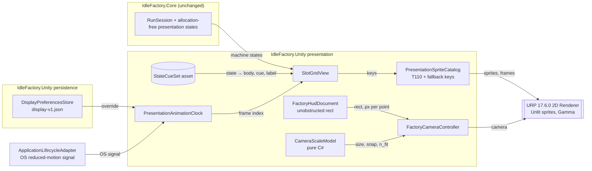

# Component Diagram: Visual Identity — 2.5D Pixel-Art Restyle

**Feature**: Replace the Feature 003 placeholder art with a 2.5D pixel-art look on a URP 2D foundation, without gameplay change.
**Generated**: 2026-10-01
**Scope**: Full feature (runtime presentation components)

---

## Overview

The runtime components that Feature 004 adds or changes inside the Unity presentation layer, and how simulation state reaches the screen. Core appears only as the unchanged source of presentation states.

## Component Diagram

## Component Breakdown

### SlotGridView

**Role**: Turns each slot's machine state into body art, a state cue, markers and labels.

**Why this exists as a separate component**: It is the only place where presentation meaning is assigned to states, so changing the cue variant (owner's spike choice) touches data, not gameplay.

**Key interactions**:
- ← RunSession: reads the existing allocation-free presentation states only.
- ← StateCueSet: reads the mapping for the Art-Bible-selected variant.
- → Catalog: asks for keys; never loads assets by path.

### StateCueSet

**Role**: Data mapping state → (body variant, cue icon, label policy, precedence).

**Why this exists as a separate component**: Variant (a) "body + exception icons" and (b) "pixel badges" must be swappable after the spike without code changes (research R06).

### PresentationSpriteCatalog

**Role**: Key → sprite or frame list, validated by world size and pivot (T110), with F003 placeholders as fallbacks.

**Why this exists as a separate component**: Keeps F003 keys stable (FR-002) and makes missing art degrade to a placeholder instead of a blank (FR-024).

### PresentationAnimationClock

**Role**: One shared clock computing frame indices for all running machines.

**Why this exists as a separate component**: One update for all animations gives zero per-frame allocations and a single place to freeze motion (FR-019, FR-020, FR-026).

### CameraScaleModel and FactoryCameraController

**Role**: The pure model computes integer scale, orthographic size, snap and fit-all; the controller applies it to the camera and keeps pan and zoom input.

**Why this exists as a separate component**: Splitting the pure math from Unity lets Edit Mode tests cover every screen class and pixel ratio (research R02, R03) while the controller remains the sole camera writer.

### DisplayPreferencesStore

**Role**: Reads and writes the reduced-motion override in a separate local file.

**Why this exists as a separate component**: Keeps player display settings out of the save (FR-001, FR-020) with its own fail-safe validation.

---

## Design Reasoning

### Why this structure?

Everything new is presentation; Core is never touched (plan Constitution II). Data-driven cue and animation mapping lets the owner's spike decision and later Art Bible versions change the look without code edits. The camera math is pure because the points-versus-pixels problem found in research R03 must be tested exhaustively.

### Alternatives considered

| Structure | Why it wasn't chosen |
|-----------|---------------------|
| URP `PixelPerfectCamera` as the camera owner | Conflicts with existing pan/zoom math and HUD-aware framing; letterboxing (R02) |
| `Animator` per machine | Allocations and per-instance state for at most 12 sprites (R05) |
| Reduced motion stored in Save V2 | Changes the save format, rejected by the owner (R11) |

### When you'd restructure

If factories grow far beyond 12 slots or scroll, the row-based sorting and single-clock update would need culling and a spatial index; if dynamic 2D lighting becomes central, the Unlit default and the baked-lighting rule would move into a lit material set.
