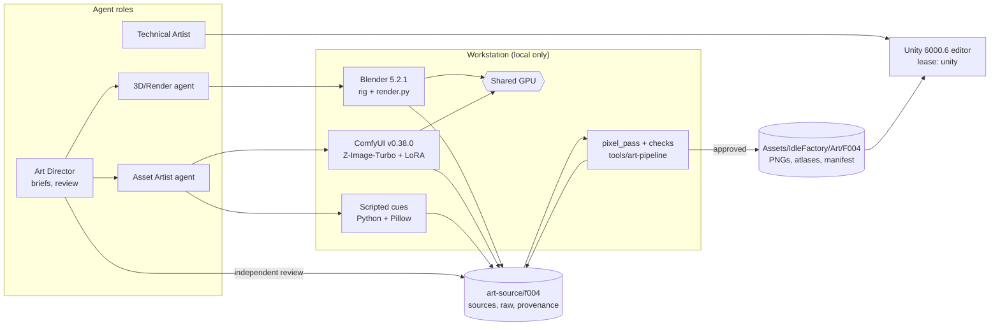
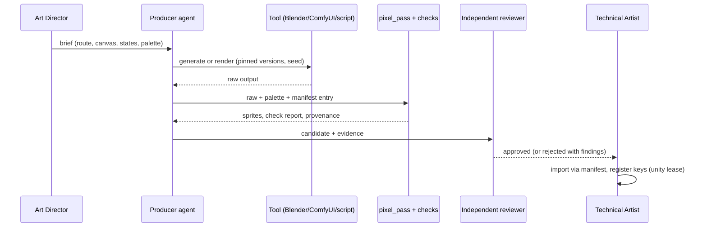

# System Design: Visual Identity Production Toolchain

**Feature**: 2.5D pixel-art restyle; new offline art production infrastructure and a new render pipeline.
**Generated**: 2026-10-01
**Scope**: New infrastructure for the feature (offline toolchain and its hand-off into Unity). Runtime components: see `component-diagram.md`.

---

## Overview

Agents produce art on the workstation with three local routes (Blender, ComfyUI, scripted drawing). All routes converge in one deterministic pixel pass that emits checked sprites, a manifest and provenance, which the Technical Artist imports into Unity. Nothing runs in the cloud; the workstation's GPU, Unity editor and emulator are shared, leased resources.

## System Design Diagram

## Infrastructure Decisions

### Local generation and rendering only

**What**: Blender and ComfyUI run locally; no hosted generation.

**Why**: AGENTS.md prefers local tools and requires explicit approval for hosted providers; the local ComfyUI and Blender MCP are already verified (`docs/integrations/mcp-readiness.md`).

**Alternatives considered**:
| Option | Why it wasn't chosen |
|--------|---------------------|
| Comfy Cloud | Needs authentication, a cost boundary and data-sharing rules |
| Commercial asset packs | Inconsistent style and license fragmentation |

**When you'd choose differently**: If local VRAM (16 GB) cannot run a needed model, a hosted route with an explicit cost and data decision.

### One deterministic convergence point

**What**: Every route ends in `tools/art-pipeline` `pixel_pass` and `checks` before review.

**Why**: Diffusion output has irregular "fake pixels" and EEVEE varies per driver; a deterministic pass plus committed intermediates makes results exactly reproducible (research R09) and enforces palette, outline and readability rules automatically (FR-023).

**Alternatives considered**:
| Option | Why it wasn't chosen |
|--------|---------------------|
| Hand cleanup in a pixel editor | No human editor available (owner decision) |
| Unity editor tooling for the pass | Would tie production to the single Unity lease |

### Sources outside `Assets/`

**What**: `art-source/f004/` holds models, raw outputs and provenance; only final PNGs and the manifest enter `Assets/`.

**Why**: Unity would try to import `.blend` files and needs Blender for that; keeping sources outside avoids importer side effects and keeps the Unity diff small.

---

## Data Flow

## Scaling & Reliability Notes

The GPU is a shared resource: generation and render batches never run during performance measurements or emulator sessions (research R14). Large sources over 10 MB need an explicit decision (no LFS initially). A failed check blocks the asset before review; a rejected review returns only that asset to its producer.
