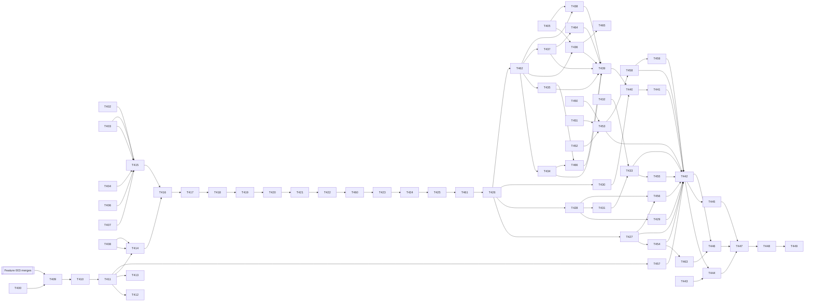

# Tasks: Visual Identity — 2.5D Pixel-Art Restyle

**Input**: Approved artifacts in `specs/004-visual-identity/`

**Prerequisites**: `spec.md` (clarified 2026-10-01), `plan.md` (OD-1 to OD-8), `research.md` (R01–R18), `data-model.md`, `contracts/render-foundation.md`, `contracts/camera-scale.md`, `contracts/presentation-and-state-cues.md`, `contracts/art-pipeline.md`, `quickstart.md`, `reviews/discovery.md`, `reviews/plan-reviews.md` and the constitution.

**Tests**: Every implementation Issue ends with its named tests green (`scripts/test-unity.ps1 -TestFile <file>`, then its ledger unit's suite; art tooling through `scripts/test-art-pipeline.ps1`). Test work is part of each task, never a separate red-only Issue. Human and agent evaluation gates (SC-001, SC-002, owner decisions) are *Parent* tasks and are reported separately from automated suites.

**Implementation lane**: MAQA. Each task is one MAQA Issue unless marked *Parent*. Issues are created later by an owner-approved `$speckit-maqa-sync` run. Every accepted dependency is merged to `origin/main` before its dependents start. After QA PASS the parent merges only through `scripts/maqa-merge.ps1 -Issue <n>` (no other merge path), then runs the coordinator's `merged #<n>` step and `scripts/maqa-board-mirror.ps1`. Each batch ends with the `after_implement` hooks (`$speckit-wiki-ingest`, `$speckit-learn-review`) run by the parent, `scripts/check-after-implement-hooks.ps1`, `scripts/maqa-stale-worktrees.ps1` and a fresh session (maqa-batch-handoff).

**Roles and skills**: role sections come from `docs/agents/roles-and-reviews.md` and are copied into each assignment; workstation rules from `docs/agents/workstation-pitfalls.md`. Claude Code workers may use the `unity:*` skills named in `docs/agents/unity-plugin-skills.md` as knowledge only, never as a gate (T410/T411: `unity:migrate-birp-to-urp`, `unity:2d-pixel-perfect`; T430/T440: `unity:sprite-editor`, `unity:manage-sprite-atlas`; UI tasks: `unity:ui-uitk`); Codex workers deliver the same result without them. The render pipeline changes only in T411. **Play-Tester**: omitted for every F004 batch with the reason recorded in `plan.md` › Review waves and role disposition.

**Feature 003 dependency**: Satisfied 2026-10-27 (Feature 003 and Feature 005 closed, `main` dacf111). The **[F003]** marker is kept as history; it no longer blocks any task. Task texts were re-validated against `main` on the same date (`reviews/plan-reviews.md` › Re-validation 2026-10-27).

**Shared resources**: `unity`, `emulator` and the new `gpu` lease via `scripts/resource-lease.ps1` (owner `issue-<n>`; the parent acquires before `SPAWN` and releases after QA and merge; a lease whose Issue is closed is stale and taken over automatically, a session-named lease needs the owner's OK). Unity runs that may have Android as the active target, every `-StandaloneWindowsPlayer` run and every performance run hold `unity,emulator`; performance runs also hold `gpu`. Blender and ComfyUI batches hold `gpu`. `[P]` means disjoint paths; leased runs are still serialized.

**Task IDs**: Task IDs are unique across the repository because the MAQA scripts map each `maqa` Issue by the task ID in its title without feature scope. Features 001–003 use T001–T143, Feature 003 follow-up Issues use T191–T196 and T243–T251, and Feature 005 uses T300–T367, so this feature uses T400–T455 (renumbered 2026-10-27 from T193–T242, which collided with Feature 003 follow-up Issues such as #307).

## Format: `[ID] [P?] [Story] Description`

- **[P]**: may run concurrently after its dependencies, on disjoint paths and worktrees.
- **[US#]**: user story in `spec.md`. Setup, foundational and closeout phases carry no story label.
- Every task names its role and lenses, paths, validation, resources and covered requirements.
- *Parent* tasks have no MAQA Issue and are ticked manually by the parent after verification.

## Issue mapping

| Task | Issue | Resources | Notes |
|---|---|---|---|
| T400, T401 | *parent* | none | Gates and plan review record |
| T402, T404, T406, T407 | new | none | Offline tooling, scripts, lease |
| T403 | new | gpu | Blender rig and render script |
| T405 | *parent* | gpu | Owner-approved LoRA download |
| T408 | new | unity | Pure camera model and Edit Mode tests |
| T409–T412 | new | unity, emulator, gpu | Baselines, phase 0, B2 |
| T413 | new | none | Independent phase-0 review |
| T414, T416, T419, T422 | new | unity, emulator | Spike import and in-game evidence |
| T415, T418, T421 | new | gpu | Spike production |
| T417, T420, T423, T426 | *parent* | none | Owner decisions |
| T424 | new | none | Art Bible and briefs |
| T425 | new | none | Independent Art Bible review |
| T461 | new | none | Art Bible revision for the T425 conditions (owner decisions 2026-10-29) |
| T427–T433 | new | unity (T427, T433: unity, emulator) | Presentation integration |
| T434–T436 | new | gpu | Production (Blender, ComfyUI) |
| T462 | new | none | Art-pipeline v1 checks and `palette-v1.json` (T425 condition R9) |
| T463 | new | unity | Landscape first-run HUD rect for the camera fit (T427 finding F1, owner decision 2026-11-03) |
| T437, T438 | new | none | Scripted production |
| T464, T465 | new | none | Tier chips; base-model hashes (owner decisions 2026-11-03, T436 QA #550) |
| T466 | new | gpu | Rig 2:1 fix and re-render of machines, plates and floor (owner decision 2026-11-03, #553) |
| T439 | new | none | Independent art review per family |
| T440, T441 | new | unity | Technical Art import, UI icons |
| T442–T444 | new | unity, emulator (T444 also gpu) | Evidence |
| T443 | new | none | Emulator journey script extension |
| T445, T447 | *parent* | none | Human/agent readability gates, owner acceptance |
| T446 | new | none | Independent final reviews |
| T448, T449 | *parent* | none | Closeout hooks and convergence |
| T450–T452 | new | unity | Feature 005 UI polish (US8), no art dependency |
| T453 | new | unity | Independent UI/UX re-review of the polish (screenshots) |
| T454 | new | unity, emulator | Pinch end and zoom-button state (split from T427) |
| T455 | new | unity, emulator | Independent UI/UX review of the Settings sheet |
| T456 | new | unity | Isometric 2:1 slot lattice (owner decision S1, 2026-10-28) |
| T457 | new | unity, emulator | Render-foundation test hardening and N-4 (owner decision 2026-10-28) |
| T458 | new | unity | Layout polish N-1/N-2 (owner decision 2026-10-28) |
| T459 | new | unity | Layout polish N-5/N-6, phone landscape 640×360 (owner decision 2026-10-29) |
| T460 | new | unity | Revised `waiting` badge of cue variant b and a new trial set (owner decision T423, 2026-10-29) |

**Organization**: Tasks are grouped by user story; the work items of `plan.md` › Proposed work breakdown (WI 1–11) are cited per task. The context-orchestration work-unit ledger below is the execution control plane for the parent agent and its clean-context MAQA workers.

## Context Orchestration Process

### Parent Orchestrator Rules

- Execute work units in ledger order unless the ledger marks units as parallel candidates and their prerequisites are verified. Task-level `[P]` markers are local hints only.
- Task checkboxes are the implementation completion checklist: a unit is complete only when every referenced task is checked after parent verification. GitHub Issues remain the MAQA workflow-status authority and checkboxes are mirrored from them (`scripts/maqa-sync-task-checkboxes.ps1`).
- Use a clean subagent session for each delegated unit, with one authoritative MAQA Issue and worktree. Include the full handoff packet; do not rely on prior conversation state.
- Keep each worker inside its listed write scope and stop before editing an unassigned path or a shared serialized Unity asset (scenes, settings and atlases only through Unity tooling).
- Test tasks require fail-first behavior where practical; a red-only unit is never accepted.
- Acquire the leases a unit needs (`scripts/resource-lease.ps1`, owner `issue-<n>`: `unity`; `emulator` for player, Android or performance runs; `gpu` for Blender, ComfyUI and performance runs) before spawning its worker, and release them after QA and merge.
- Units marked **[F003]** in their task start only after the Feature 003 Issues listed in `plan.md` › Feature 003 dependencies are merged.
- Choose the model tier per AGENTS.md routing (Medium by default; Low for read-only checklist reviews) and escalate only with a recorded reason.
- Producers never review their own assets or Art Bible text; the independent reviewer is a different session (research R18).
- The parent inspects diffs, runs targeted verification, checks for unrelated changes, and fixes or re-delegates inconsistencies before starting a dependent unit.
- The parent owns final validation and reruns the completion gates even when another agent helped interpret results. Workers and QA never run the `after_implement` hooks.

### Required Subagent Handoff Packet

Every assignment includes:

- the work unit ID, phase, task ID, MAQA Issue, exact task text and exact paths;
- the role, review lenses, complexity tier and model/reasoning level;
- the relevant `spec.md` FR, SC and edge cases, `plan.md` Design sections and owner decisions OD-1 to OD-8, `research.md` R-ids, `data-model.md` rows and `contracts/` sections;
- non-negotiable constraints: Core untouched; no gameplay, content or save change; Feature 003 keys never renamed; whole-number scales only; no GUI pixel editing; generated art only with commercial-use licenses and complete provenance; Art Bible version and the approved brief for visual work;
- the accepted prerequisite commits and the current implementation status;
- allowed and forbidden paths and tools (Blender MCP and ComfyUI only for production units that name them, after a real tool call in the worker session);
- Unity `6000.6.0f1`, target platforms and the required Edit Mode, Play Mode, player or pipeline validation, with the exact commands;
- the relevant wiki pages named in the unit's handoff sources;
- the required response: files changed, task IDs completed, tests run with results, expected failures, assumptions, unresolved risks, parent follow-up and a done/blocked verdict.

### Parent Verification Gate

For each unit, the parent:

1. inspects `git diff -- <unit paths>` plus every extra path the worker reported, and confirms edits stay in scope or are justified adjacent changes;
2. runs the targeted `scripts/test-unity.ps1 -TestFile <file>` commands, `scripts/test-art-pipeline.ps1` where art tooling or assets changed, and the suite named in the unit;
3. rereads the contract and data-model sections for any public boundary change;
4. confirms that Core, content, Save V1/V2 paths, `Library/` and `ProjectSettings/` noise (`scripts/check-settings-noise.ps1 -Commit <sha>`) and unassigned serialized assets are unchanged unless the unit names them;
5. requires independent QA PASS on the exact commit, plus the named specialist reviews, before marking the unit.

### Context Compaction Recovery

After compaction:

1. Read this process, the ledger and the checklist.
2. Run `git status --short` and `scripts/resource-lease.ps1 -Status`, and inspect existing diffs.
3. Resume at an earlier partially changed unit if one exists; otherwise at the first unit with unchecked tasks whose prerequisites are accepted.
4. Reconstruct state from Issue status, merged commits, mirrored checkboxes, diffs, review records and targeted tests.
5. Finish and verify that unit before opening another worker.

### Work Unit Ledger

Ledger convention: one unit per task, rows in execution order, every prerequisite names an earlier unit; the Tasks column is the only mapping between units and tasks. Refreshed 2026-10-29 after the owner decisions on the T425 conditions (63 units; T461 and T462 added, units renumbered in checklist order). Refreshed 2026-11-03: T463 added as WU33 after the owner decision on the T427 finding F1 (64 units, later units renumbered). Refreshed 2026-11-03: T464 and T465 added as WU48 and WU49 after the owner decisions on the T436 QA findings (#550); later units renumbered (66 units). Refreshed 2026-11-03: T466 (rig 2:1 fix and re-render, owner decision, #553) added as WU50; later units renumbered (67 units).

| Unit | Phase | Tasks | Atomic scope and touched paths | Prerequisites | Required handoff sources | Parent verification |
|------|-------|-------|--------------------------------|---------------|--------------------------|---------------------|
| WU01 | Phase 1: Setup and gates | T400 | Parent-only. Parent-only decision record; no repository code. | None | spec.md, plan.md (Feature 003 dependencies), reviews/plan-reviews.md; spec.md FR/SC named in the task | Parent records the decision or gate result with date and evidence links; diff limited to the named records. |
| WU02 | Phase 1: Setup and gates | T401 | Parent-only. `specs/004-visual-identity/reviews/plan-reviews.md` | None | spec.md, plan.md (Feature 003 dependencies), reviews/plan-reviews.md; spec.md FR/SC named in the task | Parent records the decision or gate result with date and evidence links; diff limited to the named records. |
| WU03 | Phase 2: Foundational tooling (no Feature 003 dependency) | T402 | `tools/art-pipeline/`, `palette/palette-v0.json`, `art-source/_rejected/`, `tools/art-pipeline/tests/`, `scripts/test-art-pipeline.ps1` | None (parallel candidate) | contracts/art-pipeline.md, contracts/camera-scale.md, research.md R02, R03, R07, R09, R14, plan.md Test strategy; wiki/pages/art-production-pipeline.md, pixel-camera-scale.md; spec.md FR/SC named in the task | `scripts/test-art-pipeline.ps1`; diff limited to the listed paths; independent QA PASS on the exact commit. |
| WU04 | Phase 2: Foundational tooling (no Feature 003 dependency) | T403 | `tools/art-pipeline/blender/rig-v1.blend`, `tools/art-pipeline/blender/render.py`, `docs/integrations/mcp-readiness.md`, `scripts/check-art-tooling.ps1` | None (parallel candidate) | contracts/art-pipeline.md, contracts/camera-scale.md, research.md R02, R03, R07, R09, R14, plan.md Test strategy; wiki/pages/art-production-pipeline.md, pixel-camera-scale.md; spec.md FR/SC named in the task | `scripts/test-art-pipeline.ps1`; diff limited to the listed paths; independent QA PASS on the exact commit. |
| WU05 | Phase 2: Foundational tooling (no Feature 003 dependency) | T404 | `tools/art-pipeline/comfy/` | None (parallel candidate) | contracts/art-pipeline.md, contracts/camera-scale.md, research.md R02, R03, R07, R09, R14, plan.md Test strategy; wiki/pages/art-production-pipeline.md, pixel-camera-scale.md; spec.md FR/SC named in the task | `scripts/test-art-pipeline.ps1`; diff limited to the listed paths; independent QA PASS on the exact commit. |
| WU06 | Phase 2: Foundational tooling (no Feature 003 dependency) | T405 | Parent-only. `tarn59/pixel_art_style_lora_z_image_turbo`, `tools/art-pipeline/models.json` | None | contracts/art-pipeline.md, contracts/camera-scale.md, research.md R02, R03, R07, R09, R14, plan.md Test strategy; wiki/pages/art-production-pipeline.md, pixel-camera-scale.md; spec.md FR/SC named in the task | Parent records the decision or gate result with date and evidence links; diff limited to the named records. |
| WU07 | Phase 2: Foundational tooling (no Feature 003 dependency) | T406 | `scripts/test-art-pipeline.ps1`, `scripts/test-unity.ps1`, `tools/art-pipeline/`, `art-source/`, `Assets/IdleFactory/Art/F004/`, `scripts/check-after-implement-hooks.ps1` | None (parallel candidate) | contracts/art-pipeline.md, contracts/camera-scale.md, research.md R02, R03, R07, R09, R14, plan.md Test strategy; wiki/pages/art-production-pipeline.md, pixel-camera-scale.md; spec.md FR/SC named in the task | `scripts/test-art-pipeline.ps1`; diff limited to the listed paths; independent QA PASS on the exact commit. |
| WU08 | Phase 2: Foundational tooling (no Feature 003 dependency) | T407 | `scripts/resource-lease.ps1` | None (parallel candidate) | contracts/art-pipeline.md, contracts/camera-scale.md, research.md R02, R03, R07, R09, R14, plan.md Test strategy; wiki/pages/art-production-pipeline.md, pixel-camera-scale.md; spec.md FR/SC named in the task | diff inspection against the listed paths plus the closest validation named in the task; diff limited to the listed paths; independent QA PASS on the exact commit. |
| WU09 | Phase 2: Foundational tooling (no Feature 003 dependency) | T408 | `Assets/IdleFactory/Unity/Presentation/CameraScaleModel.cs`, `Assets/IdleFactory/Tests/EditMode/CameraScaleModelTests.cs` | None (parallel candidate) | contracts/art-pipeline.md, contracts/camera-scale.md, research.md R02, R03, R07, R09, R14, plan.md Test strategy; wiki/pages/art-production-pipeline.md, pixel-camera-scale.md; spec.md FR/SC named in the task | `scripts/test-unity.ps1 -TestFile Assets/IdleFactory/Tests/EditMode/CameraScaleModelTests.cs`; `scripts/test-unity.ps1` filtered to `ScreenClassScaleTableTests`; full `scripts/test-unity.ps1`; `scripts/check-settings-noise.ps1 -Commit <sha>`; diff limited to the listed paths; independent QA PASS on the exact commit. |
| WU10 | Phase 3: User Story 7 — Rendering foundation switch without regression (P1, phase 0) | T409 | `Assets/IdleFactory/Tests/PlayMode/Fixtures/Screenshots/F004-B1/`, `Assets/IdleFactory/Tests/PlayMode/RenderParityTests.cs`, `Assets/IdleFactory/Tests/PlayMode/Fixtures/W004V/` | WU01 | contracts/render-foundation.md, research.md R01, R12, R13, plan.md Performance, quickstart.md Scenario 1; wiki/pages/urp-rendering-foundation.md, mobile-performance-targets.md, android-emulator-profiling.md, android-emulator-validation.md; spec.md FR/SC named in the task | `scripts/test-unity.ps1 -TestFile Assets/IdleFactory/Tests/PlayMode/RenderParityTests.cs`; full `scripts/test-unity.ps1`; `scripts/check-settings-noise.ps1 -Commit <sha>`; diff limited to the listed paths; independent QA PASS on the exact commit. |
| WU11 | Phase 3: User Story 7 — Rendering foundation switch without regression (P1, phase 0) | T410 | `<git-common-dir>/../artifacts/f004/B1-<commit7>-<sha256-8>.apk`, `specs/004-visual-identity/reviews/baselines.md` | WU10 | contracts/render-foundation.md, research.md R01, R12, R13, plan.md Performance, quickstart.md Scenario 1; wiki/pages/urp-rendering-foundation.md, mobile-performance-targets.md, android-emulator-profiling.md, android-emulator-validation.md; spec.md FR/SC named in the task | full `scripts/test-unity.ps1`; `scripts/check-settings-noise.ps1 -Commit <sha>`; diff limited to the listed paths; independent QA PASS on the exact commit. |
| WU12 | Phase 3: User Story 7 — Rendering foundation switch without regression (P1, phase 0) | T411 | `Assets/IdleFactory/Rendering/`, `Assets/IdleFactory/Tests/EditMode/RenderPipelineConfigurationTests.cs`, `Packages/manifest.json`, `Packages/packages-lock.json`, `ProjectSettings/GraphicsSettings.asset`, `ProjectSettings/QualitySettings.asset`, `Assets/IdleFactory/Scenes/CoreGameFoundation.unity` (camera only) | WU10, WU11 | contracts/render-foundation.md, research.md R01, R12, R13, plan.md Performance, quickstart.md Scenario 1; wiki/pages/urp-rendering-foundation.md, mobile-performance-targets.md, android-emulator-profiling.md, android-emulator-validation.md; spec.md FR/SC named in the task | `scripts/test-unity.ps1 -TestFile Assets/IdleFactory/Tests/EditMode/RenderPipelineConfigurationTests.cs`; `scripts/test-unity.ps1` filtered to `RenderParityTests`; `scripts/test-art-pipeline.ps1`; full `scripts/test-unity.ps1`; `scripts/check-settings-noise.ps1 -Commit <sha>`; diff limited to the listed paths; independent QA PASS on the exact commit. |
| WU13 | Phase 3: User Story 7 — Rendering foundation switch without regression (P1, phase 0) | T412 | `specs/004-visual-identity/reviews/performance-budgets.md` | WU12 | contracts/render-foundation.md, research.md R01, R12, R13, plan.md Performance, quickstart.md Scenario 1; wiki/pages/urp-rendering-foundation.md, mobile-performance-targets.md, android-emulator-profiling.md, android-emulator-validation.md; spec.md FR/SC named in the task | full `scripts/test-unity.ps1`; `scripts/check-settings-noise.ps1 -Commit <sha>`; diff limited to the listed paths; independent QA PASS on the exact commit. |
| WU14 | Phase 3: User Story 7 — Rendering foundation switch without regression (P1, phase 0) | T413 | `specs/004-visual-identity/reviews/phase0-review.md` | WU12 | contracts/render-foundation.md, research.md R01, R12, R13, plan.md Performance, quickstart.md Scenario 1; wiki/pages/urp-rendering-foundation.md, mobile-performance-targets.md, android-emulator-profiling.md, android-emulator-validation.md; spec.md FR/SC named in the task | diff inspection against the listed paths plus the closest validation named in the task; diff limited to the listed paths; independent QA PASS on the exact commit. |
| WU15 | Phase 3: User Story 7 — Rendering foundation switch without regression (P1, phase 0) | T457 | `Assets/IdleFactory/Tests/EditMode/RenderPipelineConfigurationTests.cs`, `Assets/IdleFactory/Tests/PlayMode/RenderParityTests.cs`, `RenderCaptureHarness.cs`, `Assets/IdleFactory/Rendering/` (stripping or renderer-data setting for N-4 only, through Unity tooling) | WU12 | contracts/render-foundation.md, research.md R01, R13, reviews/phase0-review.md (A6, A8, F1, F3, F4, F5), reviews/polish-review.md (N-4); wiki/pages/urp-rendering-foundation.md, f004-batch-4-workflow-pitfalls.md; spec.md FR/SC named in the task | `scripts/test-unity.ps1 -TestFile Assets/IdleFactory/Tests/EditMode/RenderPipelineConfigurationTests.cs`; `scripts/test-unity.ps1` filtered to `RenderParityTests` incl. one cold run after a fresh `Library` or target switch; development-player log without the GaussianDepthOfField entry; Android variant count within the T411 bound; full `scripts/test-unity.ps1`; `git diff` on `UniversalRenderPipelineGlobalSettings.asset` reviewed; `scripts/check-settings-noise.ps1 -Commit <sha>`; diff limited to the listed paths; independent QA PASS on the exact commit. |
| WU16 | Phase 4: User Story 6 — Owner decides the style on evidence (P1) | T414 | `Assets/IdleFactory/Art/F004/Spike/D16/`, `D24/`, `D32/` | WU09, WU12 | contracts/art-pipeline.md, contracts/presentation-and-state-cues.md, research.md R03, R06, R16, R17, R18, data-model.md (style-spike record, brief), quickstart.md Scenario 2; wiki/pages/visual-identity-art-direction.md, art-production-pipeline.md; spec.md FR/SC named in the task | full `scripts/test-unity.ps1`; `scripts/check-settings-noise.ps1 -Commit <sha>`; diff limited to the listed paths; independent QA PASS on the exact commit. |
| WU17 | Phase 4: User Story 6 — Owner decides the style on evidence (P1) | T415 | `art-source/f004/spike/s1/` | WU03, WU04, WU05, WU07, WU08 (parallel candidate) | contracts/art-pipeline.md, contracts/presentation-and-state-cues.md, research.md R03, R06, R16, R17, R18, data-model.md (style-spike record, brief), quickstart.md Scenario 2; wiki/pages/visual-identity-art-direction.md, art-production-pipeline.md; spec.md FR/SC named in the task | `scripts/test-art-pipeline.ps1`; diff limited to the listed paths; independent QA PASS on the exact commit. |
| WU18 | Phase 4: User Story 6 — Owner decides the style on evidence (P1) | T416 | `specs/004-visual-identity/reviews/style-spike.md` | WU16, WU17 | contracts/art-pipeline.md, contracts/presentation-and-state-cues.md, research.md R03, R06, R16, R17, R18, data-model.md (style-spike record, brief), quickstart.md Scenario 2; wiki/pages/visual-identity-art-direction.md, art-production-pipeline.md; spec.md FR/SC named in the task | full `scripts/test-unity.ps1`; `scripts/check-settings-noise.ps1 -Commit <sha>`; diff limited to the listed paths; independent QA PASS on the exact commit. |
| WU19 | Phase 4: User Story 6 — Owner decides the style on evidence (P1) | T417 | Parent-only. Parent-only decision record; no repository code. | WU18 | contracts/art-pipeline.md, contracts/presentation-and-state-cues.md, research.md R03, R06, R16, R17, R18, data-model.md (style-spike record, brief), quickstart.md Scenario 2; wiki/pages/visual-identity-art-direction.md, art-production-pipeline.md; spec.md FR/SC named in the task | Parent records the decision or gate result with date and evidence links; diff limited to the named records. |
| WU20 | Phase 4: User Story 6 — Owner decides the style on evidence (P1) | T418 | `art-source/f004/spike/s2/`, `Assets/IdleFactory/Art/F004/Spike/D16/`, `D24/` | WU19 (parallel candidate) | contracts/art-pipeline.md, contracts/presentation-and-state-cues.md, research.md R03, R06, R16, R17, R18, data-model.md (style-spike record, brief), quickstart.md Scenario 2; wiki/pages/visual-identity-art-direction.md, art-production-pipeline.md; spec.md FR/SC named in the task | `scripts/test-art-pipeline.ps1`; diff limited to the listed paths; independent QA PASS on the exact commit. |
| WU21 | Phase 4: User Story 6 — Owner decides the style on evidence (P1) | T419 | Parent-only decision record; no repository code. | WU20 | contracts/art-pipeline.md, contracts/presentation-and-state-cues.md, research.md R03, R06, R16, R17, R18, data-model.md (style-spike record, brief), quickstart.md Scenario 2; wiki/pages/visual-identity-art-direction.md, art-production-pipeline.md; spec.md FR/SC named in the task | full `scripts/test-unity.ps1`; `scripts/check-settings-noise.ps1 -Commit <sha>`; diff limited to the listed paths; independent QA PASS on the exact commit. |
| WU22 | Phase 4: User Story 6 — Owner decides the style on evidence (P1) | T420 | Parent-only. Parent-only decision record; no repository code. | WU21 | contracts/art-pipeline.md, contracts/presentation-and-state-cues.md, research.md R03, R06, R16, R17, R18, data-model.md (style-spike record, brief), quickstart.md Scenario 2; wiki/pages/visual-identity-art-direction.md, art-production-pipeline.md; spec.md FR/SC named in the task | Parent records the decision or gate result with date and evidence links; diff limited to the named records. |
| WU23 | Phase 4: User Story 6 — Owner decides the style on evidence (P1) | T421 | `art-source/f004/spike/s3-s4/`, `Assets/IdleFactory/Art/F004/Spike/D<k>/` | WU22 (parallel candidate) | contracts/art-pipeline.md, contracts/presentation-and-state-cues.md, research.md R03, R06, R16, R17, R18, data-model.md (style-spike record, brief), quickstart.md Scenario 2; wiki/pages/visual-identity-art-direction.md, art-production-pipeline.md; spec.md FR/SC named in the task | `scripts/test-art-pipeline.ps1`; diff limited to the listed paths; independent QA PASS on the exact commit. |
| WU24 | Phase 4: User Story 6 — Owner decides the style on evidence (P1) | T422 | `tools/art-pipeline/trials/timed_trial.py`, `reviews/readability-spike.md` | WU23 | contracts/art-pipeline.md, contracts/presentation-and-state-cues.md, research.md R03, R06, R16, R17, R18, data-model.md (style-spike record, brief), quickstart.md Scenario 2; wiki/pages/visual-identity-art-direction.md, art-production-pipeline.md; spec.md FR/SC named in the task | `scripts/test-art-pipeline.ps1`; full `scripts/test-unity.ps1`; `scripts/check-settings-noise.ps1 -Commit <sha>`; diff limited to the listed paths; independent QA PASS on the exact commit. |
| WU25 | Phase 4: User Story 6 — Owner decides the style on evidence (P1) | T460 | `art-source/f004/spike/s3-s4/`, `Assets/IdleFactory/Art/F004/Spike/D24/isometric-2-1-s3/`, `Assets/IdleFactory/Art/F004/Spike/Tests/EditMode/SpikeImportTests.cs`, `specs/004-visual-identity/reviews/style-spike/s3/`, `tools/art-pipeline/trials/timed_trial.py` | WU24 | contracts/art-pipeline.md, contracts/presentation-and-state-cues.md, research.md R16, R17, data-model.md (style-spike record), reviews/style-spike.md § S3/S4 and § Owner timed trial, round 1; wiki/pages/f004-s2-spike-and-s1-decision.md, art-production-pipeline.md; spec.md FR/SC named in the task | `scripts/test-art-pipeline.ps1`; `scripts/test-unity.ps1 -Suite EditMode -TestFile Assets/IdleFactory/Art/F004/Spike/Tests/EditMode/SpikeImportTests.cs`; `scripts/check-settings-noise.ps1 -Commit <sha>`; diff limited to the listed paths; independent blind naming of the new b23 sheets with zero confusions; independent QA PASS on the exact commit. |
| WU26 | Phase 4: User Story 6 — Owner decides the style on evidence (P1) | T423 | Parent-only. `reviews/style-spike.md` | WU25 | contracts/art-pipeline.md, contracts/presentation-and-state-cues.md, research.md R03, R06, R16, R17, R18, data-model.md (style-spike record, brief), quickstart.md Scenario 2; wiki/pages/visual-identity-art-direction.md, art-production-pipeline.md; spec.md FR/SC named in the task | Parent records the decision or gate result with date and evidence links; diff limited to the named records. |
| WU27 | Phase 4: User Story 6 — Owner decides the style on evidence (P1) | T424 | `docs/art/F004-art-bible-v1.md`, `docs/art/F004-asset-briefs-v1.md` | WU26 | contracts/art-pipeline.md, contracts/presentation-and-state-cues.md, research.md R03, R06, R16, R17, R18, data-model.md (style-spike record, brief), quickstart.md Scenario 2; wiki/pages/visual-identity-art-direction.md, art-production-pipeline.md; spec.md FR/SC named in the task | diff inspection against the listed paths plus the closest validation named in the task; diff limited to the listed paths; independent QA PASS on the exact commit. |
| WU28 | Phase 4: User Story 6 — Owner decides the style on evidence (P1) | T425 | `specs/004-visual-identity/reviews/art-bible-review.md` | WU27 | contracts/art-pipeline.md, contracts/presentation-and-state-cues.md, research.md R03, R06, R16, R17, R18, data-model.md (style-spike record, brief), quickstart.md Scenario 2; wiki/pages/visual-identity-art-direction.md, art-production-pipeline.md; spec.md FR/SC named in the task | diff inspection against the listed paths plus the closest validation named in the task; diff limited to the listed paths; independent QA PASS on the exact commit. |
| WU29 | Phase 4: User Story 6 — Owner decides the style on evidence (P1) | T461 | `docs/art/F004-art-bible-v1.md`, `docs/art/F004-asset-briefs-v1.md`, `specs/004-visual-identity/contracts/art-pipeline.md`, `specs/004-visual-identity/plan.md`, `specs/004-visual-identity/research.md` (ComfyUI pin only) | WU28 | docs/art/F004-art-bible-v1.md, docs/art/F004-asset-briefs-v1.md, reviews/art-bible-review.md, reviews/style-spike.md, contracts/art-pipeline.md, contracts/presentation-and-state-cues.md, research.md R16–R18; wiki/pages/visual-identity-art-direction.md, f004-s3-s4-cue-and-lighting-decision.md, art-production-pipeline.md; spec.md FR/SC named in the task | Diff limited to the listed paths; each condition R1–R5, R7, R8, R11, R12, R15 mapped to a section; re-measured numbers reproduce; independent QA PASS on the exact commit. |
| WU30 | Phase 4: User Story 6 — Owner decides the style on evidence (P1) | T426 | Parent-only. Parent-only decision record; no repository code. | WU29 | contracts/art-pipeline.md, contracts/presentation-and-state-cues.md, research.md R03, R06, R16, R17, R18, data-model.md (style-spike record, brief), quickstart.md Scenario 2; wiki/pages/visual-identity-art-direction.md, art-production-pipeline.md; spec.md FR/SC named in the task | Parent records the decision or gate result with date and evidence links; diff limited to the named records. |
| WU31 | Phase 5: User Story 3 — Crisp pixels at every zoom and on every screen (P1) | T427 | `Assets/IdleFactory/Unity/Presentation/FactoryCameraController.cs`, `RunCameraFraming.cs`, `SlotGridView.cs` (`RunZoomSettings` only), `Assets/IdleFactory/Unity/Bootstrap/CoreGameFoundationBootstrap.cs` (camera wiring only), `Assets/IdleFactory/Tests/PlayMode/RunHudLayoutTests.cs`, `SlotGridTests.cs`, `PixelCrispnessTests.cs`, `ScreenClassScalePlayTests.cs` | WU09, WU12, WU30 | contracts/camera-scale.md, research.md R02, R03, R13, R15, quickstart.md Scenario 3; wiki/pages/pixel-camera-scale.md, ui-toolkit-hud-layout-pitfalls.md; spec.md FR/SC named in the task | `scripts/test-unity.ps1` filtered to `RunHudLayoutTests`; `scripts/test-unity.ps1` filtered to `SlotGridTests`; `scripts/test-unity.ps1` filtered to `PixelCrispnessTests`; `scripts/test-unity.ps1` filtered to `ScreenClassScalePlayTests`; full `scripts/test-unity.ps1`; `scripts/check-settings-noise.ps1 -Commit <sha>`; `scripts/test-unity.ps1 -StandaloneWindowsPlayer`; diff limited to the listed paths; independent QA PASS on the exact commit. |
| WU32 | Phase 5: User Story 3 — Crisp pixels at every zoom and on every screen (P1) | T454 | `Assets/IdleFactory/Unity/Input/NavigationGestureInterpreter.cs`, `NavigationInputAdapter.cs`, `Assets/IdleFactory/Unity/Bootstrap/CoreGameFoundationBootstrap.cs` (`RouteNavigationIntent` case only), `Assets/IdleFactory/Unity/UI/RunShellDocument.cs` (zoom-button state only), `Assets/IdleFactory/Tests/PlayMode/NavigationInputTests.cs`, `RunHudLayoutTests.cs` | WU31 | contracts/camera-scale.md rules 4–5, research.md R02, quickstart.md Scenario 3; wiki/pages/pixel-camera-scale.md, ui-toolkit-hud-layout-pitfalls.md; spec.md FR/SC named in the task | `scripts/test-unity.ps1 -TestFile Assets/IdleFactory/Tests/PlayMode/NavigationInputTests.cs`; `scripts/test-unity.ps1 -TestFile Assets/IdleFactory/Tests/PlayMode/RunHudLayoutTests.cs`; full `scripts/test-unity.ps1`; `scripts/check-settings-noise.ps1 -Commit <sha>`; diff limited to the listed paths; independent QA PASS on the exact commit. |
| WU33 | Phase 5: User Story 3 — Crisp pixels at every zoom and on every screen (P1) | T463 | `Assets/IdleFactory/Unity/UI/RunShellDocument.cs` (`TryGetUnobstructedScreenRect` only), `Assets/IdleFactory/Unity/UI/FactoryRun.uxml`, `FactoryRun.uss` (hint bar and vein placement only), `Assets/IdleFactory/Tests/PlayMode/ScreenClassScalePlayTests.cs`, `RunHudLayoutTests.cs` | WU32 | contracts/camera-scale.md rules 1–3 and 7, research.md R02, R15; #539 QA and review comments (F1, B2 options A–C); wiki/pages/pixel-camera-scale.md, ui-toolkit-hud-layout-pitfalls.md; spec.md FR/SC named in the task | `scripts/test-unity.ps1 -TestFile Assets/IdleFactory/Tests/PlayMode/ScreenClassScalePlayTests.cs`; `scripts/test-unity.ps1 -TestFile Assets/IdleFactory/Tests/PlayMode/RunHudLayoutTests.cs`; full `scripts/test-unity.ps1`; `scripts/check-settings-noise.ps1 -Commit <sha>`; diff limited to the listed paths; independent QA PASS and independent UI/UX acceptance on the exact commit. |
| WU34 | Phase 6: User Stories 1 and 2 — State cues and restyled factory (P1) | T428 | `Assets/IdleFactory/Unity/Presentation/PresentationSpriteCatalog.cs`, `Assets/IdleFactory/Tests/EditMode/PresentationCatalogFallbackTests.cs`, `Assets/IdleFactory/Tests/PlayMode/ArtFallbackTests.cs`, `Assets/IdleFactory/Tests/EditMode/PresentationSpriteCatalogTests.cs` (F001 required-key rows moved to the optional table) | WU30 | contracts/presentation-and-state-cues.md, contracts/art-pipeline.md (Unity side), research.md R04, R06, R10, data-model.md (catalog entry, state-cue set); wiki/pages/unity-presentation-boundary.md, visual-identity-art-direction.md; spec.md FR/SC named in the task | `scripts/test-unity.ps1 -TestFile Assets/IdleFactory/Tests/EditMode/PresentationCatalogFallbackTests.cs`; `scripts/test-unity.ps1 -TestFile Assets/IdleFactory/Tests/PlayMode/ArtFallbackTests.cs`; full `scripts/test-unity.ps1`; `scripts/check-settings-noise.ps1 -Commit <sha>`; `scripts/test-unity.ps1 -StandaloneWindowsPlayer`; diff limited to the listed paths; independent QA PASS on the exact commit. |
| WU35 | Phase 6: User Stories 1 and 2 — State cues and restyled factory (P1) | T429 | `Assets/IdleFactory/Unity/Presentation/StateCueSet.cs`, `Assets/IdleFactory/Tests/EditMode/StateCueSetTests.cs`, `Assets/IdleFactory/Tests/PlayMode/StateCueOverlayTests.cs`, `Assets/IdleFactory/Unity/Presentation/SlotGridView.cs`, `Assets/IdleFactory/Tests/PlayMode/SlotGridTests.cs` (only if the `SlotVisual` constructor changes; existing `BadgeFor` signatures kept) | WU34 | contracts/presentation-and-state-cues.md, contracts/art-pipeline.md (Unity side), research.md R04, R06, R10, data-model.md (catalog entry, state-cue set); wiki/pages/unity-presentation-boundary.md, visual-identity-art-direction.md; spec.md FR/SC named in the task | `scripts/test-unity.ps1 -TestFile Assets/IdleFactory/Tests/EditMode/StateCueSetTests.cs`; `scripts/test-unity.ps1 -TestFile Assets/IdleFactory/Tests/PlayMode/StateCueOverlayTests.cs`; full `scripts/test-unity.ps1`; `scripts/check-settings-noise.ps1 -Commit <sha>`; diff limited to the listed paths; independent QA PASS on the exact commit. |
| WU36 | Phase 6: User Stories 1 and 2 — State cues and restyled factory (P1) | T430 | `Assets/IdleFactory/Editor/Art/F004SpriteImportPostprocessor.cs`, `Assets/IdleFactory/Tests/EditMode/F004AssetContractTests.cs` | WU30 | contracts/presentation-and-state-cues.md, contracts/art-pipeline.md (Unity side), research.md R04, R06, R10, data-model.md (catalog entry, state-cue set); wiki/pages/unity-presentation-boundary.md, visual-identity-art-direction.md; spec.md FR/SC named in the task | `scripts/test-unity.ps1 -TestFile Assets/IdleFactory/Tests/EditMode/F004AssetContractTests.cs`; full `scripts/test-unity.ps1`; `scripts/check-settings-noise.ps1 -Commit <sha>`; diff limited to the listed paths; independent QA PASS on the exact commit. |
| WU37 | Phase 6: User Stories 1 and 2 — State cues and restyled factory (P1) | T456 | `Assets/IdleFactory/Unity/Presentation/SlotGridView.cs`, `GridWorldMapper.cs`, `Assets/IdleFactory/Tests/PlayMode/SlotGridTests.cs`, `NavigationInputTests.cs`, Edit Mode mapping tests | WU31, WU34 | research.md R04, contracts/presentation-and-state-cues.md, contracts/camera-scale.md, reviews/style-spike.md § S1 (owner decision, Art Director condition 1); wiki/pages/unity-presentation-boundary.md, pixel-camera-scale.md; spec.md FR/SC named in the task | `scripts/test-unity.ps1 -TestFile Assets/IdleFactory/Tests/PlayMode/SlotGridTests.cs` and `NavigationInputTests.cs`; full `scripts/test-unity.ps1`; `scripts/check-settings-noise.ps1 -Commit <sha>`; diff limited to the listed paths; independent QA PASS on the exact commit. |
| WU38 | Phase 7: User Story 4 — Animation and reduced motion (P2) | T431 | `Assets/IdleFactory/Unity/Presentation/PresentationAnimationClock.cs` | WU34 (parallel candidate) | contracts/presentation-and-state-cues.md (Animation, Display preferences), research.md R05, R11, data-model.md (display preferences), plan.md OD-8; wiki/pages/unity-presentation-boundary.md, ui-toolkit-hud-layout-pitfalls.md; spec.md FR/SC named in the task | `scripts/test-unity.ps1` filtered to `PresentationAnimationClockTests`; `scripts/test-unity.ps1` filtered to `PresentationAllocationTests`; full `scripts/test-unity.ps1`; `scripts/check-settings-noise.ps1 -Commit <sha>`; diff limited to the listed paths; independent QA PASS on the exact commit. |
| WU39 | Phase 7: User Story 4 — Animation and reduced motion (P2) | T432 | `Assets/IdleFactory/Unity/Persistence/DisplayPreferencesStore.cs`, `Assets/IdleFactory/Unity/Bootstrap/ReducedMotionSignal.{Android,Windows,Default}.cs`, `Assets/IdleFactory/Unity/Bootstrap/CoreGameFoundationBootstrap.cs` (focus-return refresh only), `link.xml`, `Assets/IdleFactory/Tests/EditMode/DisplayPreferencesStoreTests.cs` | None (parallel candidate) | contracts/presentation-and-state-cues.md (Animation, Display preferences), research.md R05, R11, data-model.md (display preferences), plan.md OD-8; wiki/pages/unity-presentation-boundary.md, ui-toolkit-hud-layout-pitfalls.md; spec.md FR/SC named in the task | `scripts/test-unity.ps1` filtered to `DisplayPreferencesStoreTests`; full `scripts/test-unity.ps1`; `scripts/check-settings-noise.ps1 -Commit <sha>`; diff limited to the listed paths; independent QA PASS on the exact commit. |
| WU40 | Phase 7: User Story 4 — Animation and reduced motion (P2) | T433 | `Assets/IdleFactory/Unity/UI/Panels/Settings/`, `Assets/IdleFactory/Unity/UI/ShellPanelRegistry.cs` (the `ShellPanelIds.Settings` constant and its `IsKnown` clause), `Assets/IdleFactory/Unity/UI/FactoryRun.uxml`/`.uss` (gear only), `Assets/IdleFactory/Unity/UI/RunShellDocument.cs` (gear lookup, `ShowPanel` state, `HandleBack` branch, focus return), `Assets/IdleFactory/Tests/PlayMode/SettingsSheetTests.cs`, `ReducedMotionTests.cs` | WU38, WU39 | contracts/presentation-and-state-cues.md (Animation, Display preferences), research.md R05, R11, data-model.md (display preferences), plan.md OD-8; wiki/pages/unity-presentation-boundary.md, ui-toolkit-hud-layout-pitfalls.md; spec.md FR/SC named in the task | `scripts/test-unity.ps1` filtered to `SettingsSheetTests`; `scripts/test-unity.ps1` filtered to `ReducedMotionTests`; full `scripts/test-unity.ps1`; `scripts/check-settings-noise.ps1 -Commit <sha>`; `scripts/test-unity.ps1 -StandaloneWindowsPlayer`; diff limited to the listed paths; independent QA PASS on the exact commit. |
| WU41 | Phase 7: User Story 4 — Animation and reduced motion (P2) | T455 | Read-only review. `specs/004-visual-identity/reviews/settings-review.md` | WU40 | contracts/presentation-and-state-cues.md (Display preferences), plan.md OD-8, spec.md FR-020, FR-020a; wiki/pages/ui-toolkit-hud-layout-pitfalls.md, run-panel-conventions.md | diff limited to the review record; reviewer independent of T433's author; screenshot matrix and device-pass line present. |
| WU42 | Phase 8: Production of the restyled asset set (US2, US5, US6) | T462 | `tools/art-pipeline` (checks, manifest flag, `palette-v1.json`) | WU30 | docs/art/F004-art-bible-v1.md, docs/art/F004-asset-briefs-v1.md, reviews/art-bible-review.md, reviews/style-spike.md, contracts/art-pipeline.md, contracts/presentation-and-state-cues.md, research.md R16–R18; wiki/pages/visual-identity-art-direction.md, f004-s3-s4-cue-and-lighting-decision.md, art-production-pipeline.md; spec.md FR/SC named in the task; research.md R07–R10 | `scripts/test-art-pipeline.ps1`; diff limited to the listed paths; independent QA PASS on the exact commit. |
| WU43 | Phase 8: Production of the restyled asset set (US2, US5, US6) | T434 | `art-source/f004/machines/` | WU04, WU42 (parallel candidate) | docs/art/F004-art-bible-v1.md, docs/art/F004-asset-briefs-v1.md, contracts/art-pipeline.md, research.md R07–R10; wiki/pages/art-production-pipeline.md, visual-identity-art-direction.md; spec.md FR/SC named in the task | `scripts/test-art-pipeline.ps1`; diff limited to the listed paths; independent QA PASS on the exact commit. |
| WU44 | Phase 8: Production of the restyled asset set (US2, US5, US6) | T435 | `art-source/f004/slots/`, `art-source/f004/floor/` | WU42 (parallel candidate) | docs/art/F004-art-bible-v1.md, docs/art/F004-asset-briefs-v1.md, contracts/art-pipeline.md, research.md R07–R10; wiki/pages/art-production-pipeline.md, visual-identity-art-direction.md; spec.md FR/SC named in the task | `scripts/test-art-pipeline.ps1`; diff limited to the listed paths; independent QA PASS on the exact commit. |
| WU45 | Phase 8: Production of the restyled asset set (US2, US5, US6) | T436 | `art-source/f004/resources/`, `art-source/f004/items/` | WU06, WU42 (parallel candidate) | docs/art/F004-art-bible-v1.md, docs/art/F004-asset-briefs-v1.md, contracts/art-pipeline.md, research.md R07–R10; wiki/pages/art-production-pipeline.md, visual-identity-art-direction.md; spec.md FR/SC named in the task | `scripts/test-art-pipeline.ps1`; diff limited to the listed paths; independent QA PASS on the exact commit. |
| WU46 | Phase 8: Production of the restyled asset set (US2, US5, US6) | T437 | `tools/art-pipeline` | WU42 (parallel candidate) | docs/art/F004-art-bible-v1.md, docs/art/F004-asset-briefs-v1.md, contracts/art-pipeline.md, research.md R07–R10; wiki/pages/art-production-pipeline.md, visual-identity-art-direction.md; spec.md FR/SC named in the task | `scripts/test-art-pipeline.ps1`; diff limited to the listed paths; independent QA PASS on the exact commit. |
| WU47 | Phase 8: Production of the restyled asset set (US2, US5, US6) | T438 | `art-source/f004/ui-icons/` | WU06, WU42 (parallel candidate) | docs/art/F004-art-bible-v1.md, docs/art/F004-asset-briefs-v1.md, contracts/art-pipeline.md, research.md R07–R10; wiki/pages/art-production-pipeline.md, visual-identity-art-direction.md; spec.md FR/SC named in the task | `scripts/test-art-pipeline.ps1`; diff limited to the listed paths; independent QA PASS on the exact commit. |
| WU48 | Phase 8: Production of the restyled asset set (US2, US5, US6) | T464 | `tools/art-pipeline`, `art-source/f004/items/` (tier-chip files only) | WU46 (parallel candidate) | docs/art/F004-art-bible-v1.md, docs/art/F004-asset-briefs-v1.md, contracts/art-pipeline.md, research.md R07–R10; wiki/pages/art-production-pipeline.md, visual-identity-art-direction.md; spec.md FR/SC named in the task | `scripts/test-art-pipeline.ps1`; diff limited to the listed paths; independent QA PASS on the exact commit. |
| WU49 | Phase 8: Production of the restyled asset set (US2, US5, US6) | T465 | `tools/art-pipeline/models.json`, `tools/art-pipeline/art_pipeline/`, `tools/art-pipeline/tests/`, `art-source/f004/resources/comfy_gen.py` | WU45 (parallel candidate) | contracts/art-pipeline.md (Provenance), research.md R14, docs/integrations/mcp-readiness.md (ComfyUI); wiki/pages/art-production-pipeline.md; spec.md FR/SC named in the task | `scripts/test-art-pipeline.ps1`; diff limited to the listed paths; independent QA PASS on the exact commit. |
| WU50 | Phase 8: Production of the restyled asset set (US2, US5, US6) | T466 | `tools/art-pipeline/blender/` (rig_common.py, rig-v2.blend), `art-source/f004/machines/`, `art-source/f004/slots/` (blender plate files only), `art-source/f004/floor/` | WU43, WU44 | docs/art/F004-art-bible-v1.md (projection, footprint), docs/art/F004-asset-briefs-v1.md, contracts/art-pipeline.md, research.md R07–R10, docs/integrations/mcp-readiness.md (Blender); #553, #548, #549 comments; wiki/pages/art-production-pipeline.md, visual-identity-art-direction.md; spec.md FR/SC named in the task | `scripts/test-art-pipeline.ps1`; the machines and slots/floor pipelines CHECKS-PASSED; `inspect_rig.py` shows 2:1; diff limited to the listed paths; independent QA PASS on the exact commit. |
| WU51 | Phase 8: Production of the restyled asset set (US2, US5, US6) | T439 | `specs/004-visual-identity/reviews/art-direction-review.md` | WU43, WU44, WU45, WU46, WU47, WU48, WU50 | docs/art/F004-art-bible-v1.md, docs/art/F004-asset-briefs-v1.md, contracts/art-pipeline.md, research.md R07–R10; wiki/pages/art-production-pipeline.md, visual-identity-art-direction.md; spec.md FR/SC named in the task | diff inspection against the listed paths plus the closest validation named in the task; diff limited to the listed paths; independent QA PASS on the exact commit. |
| WU52 | Phase 8: Production of the restyled asset set (US2, US5, US6) | T440 | `Assets/IdleFactory/Art/F004/`, `docs/art/F004-technical-art-integration.md` | WU36, WU51 | docs/art/F004-art-bible-v1.md, docs/art/F004-asset-briefs-v1.md, contracts/art-pipeline.md, research.md R07–R10; wiki/pages/art-production-pipeline.md, visual-identity-art-direction.md; spec.md FR/SC named in the task | `scripts/test-unity.ps1` filtered to `F004AssetContractTests`; full `scripts/test-unity.ps1`; `scripts/check-settings-noise.ps1 -Commit <sha>`; diff limited to the listed paths; independent QA PASS on the exact commit. |
| WU53 | Phase 9: User Story 5 — Restyled interface icons (P3) | T441 | Parent-only decision record; no repository code. | WU47, WU52 | contracts/presentation-and-state-cues.md, research.md R10, specs/003-first-factory-prestige/contracts/ui-surfaces.md; wiki/pages/ui-toolkit-hud-layout-pitfalls.md; spec.md FR/SC named in the task | `scripts/test-unity.ps1` filtered to `TextScaleLayoutTests`; full `scripts/test-unity.ps1`; `scripts/check-settings-noise.ps1 -Commit <sha>`; diff limited to the listed paths; independent QA PASS on the exact commit. |
| WU54 | Phase 9b: User Story 8 — Carried-over interface polish from Feature 005 (P2) | T450 | `Assets/IdleFactory/Unity/UI/Panels/MachinePanelPresenter.cs`, `Assets/IdleFactory/Tests/PlayMode/MachinePanelGuidanceTests.cs`, `MachinePanelTests.cs` | None (parallel candidate) | spec.md US8, FR-029–FR-033, SC-010; specs/005-economy-contracts/reviews/ui-ux-review.md (R-02, R-06, R-20, R-23, R-31), specs/005-economy-contracts/reviews/final-acceptance.md §5; wiki/pages/run-panel-conventions.md, f005-batch-d-ui-review-and-fixes.md | `scripts/test-unity.ps1 -TestFile Assets/IdleFactory/Tests/PlayMode/MachinePanelGuidanceTests.cs`; `scripts/test-unity.ps1 -TestFile Assets/IdleFactory/Tests/PlayMode/MachinePanelTests.cs`; full Edit Mode suite; `scripts/check-settings-noise.ps1 -Commit <sha>`; re-baselined focus test listed with old-to-new diff; diff limited to the listed paths; independent QA PASS on the exact commit. |
| WU55 | Phase 9b: User Story 8 — Carried-over interface polish from Feature 005 (P2) | T451 | `Assets/IdleFactory/Unity/UI/Panels/ResearchEffectCopy.cs`, `OfflineSummaryPanel.cs`, `ContractsPanel.cs`, `Assets/IdleFactory/Tests/PlayMode/OreVeinPanelTests.cs`, `UiReviewFixesTests.cs`, `OfflineSummaryPanelTests.cs`, `ContractsPanelTests.cs` | None (parallel candidate) | spec.md US8, FR-029–FR-033, SC-010; specs/005-economy-contracts/reviews/ui-ux-review.md (R-02, R-06, R-20, R-23, R-31), specs/005-economy-contracts/reviews/final-acceptance.md §5; wiki/pages/run-panel-conventions.md, f005-batch-d-ui-review-and-fixes.md | `scripts/test-unity.ps1 -TestFile` for `OreVeinPanelTests.cs`, `OfflineSummaryPanelTests.cs`, `ContractsPanelTests.cs` (and `UiReviewFixesTests.cs` when touched); full Edit Mode suite; `scripts/check-settings-noise.ps1 -Commit <sha>`; diff limited to the listed paths; independent QA PASS on the exact commit. |
| WU56 | Phase 9b: User Story 8 — Carried-over interface polish from Feature 005 (P2) | T452 | `Assets/IdleFactory/Unity/UI/Panels/ResearchPanel.cs` | None (parallel candidate) | spec.md US8, FR-029–FR-033, SC-010; specs/005-economy-contracts/reviews/ui-ux-review.md (R-02, R-06, R-20, R-23, R-31), specs/005-economy-contracts/reviews/final-acceptance.md §5; wiki/pages/run-panel-conventions.md, f005-batch-d-ui-review-and-fixes.md | `git grep -nE "\.PreventDefault\(\)" -- Assets/IdleFactory/Unity` empty; no `CS0618` for `ResearchPanel.cs` in the Editor log; `scripts/test-unity.ps1 -TestFile Assets/IdleFactory/Tests/PlayMode/ResearchPanelTests.cs` and `ResearchPanelScrollTests.cs`; `scripts/check-settings-noise.ps1 -Commit <sha>`; independent QA PASS on the exact commit. |
| WU57 | Phase 9b: User Story 8 — Carried-over interface polish from Feature 005 (P2) | T453 | Read-only review. `specs/004-visual-identity/reviews/polish-review.md` | WU54, WU55, WU56 | spec.md US8, FR-029–FR-033, SC-010; specs/005-economy-contracts/reviews/ui-ux-review.md (R-02, R-06, R-20, R-23, R-31), specs/005-economy-contracts/reviews/final-acceptance.md §5; wiki/pages/run-panel-conventions.md, f005-batch-d-ui-review-and-fixes.md | diff limited to the review record; reviewer independent of T450–T452 authors; every FR-029–FR-033 item has a verdict with evidence. |
| WU58 | Phase 9b: User Story 8 — Carried-over interface polish from Feature 005 (P2) | T458 | `Assets/IdleFactory/Unity/UI/FactoryRun.uxml`, `FactoryRun.uss`, `RunShellDocument.cs`, `Panels/OverdriveControl.cs`, `Panels/MachinePanelPresenter.cs`, `Assets/IdleFactory/Tests/PlayMode/MachinePanelGuidanceTests.cs`, `TextScaleLayoutTests.cs`, `specs/004-visual-identity/reviews/polish-review.md` (independent reviewer only) | WU57 | spec.md US8, FR-029–FR-033, SC-010; reviews/polish-review.md (N-1, N-2); wiki/pages/run-panel-conventions.md, ui-toolkit-hud-layout-pitfalls.md; spec.md FR/SC named in the task | `scripts/test-unity.ps1 -TestFile Assets/IdleFactory/Tests/PlayMode/MachinePanelGuidanceTests.cs` and `TextScaleLayoutTests.cs`; full `scripts/test-unity.ps1`; `scripts/check-settings-noise.ps1 -Commit <sha>`; independent UI/UX verdict recorded; diff limited to the listed paths; independent QA PASS on the exact commit. |
| WU59 | Phase 9b: User Story 8 — Carried-over interface polish from Feature 005 (P2) | T459 | `Assets/IdleFactory/Unity/UI/FactoryRun.uxml`, `FactoryRun.uss`, `RunShellDocument.cs`, `Panels/MachinePanelPresenter.cs`, `Assets/IdleFactory/Tests/PlayMode/MachinePanelGuidanceTests.cs`, `TextScaleLayoutTests.cs`, `specs/004-visual-identity/reviews/polish-review.md` (independent reviewer only) | WU58 | spec.md US8, FR-029–FR-033, SC-010; reviews/polish-review.md (§ N-1/N-2 re-review, N-5, N-6); wiki/pages/run-panel-conventions.md, ui-toolkit-hud-layout-pitfalls.md; spec.md FR/SC named in the task | `scripts/test-unity.ps1 -TestFile Assets/IdleFactory/Tests/PlayMode/MachinePanelGuidanceTests.cs` and `TextScaleLayoutTests.cs`; full `scripts/test-unity.ps1`; `scripts/check-settings-noise.ps1 -Commit <sha>`; independent UI/UX verdict recorded; diff limited to the listed paths; independent QA PASS on the exact commit. |
| WU60 | Phase 10: Verification and evidence | T442 | Parent-only decision record; no repository code. | WU31, WU35, WU40, WU53, WU57, WU32, WU41, WU15, WU37, WU58, WU59 | quickstart.md Scenarios 1–7, research.md R12, R17, plan.md Test strategy; wiki/pages/unity-player-validation.md, android-emulator-profiling.md, player-level-test-gaps.md; spec.md FR/SC named in the task | `scripts/test-unity.ps1` filtered to `RestyledSceneSmokePlayerTests`; `scripts/test-art-pipeline.ps1`; full `scripts/test-unity.ps1`; `scripts/check-settings-noise.ps1 -Commit <sha>`; diff limited to the listed paths; independent QA PASS on the exact commit. |
| WU61 | Phase 10: Verification and evidence | T443 | `scripts/android-emulator-journey.ps1` | None (parallel candidate) | quickstart.md Scenarios 1–7, research.md R12, R17, plan.md Test strategy; wiki/pages/unity-player-validation.md, android-emulator-profiling.md, player-level-test-gaps.md; spec.md FR/SC named in the task | diff inspection against the listed paths plus the closest validation named in the task; diff limited to the listed paths; independent QA PASS on the exact commit. |
| WU62 | Phase 10: Verification and evidence | T444 | `reviews/performance-b3.md` | WU60, WU61 | quickstart.md Scenarios 1–7, research.md R12, R17, plan.md Test strategy; wiki/pages/unity-player-validation.md, android-emulator-profiling.md, player-level-test-gaps.md; spec.md FR/SC named in the task | full `scripts/test-unity.ps1`; `scripts/check-settings-noise.ps1 -Commit <sha>`; diff limited to the listed paths; independent QA PASS on the exact commit. |
| WU63 | Phase 10: Verification and evidence | T445 | Parent-only. `reviews/readability-final.md` | WU60 | quickstart.md Scenarios 1–7, research.md R12, R17, plan.md Test strategy; wiki/pages/unity-player-validation.md, android-emulator-profiling.md, player-level-test-gaps.md; spec.md FR/SC named in the task | Parent records the decision or gate result with date and evidence links; diff limited to the named records. |
| WU64 | Phase 10: Verification and evidence | T446 | `specs/004-visual-identity/reviews/final-acceptance.md` | WU60 | quickstart.md Scenarios 1–7, research.md R12, R17, plan.md Test strategy; wiki/pages/unity-player-validation.md, android-emulator-profiling.md, player-level-test-gaps.md; spec.md FR/SC named in the task | diff inspection against the listed paths plus the closest validation named in the task; diff limited to the listed paths; independent QA PASS on the exact commit. |
| WU65 | Phase 10: Verification and evidence | T447 | Parent-only. `reviews/final-acceptance.md` | WU62, WU63, WU64 | quickstart.md Scenarios 1–7, research.md R12, R17, plan.md Test strategy; wiki/pages/unity-player-validation.md, android-emulator-profiling.md, player-level-test-gaps.md; spec.md FR/SC named in the task | Parent records the decision or gate result with date and evidence links; diff limited to the named records. |
| WU66 | Phase 11: Closeout hooks and convergence (parent) | T448 | Parent-only. Parent-only decision record; no repository code. | WU65 | tasks.md, plan.md, AGENTS.md (after_implement hooks); spec.md FR/SC named in the task | Parent records the decision or gate result with date and evidence links; diff limited to the named records. |
| WU67 | Phase 11: Closeout hooks and convergence (parent) | T449 | Parent-only. `scripts/maqa-stale-worktrees.ps1` | WU66 | tasks.md, plan.md, AGENTS.md (after_implement hooks); spec.md FR/SC named in the task | Parent records the decision or gate result with date and evidence links; diff limited to the named records. |

## Phase 1: Setup and gates

- [X] T400 *Parent*: verify the greenfield gates on the exact base commit (constitution, branch convention, wiki, `maqa` labels, `maqa-config.yml` commands) and that `$speckit-analyze` has no unresolved critical finding for this feature; record which Feature 003 Issues listed in `plan.md` › Feature 003 dependencies are still open. Resources: none.
- [X] T401 *Parent*: plan review waves 1–3 (`max_parallel: 3`) recorded in `specs/004-visual-identity/reviews/plan-reviews.md` with every disposition applied (done 2026-10-01). Resources: none.

## Phase 2: Foundational tooling (no Feature 003 dependency)

- [X] T402 [P] Technical Artist with Asset Artist lens (WI 3): create the `uv` project `tools/art-pipeline/` (`pyproject.toml` with `requires-python`, `uv.lock` pinning Pillow), modules `pixel_pass` (route-specific reduction, alpha 0/255, CIELAB quantization with deterministic tie-break and no dithering, 1-px outline generation, one fixed footprint-anchored canvas and pivot per asset shared by all frames, manifest entries with schema version and PNG hashes), `checks` (palette and per-group budget, canvas, pivot, alpha, outline, frames, overhang ≤ 0.5 cell, flash metric "mean relative-luminance change > 0.10 counts as a flash, at most 3 per second", frame 0 lights-on, IoU ≤ 0.70 at full size and on a 32×32 downsample, contrast ≥ 3:1 non-text and ≥ 4.5:1 glyphs incl. darkest allowed light, cue icons ≥ 12×12 art px, grayscale and CVD sheet generation with seeded shuffle), `cues` (scripted drawing), `palette/palette-v0.json` (groups and budgets, cap 48), `models.json` (source URL, version, license, SHA-256; hash verified before use), size budgets (25 MB per family, 150 MB total) and `.gitignore` entries for `art-source/_rejected/` and the artifact archive; pytest suite in `tools/art-pipeline/tests/` incl. a golden reproduction per route on committed fixtures. Validation: `scripts/test-art-pipeline.ps1` (T406) or `uv run --frozen --offline --project tools/art-pipeline pytest`. Resources: none. Covers FR-021, FR-022, FR-023, SC-004; research R07, R09.
- [X] T403 [P] 3D and Render Artist (Technical Artist lens) (WI 3): versioned Blender rig `tools/art-pipeline/blender/rig-v1.blend` (orthographic camera per projection candidate, top-left key light, flat/toon materials, Standard view transform, Look None, filter size 0, transparent film, Workbench or Cycles CPU with fixed seed and no denoiser) and `tools/art-pipeline/blender/render.py` run as `"$BLENDER_EXE" -b <rig> --factory-startup --python-exit-code 1 -P render.py -- <asset>`, recording render time, Blender version, GPU and driver into the provenance stub; record `BLENDER_EXE` default and `uv` version in `docs/integrations/mcp-readiness.md`; add a tooling preflight `scripts/check-art-tooling.ps1` (uv, Blender, ComfyUI `server_info` reachability; reports "tooling unavailable"). Validation: one smoke render of a test cube reproduced twice within the R09 tolerance. Resources: gpu. Covers FR-021, FR-021a; research R07, R09, R14.
- [X] T404 [P] Asset Artist (Art Director lens) (WI 3): committed ComfyUI workflow JSON files under `tools/art-pipeline/comfy/` for Z-Image-Turbo with and without the pixel-art LoRA (prompt, negative prompt, seed and sampler slots), plus the grid-detection and mode-reduction step for generative output in `pixel_pass` tests with committed sample outputs; no download in this task. Validation: pipeline pytest on the samples. Resources: none. Covers FR-021, FR-021a; research R07, R08.
- [X] T405 *Parent* after the owner approves the download: fetch `tarn59/pixel_art_style_lora_z_image_turbo` through the local ComfyUI tooling, record source URL, version, license (Apache-2.0) and SHA-256 in `tools/art-pipeline/models.json`, verify the hash. Until then the generative route stays blocked. Resources: gpu. Covers FR-021; research R14.
- [X] T406 [P] DevOps/Operations with Test/QA lens (WI 3): `scripts/test-art-pipeline.ps1` (absolute `uv`, proxy variables cleared for its process, `uv run --frozen --offline`, "tooling unavailable" outcome distinct from failure); chain it from `scripts/test-unity.ps1` when `tools/art-pipeline/`, `art-source/` or `Assets/IdleFactory/Art/F004/` changed; name it in the QA assignment contract in `AGENTS.md`; extend `scripts/check-after-implement-hooks.ps1` to require a passing pipeline report for batches that changed those paths. Validation: script parse and dry run without `uv` (expects "tooling unavailable"). Resources: none. Covers FR-023, SC-004; research R07.
- [X] T407 [P] DevOps/Operations (WI 3): add `gpu` to `scripts/resource-lease.ps1` known resources, help and `-Status`; document acquisition rules in `AGENTS.md` › Shared workstation resources (parent per Issue before SPAWN, interactive Blender/ComfyUI sessions as session owner, performance runs); create the `resource:gpu` label in the MAQA label bootstrap. Validation: lease acquire, renew, conflict (exit 2) and release with a dummy owner. Resources: none. Covers research R14.
- [X] T408 [P] [US3] Gameplay Developer (Architect and Test/QA lenses) (WI 4): pure `Assets/IdleFactory/Unity/Presentation/CameraScaleModel.cs` implementing `contracts/camera-scale.md` rules 1–7 (allowed set `[n_min, maxScale]`, `n_min = ⌈readableCellPoints · pxPerPoint / D⌉`, fit-all centered, runtime degrade with `presentation.scale.belowFloor`, odd-size half-pixel offset, snap with anchor hold, sheet pan-then-step and restore, single-level behavior); final-green `Assets/IdleFactory/Tests/EditMode/CameraScaleModelTests.cs` (fractional `pxPerPoint` 1.68, 2.0, 2.625, 3.0; odd sizes; free window sizes; degrade; 44×44 pt footprint hit area at every `n`) and `ScreenClassScaleTableTests.cs` (every Feature 003 screen class and orientation × D ∈ {16, 24, 32}: `n_fit ≥ n_min`, level count and margin incl. 360×640 and 390×844 portrait, table emitted for spike records). Resources: unity. Covers FR-011, FR-016, FR-017, FR-018; research R02, R03.

## Phase 3: User Story 7 — Rendering foundation switch without regression (P1, phase 0)

- [X] T409 [US7] [F003] Test/QA with Performance Engineer (WI 1): pre-switch baselines on the merged Feature 003 state: test-name and count manifest of all suites; deterministic RenderTexture capture helper and committed baseline PNGs at 640×480 and the Feature 003 screen classes under `Assets/IdleFactory/Tests/PlayMode/Fixtures/Screenshots/F004-B1/` (importer kept readable, uncompressed, out of atlases; size recorded) with `Assets/IdleFactory/Tests/PlayMode/RenderParityTests.cs`; W004-V fixture (forced presentation states over the W003-S checkpoint, camera presets `n_min` and fit-all) under `Assets/IdleFactory/Tests/PlayMode/Fixtures/W004V/`; metric collection for batches/SetPass, texture memory, shader variants and APK size. No expectation of an existing test changes. Resources: unity, emulator. Covers FR-004, FR-006, FR-025; research R12, R13.
- [X] T410 [US7] [F003] Performance Engineer (WI 1) after T409: build the profiler-free Built-in player of the pre-switch commit, archive the APK at `<git-common-dir>/../artifacts/f004/B1-<commit7>-<sha256-8>.apk`, record sha256, size, commit, Unity version, target and graphics API in `specs/004-visual-identity/reviews/baselines.md`; measure B1 on W003 and W004-V with preflight (leases `unity,emulator,gpu`, no ComfyUI/Blender/editor, cold boot) and a same-session 30 FPS control. Resources: unity, emulator, gpu. Covers FR-006, FR-025, FR-027; research R12.
- [X] T411 [US7] [F003] Technical Artist with DevOps/Operations lens (WI 2) after T409 and T410: phase-0 change set per `contracts/render-foundation.md` (URP 17.6.0, `Assets/IdleFactory/Rendering/` pipeline, 2D Renderer and global settings assets, Graphics and every quality level, Unlit default sprite material, Gamma kept, HDR/post/depth/opaque off, camera renderer index 0 via Unity tooling) as one self-contained commit; final-green `Assets/IdleFactory/Tests/EditMode/RenderPipelineConfigurationTests.cs`; gates: identical test manifest and pass set, `-StandaloneWindowsPlayer`, `RenderParityTests` (≤ 0.1 % differing pixels, ≤ 2/255 per channel), IL2CPP Android GLES3 build and `scripts/android-emulator-journey.ps1`, clean `Library` reimport, stripped variant counts, rollback dry-run on a scratch branch, `scripts/check-settings-noise.ps1 -Commit <sha>`. Resources: unity, emulator. Covers FR-004, FR-005, SC-008; research R01.
- [X] T412 [US7] Performance Engineer (WI 2) after T411: B2 in one cold-booted ABA session (B1 → B2 → B1, 30 FPS control, noise band recorded); freeze `specs/004-visual-identity/reviews/performance-budgets.md` (60 FPS average, p95 bucket, 0 intervals ≥ 50 ms, Windows host frame unchanged, 0 steady-state allocations, ≤ 8 MB world art, atlas pages ≤ 1024², batch count, CPU ≤ max(10 %, 2 points), APK ≤ +10 MB). Resources: unity, emulator, gpu. Covers FR-004, FR-027, SC-008; research R12.
- [X] T413 [US7] Independent read-only review of the phase-0 commit: Software Architect, Test/QA and DevOps/Operations verdicts recorded in `specs/004-visual-identity/reviews/phase0-review.md`. Resources: none. Covers FR-004, FR-005, SC-006, SC-008.
- [X] T457 [US7] Technical Artist (Test/QA and DevOps/Operations lenses) after T411 (owner decision 2026-10-28, phase0-review §§ A6, A8, F1, F3, F4, F5 and polish-review N-4): harden the render-foundation tests in `Assets/IdleFactory/Tests/EditMode/RenderPipelineConfigurationTests.cs` and `Assets/IdleFactory/Tests/PlayMode/RenderParityTests.cs`/`RenderCaptureHarness.cs`: (a) remove or relabel the vacuous 0.1 % budget tests so every remaining assertion can fail (R13 stays literal, owner decision #523); (b) a guard that fails when `UniversalRenderPipelineGlobalSettings.asset` loses its `m_SettingsList.m_List` entries or the authoritative stripping values; (c) a pin of the URP package at 17.6.0 and a Renderer2D post-processing assertion; (d) a positive control for the Light2D check; (e) a warm-up frame before the parity capture, closing the RenderParity desktop 640×480 outlier of the first Play Mode run after a fresh `Library` or a target switch (prove it with one such cold run); (f) N-4: remove the cause of the 22 "Hidden/Universal Render Pipeline/GaussianDepthOfField is not supported or has been stripped" player-log entries (stripping or renderer-data setting under `Assets/IdleFactory/Rendering/`, through Unity tooling), proven by a development-player log without the entry and an unchanged Android variant count within the T411 bound. Resources: unity, emulator. Covers FR-004, FR-005, SC-006, SC-008.

## Phase 4: User Story 6 — Owner decides the style on evidence (P1)

- [X] T414 [US6] [F003] Technical Artist (WI 5) after T411 and T408: isolated spike import path `Assets/IdleFactory/Art/F004/Spike/D16/`, `D24/`, `D32/` with per-density importer settings (PPU = D, point filter, no mips, uncompressed) and a spike scene variant using `CameraScaleModel`; the path is deleted or promoted later only by explicit decision. Resources: unity. Covers FR-007; research R16.
- [X] T415 [P] [US6] 3D and Render Artist (Art Director lens) (WI 5, S1) after T403: spike S1 assets at D = 24 on the Blender route in both projections (3/4 oblique, isometric 2:1): the two machines at highest silhouette-confusion risk (running loop + still states), four slot plates, two resources (scripted or Blender); pixel pass, checks and provenance under `art-source/f004/spike/s1/`. Resources: gpu. Covers FR-007; research R16.
- [X] T416 [US6] Test/QA with UI/UX Reviewer lens (WI 5) after T414 and T415: S1 in-game evidence on phone, tablet and emulator at `n_min` and fit-all (contact sheets at 1×, on-device screenshots labelled A/B, zoom-level table), gate results, the agents' recommended option and default; independent second Art Director session reviews the gates. Record in `specs/004-visual-identity/reviews/style-spike.md` § S1. Resources: unity, emulator. Covers FR-007, FR-008, SC-009.
- [X] T417 *Parent*: owner decision S1 (projection) with date and reason, or reject with one bounded redo round. Covers FR-008, SC-009.
- [X] T418 [P] [US6] 3D and Render Artist (WI 5, S2) after T417: the S1 set on the winning projection at D = 16 and D = 24, plus the palette v0 group-budget test; sources, raws and provenance under `art-source/f004/spike/s2/`, spike imports under `Assets/IdleFactory/Art/F004/Spike/D16/` and `D24/`. Resources: gpu. Covers FR-007; research R03, R16.
- [X] T419 [US6] Test/QA with UI/UX Reviewer lens (WI 5) after T418: S2 evidence as in T416, explicitly showing the zoom-level and margin table per screen class (single-level range on the worst phone) and cue legibility at `n_min`; record § S2. Resources: unity, emulator. Covers FR-007, FR-011, SC-005.
- [X] T420 *Parent*: owner decision S2 (density D). Covers FR-008. Decided 2026-10-29: D24 with the seven second-session Art Director conditions, recorded in `reviews/style-spike.md` § S2.
- [X] T421 [P] [US6] Asset Artist (Art Director lens) (WI 5, S3/S4) after T420: scripted cue variants (a) body treatment + exception icons with the salience rule (problem states warning body + icon; paused/inactive desaturated + small glyph; running none) and (b) pixel badges without badges on running machines, on one machine body; lighting A/B: baked key light with emissive frames (default) vs 2D-light accents; outputs under `art-source/f004/spike/s3-s4/` and `Assets/IdleFactory/Art/F004/Spike/D<k>/`. Owner decision S2 = D24 (2026-10-29, T420; `reviews/style-spike.md` § S2 Art Director conditions): D = 24 on isometric 2:1; cue icons at 17x17 art px or larger (>= 24 pt at `n_min` on the 320 dpi phones; 22 to 23 art px on the emulator and tablet landscape) as an overlay badge offset from the body, warning vs paused distinguished by shape in grayscale (not only colour), canvas headroom checked, silhouette IoU kept at or below 0.70 (condition 2). Resources: gpu. Covers FR-007, FR-010; research R06, R16.
- [X] T422 [US6] Test/QA (WI 5) after T421: S3/S4 evidence; SC-002 harness script `tools/art-pipeline/trials/timed_trial.py` (10 seeded screenshots, one problem machine each, problem states balanced, 1–2 benign distractors, answer key, per-trial timing log); SC-001 sheets from in-game captures at `n_min` and fit-all named by an independent agent session with the key withheld; record § S3/S4 and `reviews/readability-spike.md`. Owner decision S2 = D24 (2026-10-29, T420; `reviews/style-spike.md` § S2 Art Director conditions): the SC-001 sheets show slot conditions as plate-with-machine plus the empty/occupied/locked conventions and are named in grayscale and all three CVD filters with zero confusions (condition 3); state which parameter changes for any class whose cue icon misses 24 pt at `n_min`; add sprite-level import tests for `Assets/IdleFactory/Art/F004/Spike/D24/isometric-2-1-s2/` and the S3 import folder and record effort per asset (condition 6). Resources: unity, emulator. Covers FR-010, SC-001, SC-002; research R17.
- [X] T460 [US6] Asset Artist (Art Director lens) after T422 (owner decision T423 round 1, 2026-10-29, `reviews/style-spike.md` § Owner timed trial, round 1): S3 = variant b at 23 art px, but the owner's timed trial missed SC-002 (8 of 10 within 2.0 s; `waiting` slowest). Redesign only the `waiting` glyph of variant b (`s3b-cue-waiting-23` and the composite `s3b-comp-waiting-23`) so it differs from missing-input, storage-full and paused by shape in grayscale and in the three CVD filters, keeping the badge frame, size, anchor (59, 33) and palette groups; body silhouette IoU stays at or below 0.70 (bodies only, owner decision). Outputs under `art-source/f004/spike/s3-s4/` and `Assets/IdleFactory/Art/F004/Spike/D24/isometric-2-1-s3/` (Unity-generated metas, `SpikeImportTests` updated); regenerate the b23 SC-001 sheets and a new seeded b trial set with a practice screen under `specs/004-visual-identity/reviews/style-spike/s3/` with `tools/art-pipeline/trials/timed_trial.py`. The parent has the new b23 sheets named blind by an independent session (zero confusions) before the owner repeats the trial in T423. Resources: unity. Covers FR-010, SC-001, SC-002.
- [X] T423 *Parent*: owner timed trial on the spike variants and owner decisions S3 (cue variant) and S4 (lighting); `reviews/style-spike.md` complete. Round 1 (2026-10-29): S3 = b at 23 px, IoU rule on bodies only, S4 = lighting B; SC-002 missed (b 8/10), so after T460 the owner repeats the trial on the revised b set. Round 2 (2026-10-29): `trial/b-r2` 10/10 within 2.0 s, SC-002 PASS; S3 = b at 23 px with the T460 `waiting` badge, S4 = lighting B; record complete. Covers FR-008, SC-002, SC-009.
- [X] T424 [US6] Art Director (author) (WI 6) after T423: `docs/art/F004-art-bible-v1.md` (projection, light, D, canvas/pivot, palette v1 with groups and license, outline/shading/dithering/animation incl. 6 frames at 8 fps and flash rule, state-cue model and salience rule, cue sizes and label threshold, contrast and CVD rules, noise limits, UI and font rules, family-route table, style-anchor sheet, tool pins, provenance, semver, section-level supersession table for F003-PAB) and `docs/art/F004-asset-briefs-v1.md` (inventory table asset × state × frames from the 29 F003 rows plus floor/background and UI icons per surface; per asset ports, format, shadow, overhang, cueAnchor, confusionPeers, route with reason). Owner decision S2 = D24 (2026-10-29, T420; `reviews/style-spike.md` § S2 Art Director conditions): D = 24; whole-art-pixel pivots for every asset (D24 ore/ingot y = 4.5 today), the crisp-rendering check expected at 100 % vertical edges on the grid at every `n`, shimmer under pan measured, contrast checked against the declared surfaces, the slot-condition convention for the naming gate, and fit-all-only on the 320 dpi phones and the portrait tablet recorded as a standing accepted risk (conditions 1, 3, 4). Owner decisions T423 (2026-10-29): S3 = variant b at 23 art px, silhouette IoU rule on bodies only, S4 = lighting B (flat body plus 2D-light accents; light model and its render cost against the frozen B2 budgets). Resources: none. Covers FR-003, FR-009, FR-021a, FR-022; research R18.
- [X] T425 [US6] Independent review of T424 by a second Art Director session, UI/UX Reviewer and Game Designer/PO (read-only), recorded in `specs/004-visual-identity/reviews/art-bible-review.md`. Resources: none. Covers FR-009.
- [X] T461 [US6] Art Director (author) after T425 (owner decisions on the T425 conditions, 2026-10-29, `reviews/art-bible-review.md`): revise `docs/art/F004-art-bible-v1.md` and `docs/art/F004-asset-briefs-v1.md` (still v1.0, pre-freeze) for conditions R1–R5, R7, R8, R11, R12 and R15: R1 owner option (b), a graphic passes if its ink outline OR its rim reaches 3:1 against every backdrop tone it can sit on, measured as a composite-mask percentage with a stated threshold (amend §2, §6.1, §9.3, C5; re-measure the spike Miner); R2 allowed backdrop tone set under every badge, marker and frame box replacing "floor only" in C1/C3, with a numeric acceptance for T456/T429; R3 one footprint definition (shape, whole P1 dimensions, pivot-to-diamond offset, hit-test shape); R4 owner decision lock-level digit at scale 3 (cap height ≥ 15 pt on every class), slot panel names the level; R5 lamp-pixel location, frame-0 lights-on measurement basis, lit lamp on a stalled machine accepted, accent mask ⊆ body mask, outline excluded, floor never on a lit layer; R7 owner decision markers 11x11 recorded as a named deviation below 24 pt, marker and CVD naming blocking in T439/T445 incl. 1280x720 at n = 2, marker/plate-apex touch resolved; R8 owner decision running badge as manifest entry `intentionallyEmpty` without PNG; R11 crispness definitions (world art grid, every run a multiple of n, odd-dimension viewport, pivot tolerance < 1e-3); R12 ComfyUI pin v0.43.0 also in `specs/004-visual-identity/contracts/art-pipeline.md`, `plan.md`, `research.md`; R15 minor notes (background seam, unused C4 tokens, Assembler flash headroom as a T434 requirement, loop resume after waiting/paused). Resources: none. Covers FR-003, FR-009, FR-010, FR-022.
- [X] T426 *Parent*: after T461, owner sign-off of Art Bible v1.0 and briefs (status flipped to approved with the reviewed commit hash; `palette-v1.json` is produced by T462); spike import path deleted or promoted by recorded decision. Covers FR-008, FR-009, SC-009.

## Phase 5: User Story 3 — Crisp pixels at every zoom and on every screen (P1)

- [X] T427 [US3] [F003] UI/UX Developer (Architect and Test/QA lenses) (WI 7) after T408, T411 and T426: integrate `CameraScaleModel` into `Assets/IdleFactory/Unity/Presentation/FactoryCameraController.cs`, which becomes the sole camera writer: replace the continuous exponential zoom (`ZoomAtWorldPoint`, `ZoomFromVisibleControl`) by integer levels, make `RunCameraFraming.cs` (`FitAll`, `ConfigureLimits`, `FrameSlot`, `FrameContent`) compute geometry only, replace or reduce `RunZoomSettings` in `SlotGridView.cs`, adjust the wiring in `Bootstrap/CoreGameFoundationBootstrap.cs` (`pxPerPoint` and rect from `RunShellDocument.TryGetUnobstructedScreenRect` and `Root.panel.scaledPixelsPerPoint`), reduce `RunZoomSettings` to the Art Bible inputs without a scene hand edit; each pinch `Zoom` intent snaps directly until T454; instant snaps; wheel and button steps; sheet rule 7; not-ready rect → no re-fit; pan padding half a cell; resize re-fit; re-baseline the seven cases named in `contracts/camera-scale.md` › Tests (`RunHudLayoutTests` zoom limits, fit-all, two sheet cases; `SlotGridTests` fit-all, zoom limits, badge scale) keeping the invariants (12 slots at fit-all, selected slot above a sheet, minimum cell via `n_min`; `RunZoomSettings` constants change only here; old-to-new assertion diff in the evidence); final-green `PixelCrispnessTests` (R13 capture, uniform `n×n` blocks at rest and in every frame of a scripted slow pan, also `[Category("StandalonePlayer")]`) and `ScreenClassScalePlayTests` (real HUD rect incl. ore-vein overlay, hint bar and open sheet; oversized-HUD negative case). Owner decision S2 = D24 (2026-10-29, T420; `reviews/style-spike.md` § S2 Art Director conditions): acceptance at D = 24 includes the 1 % `n_min` tolerance and its HUD-aware Play Mode proof on the 1280x720 phone (`n_fit` 2 < `n_min` 3 without it) (condition 1). Resources: unity, emulator. Covers FR-011, FR-012, FR-016, FR-017, FR-018, SC-005, SC-006; research R02, R15.
- [ ] T454 [US3] UI/UX Developer (Architect and Test/QA lenses) (WI 7) after T427: pinch preview and snap on gesture end: an additive `NavigationIntentKind` member for pinch end in `Assets/IdleFactory/Unity/Input/NavigationGestureInterpreter.cs`/`NavigationInputAdapter.cs`, its case in `CoreGameFoundationBootstrap.RouteNavigationIntent`, contract rules 4–5 (anchor hold, cancel on second touch, rotation or layout change), and zoom buttons disabled with a visible reason at the range ends and hidden in a single-level range (`ZoomInButton`/`ZoomOutButton` state in `Assets/IdleFactory/Unity/UI/RunShellDocument.cs`); extend `Assets/IdleFactory/Tests/PlayMode/NavigationInputTests.cs` and `RunHudLayoutTests.cs` (buttons per range). Validation: `scripts/test-unity.ps1 -TestFile` for both files, full suites, `scripts/check-settings-noise.ps1 -Commit <sha>`. Resources: unity, emulator. Covers FR-011, FR-012, FR-016, SC-005; research R02.
- [ ] T463 [US3] UI/UX Developer (Architect and Test/QA lenses) (WI 7) after T427, serialized with T454 (shared `RunShellDocument.cs` and `RunHudLayoutTests.cs`) (owner decision 2026-11-03 on the T427 finding F1, #539): the first-run landscape HUD gap: with the ore-vein overlay and the empty-grid hint bar both shown, `Assets/IdleFactory/Unity/UI/RunShellDocument.cs` `TryGetUnobstructedScreenRect` cuts the full width at the corner vein and the hint bar, so 1280x720 @320 dpi (rect 1184x311 px, n_fit 1 < n_min 2) and 2400x1080 @420 dpi (n_fit 2 < n_min 3) fall below the readable floor; make the rect corner-aware for the vein (cut above or left of it, whichever gives the larger fitting scale) and, where still needed, keep the hint bar from taking full-width height on compact landscape (`FactoryRun.uxml`, `FactoryRun.uss`; collapsing or removing the hint text is an owner decision); flip `ScreenClassScalePlayTests.OverlayGaps` so every reference device reaches n_fit ≥ n_min with ore-vein overlay, hint bar and open sheet; update the vein rect cases in `RunHudLayoutTests`; full Play Mode suite green; independent UI/UX acceptance with captures per screen class. Blocks the FR-011 and SC-005 acceptance in T446. Resources: unity. Covers FR-011, FR-018, SC-005.

## Phase 6: User Stories 1 and 2 — State cues and restyled factory (P1)

- [X] T428 [US1] [US2] [F003] Gameplay Developer (Architect lens) (WI 7) after T426: extend the merged `Assets/IdleFactory/Unity/Presentation/PresentationSpriteCatalog.cs`: replace the hard-coded F001 `Requirements[]` table (which pins sprite names) by a per-key requirement registry (world size, pivot, frame count) covering every key the views use incl. `F003-*`, with a recorded Architect decision whether F001 keys stay start-up requirements; existing `PresentationSpriteCatalogTests` stay green or change only with a listed reason; then add primary frames, retained F003 fallback frames (own PPU, pivot, world size), additive `F004-` keys and `presentation.art.fallback` (once per key, no paths); fallback only if it validates, otherwise `presentation.key.unresolved`; final-green `Assets/IdleFactory/Tests/EditMode/PresentationCatalogFallbackTests.cs` and `Assets/IdleFactory/Tests/PlayMode/ArtFallbackTests.cs` (slot stays tappable, cues anchored to the footprint, late-load without layout shift; also StandalonePlayer-tagged); Feature 003 failure-matrix tests stay green. Resources: unity. Covers FR-002, FR-024; research R10.
- [ ] T429 [US1] [US2] [F003] UI/UX Developer (Architect and Art Director lenses) (WI 7) after T428: `Assets/IdleFactory/Unity/Presentation/StateCueSet.cs` (asset; machine states as resolved by `SlotGridModel.BadgeFor` — running, waiting, missing-input, storage-full, paused, inactive — optionally as a `MachineVisualState` enum returned by `BadgeFor` with the same precedence; slot conditions in separate tables; no second precedence rule) and its use in `SlotGridView.cs` (no body-state variants: cue variant b keeps the body unchanged; badge and marker anchors per the Art Bible (badge bottom-centre (59, 33), marker boxes M1/M2) re-derived from the 64 PPU constants for D = 24; `F004-ACCENT-*` renderers (at most 12) on the shared clock; running badge resolves to the `intentionallyEmpty` entry; `labelPolicy` for lock digits; sorting layer and Sorting Groups are new): footprint-anchored overlays (badge, markers, selection frame per the Art Bible), overlay sorting layer, row-based `sortingOrder`, one Sorting Group per machine, label threshold; final-green `Assets/IdleFactory/Tests/EditMode/StateCueSetTests.cs` and `Assets/IdleFactory/Tests/PlayMode/StateCueOverlayTests.cs` (12 occupied slots, densest overlay at `n_min`, no overlap with the row behind, top row not clipped, overhang tap selects the slot behind, backdrop tone under every badge, marker and frame box in the allowed set (Art Bible R2 acceptance), every non-running `BadgeFor` result renders a non-empty badge, locked-slot panel names the level at every class, loop resume after waiting/paused as defined). Resources: unity. Covers FR-010, FR-013, FR-014, FR-015; research R04, R06.
- [X] T430 [US2] [F003] Technical Artist (Test/QA lens) (WI 7) after T426: `Assets/IdleFactory/Editor/Art/F004SpriteImportPostprocessor.cs` (manifest dependency, version, PPU = D, pivots with `|pivotPx − round| < 1e-3`, `intentionallyEmpty` entries without PNG, point filter, no mips) and Sprite Atlas v2 per family with overrides for Default, Standalone and Android (RGBA32, no mips, padding 2, no rotation, pages ≤ 1024²); Sprite Atlas v2 packer mode recorded as a settings decision (`IDLEFACTORY_ALLOW_SETTINGS_NOISE=1`, included in revert assertions); final-green `Assets/IdleFactory/Tests/EditMode/F004AssetContractTests.cs`. Resources: unity. Covers FR-022, FR-023; research R10.
- [ ] T456 [US2] [F003] Gameplay Developer (Architect and Test/QA lenses) after T426, T427 and T428 (owner decision S1 = B isometric 2:1, 2026-10-28; Art Director condition 1 in `reviews/style-spike.md` § S1): isometric 2:1 slot lattice in `Assets/IdleFactory/Unity/Presentation/SlotGridView.cs` and `GridWorldMapper.cs`: diamond plate positions and spacing for the 12 slots, `sortingOrder` from the isometric row so front rows draw later (research R04), footprint-only hit testing on the diamond footprint, machine overhang within the 0.5-cell gap, and the fit-all extent derived from the lattice; Edit Mode tests for the mapping and Play Mode tests in `Assets/IdleFactory/Tests/PlayMode/SlotGridTests.cs` and `NavigationInputTests.cs` (tap on every slot, no overlap hit, sort order). Owner decision S2 = D24 (2026-10-29, T420; `reviews/style-spike.md` § S2 Art Director conditions): lattice at D = 24 (70 px plate at 2.5-cell / 60 px spacing overlaps today) (condition 5). Resources: unity. Covers FR-007, FR-011; research R04.

## Phase 7: User Story 4 — Animation and reduced motion (P2)

- [ ] T431 [P] [US4] Gameplay Developer (Performance lens) (WI 7) after T428: `Assets/IdleFactory/Unity/Presentation/PresentationAnimationClock.cs` (integer-millisecond unscaled presentation time, paused on suspend, `frame = ⌊t · fps⌋ mod frameCount`, only running machines animate; also drives the `F004-ACCENT-*` frame index) and a pure effective-reduced-motion resolver; final-green `PresentationAnimationClockTests.cs` and `PresentationAllocationTests.cs` (accent renderers included, `GcAllocationCounter`, warmed: clock tick, cue refresh, camera snap during pan and zoom, reduced motion on and off; 0 samples). Resources: unity. Covers FR-019, FR-020, FR-026; research R05.
- [X] T432 [P] [US4] Gameplay Developer (Security/Privacy lens) (WI 7): `Assets/IdleFactory/Unity/Persistence/DisplayPreferencesStore.cs` (header: not a save; `<PersistenceRoots.Resolve(persistentDataPath)>/IdleFactory/Preferences/display-v1.json`, next to but outside the checkpoint files; "`version` = 1 exactly; `reducedMotion` ∈ {`followSystem`, `on`, `off`}; no other members"; strict token walk, no reflection deserialization; files over 4 KB, unknown members, wrong types and other versions → `followSystem`; atomic native replace, prior file unchanged on failure; `preferences.display.invalid` once per session) and `IReducedMotionSignal` with `Assets/IdleFactory/Unity/Bootstrap/ReducedMotionSignal.Android.cs`, `.Windows.cs`, `.Default.cs` (never throw, "not reduced" on failure, `SetLastError = true` and code-only logging, JNI kept in a new `Assets/link.xml` (none exists yet) with a rationale comment); `CoreGameFoundationBootstrap.NotifyFocusChanged` only triggers a re-read on focus return; the Android signal follows the `ShellTextScale` JNI pattern; checkpoint code ignores `Preferences/`; final-green `DisplayPreferencesStoreTests.cs` (checkpoint and session-log cleanup leave the file untouched; valid, missing, truncated, oversized, wrong version, unknown member, wrong type, read-only directory, atomic-write failure) and the resolver matrix. Resources: unity. Covers FR-001, FR-020; research R11.
- [ ] T433 [US4] [F003] UI/UX Developer (UI/UX Reviewer later independent) (WI 7) after T431 and T432: Settings sheet `Assets/IdleFactory/Unity/UI/Panels/Settings/` (UXML, USS, presenter) mounted as a new `ShellPanelIds.Settings` (added to `IsKnown`) through `ShellPanelRegistry` with an `IShellPanel` presenter, and a gear element in the `FactoryRun.uxml` top strip looked up by `Assets/IdleFactory/Unity/UI/RunShellDocument.cs`; opening through `ShowPanel(ShellPanelIds.Settings, ...)` with its own open-state flag (replaces an open tab or slot sheet), closing through a new `RunShellDocument.HandleBack` branch after the dialog and pinned-host cases; gear placement, states and accessibility per `contracts/presentation-and-state-cues.md` › Display preferences; radio group "Follow system / On / Off" with the live effective-state line and the inline "Not saved" note; reduced motion affects only looping art animation; final-green `SettingsSheetTests.cs` (focus order, focus return to the gear, Escape/Android Back, 44×44 pt, 200 % text) and `ReducedMotionTests.cs` (loops freeze from the next frame; save directories byte-identical; also StandalonePlayer-tagged); HUD overlap and clipping tests re-run at every screen class with the gear. Resources: unity, emulator. Covers FR-018, FR-020, FR-020a; plan OD-8.
- [ ] T455 [US4] Independent read-only UI/UX Reviewer (not the author of T433): Settings sheet and gear review with a screenshot matrix (360×640 portrait, compact landscape, tablet; 100 % and 200 % text; keyboard only; pointer and touch), the state table (no file, system unavailable, user choice, "Not saved"), accessible names, and a TalkBack/OS font scale 2.0 device-pass line; recorded in `specs/004-visual-identity/reviews/settings-review.md`. Resources: unity, emulator. Covers FR-020a.

## Phase 8: Production of the restyled asset set (US2, US5, US6)

- [X] T462 [US2] Asset Artist (Technical Artist lens) after T426 (owner decisions on the T425 conditions, 2026-10-29, `reviews/art-bible-review.md`), condition R9: art-pipeline v1 checks in `tools/art-pipeline` with pytest: integral-pivot assertion in `check_pivot`, id-level palette allowance, overlay keep-out region check, rim and backdrop contrast on composites (T461 rules R1/R2), accent mask ⊆ body mask, the `intentionallyEmpty` manifest flag (no PNG, passes the checks), and `palette-v1.json` from the frozen Art Bible; `scripts/test-art-pipeline.ps1` green. Before T434–T438 produce their check reports. Resources: none. Covers FR-021a, FR-022.
- [ ] T434 [P] [US2] 3D and Render Artist (Art Director lens) (WI 8) after T426, T462 and T403: the four machines per briefs (running loop 6 frames at 8 fps with frame 0 lights-on; frame 0 is the still state, no body variants under cue variant b; `F004-ACCENT-*` accent layers; flash headroom below the limit) on the Blender route; pixel pass, checks, provenance and winning raws under `art-source/f004/machines/`. Resources: gpu. Covers FR-003, FR-013, FR-019, FR-021, FR-022, FR-023.
- [ ] T435 [P] [US2] 3D and Render Artist (WI 8) after T426 and T462: slot plates (empty, locked L2–L5 without digits since the digits are the `F004-LABEL-LOCK-*` labels of T437, occupied, selected) and floor/background tiles with the tiling rule at the lattice period of the Art Bible footprint definition (T461, R3), same rig; outputs under `art-source/f004/slots/` and `art-source/f004/floor/`. Resources: gpu. Covers FR-003, FR-022.
- [ ] T436 [P] [US2] Asset Artist (WI 8) after T426, T462 and T405: four Iron resources and three item tiers on the ComfyUI route (seed, workflow, candidate selection recorded) through the pixel pass; outputs under `art-source/f004/resources/` and `art-source/f004/items/`. Resources: gpu. Covers FR-003, FR-021, FR-022.
- [ ] T437 [P] [US1] Asset Artist (WI 8) after T426 and T462: state cues, markers, selection frame, `F004-LABEL-LOCK-L2..L5` digit labels at scale 3 and simple glyphs by scripted drawing (`tools/art-pipeline` `cues`), deterministic. Resources: none. Covers FR-003, FR-010, FR-014.
- [ ] T438 [P] [US5] Asset Artist (UI/UX lens) (WI 8) after T426 and T462: UI icons per surface from the brief (all scripted per the brief route table; a route change needs a brief revision), at integer display multiples; outputs under `art-source/f004/ui-icons/`. Resources: none. Covers FR-003, US5.
- [ ] T464 [P] [US2] Asset Artist (WI 8) after T426, T462 and T437 (owner decision 2026-11-03 on the T436 QA finding, #550): item tier chips `F003-ITEM-TIER-1`, `-2`, `-3` (brief rows 27–29: 32 x 16, pivot (16, 8), Tier I / II / III, route scripted, family `items`, the exact tier frames used by the T436 item sprites) by scripted drawing in `tools/art-pipeline` (the `cues` module or a sibling module, additive), deterministic; pixel pass, checks, provenance; outputs under `art-source/f004/items/` with own manifest and check-report names (T436 files untouched). Resources: none. Covers FR-003, SC-003.
- [ ] T465 [P] [US6] Asset Artist (Technical Artist lens) after T436 (owner decision 2026-11-03 on the T436 QA finding, #550): the Z-Image-Turbo base model files (diffusion model, text encoder, VAE) listed in `tools/art-pipeline/models.json` with source URL, version, license and SHA-256 per `contracts/art-pipeline.md` § Provenance and verified before every ComfyUI generation like the LoRA (refuse on mismatch with a diagnostic without local paths); remove the local-user default path in `art-source/f004/resources/comfy_gen.py`; tests in `tools/art-pipeline/tests/`. No download, no regeneration. Resources: none. Covers FR-021.
- [ ] T466 [US2] 3D and Render Artist (Art Director lens) after T434 and T435 (owner decision 2026-11-03; parent measurement in #553): the rig's `cam-isometric-2-1` (rot_x 63.435°, rot_z 45°) projects ground edges at 2.236:1 (√5), not the Art Bible's 2:1, because the orthographic vertical compression is cos(rot_x); set rot_x to 60° in `tools/art-pipeline/blender/rig_common.py`, rebuild the rig as `rig-v2.blend` with `build_rig.py` (rig-v1 stays for provenance), verify 2:1 ground edges with `inspect_rig.py`, and re-render the T434 machines (`art-source/f004/machines/`) and the T435 plates and floor (`art-source/f004/slots/` blender files, `art-source/f004/floor/`) through their committed pipelines (hybrid route: iterate in Blender MCP, final renders by headless batch); all checks, cross-family checks against the T437 overlays and the rim rule re-run; T437 files untouched; provenance names rig-v2. Resources: gpu. Covers FR-003, FR-022, FR-023.
- [ ] T439 [US2] Independent second-session Art Director review per family with UI/UX Reviewer (cue legibility) and Game Designer/PO (readability), including the cross-family cohesion review against the style-anchor sheet; recorded in `specs/004-visual-identity/reviews/art-direction-review.md`; rejected assets return to their producer. Resources: none. Covers FR-022, SC-004.
- [ ] T440 [US2] [F003] Technical Artist (WI 9) after T430 and T439 per approved family: import into `Assets/IdleFactory/Art/F004/` through the manifest, register primary frames and `F004-` keys in the catalog via Unity tooling, record evidence in `docs/art/F004-technical-art-integration.md`; `F004AssetContractTests` green incl. "every F003 key resolves to F004 primary frames" (the running badge via `intentionallyEmpty`); APK delta checkpoint after the first imported family, any readability cut needs an owner decision; after the last family, delete the spike import path `Assets/IdleFactory/Art/F004/Spike/` with its assembly definition and `SpikeImportTests` (owner decision T426, 2026-10-30), keeping `art-source/f004/spike/` and the review evidence. Resources: unity. Covers FR-002, FR-003, FR-022, FR-023, SC-003.

## Phase 9: User Story 5 — Restyled interface icons (P3)

- [ ] T441 [US5] [F003] UI/UX Developer (WI 9) after T438 and T440: use the restyled icons on every Feature 003 surface by key (no mixed styles per surface), UI token contrast table check after tint, blind naming of the confusable icon pairs at 24 pt and at 200 % text, 2 px stroke capture at 420 dpi, USS spinner stops under reduced motion, final-green `TextScaleLayoutTests.cs` (200 % text on the shell and each panel; icons stay in bounds). Resources: unity. Covers FR-014, US5.

## Phase 9b: User Story 8 — Carried-over interface polish from Feature 005 (P2)

No art or Phase 0 dependency: these tasks run on the current placeholder art and may start as soon as their Issues exist. They change presentation code and tests only (FR-001).

- [X] T450 [P] [US8] UI/UX Developer (Test/QA lens; not an author of the Feature 005 UI/UX reviews): first write the failing test that reproduces R-23 with the shipped catalog (if none fails, record that and keep the test as the guard); then in `Assets/IdleFactory/Unity/UI/Panels/MachinePanelPresenter.cs` decide the hint per `BuildProducer` action by resource (owned machine type → `session.Catalog` recipe outputs contain `action.ResourceId`), and change `MoveFocusToStableControl` to the FR-030 order (Upgrade if visible and enabled → sheet close → shell default target when the selection empties). Rewrite `UsingAFixButtonMovesFocusToTheActiveToggleInsteadOfLosingIt` in `Assets/IdleFactory/Tests/PlayMode/MachinePanelGuidanceTests.cs` as a recorded re-baseline (old: ActiveButton; new: FR-030 target) and add: hint hidden/shown against the shipped catalog, a machine type with several outputs, two machines of which one matches, hint returns after the producer is removed; focus after fix, after guidance clears, at max level (Upgrade disabled), after the selection empties; repeated Enter never flips Active. Validation: `scripts/test-unity.ps1 -TestFile Assets/IdleFactory/Tests/PlayMode/MachinePanelGuidanceTests.cs` and `-TestFile Assets/IdleFactory/Tests/PlayMode/MachinePanelTests.cs` (Play Mode), full Edit Mode suite, `scripts/check-settings-noise.ps1 -Commit <sha>`; the Windows-player run happens once per batch at batch end. Resources: unity. Covers FR-029, FR-030, SC-010.
- [X] T451 [P] [US8] UI/UX Developer (Test/QA lens): `Assets/IdleFactory/Unity/UI/Panels/ResearchEffectCopy.cs` (`startingCash` → "+$<amount> at run start" plus the unchanged level suffix), `OfflineSummaryPanel.cs` (omit the idle line when the effective duration formats as "0 s"), `ContractsPanel.cs` (reason line for every live offer that cannot be accepted, neutral or warning icon per the Feature 005 R-06 rule). Tests (Play Mode): exact-string assert for the starting-money effect next to the existing `ResearchEffectCopy.Describe` asserts in `Assets/IdleFactory/Tests/PlayMode/OreVeinPanelTests.cs` (and `UiReviewFixesTests.cs` if it asserts the old text); `OfflineSummaryPanelTests.cs` at 0.4 s, 0.5 s and 1.0 s effective time; `ContractsPanelTests.cs` one case per non-acceptable reason value with the asserted icon class, plus focus restoration when the focused card moves through `SortOffers` and when it leaves the list. Validation: `scripts/test-unity.ps1 -TestFile` for each of those four files, full Edit Mode suite, `scripts/check-settings-noise.ps1 -Commit <sha>`. Resources: unity. Covers FR-031, FR-032, SC-010.
- [X] T452 [P] [US8] UI/UX Developer, Low tier: replace the obsolete `EventBase.PreventDefault()` calls in `Assets/IdleFactory/Unity/UI/Panels/ResearchPanel.cs` (lines 550, 651, 663 on 2026-10-27) with the supported Unity 6 API without behavior change. Validation: `git grep -nE "\.PreventDefault\(\)" -- Assets/IdleFactory/Unity` returns nothing; the Editor log of the `scripts/test-unity.ps1` run contains no `CS0618` line for `ResearchPanel.cs`; `-TestFile Assets/IdleFactory/Tests/PlayMode/ResearchPanelTests.cs` and `ResearchPanelScrollTests.cs` (spatial-navigation cases guard the double-move) stay green; `scripts/check-settings-noise.ps1 -Commit <sha>`. Resources: unity. Covers FR-033, SC-010.
- [X] T453 [US8] Independent read-only UI/UX Reviewer (not the author of T450–T452) re-reviews the merged T450–T452 against FR-029–FR-033 and the Feature 005 findings R-20, R-23, R-02, R-31, R-06, with screenshots from the Windows player at 640×480 and the Feature 003 screen classes at 100 % and 200 % text; recorded in `specs/004-visual-identity/reviews/polish-review.md`. Resources: unity (screenshots). Covers SC-010.
- [X] T458 [US8] UI/UX Developer (Test/QA lens) after T453 (owner decision 2026-10-28, `reviews/polish-review.md` N-1 and N-2): N-1: at 200 % text on the side-panel classes (768×1024, 1024×768, 1280×720, 1920×1080) the sheet title wraps only at word boundaries or takes priority over the Overdrive control in the shell header (`Assets/IdleFactory/Unity/UI/FactoryRun.uxml`/`.uss`, `RunShellDocument.cs`, `Panels/OverdriveControl.cs`), with a layout assertion that detects a mid-word break; N-2: at 640×480 the machine panel shows the paused or missing-input reason and its fix control in the first view (above Upgrade, Switch off and Remove, or as a one-line reason in the status line; `Assets/IdleFactory/Unity/UI/Panels/MachinePanelPresenter.cs`), with Play Mode tests in `MachinePanelGuidanceTests.cs`. An independent read-only UI/UX Reviewer (not the author) records the verdict with captures in `reviews/polish-review.md` § N-1/N-2. Resources: unity. Covers FR-029–FR-033, US8, SC-010.
- [X] T459 [US8] UI/UX Developer (Test/QA lens) after T458 (owner decision 2026-10-29, `reviews/polish-review.md` § N-1/N-2 re-review, N-5 and N-6): at phone landscape 640×360 with 200 % text, N-5: the machine sheet shows the status row with the paused or missing-input reason in the first view (today it starts at y 248 with the viewport ending at y 255), keeping the owner's N-2 decision (one-line reason in the status line; blockers and fix control stay below the actions) and the T249 rule that Upgrade, Switch off and Remove do not move when a blocker appears or clears; N-6: no sheet title breaks inside a word (today "Contrac/ts": title 138 pt, word 158 pt, because Close shares the one-row phone header), for example by letting the title wrap at word boundaries or shrinking the Close label on this class at an unchanged touch size (`Assets/IdleFactory/Unity/UI/FactoryRun.uxml`/`.uss`, `RunShellDocument.cs`, `Panels/MachinePanelPresenter.cs`). Play Mode layout assertions in `TextScaleLayoutTests.cs` (mid-word break at 640×360 @200 %) and `MachinePanelGuidanceTests.cs` (reason within the first view at 640×360 @200 %); no regression on the other phone and side-panel classes at 100 % and 200 %. An independent read-only UI/UX Reviewer (not the author) records the verdict with captures in `reviews/polish-review.md` § N-5/N-6. Resources: unity. Covers FR-029–FR-033, US8, SC-010.

## Phase 10: Verification and evidence

- [ ] T442 Test/QA (WI 10) after T427–T441 and T450–T459: full Edit Mode and Play Mode suites with the test manifest, `-StandaloneWindowsPlayer` incl. `RestyledSceneSmokePlayerTests.cs` and the tagged cases, console check, pipeline report on the exact commit; asserts the actual camera scale n per screen class and confirms DEV-1/DEV-2 of the Art Bible. Resources: unity, emulator. Covers SC-003, SC-004, SC-006.
- [X] T443 [P] DevOps/Operations (WI 10): extend `scripts/android-emulator-journey.ps1` with F004 steps (restyled journey, `adb screencap` block-uniformity check for crispness, W004-V push); validate without an emulator (parsing, unknown step, lease conflict). Resources: none. Covers FR-016, SC-005.
- [ ] T444 Performance Engineer (WI 10) after T442 and T443: B3 on W003 and W004-V (ABA with the archived B1 where comparable, 30 FPS control, preflight), 600-frame Windows-player allocation run, metrics against the frozen budgets, final Performance review in `reviews/performance-b3.md` with the physical-device gap stated. Also closes the T412 carry-overs (owner decision 2026-10-29, `reviews/performance-budgets.md` § 3 and § 5): OPS-4, one full Play Mode run each on `ac813fd` (B1) and `b9221ca` (URP) with `scripts/test-unity.ps1 -TimeoutSeconds 3000` on a quiet host, compile time logged; OPS-7, the R01 rollback dry run repeated on a scratch branch (revert of the final URP merge with both parents, compile, `RenderParityTests`, plus the `EditorSettings m_SpritePackerMode` check), scratch branch never pushed. Resources: unity, emulator, gpu. Covers FR-025, FR-026, FR-027, SC-007.
- [ ] T445 *Parent*: final SC-001 sheets from the shipped build named by an independent agent session (markers and CVD blocking, incl. 1280x720 at n = 2) and the owner's SC-002 timed trial (9 of 10 with per-state breakdown, plus a reduced-motion variant), recorded in `reviews/readability-final.md`. Covers SC-001, SC-002.
- [ ] T446 Independent read-only final reviews (Game Designer/PO, Software Architect, Test/QA, UI/UX Reviewer, Art Director, Technical Artist, Security/Privacy, DevOps/Operations) recorded in `specs/004-visual-identity/reviews/final-acceptance.md`. Resources: none. Covers FR-001–FR-028.
- [ ] T447 *Parent*: owner visual acceptance per family with before/after sheets in `reviews/final-acceptance.md`; recorded decision to archive or remove the Feature 003 placeholder sources (fallback frames stay until then). Covers SC-003, SC-009.

## Phase 11: Closeout hooks and convergence (parent)

- [ ] T448 *Parent* after T447: `scripts/maqa-sync-task-checkboxes.ps1 -TasksFile specs/004-visual-identity/tasks.md`, then `$speckit-wiki-ingest specs/004-visual-identity` (Art Bible, rendering foundation, zoom rule, pipeline learnings; FR-028), `$speckit-learn-review`, `$speckit-wiki-lint`. Covers FR-028.
- [ ] T449 *Parent* after T448: `scripts/check-after-implement-hooks.ps1 -FeatureDir specs/004-visual-identity`, `$speckit-converge` until no remaining work, `scripts/maqa-stale-worktrees.ps1` with removal commands handed to the user.

---

## Dependencies and execution order

Story completion order: US7 (phase 0) → US6 (style decision) → US3 → US1/US2 → US4 → US5. US7 and the foundational tooling are the MVP gate: nothing player-visible changes until the owner has decided the style.

## Parallel Execution

### Parallel Opportunities

Work-unit ordering in the ledger controls orchestration; `[P]` markers are local hints only.

- Now: T402, T403, T404, T406, T407 and T408 (disjoint paths; T408 needs the `unity` lease only for its test run), and the polish tasks T450, T451, T452 (disjoint panel paths; Unity runs serialized by the lease).
- After T426 and T462: T434–T438 production in parallel, with Blender and ComfyUI batches serialized by the `gpu` lease; T427, T428, T430 in parallel on disjoint Unity paths (Unity runs serialized by the lease).
- T431 and T432 in parallel; T443 in parallel with T442.

## Subagent Handoff Examples

**Test-oriented unit: WU09/T408 (`CameraScaleModel`)**: assign a Gameplay Developer with the Architect and Test/QA lenses, Medium tier. Give it the T408 text, `contracts/camera-scale.md` rules 1–7, research R02 and R03, spec FR-011, FR-016–FR-018, and `wiki/pages/pixel-camera-scale.md`. It may write only `Assets/IdleFactory/Unity/Presentation/CameraScaleModel.cs` and the two named Edit Mode test files; it writes the screen-class table test first, reports the per-class level and margin table, the commands with results and a done/blocked verdict.

**Implementation unit: WU12/T411 (phase-0 URP switch)**: assign a Technical Artist with the DevOps/Operations lens, Medium tier at `high` reasoning because of settings and build risk, after the parent acquired `unity,emulator`. Give it the T411 text, `contracts/render-foundation.md`, research R01 and R13, the B1 record and `wiki/pages/urp-rendering-foundation.md`. It may change only the paths in the change set, through Unity tooling for scene and settings, as one commit; it reports every gate result (test manifest, parity, Android build, rollback dry-run, settings-noise check) and stops on the first failing gate.

## Implementation Strategy

### Incremental Delivery

1. Tooling foundation and pure camera model while Feature 003 finishes (Phase 2).
2. Phase 0 URP switch with parity and B2 (US7) after Feature 003's scene/settings work.
3. Staged spike and owner decisions, then Art Bible v1.0 (US6).
4. Presentation integration (US3, US1/US2, US4) with placeholders still in place.
5. Production and import per family, then UI icons (US2, US5).
6. Evidence, independent reviews, owner acceptance, closeout.

### Context-Orchestrated Subagent Strategy

The parent dispatches each MAQA Issue to a clean-context worker with the handoff packet from the ledger (added by `$speckit-orchestration-task-context-management-prepare` after `$speckit-analyze`), verifies the committed result through QA and the named specialist lenses, and only then starts dependent units.

## Requirement coverage

| Requirement | Tasks |
|---|---|
| FR-001 | T432, T442, T446 |
| FR-002 | T428, T440 |
| FR-003 | T424, T434–T440 |
| FR-004–FR-006, US7, SC-008 | T409–T413, T457 |
| FR-007, FR-008, SC-009 | T414–T423, T460, T426, T447 |
| FR-009 | T424–T426 |
| FR-010, US1 | T421, T422, T429, T437 |
| FR-011, FR-012, FR-016–FR-018, US3, SC-005 | T408, T419, T427, T454, T456, T443 |
| FR-013–FR-015 | T429, T434, T437, T441 |
| FR-019, FR-020, FR-020a, US4 | T431–T434 |
| FR-021, FR-021a, FR-022, FR-023, SC-004 | T402–T406, T424, T430, T434–T440 |
| FR-024 | T428 |
| FR-025–FR-027, SC-007 | T409, T410, T412, T431, T444 |
| FR-028 | T448 |
| SC-001, SC-002 | T422, T460, T423, T445 |
| SC-003 | T440, T442, T447 |
| SC-006 | T411, T427, T442 |
| US5 | T438, T441 |
| FR-029–FR-033, US8, SC-010 | T450–T453, T458 |
| FR-020a (independent review) | T433, T455 |
