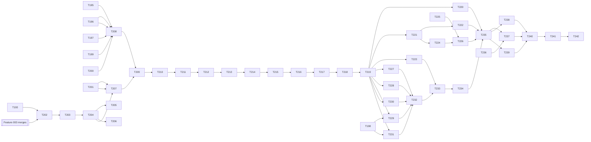

# Tasks: Visual Identity — 2.5D Pixel-Art Restyle

**Input**: Approved artifacts in `specs/004-visual-identity/`

**Prerequisites**: `spec.md` (clarified 2026-10-01), `plan.md` (OD-1 to OD-8), `research.md` (R01–R18), `data-model.md`, `contracts/render-foundation.md`, `contracts/camera-scale.md`, `contracts/presentation-and-state-cues.md`, `contracts/art-pipeline.md`, `quickstart.md`, `reviews/discovery.md`, `reviews/plan-reviews.md` and the constitution.

**Tests**: Every implementation Issue ends with its named tests green (`scripts/test-unity.ps1 -TestFile <file>`, then its ledger unit's suite; art tooling through `scripts/test-art-pipeline.ps1`). Test work is part of each task, never a separate red-only Issue. Human and agent evaluation gates (SC-001, SC-002, owner decisions) are *Parent* tasks and are reported separately from automated suites.

**Implementation lane**: MAQA. Each task is one MAQA Issue unless marked *Parent*. Issues are created later by an owner-approved `$speckit-maqa-sync` run. Every accepted dependency is merged to `origin/main` before its dependents start.

**Feature 003 dependency**: Tasks marked **[F003]** start only after the Feature 003 Issues named in `plan.md` › Feature 003 dependencies are merged (scene, camera and settings writers incl. T110, T112, T119 for phase 0; T110, T111, T112, T139 for in-game spike work; the T112 panel registry for the Settings sheet). Tasks without the marker may run in parallel with Feature 003.

**Shared resources**: `unity`, `emulator` and the new `gpu` lease via `scripts/resource-lease.ps1` (owner `issue-<n>`). Unity runs that may have Android as the active target, every `-StandaloneWindowsPlayer` run and every performance run hold `unity,emulator`; performance runs also hold `gpu`. Blender and ComfyUI batches hold `gpu`. `[P]` means disjoint paths; leased runs are still serialized.

**Task IDs**: Task IDs are unique across the repository because the MAQA scripts map each `maqa` Issue by the task ID in its title without feature scope. Features 001–003 use T001–T143 and Feature 003 follow-ups (PR #280) use T191–T192, so this feature uses T193–T242.

## Format: `[ID] [P?] [Story] Description`

- **[P]**: may run concurrently after its dependencies, on disjoint paths and worktrees.
- **[US#]**: user story in `spec.md`. Setup, foundational and closeout phases carry no story label.
- Every task names its role and lenses, paths, validation, resources and covered requirements.
- *Parent* tasks have no MAQA Issue and are ticked manually by the parent after verification.

## Issue mapping

| Task | Issue | Resources | Notes |
|---|---|---|---|
| T193, T194 | *parent* | none | Gates and plan review record |
| T195, T197, T199, T200 | new | none | Offline tooling, scripts, lease |
| T196 | new | gpu | Blender rig and render script |
| T198 | *parent* | gpu | Owner-approved LoRA download |
| T201 | new | unity | Pure camera model and Edit Mode tests |
| T202–T205 | new | unity, emulator, gpu | Baselines, phase 0, B2 |
| T206 | new | none | Independent phase-0 review |
| T207, T209, T212, T215 | new | unity, emulator | Spike import and in-game evidence |
| T208, T211, T214 | new | gpu | Spike production |
| T210, T213, T216, T219 | *parent* | none | Owner decisions |
| T217 | new | none | Art Bible and briefs |
| T218 | new | none | Independent Art Bible review |
| T220–T226 | new | unity (T220, T226: unity, emulator) | Presentation integration |
| T227–T229 | new | gpu | Production (Blender, ComfyUI) |
| T230, T231 | new | none | Scripted production |
| T232 | new | none | Independent art review per family |
| T233, T234 | new | unity | Technical Art import, UI icons |
| T235–T237 | new | unity, emulator (T237 also gpu) | Evidence |
| T236 | new | none | Emulator journey script extension |
| T238, T240 | *parent* | none | Human/agent readability gates, owner acceptance |
| T239 | new | none | Independent final reviews |
| T241, T242 | *parent* | none | Closeout hooks and convergence |

**Organization**: Tasks are grouped by user story; the work items of `plan.md` › Proposed work breakdown (WI 1–11) are cited per task. The context-orchestration work-unit ledger below is the execution control plane for the parent agent and its clean-context MAQA workers.

## Context Orchestration Process

### Parent Orchestrator Rules

- Execute work units in ledger order unless the ledger marks units as parallel candidates and their prerequisites are verified. Task-level `[P]` markers are local hints only.
- Task checkboxes are the implementation completion checklist: a unit is complete only when every referenced task is checked after parent verification. GitHub Issues remain the MAQA workflow-status authority and checkboxes are mirrored from them (`scripts/maqa-sync-task-checkboxes.ps1`).
- Use a clean subagent session for each delegated unit, with one authoritative MAQA Issue and worktree. Include the full handoff packet; do not rely on prior conversation state.
- Keep each worker inside its listed write scope and stop before editing an unassigned path or a shared serialized Unity asset (scenes, settings and atlases only through Unity tooling).
- Test tasks require fail-first behavior where practical; a red-only unit is never accepted.
- Acquire the leases a unit needs (`scripts/resource-lease.ps1`, owner `issue-<n>`: `unity`; `emulator` for player, Android or performance runs; `gpu` for Blender, ComfyUI and performance runs) before spawning its worker, and release them after QA and merge.
- Units marked **[F003]** in their task start only after the Feature 003 Issues listed in `plan.md` › Feature 003 dependencies are merged.
- Choose the model tier per AGENTS.md routing (Medium by default; Low for read-only checklist reviews) and escalate only with a recorded reason.
- Producers never review their own assets or Art Bible text; the independent reviewer is a different session (research R18).
- The parent inspects diffs, runs targeted verification, checks for unrelated changes, and fixes or re-delegates inconsistencies before starting a dependent unit.
- The parent owns final validation and reruns the completion gates even when another agent helped interpret results. Workers and QA never run the `after_implement` hooks.

### Required Subagent Handoff Packet

Every assignment includes:

- the work unit ID, phase, task ID, MAQA Issue, exact task text and exact paths;
- the role, review lenses, complexity tier and model/reasoning level;
- the relevant `spec.md` FR, SC and edge cases, `plan.md` Design sections and owner decisions OD-1 to OD-8, `research.md` R-ids, `data-model.md` rows and `contracts/` sections;
- non-negotiable constraints: Core untouched; no gameplay, content or save change; Feature 003 keys never renamed; whole-number scales only; no GUI pixel editing; generated art only with commercial-use licenses and complete provenance; Art Bible version and the approved brief for visual work;
- the accepted prerequisite commits and the current implementation status;
- allowed and forbidden paths and tools (Blender MCP and ComfyUI only for production units that name them, after a real tool call in the worker session);
- Unity `6000.6.0f1`, target platforms and the required Edit Mode, Play Mode, player or pipeline validation, with the exact commands;
- the relevant wiki pages named in the unit's handoff sources;
- the required response: files changed, task IDs completed, tests run with results, expected failures, assumptions, unresolved risks, parent follow-up and a done/blocked verdict.

### Parent Verification Gate

For each unit, the parent:

1. inspects `git diff -- <unit paths>` plus every extra path the worker reported, and confirms edits stay in scope or are justified adjacent changes;
2. runs the targeted `scripts/test-unity.ps1 -TestFile <file>` commands, `scripts/test-art-pipeline.ps1` where art tooling or assets changed, and the suite named in the unit;
3. rereads the contract and data-model sections for any public boundary change;
4. confirms that Core, content, Save V1/V2 paths, `Library/` and `ProjectSettings/` noise (`scripts/check-settings-noise.ps1 -Commit <sha>`) and unassigned serialized assets are unchanged unless the unit names them;
5. requires independent QA PASS on the exact commit, plus the named specialist reviews, before marking the unit.

### Context Compaction Recovery

After compaction:

1. Read this process, the ledger and the checklist.
2. Run `git status --short` and `scripts/resource-lease.ps1 -Status`, and inspect existing diffs.
3. Resume at an earlier partially changed unit if one exists; otherwise at the first unit with unchecked tasks whose prerequisites are accepted.
4. Reconstruct state from Issue status, merged commits, mirrored checkboxes, diffs, review records and targeted tests.
5. Finish and verify that unit before opening another worker.

### Work Unit Ledger

Ledger convention: one unit per task, rows in execution order, every prerequisite names an earlier unit; the Tasks column is the only mapping between units and tasks.

| Unit | Phase | Tasks | Atomic scope and touched paths | Prerequisites | Required handoff sources | Parent verification |
|------|-------|-------|--------------------------------|---------------|--------------------------|---------------------|
| WU01 | Phase 1: Setup and gates | T193 | Parent-only. Parent-only decision record; no repository code. | None | spec.md, plan.md (Feature 003 dependencies), reviews/plan-reviews.md; spec.md FR/SC named in the task | Parent records the decision or gate result with date and evidence links; diff limited to the named records. |
| WU02 | Phase 1: Setup and gates | T194 | Parent-only. `specs/004-visual-identity/reviews/plan-reviews.md` | None | spec.md, plan.md (Feature 003 dependencies), reviews/plan-reviews.md; spec.md FR/SC named in the task | Parent records the decision or gate result with date and evidence links; diff limited to the named records. |
| WU03 | Phase 2: Foundational tooling (no Feature 003 dependency) | T195 | `tools/art-pipeline/`, `palette/palette-v0.json`, `art-source/_rejected/`, `tools/art-pipeline/tests/`, `scripts/test-art-pipeline.ps1` | None (parallel candidate) | contracts/art-pipeline.md, contracts/camera-scale.md, research.md R02, R03, R07, R09, R14, plan.md Test strategy; wiki/pages/art-production-pipeline.md, pixel-camera-scale.md; spec.md FR/SC named in the task | `scripts/test-art-pipeline.ps1`; diff limited to the listed paths; independent QA PASS on the exact commit. |
| WU04 | Phase 2: Foundational tooling (no Feature 003 dependency) | T196 | `tools/art-pipeline/blender/rig-v1.blend`, `tools/art-pipeline/blender/render.py`, `docs/integrations/mcp-readiness.md`, `scripts/check-art-tooling.ps1` | None (parallel candidate) | contracts/art-pipeline.md, contracts/camera-scale.md, research.md R02, R03, R07, R09, R14, plan.md Test strategy; wiki/pages/art-production-pipeline.md, pixel-camera-scale.md; spec.md FR/SC named in the task | `scripts/test-art-pipeline.ps1`; diff limited to the listed paths; independent QA PASS on the exact commit. |
| WU05 | Phase 2: Foundational tooling (no Feature 003 dependency) | T197 | `tools/art-pipeline/comfy/` | None (parallel candidate) | contracts/art-pipeline.md, contracts/camera-scale.md, research.md R02, R03, R07, R09, R14, plan.md Test strategy; wiki/pages/art-production-pipeline.md, pixel-camera-scale.md; spec.md FR/SC named in the task | `scripts/test-art-pipeline.ps1`; diff limited to the listed paths; independent QA PASS on the exact commit. |
| WU06 | Phase 2: Foundational tooling (no Feature 003 dependency) | T198 | Parent-only. `tarn59/pixel_art_style_lora_z_image_turbo`, `tools/art-pipeline/models.json` | None | contracts/art-pipeline.md, contracts/camera-scale.md, research.md R02, R03, R07, R09, R14, plan.md Test strategy; wiki/pages/art-production-pipeline.md, pixel-camera-scale.md; spec.md FR/SC named in the task | Parent records the decision or gate result with date and evidence links; diff limited to the named records. |
| WU07 | Phase 2: Foundational tooling (no Feature 003 dependency) | T199 | `scripts/test-art-pipeline.ps1`, `scripts/test-unity.ps1`, `tools/art-pipeline/`, `art-source/`, `Assets/IdleFactory/Art/F004/`, `scripts/check-after-implement-hooks.ps1` | None (parallel candidate) | contracts/art-pipeline.md, contracts/camera-scale.md, research.md R02, R03, R07, R09, R14, plan.md Test strategy; wiki/pages/art-production-pipeline.md, pixel-camera-scale.md; spec.md FR/SC named in the task | `scripts/test-art-pipeline.ps1`; diff limited to the listed paths; independent QA PASS on the exact commit. |
| WU08 | Phase 2: Foundational tooling (no Feature 003 dependency) | T200 | `scripts/resource-lease.ps1` | None (parallel candidate) | contracts/art-pipeline.md, contracts/camera-scale.md, research.md R02, R03, R07, R09, R14, plan.md Test strategy; wiki/pages/art-production-pipeline.md, pixel-camera-scale.md; spec.md FR/SC named in the task | diff inspection against the listed paths plus the closest validation named in the task; diff limited to the listed paths; independent QA PASS on the exact commit. |
| WU09 | Phase 2: Foundational tooling (no Feature 003 dependency) | T201 | `Assets/IdleFactory/Unity/Presentation/CameraScaleModel.cs`, `Assets/IdleFactory/Tests/EditMode/CameraScaleModelTests.cs` | None (parallel candidate) | contracts/art-pipeline.md, contracts/camera-scale.md, research.md R02, R03, R07, R09, R14, plan.md Test strategy; wiki/pages/art-production-pipeline.md, pixel-camera-scale.md; spec.md FR/SC named in the task | `scripts/test-unity.ps1 -TestFile Assets/IdleFactory/Tests/EditMode/CameraScaleModelTests.cs`; `scripts/test-unity.ps1` filtered to `ScreenClassScaleTableTests`; full `scripts/test-unity.ps1`; `scripts/check-settings-noise.ps1 -Commit <sha>`; diff limited to the listed paths; independent QA PASS on the exact commit. |
| WU10 | Phase 3: User Story 7 — Rendering foundation switch without regression (P1, phase 0) | T202 | `Assets/IdleFactory/Tests/PlayMode/Fixtures/Screenshots/F004-B1/`, `Assets/IdleFactory/Tests/PlayMode/RenderParityTests.cs`, `Assets/IdleFactory/Tests/PlayMode/Fixtures/W004V/` | WU01 | contracts/render-foundation.md, research.md R01, R12, R13, plan.md Performance, quickstart.md Scenario 1; wiki/pages/urp-rendering-foundation.md, mobile-performance-targets.md, android-emulator-profiling.md, android-emulator-validation.md; spec.md FR/SC named in the task | `scripts/test-unity.ps1 -TestFile Assets/IdleFactory/Tests/PlayMode/RenderParityTests.cs`; full `scripts/test-unity.ps1`; `scripts/check-settings-noise.ps1 -Commit <sha>`; diff limited to the listed paths; independent QA PASS on the exact commit. |
| WU11 | Phase 3: User Story 7 — Rendering foundation switch without regression (P1, phase 0) | T203 | `<git-common-dir>/../artifacts/f004/B1-<commit7>-<sha256-8>.apk`, `specs/004-visual-identity/reviews/baselines.md` | WU10 | contracts/render-foundation.md, research.md R01, R12, R13, plan.md Performance, quickstart.md Scenario 1; wiki/pages/urp-rendering-foundation.md, mobile-performance-targets.md, android-emulator-profiling.md, android-emulator-validation.md; spec.md FR/SC named in the task | full `scripts/test-unity.ps1`; `scripts/check-settings-noise.ps1 -Commit <sha>`; diff limited to the listed paths; independent QA PASS on the exact commit. |
| WU12 | Phase 3: User Story 7 — Rendering foundation switch without regression (P1, phase 0) | T204 | `Assets/IdleFactory/Rendering/`, `Assets/IdleFactory/Tests/EditMode/RenderPipelineConfigurationTests.cs`, `Packages/manifest.json`, `Packages/packages-lock.json`, `ProjectSettings/GraphicsSettings.asset`, `ProjectSettings/QualitySettings.asset`, `Assets/IdleFactory/Scenes/CoreGameFoundation.unity` (camera only) | WU10, WU11 | contracts/render-foundation.md, research.md R01, R12, R13, plan.md Performance, quickstart.md Scenario 1; wiki/pages/urp-rendering-foundation.md, mobile-performance-targets.md, android-emulator-profiling.md, android-emulator-validation.md; spec.md FR/SC named in the task | `scripts/test-unity.ps1 -TestFile Assets/IdleFactory/Tests/EditMode/RenderPipelineConfigurationTests.cs`; `scripts/test-unity.ps1` filtered to `RenderParityTests`; `scripts/test-art-pipeline.ps1`; full `scripts/test-unity.ps1`; `scripts/check-settings-noise.ps1 -Commit <sha>`; diff limited to the listed paths; independent QA PASS on the exact commit. |
| WU13 | Phase 3: User Story 7 — Rendering foundation switch without regression (P1, phase 0) | T205 | `specs/004-visual-identity/reviews/performance-budgets.md` | WU12 | contracts/render-foundation.md, research.md R01, R12, R13, plan.md Performance, quickstart.md Scenario 1; wiki/pages/urp-rendering-foundation.md, mobile-performance-targets.md, android-emulator-profiling.md, android-emulator-validation.md; spec.md FR/SC named in the task | full `scripts/test-unity.ps1`; `scripts/check-settings-noise.ps1 -Commit <sha>`; diff limited to the listed paths; independent QA PASS on the exact commit. |
| WU14 | Phase 3: User Story 7 — Rendering foundation switch without regression (P1, phase 0) | T206 | `specs/004-visual-identity/reviews/phase0-review.md` | WU12 | contracts/render-foundation.md, research.md R01, R12, R13, plan.md Performance, quickstart.md Scenario 1; wiki/pages/urp-rendering-foundation.md, mobile-performance-targets.md, android-emulator-profiling.md, android-emulator-validation.md; spec.md FR/SC named in the task | diff inspection against the listed paths plus the closest validation named in the task; diff limited to the listed paths; independent QA PASS on the exact commit. |
| WU15 | Phase 4: User Story 6 — Owner decides the style on evidence (P1) | T207 | `Assets/IdleFactory/Art/F004/Spike/D16/`, `D24/`, `D32/` | WU09, WU12 | contracts/art-pipeline.md, contracts/presentation-and-state-cues.md, research.md R03, R06, R16, R17, R18, data-model.md (style-spike record, brief), quickstart.md Scenario 2; wiki/pages/visual-identity-art-direction.md, art-production-pipeline.md; spec.md FR/SC named in the task | full `scripts/test-unity.ps1`; `scripts/check-settings-noise.ps1 -Commit <sha>`; diff limited to the listed paths; independent QA PASS on the exact commit. |
| WU16 | Phase 4: User Story 6 — Owner decides the style on evidence (P1) | T208 | `art-source/f004/spike/s1/` | WU03, WU04, WU05, WU07, WU08 (parallel candidate) | contracts/art-pipeline.md, contracts/presentation-and-state-cues.md, research.md R03, R06, R16, R17, R18, data-model.md (style-spike record, brief), quickstart.md Scenario 2; wiki/pages/visual-identity-art-direction.md, art-production-pipeline.md; spec.md FR/SC named in the task | `scripts/test-art-pipeline.ps1`; diff limited to the listed paths; independent QA PASS on the exact commit. |
| WU17 | Phase 4: User Story 6 — Owner decides the style on evidence (P1) | T209 | `specs/004-visual-identity/reviews/style-spike.md` | WU15, WU16 | contracts/art-pipeline.md, contracts/presentation-and-state-cues.md, research.md R03, R06, R16, R17, R18, data-model.md (style-spike record, brief), quickstart.md Scenario 2; wiki/pages/visual-identity-art-direction.md, art-production-pipeline.md; spec.md FR/SC named in the task | full `scripts/test-unity.ps1`; `scripts/check-settings-noise.ps1 -Commit <sha>`; diff limited to the listed paths; independent QA PASS on the exact commit. |
| WU18 | Phase 4: User Story 6 — Owner decides the style on evidence (P1) | T210 | Parent-only. Parent-only decision record; no repository code. | WU17 | contracts/art-pipeline.md, contracts/presentation-and-state-cues.md, research.md R03, R06, R16, R17, R18, data-model.md (style-spike record, brief), quickstart.md Scenario 2; wiki/pages/visual-identity-art-direction.md, art-production-pipeline.md; spec.md FR/SC named in the task | Parent records the decision or gate result with date and evidence links; diff limited to the named records. |
| WU19 | Phase 4: User Story 6 — Owner decides the style on evidence (P1) | T211 | `art-source/f004/spike/s2/`, `Assets/IdleFactory/Art/F004/Spike/D16/`, `D24/` | WU18 (parallel candidate) | contracts/art-pipeline.md, contracts/presentation-and-state-cues.md, research.md R03, R06, R16, R17, R18, data-model.md (style-spike record, brief), quickstart.md Scenario 2; wiki/pages/visual-identity-art-direction.md, art-production-pipeline.md; spec.md FR/SC named in the task | `scripts/test-art-pipeline.ps1`; diff limited to the listed paths; independent QA PASS on the exact commit. |
| WU20 | Phase 4: User Story 6 — Owner decides the style on evidence (P1) | T212 | Parent-only decision record; no repository code. | WU19 | contracts/art-pipeline.md, contracts/presentation-and-state-cues.md, research.md R03, R06, R16, R17, R18, data-model.md (style-spike record, brief), quickstart.md Scenario 2; wiki/pages/visual-identity-art-direction.md, art-production-pipeline.md; spec.md FR/SC named in the task | full `scripts/test-unity.ps1`; `scripts/check-settings-noise.ps1 -Commit <sha>`; diff limited to the listed paths; independent QA PASS on the exact commit. |
| WU21 | Phase 4: User Story 6 — Owner decides the style on evidence (P1) | T213 | Parent-only. Parent-only decision record; no repository code. | WU20 | contracts/art-pipeline.md, contracts/presentation-and-state-cues.md, research.md R03, R06, R16, R17, R18, data-model.md (style-spike record, brief), quickstart.md Scenario 2; wiki/pages/visual-identity-art-direction.md, art-production-pipeline.md; spec.md FR/SC named in the task | Parent records the decision or gate result with date and evidence links; diff limited to the named records. |
| WU22 | Phase 4: User Story 6 — Owner decides the style on evidence (P1) | T214 | `art-source/f004/spike/s3-s4/`, `Assets/IdleFactory/Art/F004/Spike/D<k>/` | WU21 (parallel candidate) | contracts/art-pipeline.md, contracts/presentation-and-state-cues.md, research.md R03, R06, R16, R17, R18, data-model.md (style-spike record, brief), quickstart.md Scenario 2; wiki/pages/visual-identity-art-direction.md, art-production-pipeline.md; spec.md FR/SC named in the task | `scripts/test-art-pipeline.ps1`; diff limited to the listed paths; independent QA PASS on the exact commit. |
| WU23 | Phase 4: User Story 6 — Owner decides the style on evidence (P1) | T215 | `tools/art-pipeline/trials/timed_trial.py`, `reviews/readability-spike.md` | WU22 | contracts/art-pipeline.md, contracts/presentation-and-state-cues.md, research.md R03, R06, R16, R17, R18, data-model.md (style-spike record, brief), quickstart.md Scenario 2; wiki/pages/visual-identity-art-direction.md, art-production-pipeline.md; spec.md FR/SC named in the task | `scripts/test-art-pipeline.ps1`; full `scripts/test-unity.ps1`; `scripts/check-settings-noise.ps1 -Commit <sha>`; diff limited to the listed paths; independent QA PASS on the exact commit. |
| WU24 | Phase 4: User Story 6 — Owner decides the style on evidence (P1) | T216 | Parent-only. `reviews/style-spike.md` | WU23 | contracts/art-pipeline.md, contracts/presentation-and-state-cues.md, research.md R03, R06, R16, R17, R18, data-model.md (style-spike record, brief), quickstart.md Scenario 2; wiki/pages/visual-identity-art-direction.md, art-production-pipeline.md; spec.md FR/SC named in the task | Parent records the decision or gate result with date and evidence links; diff limited to the named records. |
| WU25 | Phase 4: User Story 6 — Owner decides the style on evidence (P1) | T217 | `docs/art/F004-art-bible-v1.md`, `docs/art/F004-asset-briefs-v1.md` | WU24 | contracts/art-pipeline.md, contracts/presentation-and-state-cues.md, research.md R03, R06, R16, R17, R18, data-model.md (style-spike record, brief), quickstart.md Scenario 2; wiki/pages/visual-identity-art-direction.md, art-production-pipeline.md; spec.md FR/SC named in the task | diff inspection against the listed paths plus the closest validation named in the task; diff limited to the listed paths; independent QA PASS on the exact commit. |
| WU26 | Phase 4: User Story 6 — Owner decides the style on evidence (P1) | T218 | `specs/004-visual-identity/reviews/art-bible-review.md` | WU25 | contracts/art-pipeline.md, contracts/presentation-and-state-cues.md, research.md R03, R06, R16, R17, R18, data-model.md (style-spike record, brief), quickstart.md Scenario 2; wiki/pages/visual-identity-art-direction.md, art-production-pipeline.md; spec.md FR/SC named in the task | diff inspection against the listed paths plus the closest validation named in the task; diff limited to the listed paths; independent QA PASS on the exact commit. |
| WU27 | Phase 4: User Story 6 — Owner decides the style on evidence (P1) | T219 | Parent-only. Parent-only decision record; no repository code. | WU26 | contracts/art-pipeline.md, contracts/presentation-and-state-cues.md, research.md R03, R06, R16, R17, R18, data-model.md (style-spike record, brief), quickstart.md Scenario 2; wiki/pages/visual-identity-art-direction.md, art-production-pipeline.md; spec.md FR/SC named in the task | Parent records the decision or gate result with date and evidence links; diff limited to the named records. |
| WU28 | Phase 5: User Story 3 — Crisp pixels at every zoom and on every screen (P1) | T220 | `Assets/IdleFactory/Unity/Presentation/FactoryCameraController.cs` | WU09, WU12, WU27 | contracts/camera-scale.md, research.md R02, R03, R13, R15, quickstart.md Scenario 3; wiki/pages/pixel-camera-scale.md, ui-toolkit-hud-layout-pitfalls.md; spec.md FR/SC named in the task | `scripts/test-unity.ps1` filtered to `ZoomReadabilityTests`; `scripts/test-unity.ps1` filtered to `SlotGridTests`; `scripts/test-unity.ps1` filtered to `PixelCrispnessTests`; `scripts/test-unity.ps1` filtered to `ScreenClassScalePlayTests`; full `scripts/test-unity.ps1`; `scripts/check-settings-noise.ps1 -Commit <sha>`; `scripts/test-unity.ps1 -StandaloneWindowsPlayer`; diff limited to the listed paths; independent QA PASS on the exact commit. |
| WU29 | Phase 6: User Stories 1 and 2 — State cues and restyled factory (P1) | T221 | `Assets/IdleFactory/Unity/Presentation/PresentationSpriteCatalog.cs`, `Assets/IdleFactory/Tests/EditMode/PresentationCatalogFallbackTests.cs`, `Assets/IdleFactory/Tests/PlayMode/ArtFallbackTests.cs` | WU27 | contracts/presentation-and-state-cues.md, contracts/art-pipeline.md (Unity side), research.md R04, R06, R10, data-model.md (catalog entry, state-cue set); wiki/pages/unity-presentation-boundary.md, visual-identity-art-direction.md; spec.md FR/SC named in the task | `scripts/test-unity.ps1 -TestFile Assets/IdleFactory/Tests/EditMode/PresentationCatalogFallbackTests.cs`; `scripts/test-unity.ps1 -TestFile Assets/IdleFactory/Tests/PlayMode/ArtFallbackTests.cs`; full `scripts/test-unity.ps1`; `scripts/check-settings-noise.ps1 -Commit <sha>`; `scripts/test-unity.ps1 -StandaloneWindowsPlayer`; diff limited to the listed paths; independent QA PASS on the exact commit. |
| WU30 | Phase 6: User Stories 1 and 2 — State cues and restyled factory (P1) | T222 | `Assets/IdleFactory/Unity/Presentation/StateCueSet.cs`, `Assets/IdleFactory/Tests/EditMode/StateCueSetTests.cs`, `Assets/IdleFactory/Tests/PlayMode/StateCueOverlayTests.cs` | WU29 | contracts/presentation-and-state-cues.md, contracts/art-pipeline.md (Unity side), research.md R04, R06, R10, data-model.md (catalog entry, state-cue set); wiki/pages/unity-presentation-boundary.md, visual-identity-art-direction.md; spec.md FR/SC named in the task | `scripts/test-unity.ps1 -TestFile Assets/IdleFactory/Tests/EditMode/StateCueSetTests.cs`; `scripts/test-unity.ps1 -TestFile Assets/IdleFactory/Tests/PlayMode/StateCueOverlayTests.cs`; full `scripts/test-unity.ps1`; `scripts/check-settings-noise.ps1 -Commit <sha>`; diff limited to the listed paths; independent QA PASS on the exact commit. |
| WU31 | Phase 6: User Stories 1 and 2 — State cues and restyled factory (P1) | T223 | `Assets/IdleFactory/Editor/Art/F004SpriteImportPostprocessor.cs`, `Assets/IdleFactory/Tests/EditMode/F004AssetContractTests.cs` | WU27 | contracts/presentation-and-state-cues.md, contracts/art-pipeline.md (Unity side), research.md R04, R06, R10, data-model.md (catalog entry, state-cue set); wiki/pages/unity-presentation-boundary.md, visual-identity-art-direction.md; spec.md FR/SC named in the task | `scripts/test-unity.ps1 -TestFile Assets/IdleFactory/Tests/EditMode/F004AssetContractTests.cs`; full `scripts/test-unity.ps1`; `scripts/check-settings-noise.ps1 -Commit <sha>`; diff limited to the listed paths; independent QA PASS on the exact commit. |
| WU32 | Phase 7: User Story 4 — Animation and reduced motion (P2) | T224 | `Assets/IdleFactory/Unity/Presentation/PresentationAnimationClock.cs` | WU29 (parallel candidate) | contracts/presentation-and-state-cues.md (Animation, Display preferences), research.md R05, R11, data-model.md (display preferences), plan.md OD-8; wiki/pages/unity-presentation-boundary.md, ui-toolkit-hud-layout-pitfalls.md; spec.md FR/SC named in the task | `scripts/test-unity.ps1` filtered to `PresentationAnimationClockTests`; `scripts/test-unity.ps1` filtered to `PresentationAllocationTests`; full `scripts/test-unity.ps1`; `scripts/check-settings-noise.ps1 -Commit <sha>`; diff limited to the listed paths; independent QA PASS on the exact commit. |
| WU33 | Phase 7: User Story 4 — Animation and reduced motion (P2) | T225 | `Assets/IdleFactory/Unity/Persistence/DisplayPreferencesStore.cs`, `persistentDataPath/IdleFactory/Preferences/display-v1.json`, `Assets/IdleFactory/Unity/Bootstrap/ReducedMotionSignal.Android.cs`, `Preferences/` | None (parallel candidate) | contracts/presentation-and-state-cues.md (Animation, Display preferences), research.md R05, R11, data-model.md (display preferences), plan.md OD-8; wiki/pages/unity-presentation-boundary.md, ui-toolkit-hud-layout-pitfalls.md; spec.md FR/SC named in the task | `scripts/test-unity.ps1` filtered to `DisplayPreferencesStoreTests`; full `scripts/test-unity.ps1`; `scripts/check-settings-noise.ps1 -Commit <sha>`; diff limited to the listed paths; independent QA PASS on the exact commit. |
| WU34 | Phase 7: User Story 4 — Animation and reduced motion (P2) | T226 | `Assets/IdleFactory/Unity/UI/Panels/Settings/` | WU32, WU33 | contracts/presentation-and-state-cues.md (Animation, Display preferences), research.md R05, R11, data-model.md (display preferences), plan.md OD-8; wiki/pages/unity-presentation-boundary.md, ui-toolkit-hud-layout-pitfalls.md; spec.md FR/SC named in the task | `scripts/test-unity.ps1` filtered to `SettingsSheetTests`; `scripts/test-unity.ps1` filtered to `ReducedMotionTests`; full `scripts/test-unity.ps1`; `scripts/check-settings-noise.ps1 -Commit <sha>`; `scripts/test-unity.ps1 -StandaloneWindowsPlayer`; diff limited to the listed paths; independent QA PASS on the exact commit. |
| WU35 | Phase 8: Production of the restyled asset set (US2, US5, US6) | T227 | `art-source/f004/machines/` | WU04, WU27 (parallel candidate) | docs/art/F004-art-bible-v1.md, docs/art/F004-asset-briefs-v1.md, contracts/art-pipeline.md, research.md R07–R10; wiki/pages/art-production-pipeline.md, visual-identity-art-direction.md; spec.md FR/SC named in the task | `scripts/test-art-pipeline.ps1`; diff limited to the listed paths; independent QA PASS on the exact commit. |
| WU36 | Phase 8: Production of the restyled asset set (US2, US5, US6) | T228 | `art-source/f004/slots/`, `art-source/f004/floor/` | WU27 (parallel candidate) | docs/art/F004-art-bible-v1.md, docs/art/F004-asset-briefs-v1.md, contracts/art-pipeline.md, research.md R07–R10; wiki/pages/art-production-pipeline.md, visual-identity-art-direction.md; spec.md FR/SC named in the task | `scripts/test-art-pipeline.ps1`; diff limited to the listed paths; independent QA PASS on the exact commit. |
| WU37 | Phase 8: Production of the restyled asset set (US2, US5, US6) | T229 | `art-source/f004/resources/`, `art-source/f004/items/` | WU06, WU27 (parallel candidate) | docs/art/F004-art-bible-v1.md, docs/art/F004-asset-briefs-v1.md, contracts/art-pipeline.md, research.md R07–R10; wiki/pages/art-production-pipeline.md, visual-identity-art-direction.md; spec.md FR/SC named in the task | `scripts/test-art-pipeline.ps1`; diff limited to the listed paths; independent QA PASS on the exact commit. |
| WU38 | Phase 8: Production of the restyled asset set (US2, US5, US6) | T230 | `tools/art-pipeline` | WU27 (parallel candidate) | docs/art/F004-art-bible-v1.md, docs/art/F004-asset-briefs-v1.md, contracts/art-pipeline.md, research.md R07–R10; wiki/pages/art-production-pipeline.md, visual-identity-art-direction.md; spec.md FR/SC named in the task | `scripts/test-art-pipeline.ps1`; diff limited to the listed paths; independent QA PASS on the exact commit. |
| WU39 | Phase 8: Production of the restyled asset set (US2, US5, US6) | T231 | `art-source/f004/ui-icons/` | WU06, WU27 (parallel candidate) | docs/art/F004-art-bible-v1.md, docs/art/F004-asset-briefs-v1.md, contracts/art-pipeline.md, research.md R07–R10; wiki/pages/art-production-pipeline.md, visual-identity-art-direction.md; spec.md FR/SC named in the task | `scripts/test-art-pipeline.ps1`; diff limited to the listed paths; independent QA PASS on the exact commit. |
| WU40 | Phase 8: Production of the restyled asset set (US2, US5, US6) | T232 | `specs/004-visual-identity/reviews/art-direction-review.md` | WU35, WU36, WU37, WU38, WU39 | docs/art/F004-art-bible-v1.md, docs/art/F004-asset-briefs-v1.md, contracts/art-pipeline.md, research.md R07–R10; wiki/pages/art-production-pipeline.md, visual-identity-art-direction.md; spec.md FR/SC named in the task | diff inspection against the listed paths plus the closest validation named in the task; diff limited to the listed paths; independent QA PASS on the exact commit. |
| WU41 | Phase 8: Production of the restyled asset set (US2, US5, US6) | T233 | `Assets/IdleFactory/Art/F004/`, `docs/art/F004-technical-art-integration.md` | WU31, WU40 | docs/art/F004-art-bible-v1.md, docs/art/F004-asset-briefs-v1.md, contracts/art-pipeline.md, research.md R07–R10; wiki/pages/art-production-pipeline.md, visual-identity-art-direction.md; spec.md FR/SC named in the task | `scripts/test-unity.ps1` filtered to `F004AssetContractTests`; full `scripts/test-unity.ps1`; `scripts/check-settings-noise.ps1 -Commit <sha>`; diff limited to the listed paths; independent QA PASS on the exact commit. |
| WU42 | Phase 9: User Story 5 — Restyled interface icons (P3) | T234 | Parent-only decision record; no repository code. | WU39, WU41 | contracts/presentation-and-state-cues.md, research.md R10, specs/003-first-factory-prestige/contracts/ui-surfaces.md; wiki/pages/ui-toolkit-hud-layout-pitfalls.md; spec.md FR/SC named in the task | `scripts/test-unity.ps1` filtered to `TextScaleLayoutTests`; full `scripts/test-unity.ps1`; `scripts/check-settings-noise.ps1 -Commit <sha>`; diff limited to the listed paths; independent QA PASS on the exact commit. |
| WU43 | Phase 10: Verification and evidence | T235 | Parent-only decision record; no repository code. | WU28, WU30, WU34, WU42 | quickstart.md Scenarios 1–7, research.md R12, R17, plan.md Test strategy; wiki/pages/unity-player-validation.md, android-emulator-profiling.md, player-level-test-gaps.md; spec.md FR/SC named in the task | `scripts/test-unity.ps1` filtered to `RestyledSceneSmokePlayerTests`; `scripts/test-art-pipeline.ps1`; full `scripts/test-unity.ps1`; `scripts/check-settings-noise.ps1 -Commit <sha>`; diff limited to the listed paths; independent QA PASS on the exact commit. |
| WU44 | Phase 10: Verification and evidence | T236 | `scripts/android-emulator-journey.ps1` | None (parallel candidate) | quickstart.md Scenarios 1–7, research.md R12, R17, plan.md Test strategy; wiki/pages/unity-player-validation.md, android-emulator-profiling.md, player-level-test-gaps.md; spec.md FR/SC named in the task | diff inspection against the listed paths plus the closest validation named in the task; diff limited to the listed paths; independent QA PASS on the exact commit. |
| WU45 | Phase 10: Verification and evidence | T237 | `reviews/performance-b3.md` | WU43, WU44 | quickstart.md Scenarios 1–7, research.md R12, R17, plan.md Test strategy; wiki/pages/unity-player-validation.md, android-emulator-profiling.md, player-level-test-gaps.md; spec.md FR/SC named in the task | full `scripts/test-unity.ps1`; `scripts/check-settings-noise.ps1 -Commit <sha>`; diff limited to the listed paths; independent QA PASS on the exact commit. |
| WU46 | Phase 10: Verification and evidence | T238 | Parent-only. `reviews/readability-final.md` | WU43 | quickstart.md Scenarios 1–7, research.md R12, R17, plan.md Test strategy; wiki/pages/unity-player-validation.md, android-emulator-profiling.md, player-level-test-gaps.md; spec.md FR/SC named in the task | Parent records the decision or gate result with date and evidence links; diff limited to the named records. |
| WU47 | Phase 10: Verification and evidence | T239 | `specs/004-visual-identity/reviews/final-acceptance.md` | WU43 | quickstart.md Scenarios 1–7, research.md R12, R17, plan.md Test strategy; wiki/pages/unity-player-validation.md, android-emulator-profiling.md, player-level-test-gaps.md; spec.md FR/SC named in the task | diff inspection against the listed paths plus the closest validation named in the task; diff limited to the listed paths; independent QA PASS on the exact commit. |
| WU48 | Phase 10: Verification and evidence | T240 | Parent-only. `reviews/final-acceptance.md` | WU45, WU46, WU47 | quickstart.md Scenarios 1–7, research.md R12, R17, plan.md Test strategy; wiki/pages/unity-player-validation.md, android-emulator-profiling.md, player-level-test-gaps.md; spec.md FR/SC named in the task | Parent records the decision or gate result with date and evidence links; diff limited to the named records. |
| WU49 | Phase 11: Closeout hooks and convergence (parent) | T241 | Parent-only. Parent-only decision record; no repository code. | WU48 | tasks.md, plan.md, AGENTS.md (after_implement hooks); spec.md FR/SC named in the task | Parent records the decision or gate result with date and evidence links; diff limited to the named records. |
| WU50 | Phase 11: Closeout hooks and convergence (parent) | T242 | Parent-only. `scripts/maqa-stale-worktrees.ps1` | WU49 | tasks.md, plan.md, AGENTS.md (after_implement hooks); spec.md FR/SC named in the task | Parent records the decision or gate result with date and evidence links; diff limited to the named records. |

## Phase 1: Setup and gates

- [ ] T193 *Parent*: verify the greenfield gates on the exact base commit (constitution, branch convention, wiki, `maqa` labels, `maqa-config.yml` commands) and that `$speckit-analyze` has no unresolved critical finding for this feature; record which Feature 003 Issues listed in `plan.md` › Feature 003 dependencies are still open. Resources: none.
- [x] T194 *Parent*: plan review waves 1–3 (`max_parallel: 3`) recorded in `specs/004-visual-identity/reviews/plan-reviews.md` with every disposition applied (done 2026-10-01). Resources: none.

## Phase 2: Foundational tooling (no Feature 003 dependency)

- [ ] T195 [P] Technical Artist with Asset Artist lens (WI 3): create the `uv` project `tools/art-pipeline/` (`pyproject.toml` with `requires-python`, `uv.lock` pinning Pillow), modules `pixel_pass` (route-specific reduction, alpha 0/255, CIELAB quantization with deterministic tie-break and no dithering, 1-px outline generation, one fixed footprint-anchored canvas and pivot per asset shared by all frames, manifest entries with schema version and PNG hashes), `checks` (palette and per-group budget, canvas, pivot, alpha, outline, frames, overhang ≤ 0.5 cell, flash metric "mean relative-luminance change > 0.10 counts as a flash, at most 3 per second", frame 0 lights-on, IoU ≤ 0.70 at full size and on a 32×32 downsample, contrast ≥ 3:1 non-text and ≥ 4.5:1 glyphs incl. darkest allowed light, cue icons ≥ 12×12 art px, grayscale and CVD sheet generation with seeded shuffle), `cues` (scripted drawing), `palette/palette-v0.json` (groups and budgets, cap 48), `models.json` (source URL, version, license, SHA-256; hash verified before use), size budgets (25 MB per family, 150 MB total) and `.gitignore` entries for `art-source/_rejected/` and the artifact archive; pytest suite in `tools/art-pipeline/tests/` incl. a golden reproduction per route on committed fixtures. Validation: `scripts/test-art-pipeline.ps1` (T199) or `uv run --frozen --offline --project tools/art-pipeline pytest`. Resources: none. Covers FR-021, FR-022, FR-023, SC-004; research R07, R09.
- [ ] T196 [P] 3D and Render Artist (Technical Artist lens) (WI 3): versioned Blender rig `tools/art-pipeline/blender/rig-v1.blend` (orthographic camera per projection candidate, top-left key light, flat/toon materials, Standard view transform, Look None, filter size 0, transparent film, Workbench or Cycles CPU with fixed seed and no denoiser) and `tools/art-pipeline/blender/render.py` run as `"$BLENDER_EXE" -b <rig> --factory-startup --python-exit-code 1 -P render.py -- <asset>`, recording render time, Blender version, GPU and driver into the provenance stub; record `BLENDER_EXE` default and `uv` version in `docs/integrations/mcp-readiness.md`; add a tooling preflight `scripts/check-art-tooling.ps1` (uv, Blender, ComfyUI `server_info` reachability; reports "tooling unavailable"). Validation: one smoke render of a test cube reproduced twice within the R09 tolerance. Resources: gpu. Covers FR-021, FR-021a; research R07, R09, R14.
- [ ] T197 [P] Asset Artist (Art Director lens) (WI 3): committed ComfyUI workflow JSON files under `tools/art-pipeline/comfy/` for Z-Image-Turbo with and without the pixel-art LoRA (prompt, negative prompt, seed and sampler slots), plus the grid-detection and mode-reduction step for generative output in `pixel_pass` tests with committed sample outputs; no download in this task. Validation: pipeline pytest on the samples. Resources: none. Covers FR-021, FR-021a; research R07, R08.
- [ ] T198 *Parent* after the owner approves the download: fetch `tarn59/pixel_art_style_lora_z_image_turbo` through the local ComfyUI tooling, record source URL, version, license (Apache-2.0) and SHA-256 in `tools/art-pipeline/models.json`, verify the hash. Until then the generative route stays blocked. Resources: gpu. Covers FR-021; research R14.
- [ ] T199 [P] DevOps/Operations with Test/QA lens (WI 3): `scripts/test-art-pipeline.ps1` (absolute `uv`, proxy variables cleared for its process, `uv run --frozen --offline`, "tooling unavailable" outcome distinct from failure); chain it from `scripts/test-unity.ps1` when `tools/art-pipeline/`, `art-source/` or `Assets/IdleFactory/Art/F004/` changed; name it in the QA assignment contract in `AGENTS.md`; extend `scripts/check-after-implement-hooks.ps1` to require a passing pipeline report for batches that changed those paths. Validation: script parse and dry run without `uv` (expects "tooling unavailable"). Resources: none. Covers FR-023, SC-004; research R07.
- [ ] T200 [P] DevOps/Operations (WI 3): add `gpu` to `scripts/resource-lease.ps1` known resources, help and `-Status`; document acquisition rules in `AGENTS.md` › Shared workstation resources (parent per Issue before SPAWN, interactive Blender/ComfyUI sessions as session owner, performance runs); create the `resource:gpu` label in the MAQA label bootstrap. Validation: lease acquire, renew, conflict (exit 2) and release with a dummy owner. Resources: none. Covers research R14.
- [ ] T201 [P] [US3] Gameplay Developer (Architect and Test/QA lenses) (WI 4): pure `Assets/IdleFactory/Unity/Presentation/CameraScaleModel.cs` implementing `contracts/camera-scale.md` rules 1–7 (allowed set `[n_min, maxScale]`, `n_min = ⌈readableCellPoints · pxPerPoint / D⌉`, fit-all centered, runtime degrade with `presentation.scale.belowFloor`, odd-size half-pixel offset, snap with anchor hold, sheet pan-then-step and restore, single-level behavior); final-green `Assets/IdleFactory/Tests/EditMode/CameraScaleModelTests.cs` (fractional `pxPerPoint` 1.68, 2.0, 2.625, 3.0; odd sizes; free window sizes; degrade; 44×44 pt footprint hit area at every `n`) and `ScreenClassScaleTableTests.cs` (every Feature 003 screen class and orientation × D ∈ {16, 24, 32}: `n_fit ≥ n_min`, level count and margin incl. 360×640 and 390×844 portrait, table emitted for spike records). Resources: unity. Covers FR-011, FR-016, FR-017, FR-018; research R02, R03.

## Phase 3: User Story 7 — Rendering foundation switch without regression (P1, phase 0)

- [ ] T202 [US7] [F003] Test/QA with Performance Engineer (WI 1): pre-switch baselines on the merged Feature 003 state: test-name and count manifest of all suites; deterministic RenderTexture capture helper and committed baseline PNGs at 640×480 and the Feature 003 screen classes under `Assets/IdleFactory/Tests/PlayMode/Fixtures/Screenshots/F004-B1/` (importer kept readable, uncompressed, out of atlases; size recorded) with `Assets/IdleFactory/Tests/PlayMode/RenderParityTests.cs`; W004-V fixture (forced presentation states over the W003-S checkpoint, camera presets `n_min` and fit-all) under `Assets/IdleFactory/Tests/PlayMode/Fixtures/W004V/`; metric collection for batches/SetPass, texture memory, shader variants and APK size. No expectation of an existing test changes. Resources: unity, emulator. Covers FR-004, FR-006, FR-025; research R12, R13.
- [ ] T203 [US7] [F003] Performance Engineer (WI 1) after T202: build the profiler-free Built-in player of the pre-switch commit, archive the APK at `<git-common-dir>/../artifacts/f004/B1-<commit7>-<sha256-8>.apk`, record sha256, size, commit, Unity version, target and graphics API in `specs/004-visual-identity/reviews/baselines.md`; measure B1 on W003 and W004-V with preflight (leases `unity,emulator,gpu`, no ComfyUI/Blender/editor, cold boot) and a same-session 30 FPS control. Resources: unity, emulator, gpu. Covers FR-006, FR-025, FR-027; research R12.
- [ ] T204 [US7] [F003] Technical Artist with DevOps/Operations lens (WI 2) after T202 and T203: phase-0 change set per `contracts/render-foundation.md` (URP 17.6.0, `Assets/IdleFactory/Rendering/` pipeline, 2D Renderer and global settings assets, Graphics and every quality level, Unlit default sprite material, Gamma kept, HDR/post/depth/opaque off, camera renderer index 0 via Unity tooling) as one self-contained commit; final-green `Assets/IdleFactory/Tests/EditMode/RenderPipelineConfigurationTests.cs`; gates: identical test manifest and pass set, `-StandaloneWindowsPlayer`, `RenderParityTests` (≤ 0.1 % differing pixels, ≤ 2/255 per channel), IL2CPP Android GLES3 build and `scripts/android-emulator-journey.ps1`, clean `Library` reimport, stripped variant counts, rollback dry-run on a scratch branch, `scripts/check-settings-noise.ps1 -Commit <sha>`. Resources: unity, emulator. Covers FR-004, FR-005, SC-008; research R01.
- [ ] T205 [US7] Performance Engineer (WI 2) after T204: B2 in one cold-booted ABA session (B1 → B2 → B1, 30 FPS control, noise band recorded); freeze `specs/004-visual-identity/reviews/performance-budgets.md` (60 FPS average, p95 bucket, 0 intervals ≥ 50 ms, Windows host frame unchanged, 0 steady-state allocations, ≤ 8 MB world art, atlas pages ≤ 1024², batch count, CPU ≤ max(10 %, 2 points), APK ≤ +10 MB). Resources: unity, emulator, gpu. Covers FR-004, FR-027, SC-008; research R12.
- [ ] T206 [US7] Independent read-only review of the phase-0 commit: Software Architect, Test/QA and DevOps/Operations verdicts recorded in `specs/004-visual-identity/reviews/phase0-review.md`. Resources: none. Covers FR-004, FR-005, SC-006, SC-008.

## Phase 4: User Story 6 — Owner decides the style on evidence (P1)

- [ ] T207 [US6] [F003] Technical Artist (WI 5) after T204 and T201: isolated spike import path `Assets/IdleFactory/Art/F004/Spike/D16/`, `D24/`, `D32/` with per-density importer settings (PPU = D, point filter, no mips, uncompressed) and a spike scene variant using `CameraScaleModel`; the path is deleted or promoted later only by explicit decision. Resources: unity. Covers FR-007; research R16.
- [ ] T208 [P] [US6] 3D and Render Artist (Art Director lens) (WI 5, S1) after T196: spike S1 assets at D = 24 on the Blender route in both projections (3/4 oblique, isometric 2:1): the two machines at highest silhouette-confusion risk (running loop + still states), four slot plates, two resources (scripted or Blender); pixel pass, checks and provenance under `art-source/f004/spike/s1/`. Resources: gpu. Covers FR-007; research R16.
- [ ] T209 [US6] Test/QA with UI/UX Reviewer lens (WI 5) after T207 and T208: S1 in-game evidence on phone, tablet and emulator at `n_min` and fit-all (contact sheets at 1×, on-device screenshots labelled A/B, zoom-level table), gate results, the agents' recommended option and default; independent second Art Director session reviews the gates. Record in `specs/004-visual-identity/reviews/style-spike.md` § S1. Resources: unity, emulator. Covers FR-007, FR-008, SC-009.
- [ ] T210 *Parent*: owner decision S1 (projection) with date and reason, or reject with one bounded redo round. Covers FR-008, SC-009.
- [ ] T211 [P] [US6] 3D and Render Artist (WI 5, S2) after T210: the S1 set on the winning projection at D = 16 and D = 24, plus the palette v0 group-budget test; sources, raws and provenance under `art-source/f004/spike/s2/`, spike imports under `Assets/IdleFactory/Art/F004/Spike/D16/` and `D24/`. Resources: gpu. Covers FR-007; research R03, R16.
- [ ] T212 [US6] Test/QA with UI/UX Reviewer lens (WI 5) after T211: S2 evidence as in T209, explicitly showing the zoom-level and margin table per screen class (single-level range on the worst phone) and cue legibility at `n_min`; record § S2. Resources: unity, emulator. Covers FR-007, FR-011, SC-005.
- [ ] T213 *Parent*: owner decision S2 (density D). Covers FR-008.
- [ ] T214 [P] [US6] Asset Artist (Art Director lens) (WI 5, S3/S4) after T213: scripted cue variants (a) body treatment + exception icons with the salience rule (problem states warning body + icon; paused/inactive desaturated + small glyph; running none) and (b) pixel badges without badges on running machines, on one machine body; lighting A/B: baked key light with emissive frames (default) vs 2D-light accents; outputs under `art-source/f004/spike/s3-s4/` and `Assets/IdleFactory/Art/F004/Spike/D<k>/`. Resources: gpu. Covers FR-007, FR-010; research R06, R16.
- [ ] T215 [US6] Test/QA (WI 5) after T214: S3/S4 evidence; SC-002 harness script `tools/art-pipeline/trials/timed_trial.py` (10 seeded screenshots, one problem machine each, problem states balanced, 1–2 benign distractors, answer key, per-trial timing log); SC-001 sheets from in-game captures at `n_min` and fit-all named by an independent agent session with the key withheld; record § S3/S4 and `reviews/readability-spike.md`. Resources: unity, emulator. Covers FR-010, SC-001, SC-002; research R17.
- [ ] T216 *Parent*: owner timed trial on the spike variants and owner decisions S3 (cue variant) and S4 (lighting); `reviews/style-spike.md` complete. Covers FR-008, SC-002, SC-009.
- [ ] T217 [US6] Art Director (author) (WI 6) after T216: `docs/art/F004-art-bible-v1.md` (projection, light, D, canvas/pivot, palette v1 with groups and license, outline/shading/dithering/animation incl. 6 frames at 8 fps and flash rule, state-cue model and salience rule, cue sizes and label threshold, contrast and CVD rules, noise limits, UI and font rules, family-route table, style-anchor sheet, tool pins, provenance, semver, section-level supersession table for F003-PAB) and `docs/art/F004-asset-briefs-v1.md` (inventory table asset × state × frames from the 29 F003 rows plus floor/background and UI icons per surface; per asset ports, format, shadow, overhang, cueAnchor, confusionPeers, route with reason). Resources: none. Covers FR-003, FR-009, FR-021a, FR-022; research R18.
- [ ] T218 [US6] Independent review of T217 by a second Art Director session, UI/UX Reviewer and Game Designer/PO (read-only), recorded in `specs/004-visual-identity/reviews/art-bible-review.md`. Resources: none. Covers FR-009.
- [ ] T219 *Parent*: owner sign-off of Art Bible v1.0 and briefs; spike import path deleted or promoted by recorded decision. Covers FR-008, FR-009, SC-009.

## Phase 5: User Story 3 — Crisp pixels at every zoom and on every screen (P1)

- [ ] T220 [US3] [F003] UI/UX Developer (Architect and Test/QA lenses) (WI 7) after T201, T204 and T219: integrate `CameraScaleModel` into `Assets/IdleFactory/Unity/Presentation/FactoryCameraController.cs` (sole camera writer; `pxPerPoint` and rect from `FactoryHudDocument`; instant snaps; wheel and button steps; disabled/hidden buttons; sheet rule 7; resize re-fit); re-baseline `ZoomReadabilityTests` and `SlotGridTests` keeping the invariants (12 slots at fit-all, selected slot above a sheet, minimum cell via `n_min`; Z16–Z64 constants removed only here; old-to-new assertion diff in the evidence); final-green `PixelCrispnessTests` (R13 capture, uniform `n×n` blocks at rest and in every frame of a scripted slow pan, also `[Category("StandalonePlayer")]`) and `ScreenClassScalePlayTests` (real HUD rect, oversized-HUD negative case). Resources: unity, emulator. Covers FR-011, FR-012, FR-016, FR-017, FR-018, SC-005, SC-006; research R02, R15.

## Phase 6: User Stories 1 and 2 — State cues and restyled factory (P1)

- [ ] T221 [US1] [US2] [F003] Gameplay Developer (Architect lens) (WI 7) after T219: extend `Assets/IdleFactory/Unity/Presentation/PresentationSpriteCatalog.cs` with primary frames, retained F003 fallback frames (own PPU, pivot, world size), additive `F004-` keys and `presentation.art.fallback` (once per key, no paths); fallback only if it validates, otherwise `presentation.key.unresolved`; final-green `Assets/IdleFactory/Tests/EditMode/PresentationCatalogFallbackTests.cs` and `Assets/IdleFactory/Tests/PlayMode/ArtFallbackTests.cs` (slot stays tappable, cues anchored to the footprint, late-load without layout shift; also StandalonePlayer-tagged); Feature 003 failure-matrix tests stay green. Resources: unity. Covers FR-002, FR-024; research R10.
- [ ] T222 [US1] [US2] [F003] UI/UX Developer (Architect and Art Director lenses) (WI 7) after T221: `Assets/IdleFactory/Unity/Presentation/StateCueSet.cs` (asset; machine states named as in Feature 003 and slot conditions in separate tables; no second precedence rule) and its use in `SlotGridView.cs`: footprint-anchored overlays (cue top-right in the overhang band, markers top-left, selection frame), overlay sorting layer, row-based `sortingOrder`, one Sorting Group per machine, label threshold; final-green `Assets/IdleFactory/Tests/EditMode/StateCueSetTests.cs` and `Assets/IdleFactory/Tests/PlayMode/StateCueOverlayTests.cs` (12 occupied slots, densest overlay at `n_min`, no overlap with the row behind, top row not clipped, overhang tap selects the slot behind). Resources: unity. Covers FR-010, FR-013, FR-014, FR-015; research R04, R06.
- [ ] T223 [US2] [F003] Technical Artist (Test/QA lens) (WI 7) after T219: `Assets/IdleFactory/Editor/Art/F004SpriteImportPostprocessor.cs` (manifest dependency, version, PPU = D, pivots, point filter, no mips) and Sprite Atlas v2 per family with overrides for Default, Standalone and Android (RGBA32, no mips, padding 2, no rotation, pages ≤ 1024²); Sprite Atlas v2 packer mode recorded as a settings decision (`IDLEFACTORY_ALLOW_SETTINGS_NOISE=1`, included in revert assertions); final-green `Assets/IdleFactory/Tests/EditMode/F004AssetContractTests.cs`. Resources: unity. Covers FR-022, FR-023; research R10.

## Phase 7: User Story 4 — Animation and reduced motion (P2)

- [ ] T224 [P] [US4] Gameplay Developer (Performance lens) (WI 7) after T221: `Assets/IdleFactory/Unity/Presentation/PresentationAnimationClock.cs` (integer-millisecond unscaled presentation time, paused on suspend, `frame = ⌊t · fps⌋ mod frameCount`, only running machines animate) and a pure effective-reduced-motion resolver; final-green `PresentationAnimationClockTests.cs` and `PresentationAllocationTests.cs` (`GcAllocationCounter`, warmed: clock tick, cue refresh, camera snap during pan and zoom, reduced motion on and off; 0 samples). Resources: unity. Covers FR-019, FR-020, FR-026; research R05.
- [ ] T225 [P] [US4] Gameplay Developer (Security/Privacy lens) (WI 7): `Assets/IdleFactory/Unity/Persistence/DisplayPreferencesStore.cs` (header: not a save; `persistentDataPath/IdleFactory/Preferences/display-v1.json`; "`version` = 1 exactly; `reducedMotion` ∈ {`followSystem`, `on`, `off`}; no other members"; strict token walk, no reflection deserialization; files over 4 KB, unknown members, wrong types and other versions → `followSystem`; atomic native replace, prior file unchanged on failure; `preferences.display.invalid` once per session) and `IReducedMotionSignal` with `Assets/IdleFactory/Unity/Bootstrap/ReducedMotionSignal.Android.cs`, `.Windows.cs`, `.Default.cs` (never throw, "not reduced" on failure, `SetLastError = true` and code-only logging, JNI kept in `link.xml` with a rationale comment); `ApplicationLifecycleAdapter` only triggers a re-read on focus return; checkpoint code ignores `Preferences/`; final-green `DisplayPreferencesStoreTests.cs` (valid, missing, truncated, oversized, wrong version, unknown member, wrong type, read-only directory, atomic-write failure) and the resolver matrix. Resources: unity. Covers FR-001, FR-020; research R11.
- [ ] T226 [US4] [F003] UI/UX Developer (UI/UX Reviewer later independent) (WI 7) after T224 and T225: Settings sheet `Assets/IdleFactory/Unity/UI/Panels/Settings/` (UXML, USS, presenter) mounted through the T112 panel registry and a gear icon in the HUD shell; radio group "Follow system / On / Off" with the live effective-state line and the inline "Not saved" note; reduced motion affects only looping art animation; final-green `SettingsSheetTests.cs` (focus order, focus return to the gear, Escape/Android Back, 44×44 pt, 200 % text) and `ReducedMotionTests.cs` (loops freeze from the next frame; save directories byte-identical; also StandalonePlayer-tagged); HUD overlap and clipping tests re-run at every screen class with the gear. Resources: unity, emulator. Covers FR-018, FR-020, FR-020a; plan OD-8.

## Phase 8: Production of the restyled asset set (US2, US5, US6)

- [ ] T227 [P] [US2] 3D and Render Artist (Art Director lens) (WI 8) after T219 and T196: the four machines per briefs (running loop 6 frames at 8 fps with frame 0 lights-on, still states and the cue-variant body treatments) on the Blender route; pixel pass, checks, provenance and winning raws under `art-source/f004/machines/`. Resources: gpu. Covers FR-003, FR-013, FR-019, FR-021, FR-022, FR-023.
- [ ] T228 [P] [US2] 3D and Render Artist (WI 8) after T219: slot plates (empty, locked L2–L5 with scripted or licensed digits, occupied, selected) and floor/background tiles with the tiling rule, same rig; outputs under `art-source/f004/slots/` and `art-source/f004/floor/`. Resources: gpu. Covers FR-003, FR-022.
- [ ] T229 [P] [US2] Asset Artist (WI 8) after T219 and T198: four Iron resources and three item tiers on the ComfyUI route (seed, workflow, candidate selection recorded) through the pixel pass; outputs under `art-source/f004/resources/` and `art-source/f004/items/`. Resources: gpu. Covers FR-003, FR-021, FR-022.
- [ ] T230 [P] [US1] Asset Artist (WI 8) after T219: state cues, markers, selection frame and simple glyphs by scripted drawing (`tools/art-pipeline` `cues`), deterministic. Resources: none. Covers FR-003, FR-010, FR-014.
- [ ] T231 [P] [US5] Asset Artist (UI/UX lens) (WI 8) after T219: UI icons per surface from the brief (simple symbols scripted, illustrative pictures via ComfyUI after T198), at integer display multiples; outputs under `art-source/f004/ui-icons/`. Resources: none. Covers FR-003, US5.
- [ ] T232 [US2] Independent second-session Art Director review per family with UI/UX Reviewer (cue legibility) and Game Designer/PO (readability), including the cross-family cohesion review against the style-anchor sheet; recorded in `specs/004-visual-identity/reviews/art-direction-review.md`; rejected assets return to their producer. Resources: none. Covers FR-022, SC-004.
- [ ] T233 [US2] [F003] Technical Artist (WI 9) after T223 and T232 per approved family: import into `Assets/IdleFactory/Art/F004/` through the manifest, register primary frames and `F004-` keys in the catalog via Unity tooling, record evidence in `docs/art/F004-technical-art-integration.md`; `F004AssetContractTests` green incl. "every F003 key resolves to F004 primary frames". Resources: unity. Covers FR-002, FR-003, FR-022, FR-023, SC-003.

## Phase 9: User Story 5 — Restyled interface icons (P3)

- [ ] T234 [US5] [F003] UI/UX Developer (WI 9) after T231 and T233: use the restyled icons on every Feature 003 surface by key (no mixed styles per surface), UI token contrast table check, final-green `TextScaleLayoutTests.cs` (200 % text on the shell and each panel; icons stay in bounds). Resources: unity. Covers FR-014, US5.

## Phase 10: Verification and evidence

- [ ] T235 Test/QA (WI 10) after T220–T234: full Edit Mode and Play Mode suites with the test manifest, `-StandaloneWindowsPlayer` incl. `RestyledSceneSmokePlayerTests.cs` and the tagged cases, console check, pipeline report on the exact commit. Resources: unity, emulator. Covers SC-003, SC-004, SC-006.
- [ ] T236 [P] DevOps/Operations (WI 10): extend `scripts/android-emulator-journey.ps1` with F004 steps (restyled journey, `adb screencap` block-uniformity check for crispness, W004-V push); validate without an emulator (parsing, unknown step, lease conflict). Resources: none. Covers FR-016, SC-005.
- [ ] T237 Performance Engineer (WI 10) after T235 and T236: B3 on W003 and W004-V (ABA with the archived B1 where comparable, 30 FPS control, preflight), 600-frame Windows-player allocation run, metrics against the frozen budgets, final Performance review in `reviews/performance-b3.md` with the physical-device gap stated. Resources: unity, emulator, gpu. Covers FR-025, FR-026, FR-027, SC-007.
- [ ] T238 *Parent*: final SC-001 sheets from the shipped build named by an independent agent session and the owner's SC-002 timed trial (9 of 10 with per-state breakdown), recorded in `reviews/readability-final.md`. Covers SC-001, SC-002.
- [ ] T239 Independent read-only final reviews (Game Designer/PO, Software Architect, Test/QA, UI/UX Reviewer, Art Director, Technical Artist, Security/Privacy, DevOps/Operations) recorded in `specs/004-visual-identity/reviews/final-acceptance.md`. Resources: none. Covers FR-001–FR-028.
- [ ] T240 *Parent*: owner visual acceptance per family with before/after sheets in `reviews/final-acceptance.md`; recorded decision to archive or remove the Feature 003 placeholder sources (fallback frames stay until then). Covers SC-003, SC-009.

## Phase 11: Closeout hooks and convergence (parent)

- [ ] T241 *Parent* after T240: `scripts/maqa-sync-task-checkboxes.ps1 -TasksFile specs/004-visual-identity/tasks.md`, then `$speckit-wiki-ingest specs/004-visual-identity` (Art Bible, rendering foundation, zoom rule, pipeline learnings; FR-028), `$speckit-learn-review`, `$speckit-wiki-lint`. Covers FR-028.
- [ ] T242 *Parent* after T241: `scripts/check-after-implement-hooks.ps1 -FeatureDir specs/004-visual-identity`, `$speckit-converge` until no remaining work, `scripts/maqa-stale-worktrees.ps1` with removal commands handed to the user.

---

## Dependencies and execution order

Story completion order: US7 (phase 0) → US6 (style decision) → US3 → US1/US2 → US4 → US5. US7 and the foundational tooling are the MVP gate: nothing player-visible changes until the owner has decided the style.

## Parallel Execution

### Parallel Opportunities

Work-unit ordering in the ledger controls orchestration; `[P]` markers are local hints only.

- Now, alongside Feature 003: T195, T196, T197, T199, T200 and T201 (disjoint paths; T201 needs the `unity` lease only for its test run).
- After T219: T227–T231 production in parallel, with Blender and ComfyUI batches serialized by the `gpu` lease; T220, T221, T223 in parallel on disjoint Unity paths (Unity runs serialized by the lease).
- T224 and T225 in parallel; T236 in parallel with T235.

## Subagent Handoff Examples

**Test-oriented unit: WU09/T201 (`CameraScaleModel`)**: assign a Gameplay Developer with the Architect and Test/QA lenses, Medium tier. Give it the T201 text, `contracts/camera-scale.md` rules 1–7, research R02 and R03, spec FR-011, FR-016–FR-018, and `wiki/pages/pixel-camera-scale.md`. It may write only `Assets/IdleFactory/Unity/Presentation/CameraScaleModel.cs` and the two named Edit Mode test files; it writes the screen-class table test first, reports the per-class level and margin table, the commands with results and a done/blocked verdict.

**Implementation unit: WU12/T204 (phase-0 URP switch)**: assign a Technical Artist with the DevOps/Operations lens, Medium tier at `high` reasoning because of settings and build risk, after the parent acquired `unity,emulator`. Give it the T204 text, `contracts/render-foundation.md`, research R01 and R13, the B1 record and `wiki/pages/urp-rendering-foundation.md`. It may change only the paths in the change set, through Unity tooling for scene and settings, as one commit; it reports every gate result (test manifest, parity, Android build, rollback dry-run, settings-noise check) and stops on the first failing gate.

## Implementation Strategy

### Incremental Delivery

1. Tooling foundation and pure camera model while Feature 003 finishes (Phase 2).
2. Phase 0 URP switch with parity and B2 (US7) after Feature 003's scene/settings work.
3. Staged spike and owner decisions, then Art Bible v1.0 (US6).
4. Presentation integration (US3, US1/US2, US4) with placeholders still in place.
5. Production and import per family, then UI icons (US2, US5).
6. Evidence, independent reviews, owner acceptance, closeout.

### Context-Orchestrated Subagent Strategy

The parent dispatches each MAQA Issue to a clean-context worker with the handoff packet from the ledger (added by `$speckit-orchestration-task-context-management-prepare` after `$speckit-analyze`), verifies the committed result through QA and the named specialist lenses, and only then starts dependent units.

## Requirement coverage

| Requirement | Tasks |
|---|---|
| FR-001 | T225, T235, T239 |
| FR-002 | T221, T233 |
| FR-003 | T217, T227–T233 |
| FR-004–FR-006, US7, SC-008 | T202–T206 |
| FR-007, FR-008, SC-009 | T207–T216, T219, T240 |
| FR-009 | T217–T219 |
| FR-010, US1 | T214, T215, T222, T230 |
| FR-011, FR-012, FR-016–FR-018, US3, SC-005 | T201, T212, T220, T236 |
| FR-013–FR-015 | T222, T227, T230, T234 |
| FR-019, FR-020, FR-020a, US4 | T224–T227 |
| FR-021, FR-021a, FR-022, FR-023, SC-004 | T195–T199, T217, T223, T227–T233 |
| FR-024 | T221 |
| FR-025–FR-027, SC-007 | T202, T203, T205, T224, T237 |
| FR-028 | T241 |
| SC-001, SC-002 | T215, T216, T238 |
| SC-003 | T233, T235, T240 |
| SC-006 | T204, T220, T235 |
| US5 | T231, T234 |
