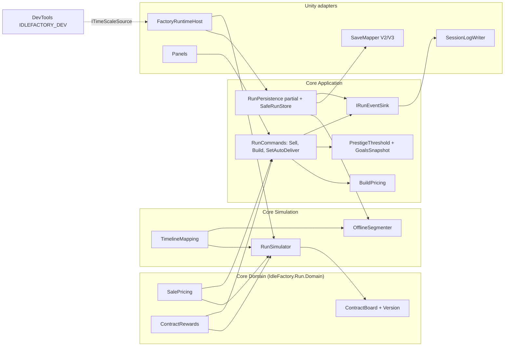

# Component Diagram: Economy and Contracts (Feature 005)

**Feature**: Selling, richer contracts with auto-delivery, build pricing, a rising prestige threshold, Industry diminishing returns, Save V3, a session log, and dev-only time acceleration.
**Generated**: 2026-10-10
**Scope**: Full feature (planned; none of this is shipped)

---

## Overview

This diagram shows the planned new and changed components of F005 and the data that flows between them, at the assembly and class level from `plan.md` Design › Components. It is a planning view: it shows what the plan intends.

## Component Diagram

## Component Breakdown

### SalePricing and ContractRewards

**Role**: The only arithmetic for selling and for contract Cash rewards.

**Why this exists as a separate component**: Auto-sell in the simulator, the `Sell` command and Factory Value must round identically, or full-stock sale would change Factory Value. Living in Domain lets Simulation, Application and Domain all call it without inverting the layering (GD-2).

**Key interactions**:
- → `RunSimulator`, `RunCommands`, `FactoryValuation`: one floor rule.

### TimelineMapping

**Role**: Maps simulated ticks to real UTC milliseconds with one rounding rule.

**Why this exists as a separate component**: Cooldowns and bonus windows are real-time stamps, but the simulation is in ticks; sharing one mapping makes live partitions and offline segments give identical stamps (AR-1).

**Key interactions**:
- → `RunSimulator.Advance`, `OfflineSegmenter`, `RunSession`.

### RunSimulator (changed)

**Role**: Settle loop of completions, auto-delivery and auto-sell with reserve, then the unlock pass; commits scratch state at the end of the advance.

**Why this exists as a separate component**: Segment invariance needs delivery at exact completion instants, so it must live inside the simulation, not in a presenter.

**Key interactions**:
- → `ContractBoard`: scratch contract state and Item grants.
- → session: outcomes, turned into events by a before/after comparison (the simulator never calls the sink).

### RunPersistence (partial) and SaveMapper

**Role**: Lifecycle, durable checkpoints, offline reconciliation; one version-parametrized mapper reading V2 and V3.

**Why this exists as a separate component**: The #356 split reduces merge conflicts; one mapper avoids copied DTOs (AR-5).

### IRunEventSink and SessionLogWriter

**Role**: Core emits allowlisted events through a port; the Unity adapter buffers and writes them.

**Why this exists as a separate component**: Keeps file IO and failure handling out of Core and the hot path, and makes the writer testable with an injected root and file layer.

### FactoryRuntimeHost and DevTools

**Role**: The host detects large UTC gaps and applies an optional time scale through the `ITimeScaleSource` seam; DevTools provides the seam only under `IDLEFACTORY_DEV`.

**Why this exists as a separate component**: Release builds must provably not contain acceleration code (checked by `scripts/check-release-build.ps1`).

---

## Design Reasoning

### Why this structure?

The plan keeps gameplay decisions in plain-C# Core (constitution, `core-architecture` wiki page) and puts only IO, content reading and UI in Unity adapters. Shared arithmetic sits in Domain because three callers must agree bit for bit (F5-R04). Time handling is centralised in `TimelineMapping` because rounding races decide contract deadlines (F5-R05).

### Alternatives considered

| Structure | Why it wasn't chosen |
|-----------|---------------------|
| Auto-delivery in the presenter or session | Not segment-invariant; offline would differ from live |
| Cooldowns and bonus windows as boundary events | They change no simulated state and cannot be inserted mid-advance |
| Plain `DEVELOPMENT_BUILD` gate for acceleration | Test and profiling players are development builds |
| Copied Save V3 DTOs | Drift risk between versions |

### When you'd restructure

If the offline value redesign (deferred by D-A) changes effectiveness per segment, `TimelineMapping` may need per-segment rates beyond `num/den`. If F004 adds a settings surface, the session-log section moves out of `MarketPanelHost`.
