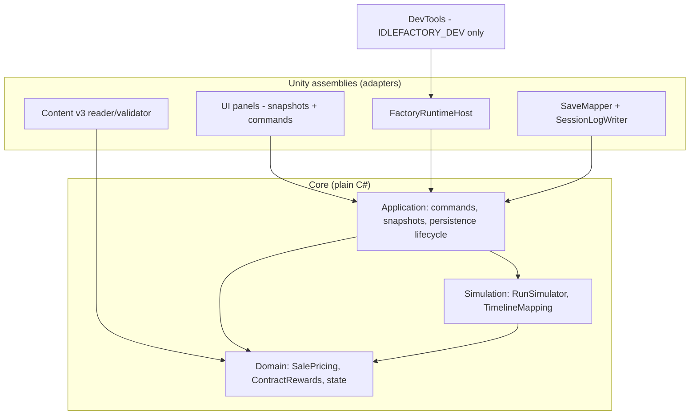

# Software Architecture: Economy and Contracts (Feature 005)

**Feature**: Economy and contracts redesign on the existing Unity run architecture.
**Generated**: 2026-10-10
**Scope**: Architectural patterns for the feature (planned; none of this is shipped)

---

## Overview

F005 extends the existing architecture: authority in plain-C# Core, Unity as adapters, presenters reading snapshots. The new patterns are a shared Domain arithmetic layer, a ports-and-adapters event sink, and a define-gated DevTools assembly that nothing else references.

## Architecture Diagram

Arrows point toward the layer depended on. Nothing depends on DevTools.

## Architectural Pattern: Layered core with ports and adapters

**What it is**: Gameplay rules live in Core, which has no Unity references. Unity code implements ports (clock, store, event sink, time-scale source) and renders snapshots.

**Why this pattern**: Constitution rules and the wiki `core-architecture` page require domain and simulation to be testable without scenes. F005 adds heavy rule changes, so Edit Mode proof (oracle tests, golden traces) must cover them.

**Tradeoffs accepted**:
- ✓ Arithmetic shared in Domain gives bit-identical sale, reward and valuation results.
- ✓ The event sink keeps file IO and failures out of the hot path.
- ✗ Partial-class splits of `RunPersistence` reduce merge conflicts but not coupling (AR-15).
- ✗ A version-parametrized mapper keeps one class growing instead of separate DTOs.

## Layer Breakdown

### Domain

**Responsibility**: State, `SalePricing`, `ContractRewards`, `ContractBoard`.

**Depends on**: nothing (innermost).

**Depended on by**: Simulation, Application, content validation.

**Why this boundary exists**: Putting pricing in Application would force Simulation to depend upward.

### Simulation

**Responsibility**: Deterministic advance, `TimelineMapping`, offline segmentation.

**Depends on**: Domain.

**Depended on by**: Application.

**Why this boundary exists**: Determinism and the W003 hashes must hold with no IO.

### Application

**Responsibility**: Commands (`Sell`, `Build` with `expectedPrice`, `SetAutoDeliver`), snapshots, `PrestigeThreshold`, persistence lifecycle, `IRunEventSink`.

**Depends on**: Domain, Simulation.

**Depended on by**: Unity adapters.

**Why this boundary exists**: Presenters must never decide gameplay outcomes.

### Unity adapters

**Responsibility**: Content v3 reading, Save V3 mapping, session-log files, host loop, panels.

**Depends on**: Core.

**Why this boundary exists**: Keeps IO, serialization and engine types out of the rules. The mapper uses public restore setters, which is why #356 keeps those `public` while making command mutators `internal`.

### DevTools

**Responsibility**: Acceleration overlay and marker.

**Depends on**: `IdleFactory.Unity`; nothing references it. `defineConstraints` excludes it from normal builds.

## Module Organization

**Strategy**: Hybrid: by layer inside Core namespaces (`IdleFactory.Run.Domain|Simulation|Application|Content`), by adapter area in Unity. See plan.md › Project Structure.

## When This Architecture Evolves

If F004 introduces a render-pipeline or settings change, the session-log UI section moves but the port stays. If online features arrive, the event sink port is the natural seam for telemetry, but the allowlist and privacy review (SEC) would have to be redone.
