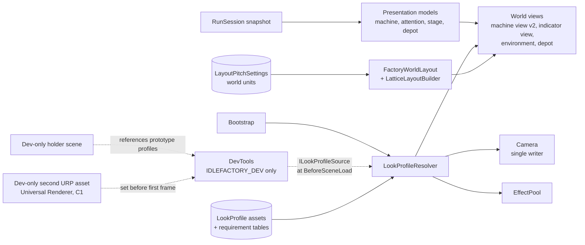
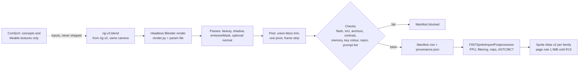
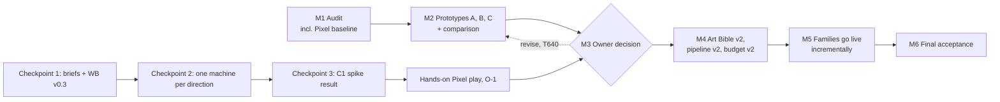
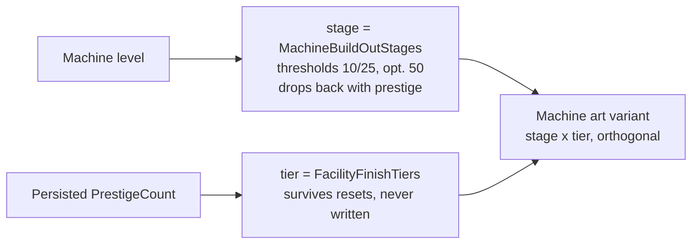

# Component Diagram: Visual Direction Reboot (Feature 007)

**Feature**: Replace the D24 pixel-art presentation with a stylized industrial look, chosen by evidence (three prototypes, M1 to M6 gates). No gameplay, economy, content or save change (FR-001).
**Generated**: 2026-11-27
**Scope**: Full feature, M1-M3 tasks (M4-M6 are regenerated after the owner decision)

---

## Overview

Four focused diagrams at component level: the runtime presentation seam, the `render-hd` art pipeline, the milestone gates, and the build-out stage by finish tier model. For layers and dependency direction see `software-architecture.md`. There is no `system-design.md`: F007 adds no infrastructure.

## 1. Runtime presentation seam

The tap path (`WorldTapResolver`, on location hit shapes) feeds input into the existing application operations; it is unchanged and not drawn.

## 2. render-hd pipeline flow

## 3. Milestone gates

Checkpoints 1 to 3 sit inside M2 (O-2); there is no elimination of a direction without the owner's explicit word.

## 4. Build-out stage x finish tier

## Component Breakdown

### LookProfileResolver (bootstrap-owned)
**Role**: Single owner of the active profile; hands art, pitch and camera policy to views, camera and effect pool.
**Why this exists as a separate component**: One seam instead of per-direction branches or scene copies. DevTools only supplies an `ILookProfileSource`, so release code has no prototype references.
**Key interactions**:
- <- DevTools source at `BeforeSceneLoad`
- -> world views, camera, `EffectPool`. An unknown id falls back to the shipped default with a log entry.

### Per-profile requirement tables
**Role**: Required keys, sizes and pivots per profile; the existing static registry is the F006 table.
**Why separate**: Fail-closed validation at start-up, no silent cross-profile fallback.

### LayoutPitchSettings
**Role**: Lattice pitch in world units (F006: 70x54 art px at D24 = 2.917 x 2.25), part of `LayoutComposition` equality and `IdentitySuffix`.
**Why separate**: On-screen density can change without changing location identity (12 content-owned locations).

### Machine view v2 and indicator view
**Role**: Body, shadow, emissive mask and overlay parts per `MachineArtEntry`; the indicator sits at `indicatorAnchor`. C uses a mesh view with the same API.

### Dev-only holder scene and second URP asset
**Role**: Isolate prototype assets and the Universal Renderer (C1). Added only for `IDLEFACTORY_DEV` builds; the shipped URP asset keeps one 2D renderer.

### Pipeline (`render-hd`, `mesh-export`, checks)
**Role**: Reproducible offline art production with blocking checks and provenance. Interactive Blender MCP is allowed; shipped pixels come only from the headless batch.

## Design Reasoning

### Why this structure?
The data flow is unchanged from F006: snapshot, presentation models, world views, with no path back to simulation. The profile selects only appearance, pitch and camera policy, which makes the FR-001 parity test meaningful. The resolver is bootstrap-owned (ARCH-6) so DevTools cannot become a runtime dependency of release code.

### Alternatives considered

| Structure | Why it wasn't chosen |
|---|---|
| Per-direction branches or scene copies | Multiplies the parity surface; violates simplicity |
| DevTools owns the resolver, or `Resources/` paths | Leaks prototype assets into release (ARCH-1, ARCH-6) |
| C2 RenderTexture or C3 fake-lit in the 2D Renderer | Fill-rate trade-off, or a dishonest hybrid test (research R06) |

### When you'd restructure
If M3 picks a `Continuous` camera policy or promotes the Universal Renderer, the single-URP-asset isolation and the parity baselines must be re-done at M4.
