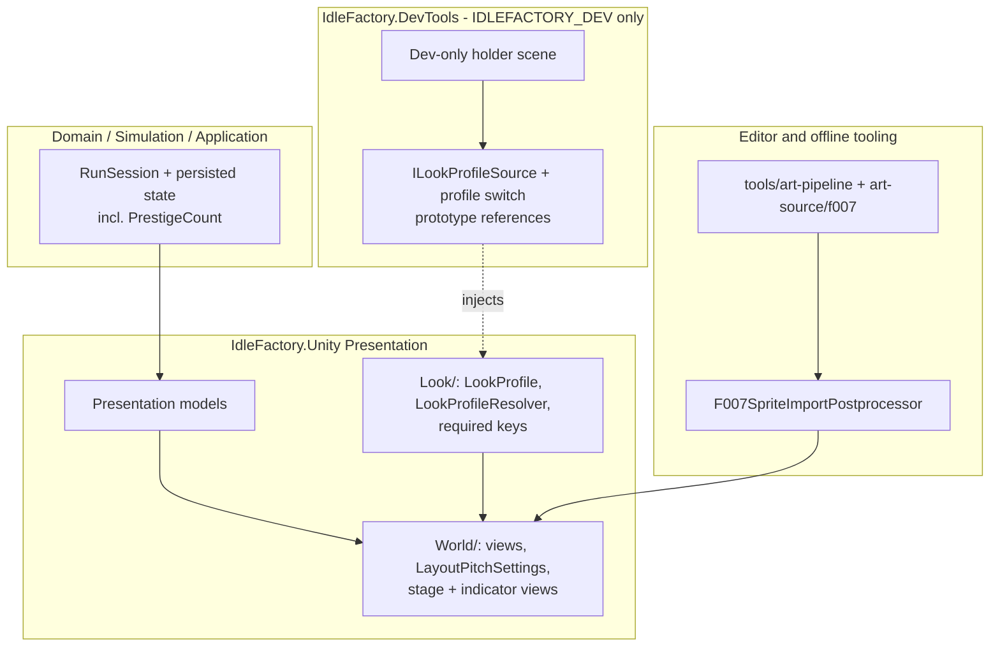

# Software Architecture: Visual Direction Reboot (Feature 007)

**Feature**: Presentation-only look seam for three prototype directions and the later production look.
**Generated**: 2026-11-27
**Scope**: Architectural patterns for the feature (no new assembly)

---

## Overview

F007 extends the existing Unity 2D project in place. Authoritative state stays in domain and simulation; a look-profile seam sits inside the presentation layer. Presentation reads snapshots and never writes back. See `component-diagram.md` for the component-level flows.

## Architecture Diagram

## Architectural Pattern: Presentation seam over unchanged layers

**What it is**: A profile selects art, pitch and camera policy; world views ask the resolver instead of fixed catalogs. The rest of the layered architecture is untouched.

**Why this pattern**: FR-001 forbids gameplay, economy or save change, and one seam reuses the catalog, layout, effects and camera (Constitution V). It makes parity testable across profiles.

**Tradeoffs accepted**:
- ✓ Prototypes switch in one development build with no scene copies.
- ✓ Release builds exclude prototype assets (checked through `BuildReport.packedAssets`).
- ✗ One justified complexity item: the dev-only Universal Renderer for C1.
- ✗ Pitch conversion touches `PivotOfCell` and `DeckTileRect` (16 call sites, T610).

## Layer Breakdown

### Domain / Simulation / Application
**Responsibility**: Authoritative state.
**Depends on**: nothing in F007.
**Depended on by**: presentation models.
**Why this boundary exists**: any F007 state here would break FR-001 and the save contract.

### Presentation (Look, World)
**Responsibility**: Resolve the profile, apply pitch, draw.
**Depends on**: snapshot models.
**Depended on by**: DevTools (injection only).
**Why this boundary exists**: authored data (LookProfile, MachineBuildOutStages, FacilityFinishTiers, LayoutPitchSettings) is read-only; stage and tier are pure functions of level and `PrestigeCount`.

### DevTools
**Responsibility**: Dev-only selection and prototype references.
**Depends on**: Look (interface).
**Why this boundary exists**: keeps prototype and second-URP references out of release.

### Editor and pipeline
**Responsibility**: Import settings and atlases per look; offline render, checks, provenance.

## Module Organization

**Strategy**: Hybrid, extending existing folders: `Unity/Presentation/Look/` (new), `Presentation/World/`, `DevTools/`, `Editor/Art/`, `Art/F007/Prototype/{A,B,C}/`, `Tests/{EditMode,PlayMode}/F007/`. asmdef boundaries are unchanged.

## When This Architecture Evolves

If M3 selects a `Continuous` camera policy or the Universal Renderer, the camera, URP asset and parity baselines change (M4). After M3 the prototype assets and holder scene are removed or archived (cleanup list, ARCH-12).
